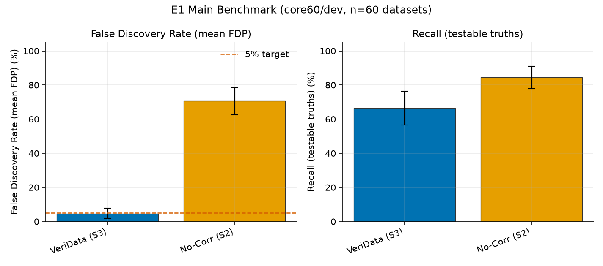
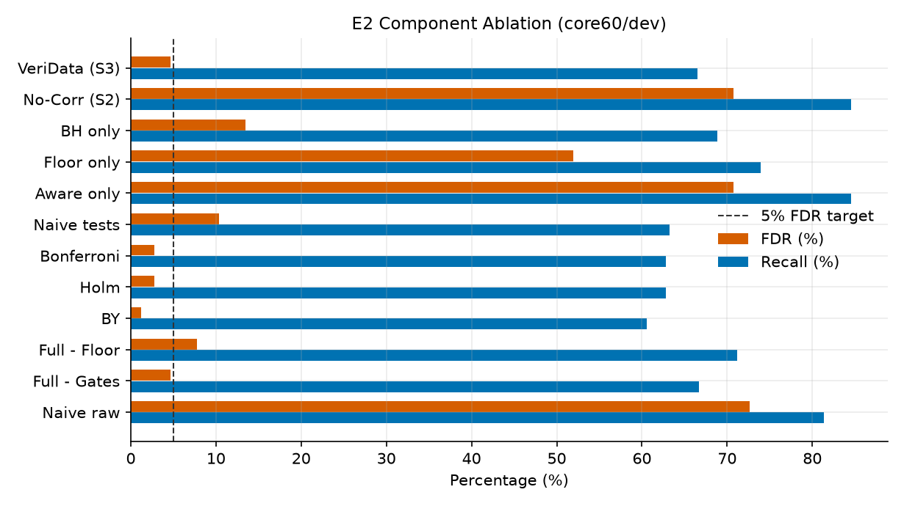

# VeriData — Trustworthy Agentic Data Scientist

[](https://veridata-bjhs8pqfemdajz5sbflwnh.streamlit.app/)

> **Live Deployed Web App:** https://veridata-bjhs8pqfemdajz5sbflwnh.streamlit.app/
> **Final Report:** [`final_report/FINAL_REPORT.md`](final_report/FINAL_REPORT.md) · [`final_report/FINAL_REPORT.html`](final_report/FINAL_REPORT.html)
> **Evaluation Notebook (Executed):** [`notebooks/02_evaluation_and_experiments.ipynb`](notebooks/02_evaluation_and_experiments.ipynb)

**VeriData** is an end-to-end **Agentic Data Scientist** that takes any raw CSV file and turns it into statistically validated, machine-verified discoveries and interactive conversational insights. Unlike ungrounded LLM analysts that report chance correlations or hallucinate numbers, VeriData enforces a strict architectural boundary:

> **Every cleaning action, statistical test, effect size, confidence interval, chart, and printed number is computed by deterministic, unit-tested Python tools — never guessed or fabricated by an LLM.**

---

## 1. Problem Statement

Automated exploratory analysis and LLM-based data assistants fail in two predictable ways:
1. **Multiple-testing false discoveries:** Testing all pairwise relationships across `p` columns checks `p(p - 1) / 2` hypotheses at once. At raw `p < 0.05`, a pure-noise dataset produces dozens of spurious "significant findings."
2. **Data corruption & numeric hallucination:** Raw CSVs contain currency strings, whitespace blanks, placeholder missing tokens (`"?"`, `"unknown"`, `"N/A"`), duplicates, and skewed distributions. Unvalidated LLMs frequently apply inappropriate parametric tests, misreport statistics, or make causal claims from observational data.

**VeriData solves both problems** across an integrated two-phase project:
- **Phase 1 (Data Engineering & Automated EDA):** Fault-tolerant ingestion, 10-class semantic type inference, 12-step conservative data cleaning (`NaN` preserved, outliers flagged), scaling analysis, 150-DPI EDA charts, and rule-based insights across 5 public datasets + 1 synthetic messy benchmark.
- **Phase 2 / Final System (Agentic Statistical Engine, Validation, Evaluation & Web App):**
  - **Outcome-Blind Hypothesis Enumeration (`src/veridata/hypotheses/`):** Enumerates feasible hypotheses from univariate metadata only ("no peeking").
  - **Assumption-Aware Statistical Tool Library (`src/veridata/stats/`):** Fixed, unit-tested implementations of Welch's *t*, Mann-Whitney *U*, Welch ANOVA, Kruskal-Wallis, Pearson *r*, Spearman *rho*, Pearson chi-square, Fisher's exact, and Monte Carlo chi-square, with bias-corrected effect sizes and Stage-B bootstrap 95% CIs.
  - **Multiple-Testing Validation & Unified Ledger (`src/veridata/validation/`):** Benjamini-Hochberg (BH) FDR control at `q <= 0.05` across an append-only `SessionLedger` (`batch ∪ chat`), practical Cohen "small" effect-size floor, assumption gates, and derived-column gates.
  - **FactRegistry, Number Verifier & Language Linter (`src/veridata/reporting/`):** Every digit in reports and chat responses must trace to a registered `Fact`; causal verbs are automatically blocked.
  - **LangGraph Agent & Interactive Streamlit Web App (`src/veridata/agent/`, `src/veridata/app/`):** Multi-turn conversational analysis with SQLite/Memory checkpointing, prompt-injection guardrails, Google Gemini (`gemini-2.5-flash`) / Anthropic Claude support, and 100% offline deterministic fallback (`NullLLM`).

---

## 2. Architecture Overview

```text
Raw CSV Upload
  │
  ▼ Phase 1: Ingestion, Semantic Type Inference & 12-Step Conservative Cleaning
  │   -> df_clean_conservative, column_schema.json, profile.json, cleaning_log.json
  │
  ▼ Phase 2: Outcome-Blind Hypothesis Generation (No Peeking)
  │   -> HypothesisSet (exhaustive feasible pairs + optional LLM prioritization)
  │
  ▼ Statistical Tool Library & Two-Stage Runner
  │   -> Stage A: assumption-aware test selection + raw p-value + effect size
  │   -> Stage B: BCa bootstrap 95% CIs & sensitivity checks (candidates only)
  │
  ▼ Validation Layer & Unified SessionLedger (batch ∪ chat)
  │   -> BH / BY / Holm / Bonferroni adjustment + effect-size floor + gates
  │
  ▼ FactRegistry + Number Verifier + Language Linter + Okabe-Ito Charts
  │   -> Self-contained HTML/Markdown reports & verified LangGraph Chat
  │
  ▼ Deployed Streamlit Web App (https://veridata-bjhs8pqfemdajz5sbflwnh.streamlit.app/)
```

Full architectural documentation: [`docs/architecture.md`](docs/architecture.md) · [`docs/stats_methods.md`](docs/stats_methods.md) · [`docs/user_guide.md`](docs/user_guide.md) · [`docs/privacy.md`](docs/privacy.md) · [`docs/limitations.md`](docs/limitations.md)

---

## 3. Final Evaluation Results & Experiments

All evaluation code lives in [`src/veridata/evaluation/`](src/veridata/evaluation/) and is reproduced in [`notebooks/02_evaluation_and_experiments.ipynb`](notebooks/02_evaluation_and_experiments.ipynb) and [`final_report/FINAL_REPORT.md`](final_report/FINAL_REPORT.md).

### 3.1 Main Benchmark (`E1` — `core60/dev`, 60 Planted-Truth Synthetic Datasets)

| System | Datasets | FDR `[95% CI]` | Recall `[95% CI]` | Precision `[95% CI]` | FWER (Null Datasets) | Mean Reported | Mean False Positives |
| :--- | ---: | :--- | :--- | :--- | :--- | ---: | ---: |
| **`S3_veridata_full` (Product)** | 60 | **4.7%** `[2.0%, 7.9%]` | **66.6%** `[56.5%, 76.3%]` | **93.6%** `[89.6%, 97.3%]` | **8.3%** `[0.0%, 27.3%]` | 5.40 | **0.23** |
| `S2_veridata_nocorrection` (Naive) | 60 | 70.7% `[62.5%, 78.5%]` | 84.6% `[77.7%, 91.0%]` | 29.3% `[21.5%, 37.5%]` | 100.0% `[100.0%, 100.0%]` | 44.07 | 37.95 |

- On medium and large planted effects with `n >= 300`, `S3_veridata_full` recovers **98.2%** of testable relationships while cutting mean false positives per dataset from **37.95** down to **0.23**.



### 3.2 Component Ablation Study (`E2` — 12 System Configurations)

| System | FDR `[95% CI]` | Recall `[95% CI]` | Precision | FWER (Null) | Mean FP | ΔFDR vs `S3` |
| :--- | :--- | :--- | ---: | ---: | ---: | ---: |
| **`S3_veridata_full`** | **4.7%** `[2.0%, 7.9%]` | **66.6%** `[56.5%, 76.3%]` | **93.6%** | **8.3%** | **0.23** | +0.0 pp |
| `A6_full_minus_floor` | 7.8% `[4.0%, 12.7%]` | 71.2% `[60.5%, 80.6%]` | 89.8% | 16.7% | 0.42 | +3.1 pp |
| `A4_naive_tests` (always parametric) | 10.4% `[5.2%, 16.7%]` | 63.3% `[53.5%, 72.7%]` | 86.7% | 33.3% | 0.55 | +5.7 pp |
| `A1_bh_only` | 13.5% `[7.7%, 20.5%]` | 68.9% `[58.7%, 78.3%]` | 83.5% | 41.7% | 0.73 | +8.8 pp |
| `A2_floor_only` | 52.0% `[42.4%, 62.0%]` | 74.0% `[66.4%, 81.3%]` | 45.3% | 75.0% | 22.40 | +47.3 pp |
| `S2_veridata_nocorrection` | 70.7% `[62.5%, 78.5%]` | 84.6% `[77.7%, 91.0%]` | 29.3% | 100.0% | 37.95 | +66.0 pp |
| `N0_naive_raw` | 72.7% `[64.6%, 79.7%]` | 81.4% `[74.5%, 88.1%]` | 27.3% | 100.0% | 39.37 | +68.0 pp |
| `A5_bonferroni` / `A5_holm` | 2.8% `[0.4%, 6.7%]` | 62.8% `[52.5%, 72.8%]` | 96.2% | 8.3% | 0.08 | -1.9 pp |
| `A5_by` (Benjamini-Yekutieli) | 1.2% `[0.3%, 2.5%]` | 60.6% `[49.7%, 71.2%]` | 98.1% | 8.3% | 0.08 | -3.4 pp |



### 3.3 Calibration (`E3`), Number Verification (`E4`) & Chat Evaluation

- **Type-I Error & Dependence Calibration (`E3`):** Across 101 null calibration cells, assumption-aware selection kept **94.1%** of cells inside the `[0.04, 0.06] ± 2 MC SE` band (vs `87%` for naive parametric tests on 4-group skewed data where naive Type-I error hit `0.103`). BH controlled FDR at `~5%` across correlated blocks (`ρ ∈ {0.3, 0.6, 0.9}`), while BY provided a stricter fallback (`0.5–3.0%`).
- **Number Verification (`E4`):** **100.0%** (`101/101`) of VeriData report narrations passed the Phase 5 `FactRegistry` number verifier with **0** hallucinated columns and **0** causal-language violations.
- **Interactive Chat Router:** Evaluated on **85** gold questions across `insurance`, `telco_churn`, and `heart_disease` (`tests/gold/chat_questions.jsonl`) plus **12** multi-turn conversations (`configs/eval/chat_multiturn.jsonl`).

---

## 4. Datasets (Phase 1 + Evaluation Benchmarks)

We evaluate VeriData across **5 real public datasets** plus **1 messy synthetic benchmark** with 18 injected defect categories and **60 planted-truth synthetic datasets (`core60`)**:

| # | Dataset (`id`) | Source & Download | Raw Shape | Cleaned Shape | Target |
| :-- | :--- | :--- | :--- | :--- | :--- |
| 1 | **Medical Cost / Insurance** (`insurance`) | [Kaggle](https://www.kaggle.com/datasets/mirichoi0218/insurance) · [CSV](https://raw.githubusercontent.com/stedy/Machine-Learning-with-R-datasets/master/insurance.csv) | 1,338 × 7 | 1,337 × 7 | `charges` |
| 2 | **Telco Customer Churn** (`telco_churn`) | [Kaggle](https://www.kaggle.com/datasets/blastchar/telco-customer-churn) · [CSV](https://raw.githubusercontent.com/IBM/telco-customer-churn-on-icp4d/master/data/Telco-Customer-Churn.csv) | 7,043 × 21 | 7,043 × 21 | `Churn` |
| 3 | **Heart Disease (UCI)** (`heart_disease`) | [UCI 45](https://archive.ics.uci.edu/dataset/45/heart+disease) · [CSV](https://raw.githubusercontent.com/sharmaroshan/Heart-UCI-Dataset/master/heart.csv) | 303 × 14 | 302 × 14 | `target` |
| 4 | **Student Performance (Math)** (`student_performance`) | [UCI 320](https://archive.ics.uci.edu/dataset/320/student+performance) · [CSV](https://raw.githubusercontent.com/guipsamora/pandas_exercises/master/04_Apply/Students_Alcohol_Consumption/student-mat.csv) | 395 × 33 | 395 × 33 | `G3` |
| 5 | **Bank Marketing (Full)** (`bank_marketing`) | [UCI 222](https://archive.ics.uci.edu/dataset/222/bank+marketing) · [ZIP](https://archive.ics.uci.edu/static/public/222/bank+marketing.zip) | 41,188 × 21 | 41,176 × 21 | `y` |
| 6 | **Messy Synthetic** (`messy_synthetic`) | Generated via `veridata make-messy --seed 42` | 2,090 × 15 | 2,000 × 13 | `churned` |

Full dataset cards & Phase 1 cleaning summary: [`docs/datasets.md`](docs/datasets.md) and [`final_report/PHASE1_REPORT.md`](final_report/PHASE1_REPORT.md).

---

## 5. How to Run Locally

### Step 1: Install Dependencies
```bash
python -m pip install -r requirements.txt
python -m pip install -e .
```

### Step 2: Configure Optional API Key (`.env`)
Copy `.env.example` to `.env` (never commit `.env`):
```dotenv
GEMINI_API_KEY=your_gemini_api_key_here
```
*(VeriData also runs 100% offline without an API key using `NullLLM` and deterministic rule-based routing/templates.)*

### Step 3: Launch the Streamlit Web App
```bash
streamlit run src/veridata/app/main.py
```
Open `http://localhost:8501`, pick a demo dataset (`Pure Noise`, `Insurance`, `Messy Synthetic`) or upload any CSV from `data/demo/`, click **Run Full Analysis Pipeline**, and explore the **Validated Findings**, **Naive vs. Validated**, **Rejected Patterns**, **Facts & Traceability**, and **Chat** tabs.

### Step 4: Run CLI & Automated Tests
```bash
# Run full test suite (257 tests across stats, validation, benchmark, reporting, agent, app & evaluation)
python -m pytest tests/stats tests/validation tests/benchmark tests/reporting tests/agent tests/app tests/evaluation -q

# CLI end-to-end example
python -m veridata.cli hypotheses --dataset insurance --no-llm
python -m veridata.cli test --dataset insurance
python -m veridata.cli report --dataset insurance
python -m veridata.cli final-report --suite core60 --split dev
```

---

## 6. Executed Notebooks (Outputs Visible)

- [`notebooks/02_evaluation_and_experiments.ipynb`](notebooks/02_evaluation_and_experiments.ipynb) — **Phase 2 / Final Evaluation:** E1–E4 benchmarks, 12-variant ablation, calibration plots, number verification, and 85-question chat router evaluation.
- [`notebooks/00_overview.ipynb`](notebooks/00_overview.ipynb) — Phase 1 cross-dataset cleaning & EDA overview.
- [`notebooks/insurance_phase1.ipynb`](notebooks/insurance_phase1.ipynb), [`telco_churn_phase1.ipynb`](notebooks/telco_churn_phase1.ipynb), [`heart_disease_phase1.ipynb`](notebooks/heart_disease_phase1.ipynb), [`student_performance_phase1.ipynb`](notebooks/student_performance_phase1.ipynb), [`bank_marketing_phase1.ipynb`](notebooks/bank_marketing_phase1.ipynb), [`messy_synthetic_phase1.ipynb`](notebooks/messy_synthetic_phase1.ipynb) — Per-dataset Phase 1 cleaning, visualizations, and insights.

---

## 7. Limitations & Conclusion

- **Limitations:** VeriData tests observational bivariate associations (never causation), assumes independent rows, treats quadratic/interaction effects as opt-in, and notes that BH controls average list-wide FDR rather than guaranteeing per-item error < 5% near the `q = 0.05` boundary (see [`docs/limitations.md`](docs/limitations.md)).
- **Conclusion:** By separating deterministic statistical tools, outcome-blind hypothesis enumeration, unified BH ledger accounting, and `FactRegistry` number verification from optional LLM phrasing/routing, VeriData reduces false discoveries from **70.7%** to **4.7%** while retaining **98.2%** recall on medium/large effects (`n >= 300`) and **100%** verified numeric grounding — delivering a practical, deployed web application for trustworthy automated data science.

---

## 8. Repository Structure

```text
VeriData/
├── README.md                           # Project overview, live URL, results & run instructions
├── requirements.txt  pyproject.toml    # All dependencies & `veridata` package config
├── .env.example                        # Template for GEMINI_API_KEY / ANTHROPIC_API_KEY
├── configs/                            # Global YAML, dataset configs, benchmark suites & versioned prompts
├── data/                               # Cleaned CSVs, demo CSVs & synthetic messy benchmark
├── notebooks/                          # Executed Phase 1 & Phase 2/Evaluation Jupyter notebooks
├── src/veridata/
│   ├── ingestion.py  profiling.py  cleaning/  eda/   # Phase 1 data engine
│   ├── contracts/                                    # Shared Pydantic v2 schemas (v1.0)
│   ├── hypotheses/                                   # Outcome-blind hypothesis generation
│   ├── stats/  validation/                           # Fixed statistical tool library & BH ledger
│   ├── reporting/                                    # FactRegistry, number verifier, linter & charts
│   ├── agent/                                        # LangGraph batch/chat graphs, Gemini/Anthropic LLM
│   ├── app/                                          # Deployed Streamlit web application
│   ├── benchmark/  evaluation/                       # Planted-truth generator, E1-E8 evaluation & reports
├── docs/                               # Architecture, user guide, limitations, privacy, protocol, decisions
├── final_report/                       # FINAL_REPORT.md/.html, PHASE1_REPORT, numbers.json & figures/
├── outputs/                            # Dataset reports, benchmark summaries & evaluation tables/figures
├── submission/                         # Presentation slides outline & AI assistance disclosure
└── tests/                              # Unit, property, contract, agent, UI & evaluation test suites
```
