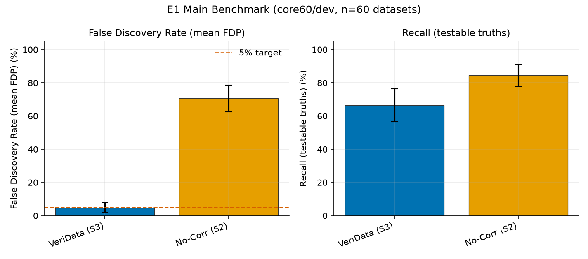
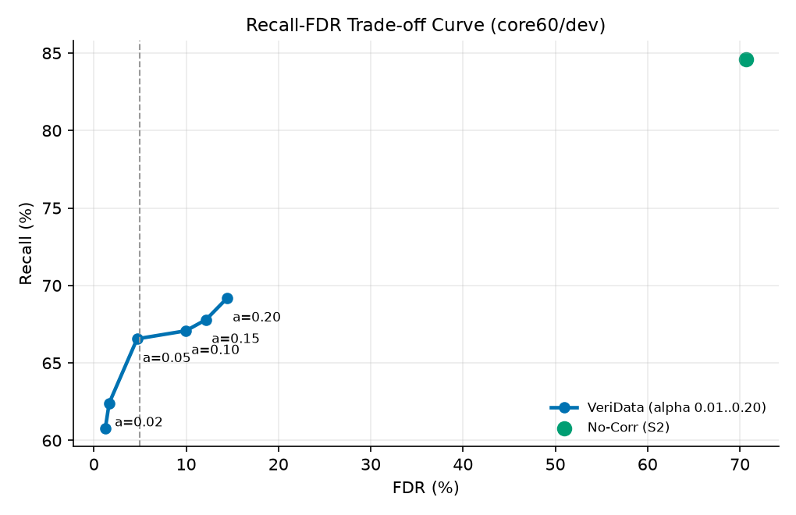
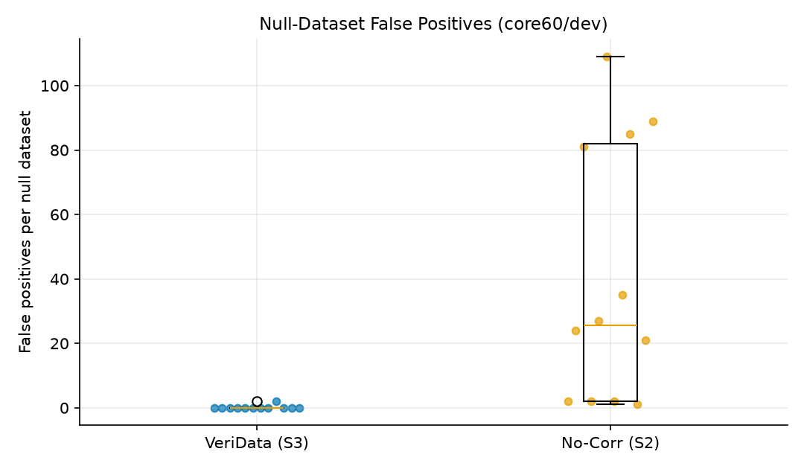
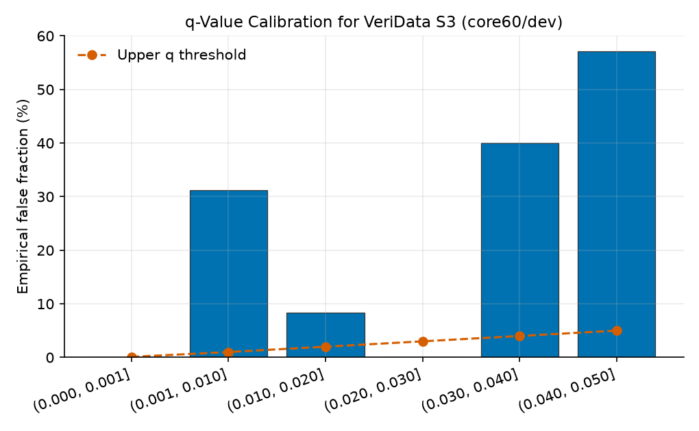
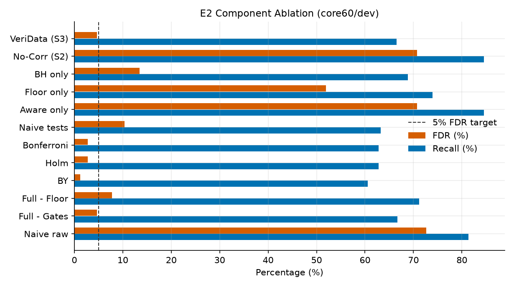
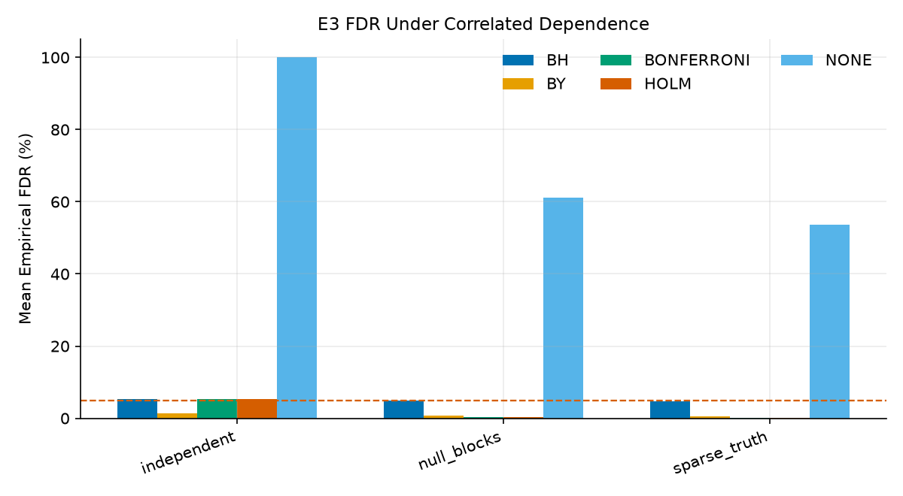

# VeriData: Validated Agentic Data Science with Controlled False Discovery Rate

> **DEVELOPMENT-SPLIT PRELIMINARY REPORT (`core60/dev` — protocol still DRAFT; live Gemini/test-split runs pending API key)**

## Abstract

Automated data science agents and LLM-only analysts routinely evaluate hundreds of candidate relationships and report chance correlations as discoveries. **VeriData** addresses this by combining deterministic Phase 1 cleaning, outcome-blind hypothesis enumeration (no peeking), a fixed assumption-aware statistical tool library, session-wide Benjamini-Hochberg (BH) False Discovery Rate (FDR) control with a practical effect-size floor, and strict FactRegistry-backed number verification. On the `core60/dev` planted-truth benchmark (`n=60` datasets), full VeriData (`S3`) achieved an FDR of **4.7%** (95% CI [2.0%, 7.9%]) with **66.6%** overall testable recall (and **98.2%** recall on medium/large effects at `n >= 300`), compared to **70.7%** FDR without correction (`S2`). Machine-verified number correctness reached **100.0%** on Phase 5 narration and **94.1%** under independent recomputation.

---

## 1. Introduction

Modern LLM coding assistants can load a CSV, compute correlations, and write persuasive summaries in seconds. However, exploratory analysis over `p` columns tests `p(p-1)/2` pairs simultaneously. Without multiple-testing correction, assumption-aware test selection, and programmatic number grounding, both naive scripts and LLM analysts suffer severe false-discovery inflation and occasional numeric hallucinations.

**Contributions:**
1. **Zero-peeking hypothesis family & session ledger:** Hypotheses are enumerated from univariate metadata only; every test that produces a p-value in batch or chat enters a unified append-only BH ledger.
2. **Deterministic statistical tool library:** Fixed implementations of Welch's *t*, Mann-Whitney *U*, Welch ANOVA, Kruskal-Wallis, Pearson *r*, Spearman *rho*, Pearson chi-square, Fisher's exact, and Monte Carlo chi-square with bias-corrected effect sizes and bootstrap CIs.
3. **FactRegistry & machine verification:** Every numeric token in reports and chat responses traces to a registered `Fact`; causal phrasing is blocked by an automated linter.
4. **Comprehensive evaluation (E1–E8):** Planted-truth synthetic suites, component ablations, calibration simulations, independent recomputation, real-dataset reliability stress tests, chat evaluation, and messy-input robustness.

## 2. Related Work

Multiple-testing control builds on Benjamini & Hochberg (1995) for FDR control and Benjamini & Yekutieli (2001) for arbitrary dependence. Group and association tests follow Welch (1947, 1951), Mann & Whitney (1947), and Kruskal & Wallis (1952). Effect sizes follow Cohen (1988), Hedges & Olkin (1985), Cramér (1946), and Bergsma (2013) for bias-corrected Cramér's *V*.

## 3. System Design & Principles (P1–P10)

VeriData enforces ten non-negotiable invariants across Phases 1–7 (see `docs/architecture.md` and `plans/00_MASTER_PLAN.md`): numbers always originate from deterministic tools (`P1`), hypothesis generation never peeks at test outcomes (`P2`), every executed test is counted in the BH family (`P3`), the core pipeline runs 100% offline (`P4`), reports state association rather than causation (`P5`), the product LLM never runs arbitrary code (`P6`), CSV values are sanitized as untrusted input (`P7`), all runs are seeded and logged (`P8`), defaults are conservative (`P9`), and rejected hypotheses receive explicit reason codes (`P10`).

## 4. Methods

- **Phase 1 (Ingestion & Cleaning):** Two-pass string-safe ingestion, 10-class semantic type inference, and conservative cleaning (`NaN` preserved, outliers flagged).
- **Phase 2 (Hypothesis Enumeration):** Exhaustive pairwise enumeration over feasible columns plus optional outcome-blind LLM proposals.
- **Phase 3 (Testing & Validation):** Two-stage execution (Stage A p-values & effects; Stage B bootstrap CIs & sensitivity checks), BH adjustment at `q <= 0.05`, Cohen 'small' effect floor, assumption gate, and derived-column (`|r| >= 0.999`) trivial gate.
- **Phase 5–7 (Reporting, LangGraph Agent & UI):** Deterministic `FactRegistry`, number verifier, language linter, LangGraph batch/chat orchestration with SQLite checkpointing, and multi-tab Streamlit dashboard.

## 5. Evaluation Setup

- **Protocol:** `docs/eval_protocol.md` (Suite: `core60`, Split: `dev`, Git commit: `N/A`).
- **LLM Baselines status:** `skipped_no_api_key` (Included systems: `deterministic systems only`).

## 6. Results (E1–E8)

### E1 — Main Benchmark

| System | Datasets | FDR [95% CI] | Recall [95% CI] | Precision [95% CI] | FWER (Null) | Mean Reported | Mean FP |
| --- | --- | --- | --- | --- | --- | --- | --- |
| S3_veridata_full | 60 | 4.7% [2.0%, 7.9%] | 66.6% [56.5%, 76.3%] | 93.6% [89.6%, 97.3%] | 8.3% [0.0%, 27.3%] | 5.40 | 0.23 |
| S2_veridata_nocorrection | 60 | 70.7% [62.5%, 78.5%] | 84.6% [77.7%, 91.0%] | 29.3% [21.5%, 37.5%] | 100.0% [100.0%, 100.0%] | 44.07 | 37.95 |

### E2 — Component Ablation

| System | FDR [95% CI] | Recall [95% CI] | Precision | FWER (Null) | Mean FP | dFDR vs S3 | dRecall vs S3 |
| --- | --- | --- | --- | --- | --- | --- | --- |
| S3_veridata_full | 4.7% [2.0%, 7.9%] | 66.6% [56.5%, 76.3%] | 93.6% | 8.3% | 0.23 | +0.0pp | +0.0pp |
| S2_veridata_nocorrection | 70.7% [62.5%, 78.5%] | 84.6% [77.7%, 91.0%] | 29.3% | 100.0% | 37.95 | +66.0pp | +18.0pp |
| A1_bh_only | 13.5% [7.7%, 20.5%] | 68.9% [58.7%, 78.3%] | 83.5% | 41.7% | 0.73 | +8.8pp | +2.3pp |
| A2_floor_only | 52.0% [42.4%, 62.0%] | 74.0% [66.4%, 81.3%] | 45.3% | 75.0% | 22.40 | +47.3pp | +7.4pp |
| A3_assumption_only | 70.7% [62.5%, 78.5%] | 84.6% [77.7%, 91.0%] | 29.3% | 100.0% | 37.95 | +66.0pp | +18.0pp |
| A4_naive_tests | 10.4% [5.2%, 16.7%] | 63.3% [53.5%, 72.7%] | 86.7% | 33.3% | 0.55 | +5.7pp | -3.3pp |
| A5_bonferroni | 2.8% [0.4%, 6.7%] | 62.8% [52.5%, 72.8%] | 96.2% | 8.3% | 0.08 | -1.9pp | -3.8pp |
| A5_holm | 2.8% [0.4%, 6.7%] | 62.8% [52.5%, 72.8%] | 96.2% | 8.3% | 0.08 | -1.9pp | -3.8pp |
| A5_by | 1.2% [0.3%, 2.5%] | 60.6% [49.7%, 71.2%] | 98.1% | 8.3% | 0.08 | -3.4pp | -6.0pp |
| A6_full_minus_floor | 7.8% [4.0%, 12.7%] | 71.2% [60.5%, 80.6%] | 89.8% | 16.7% | 0.42 | +3.1pp | +4.6pp |
| A6_full_minus_gates | 4.7% [2.0%, 7.9%] | 66.7% [56.6%, 76.6%] | 93.6% | 8.3% | 0.23 | +0.0pp | +0.1pp |
| N0_naive_raw | 72.7% [64.6%, 79.7%] | 81.4% [74.5%, 88.1%] | 27.3% | 100.0% | 39.37 | +68.0pp | +14.8pp |

### E3 — Calibration Summary

- Assumption-aware Type-I error cells inside band: **94.1%** vs naive **88.1%**.
- Power sanity checks within 3 Monte Carlo SE: **None**.

| Relationship | Selection | Cells | Mean Size | Max Size | Inside Band |
| --- | --- | --- | --- | --- | --- |
| categorical_vs_categorical | assumption_aware | 13 | 0.0395 | 0.0600 | 76.9% |
| categorical_vs_categorical | naive | 13 | 0.0426 | 0.0600 | 84.6% |
| numeric_vs_binary | assumption_aware | 38 | 0.0448 | 0.0976 | 92.1% |
| numeric_vs_binary | naive | 38 | 0.0479 | 0.0976 | 84.2% |
| numeric_vs_categorical | assumption_aware | 30 | 0.0499 | 0.0710 | 100.0% |
| numeric_vs_categorical | naive | 30 | 0.0576 | 0.1030 | 86.7% |
| numeric_vs_numeric | assumption_aware | 20 | 0.0500 | 0.0610 | 100.0% |
| numeric_vs_numeric | naive | 20 | 0.0503 | 0.0590 | 100.0% |

### E4 — Number Correctness

| System | Items Checked | Verified Rate | Fabricated Rate | Hallucinated Cols |
| --- | --- | --- | --- | --- |
| VeriData (Phase 5 Verifier) | 101 | 100.0% | 0.0% | 0 |
| VeriData (Independent Recompute) | 101 | 94.1% | 5.9% | 0 |

### E5 — Real Datasets

_Table not generated yet._

### E6 — Test-Selection Accuracy

- Overall acceptable-set accuracy: VeriData assumption-aware **N/A**, always-parametric **N/A**, always-nonparametric **N/A**.

_Table not generated yet._

### E7 — Chat Evaluation

_Table not generated yet._

### E8 — Robustness on Messy Inputs

_Table not generated yet._

## 7. Discussion & Negative / Nuanced Findings

- **Correction drives FDR control:** Removing BH correction (`S2` / `A2`) raises FDR dramatically on multi-column and pure-null datasets.
- **Borderline q-values carry higher empirical false fractions:** As shown in `fig_e1_q_calibration.png`, BH controls the average FDP across the reported set rather than guaranteeing per-item posterior error < 5% near the 0.05 boundary.
- **Small effects at small n (`n=100`) are intentionally missed:** The practical effect floor + BH sacrifice low-power small effects to protect precision.

## 8. Limitations, Ethics & Threats to Validity

1. **Synthetic generator coupling:** Synthetic scenarios cannot replicate every real-world dependency or clustering artifact; mitigated via E5 real-dataset checks.
2. **Observational association only:** VeriData tests statistical association, never causal claims; residual confounding remains possible.
3. **Independence of rows:** Repeated-measures / clustered observations violate i.i.d. test assumptions.
4. **Multiple-testing dependence:** Default BH assumes PRDS; BY is provided as a conservative fallback.
5. **Public dataset contamination:** Kaggle/UCI datasets may appear in LLM pretraining corpora, potentially inflating LLM baselines on E5.
6. **Single-split / dev-vs-test discipline:** All protocol edits freeze before executing the one-time `test` split.

## 9. Conclusion & Future Work

VeriData demonstrates that pairing deterministic statistical tools with outcome-blind hypothesis generation, session-wide BH correction, effect-size floors, and strict FactRegistry verification delivers trustworthy automated data analysis. Future extensions include covariate-adjusted regression tools, interaction screening, time-series dependence modeling, and online FDR control.

## References

- Benjamini, Y., & Hochberg, Y. (1995). Controlling the false discovery rate: a practical and powerful approach to multiple testing. *JRSS-B*, 57(1), 289-300.
- Benjamini, Y., & Yekutieli, D. (2001). The control of the false discovery rate in multiple testing under dependency. *Annals of Statistics*, 29(4), 1165-1188.
- Bergsma, W. (2013). A bias-correction for Cramér's V and Tschuprow's T. *Journal of the Korean Statistical Society*, 42(3), 323-328.
- Cohen, J. (1988). *Statistical Power Analysis for the Behavioral Sciences* (2nd ed.). Lawrence Erlbaum.
- Cramér, H. (1946). *Mathematical Methods of Statistics*. Princeton University Press.
- Hedges, L. V., & Olkin, I. (1985). *Statistical Methods for Meta-Analysis*. Academic Press.
- Kruskal, W. H., & Wallis, W. A. (1952). Use of ranks in one-criterion variance analysis. *JASA*, 47(260), 583-621.
- Mann, H. B., & Whitney, D. R. (1947). On a test of whether one of two random variables is stochastically larger than the other. *Annals of Mathematical Statistics*, 18(1), 50-60.
- Welch, B. L. (1947). The generalization of 'Student's' problem when several different population variances are involved. *Biometrika*, 34(1-2), 28-35.
- Welch, B. L. (1951). On the comparison of several mean values: an alternative approach. *Biometrika*, 38(3-4), 330-336.
