# Phase 1 Dataset Report — `bank_marketing`

_Generated by the VeriData Phase 1 pipeline. Every number comes from code (no LLM). Relationship numbers are descriptive only; no hypothesis tests were run in Phase 1._

**Contents:** 1. Overview · 2. Columns · 3. Data cleaning · 4. Exploratory data analysis · 5. Insights · 6. Normalization / scaling · 7. Output files

## 1. Overview

| Item | Value |
| :--- | :--- |
| Source file | `data\raw\bank_marketing\bank-additional-full.csv` |
| SHA-256 | `74adfc578bf77a7ff4bb1ba4a9f8709d9e3c6907342959c2c8416847e0afb4d8` |
| Raw shape | 41,188 rows × 21 columns |
| Cleaned shape (conservative, primary) | 41,176 rows × 21 columns |
| Cleaned shape (imputed, secondary) | 41,176 rows × 22 columns |
| Exact duplicate rows in raw file | 12 |
| Missing cells in raw file (incl. placeholder text) | 12,718 (1.47%) |
| Memory (raw) | 50.854294 MB |
| Target column | `y` (categorical) |

### Profiling warnings (raw file)

- Binary column 'default' is highly imbalanced (minority class = 0.0%).
- Column 'duration' has extreme skewness (skew=3.26).
- Column 'campaign' has extreme skewness (skew=4.76).
- Column 'pdays' has extreme skewness (skew=-4.92).
- Column 'previous' has extreme skewness (skew=3.83).
- Info: Column 'y' has a target/outcome-like name.

## 2. Column profile (raw file)

| Column | Raw dtype | Inferred type | Missing % | Unique | Why this type |
| :--- | :--- | :--- | ---: | ---: | :--- |
| `age` | `int64` | `numeric_continuous` | 0.0% | 78 | numeric values (100.0% parseable, 78 unique) |
| `job` | `object` | `categorical_nominal` | 0.8% | 11 | string categorical with 11 normalized unique values (raw=11) |
| `marital` | `object` | `categorical_nominal` | 0.2% | 3 | string categorical with 3 normalized unique values (raw=3) |
| `education` | `object` | `categorical_nominal` | 4.2% | 7 | string categorical with 7 normalized unique values (raw=7) |
| `default` | `object` | `binary` | 20.9% | 2 | binary string/mixed encoding (boolean-like (Yes/No/1/0): ['no', 'yes']) |
| `housing` | `object` | `binary` | 2.4% | 2 | binary string/mixed encoding (boolean-like (Yes/No/1/0): ['no', 'yes']) |
| `loan` | `object` | `binary` | 2.4% | 2 | binary string/mixed encoding (boolean-like (Yes/No/1/0): ['no', 'yes']) |
| `contact` | `object` | `binary` | 0.0% | 2 | string column with 2 distinct normalized values ('cellular', 'telephone') |
| `month` | `object` | `categorical_nominal` | 0.0% | 10 | string categorical with 10 normalized unique values (raw=10) |
| `day_of_week` | `object` | `categorical_nominal` | 0.0% | 5 | string categorical with 5 normalized unique values (raw=5) |
| `duration` | `int64` | `numeric_continuous` | 0.0% | 1,544 | numeric values (100.0% parseable, 1544 unique) |
| `campaign` | `int64` | `numeric_continuous` | 0.0% | 42 | numeric values (100.0% parseable, 42 unique) |
| `pdays` | `int64` | `numeric_continuous` | 0.0% | 27 | numeric values (100.0% parseable, 27 unique) |
| `previous` | `int64` | `numeric_discrete` | 0.0% | 8 | integer values with 8 unique levels (unique ratio 0.0%) |
| `poutcome` | `object` | `categorical_nominal` | 0.0% | 3 | string categorical with 3 normalized unique values (raw=3) |
| `emp.var.rate` | `float64` | `numeric_continuous` | 0.0% | 10 | numeric values (100.0% parseable, 10 unique) |
| `cons.price.idx` | `float64` | `numeric_continuous` | 0.0% | 26 | numeric values (100.0% parseable, 26 unique) |
| `cons.conf.idx` | `float64` | `numeric_continuous` | 0.0% | 26 | numeric values (100.0% parseable, 26 unique) |
| `euribor3m` | `float64` | `numeric_continuous` | 0.0% | 316 | numeric values (100.0% parseable, 316 unique) |
| `nr.employed` | `float64` | `numeric_continuous` | 0.0% | 11 | numeric values (100.0% parseable, 11 unique) |
| `y` | `object` | `binary` | 0.0% | 2 | binary string/mixed encoding (boolean-like (Yes/No/1/0): ['no', 'yes']) |

## 3. Data cleaning

4 cleaning steps made 22 logged changes touching 25,686 cells. Rows: 41,188 in the raw file → 41,176 in the conservative output → 41,176 in the imputed output.

### What the TA asked for

| Requirement | What the pipeline did |
| :--- | :--- |
| Missing values | ✔ converted to NaN: 12,718 cells; imputed missing level: 8,596 cells; imputed mode: 4,120 cells. Conservative output keeps NaN; imputed output fills gaps and adds `__was_missing` flags |
| Duplicates | ✔ dropped duplicate rows: 12 rows |
| Outliers | ✔ flagged outliers: 45,406 rows. 10 column(s) flagged; values are kept in the conservative output |
| Inconsistent formats | ✔ checked; nothing to change |
| Empty rows / columns | ✔ checked; nothing to change |

### Changes by step

| Step | Log entries | Cells changed | Rows removed |
| :--- | ---: | ---: | ---: |
| `normalize_missing_tokens` | 6 | 12,718 | 0 |
| `handle_duplicates` | 1 | 252 | 12 |
| `handle_missing_values` | 6 | 12,716 | 0 |
| `handle_outliers` | 9 | 0 | 0 |

### Outlier flags (1.5×IQR and modified z-score)

| Column | Flagged | Flagged % | Extreme (3×IQR) | Normal range (1.5×IQR) | Action |
| :--- | ---: | ---: | ---: | :--- | :--- |
| `age` | 468 | 1.14% | 4 | 9.5 to 69.5 | flag |
| `campaign` | 2,406 | 5.84% | 1,094 | -2 to 6 | flag |
| `cons.conf.idx` | 446 | 1.08% | 0 | -52.15 to -26.95 | flag |
| `cons.price.idx` | 0 | 0.00% | 0 | 91.697 to 95.373 | flag |
| `duration` | 2,963 | 7.20% | 1,043 | -223.5 to 644.5 | flag |
| `emp.var.rate` | 13,494 | 32.77% | 0 | -6.6 to 6.2 | flag |
| `euribor3m` | 17,081 | 41.48% | 0 | -4.082 to 10.386 | flag |
| `nr.employed` | 1,408 | 3.42% | 0 | 4,905.6 to 5,421.6 | flag |
| `pdays` | 1,515 | 3.68% | 0 |  | flag |
| `previous` | 5,625 | 13.66% | 0 |  | flag |

The full step-by-step log with before/after examples is in [cleaning_log.md](cleaning_log.md) (machine-readable: [cleaning_log.json](cleaning_log.json)).

## 4. Exploratory data analysis

### 4.1 Dataset overview

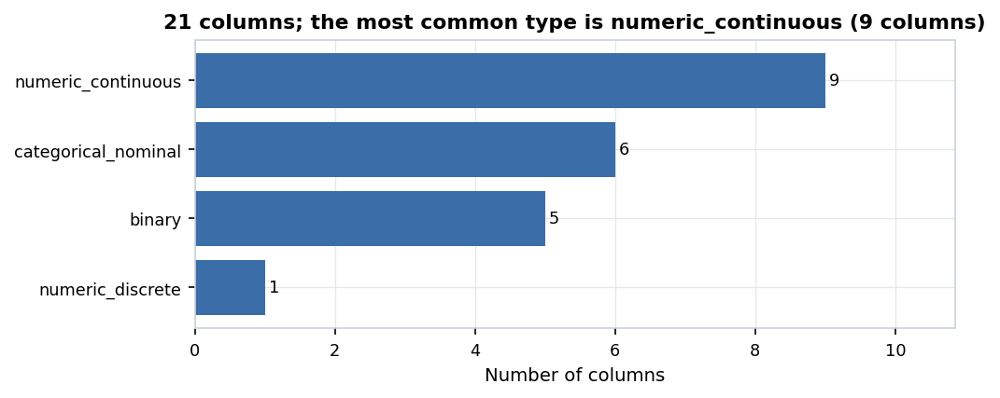

*Figure 1. 21 columns; the most common type is numeric_continuous (9 columns).* Count of columns by the semantic type the pipeline inferred (after cleaning).

| Item | Value |
| :--- | :--- |
| Rows (raw file) | 41,188 |
| Rows (cleaned, conservative) | 41,176 |
| Columns | 21 |
| Memory | 15.013 MB |
| Missing cells | 12,716 (1.47%) |
| Columns typed `numeric_continuous` | 9 |
| Columns typed `categorical_nominal` | 6 |
| Columns typed `binary` | 5 |
| Columns typed `numeric_discrete` | 1 |
| Columns left out of EDA (ID / excluded) | none |

### 4.2 Missing values

Missing values are spread out: the 10% of rows with the most gaps hold 48.25% of all missing cells.

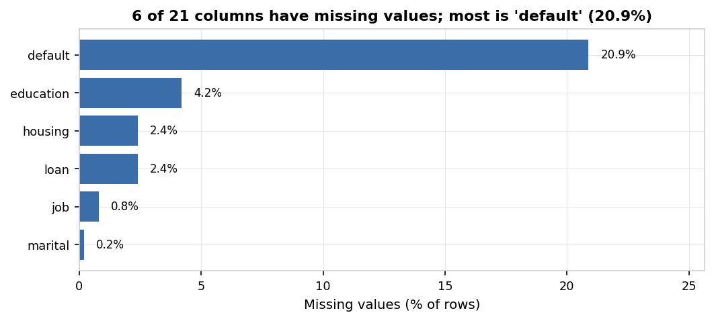

*Figure 2. 6 of 21 columns have missing values; most is 'default' (20.9%).* Percent of rows missing per column (only columns with at least one gap). Red bars are above 40%.

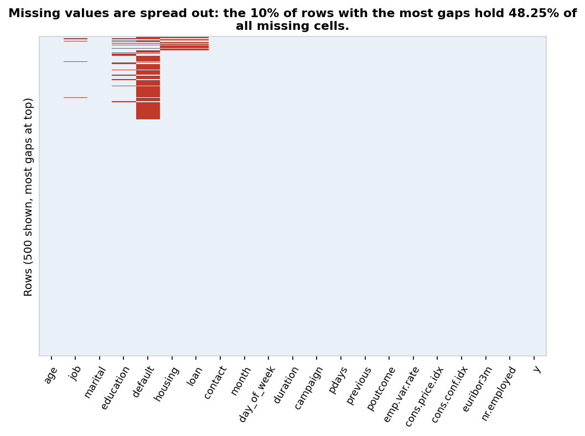

*Figure 3. Missing values are spread out: the 10% of rows with the most gaps hold 48.25% of all missing cells.* Each red cell is a missing value; rows are sorted by how many gaps they have. A random sample of 500 of 41,176 rows is shown.

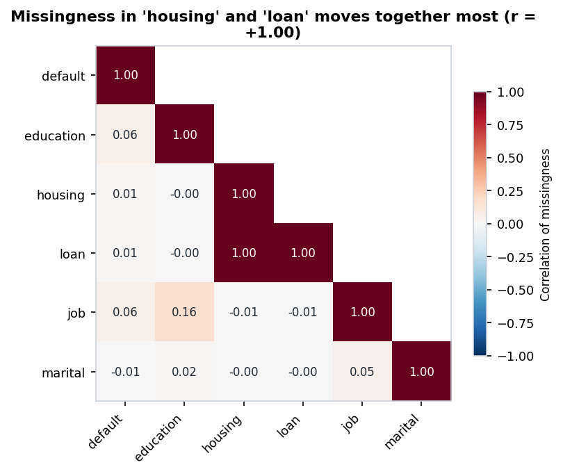

*Figure 4. Missingness in 'housing' and 'loan' moves together most (r = +1.00).* Correlation between the missing/not-missing patterns of columns with gaps. High values mean the gaps tend to occur in the same rows. Descriptive only.

**Missing values per column (cleaned data)**

| Column | Missing | Missing % |
| :--- | ---: | ---: |
| default | 8,596 | 20.88 |
| education | 1,730 | 4.2 |
| housing | 990 | 2.4 |
| loan | 990 | 2.4 |
| job | 330 | 0.8 |
| marital | 80 | 0.19 |

### 4.3 Numeric columns

Red dots in box plots are values beyond 1.5×IQR; they are flagged but kept in the conservative cleaned data.

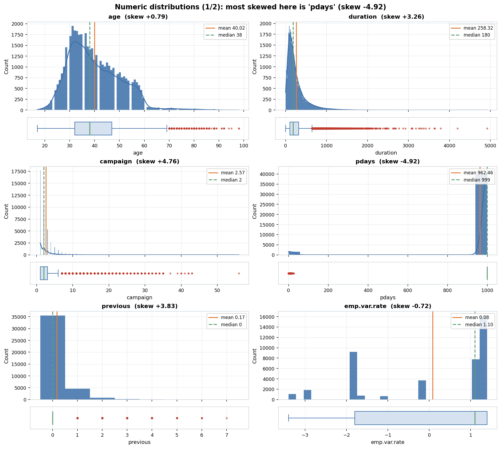

*Figure 5. Numeric distributions (1/2): most skewed here is 'pdays' (skew -4.92).* Histogram (with a smooth density curve for many-valued columns) and a box plot per column. Orange line = mean, green dashed line = median; red dots are values beyond 1.5×IQR.

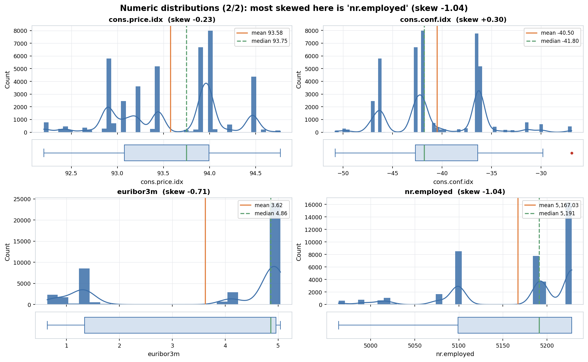

*Figure 6. Numeric distributions (2/2): most skewed here is 'nr.employed' (skew -1.04).* Histogram (with a smooth density curve for many-valued columns) and a box plot per column. Orange line = mean, green dashed line = median; red dots are values beyond 1.5×IQR.

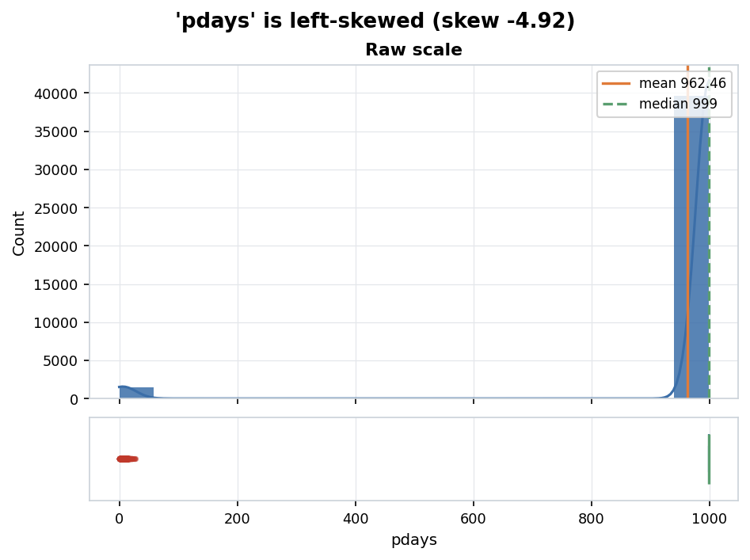

*Figure 7. 'pdays' is left-skewed (skew -4.92).* Close-up of a skewed or outlier-heavy column.

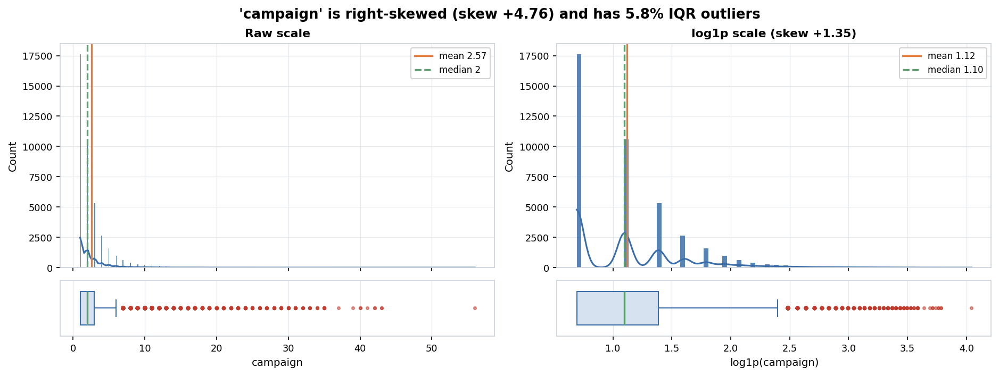

*Figure 8. 'campaign' is right-skewed (skew +4.76) and has 5.8% IQR outliers.* Close-up of a skewed or outlier-heavy column. The right panel shows the same values on a log1p scale.

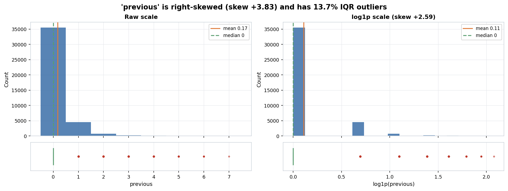

*Figure 9. 'previous' is right-skewed (skew +3.83) and has 13.7% IQR outliers.* Close-up of a skewed or outlier-heavy column. The right panel shows the same values on a log1p scale.

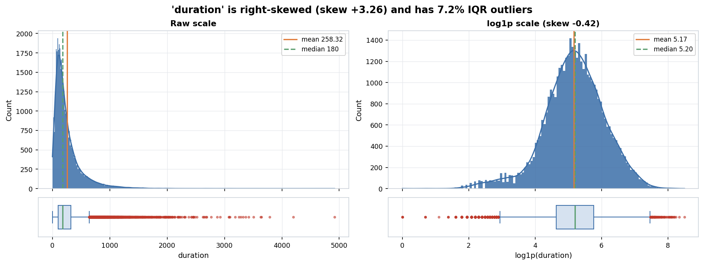

*Figure 10. 'duration' is right-skewed (skew +3.26) and has 7.2% IQR outliers.* Close-up of a skewed or outlier-heavy column. The right panel shows the same values on a log1p scale.

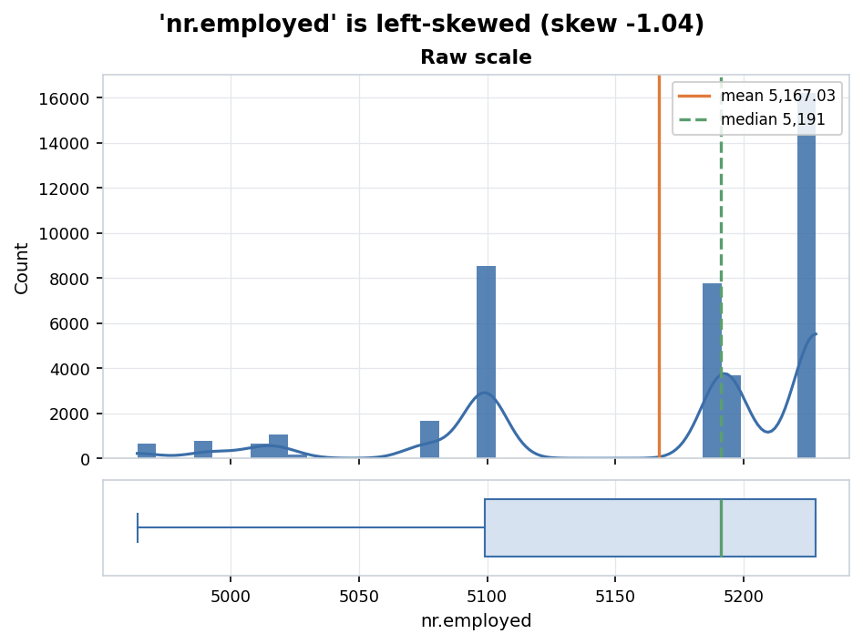

*Figure 11. 'nr.employed' is left-skewed (skew -1.04).* Close-up of a skewed or outlier-heavy column.

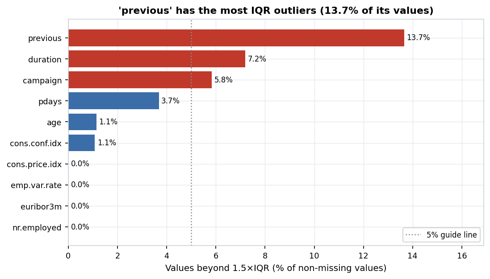

*Figure 12. 'previous' has the most IQR outliers (13.7% of its values).* Share of each numeric column's values outside 1.5×IQR. Outliers are only flagged, not removed, in the conservative cleaned data. Red bars are above the guide line.

**Numeric summary**

| Column | Count | Mean | Std | Min | Q1 | Median | Q3 | Max | Skew | Kurtosis | % zeros | % outliers (1.5×IQR) |
| :--- | ---: | ---: | ---: | ---: | ---: | ---: | ---: | ---: | ---: | ---: | ---: | ---: |
| age | 41,176 | 40.024 | 10.421 | 17 | 32 | 38 | 47 | 98 | 0.785 | 0.791 | 0 | 1.14 |
| duration | 41,176 | 258.316 | 259.305 | 0 | 102 | 180 | 319 | 4,918 | 3.263 | 20.244 | 0.01 | 7.2 |
| campaign | 41,176 | 2.568 | 2.77 | 1 | 1 | 2 | 3 | 56 | 4.762 | 36.972 | 0 | 5.84 |
| pdays | 41,176 | 962.465 | 186.937 | 0 | 999 | 999 | 999 | 999 | -4.921 | 22.222 | 0.04 | 3.68 |
| previous | 41,176 | 0.173 | 0.495 | 0 | 0 | 0 | 0 | 7 | 3.831 | 20.102 | 86.34 | 13.66 |
| emp.var.rate | 41,176 | 0.082 | 1.571 | -3.4 | -1.8 | 1.1 | 1.4 | 1.4 | -0.724 | -1.063 | 0 | 0 |
| cons.price.idx | 41,176 | 93.576 | 0.579 | 92.201 | 93.075 | 93.749 | 93.994 | 94.767 | -0.231 | -0.83 | 0 | 0 |
| cons.conf.idx | 41,176 | -40.503 | 4.628 | -50.8 | -42.7 | -41.8 | -36.4 | -26.9 | 0.303 | -0.359 | 0 | 1.08 |
| euribor3m | 41,176 | 3.621 | 1.734 | 0.634 | 1.344 | 4.857 | 4.961 | 5.045 | -0.709 | -1.407 | 0 | 0 |
| nr.employed | 41,176 | 5,167.035 | 72.251 | 4,963.6 | 5,099.1 | 5,191 | 5,228.1 | 5,228.1 | -1.044 | -0.004 | 0 | 0 |

### 4.4 Categorical and binary columns

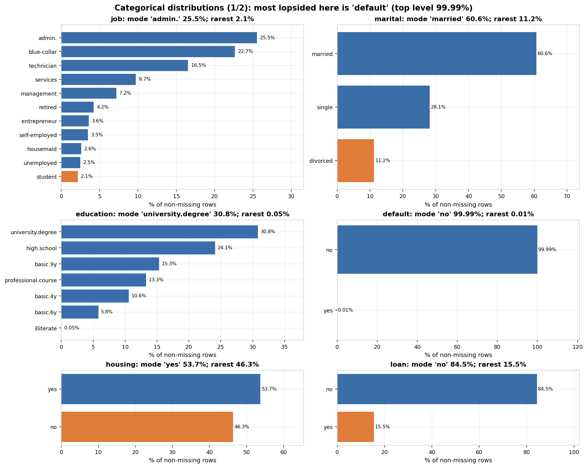

*Figure 13. Categorical distributions (1/2): most lopsided here is 'default' (top level 99.99%).* Share of rows per level (top 15 levels; the rest are grouped as 'Other'). The orange bar marks the smallest (minority) level.

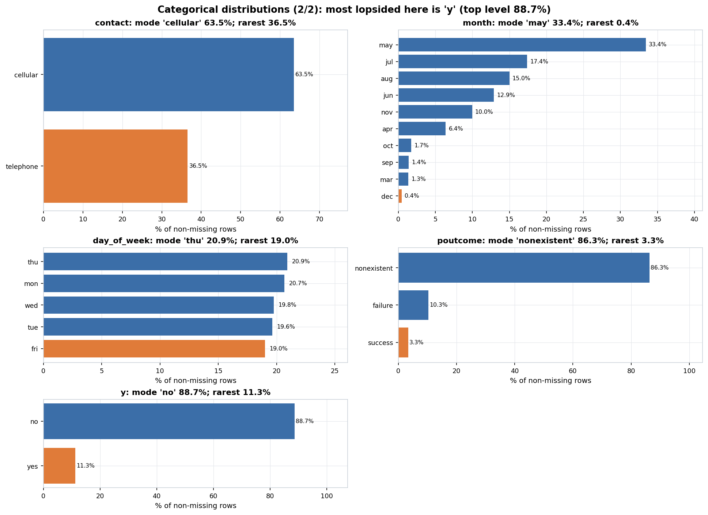

*Figure 14. Categorical distributions (2/2): most lopsided here is 'y' (top level 88.7%).* Share of rows per level (top 15 levels; the rest are grouped as 'Other'). The orange bar marks the smallest (minority) level.

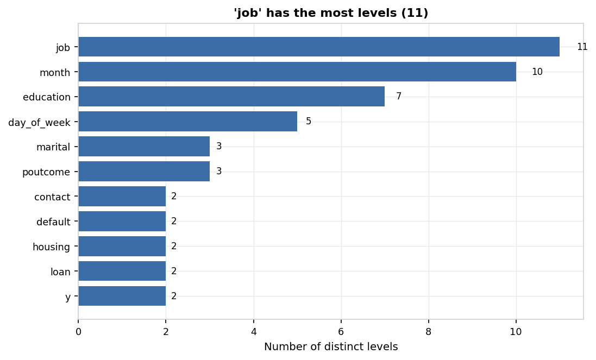

*Figure 15. 'job' has the most levels (11).* Number of distinct values in each categorical or binary column.

**Categorical summary**

| Column | Levels | Mode | Mode % | Entropy (0-1) | Rarest level | Rarest % | Levels under 1% of rows |
| :--- | ---: | :--- | ---: | ---: | :--- | ---: | ---: |
| job | 11 | admin. | 25.51 | 0.849 | student | 2.14 | 0 |
| marital | 3 | married | 60.64 | 0.824 | divorced | 11.22 | 0 |
| education | 7 | university.degree | 30.84 | 0.857 | illiterate | 0.05 | 1 |
| default | 2 | no | 99.99 | 0.001 | yes | 0.01 | 1 |
| housing | 2 | yes | 53.68 | 0.996 | no | 46.32 | 0 |
| loan | 2 | no | 84.45 | 0.623 | yes | 15.55 | 0 |
| contact | 2 | cellular | 63.47 | 0.947 | telephone | 36.53 | 0 |
| month | 10 | may | 33.43 | 0.797 | dec | 0.44 | 1 |
| day_of_week | 5 | thu | 20.93 | 1 | fri | 19.01 | 0 |
| poutcome | 3 | nonexistent | 86.34 | 0.432 | success | 3.33 | 0 |
| y | 2 | no | 88.73 | 0.508 | yes | 11.27 | 0 |

### 4.5 Target / class balance

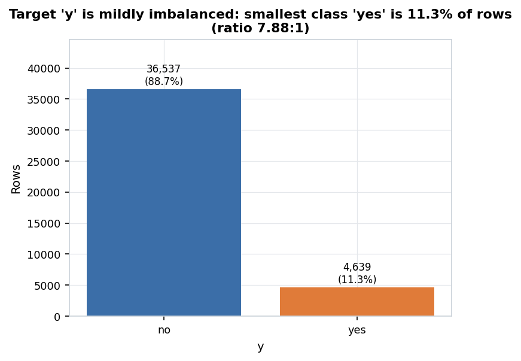

*Figure 16. Target 'y' is mildly imbalanced: smallest class 'yes' is 11.3% of rows (ratio 7.88:1).* Rows per target class. The orange bar is the smallest class. Highly imbalanced = smallest class under 10% of rows; mildly = largest/smallest ratio of 1.5 or more.

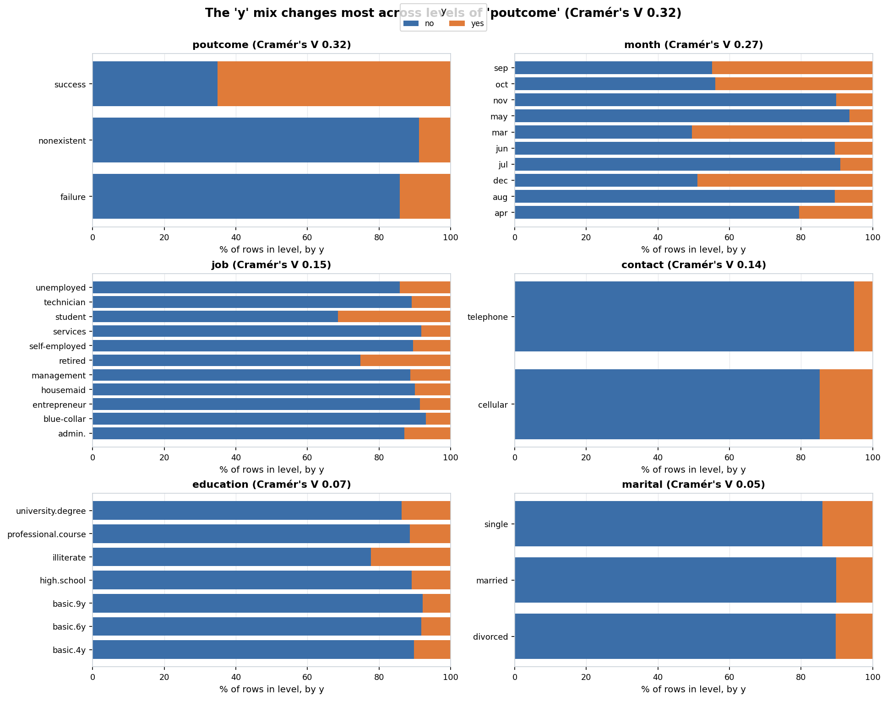

*Figure 17. The 'y' mix changes most across levels of 'poutcome' (Cramér's V 0.32).* Share of each target class within each level of the categorical features most associated with the target (bias-corrected Cramér's V). Descriptive coefficients only; no hypothesis tests were run.

**Target classes**

| Class | Count | % |
| :--- | ---: | ---: |
| no | 36,537 | 88.73 |
| yes | 4,639 | 11.27 |

Imbalance ratio (largest/smallest class) = 7.88: **mildly imbalanced**.

### 4.6 Relationships between columns (descriptive)

All coefficients here describe the data; none of them is a test result. Spearman rho and Pearson r range from -1 to +1; eta² and Cramér's V range from 0 (no association) to 1.

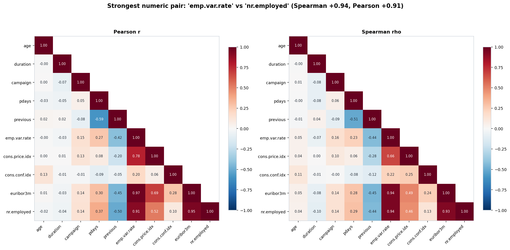

*Figure 18. Strongest numeric pair: 'emp.var.rate' vs 'nr.employed' (Spearman +0.94, Pearson +0.91).* Correlation between numeric columns (lower triangle). Left: Pearson (linear). Right: Spearman (rank-based). Descriptive coefficients only; no hypothesis tests were run.

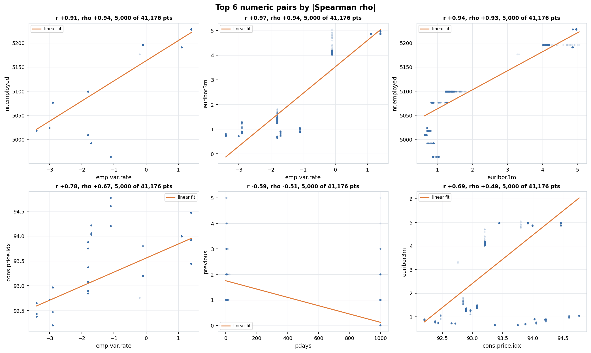

*Figure 19. Top 6 numeric pairs by |Spearman rho|.* Scatter plots with a straight-line fit for the most strongly related numeric pairs. Large datasets are randomly sampled for plotting. Descriptive coefficients only; no hypothesis tests were run.

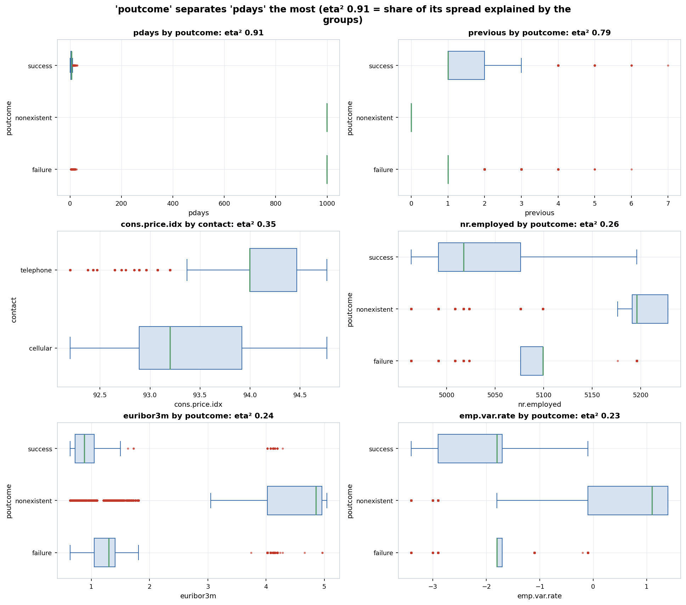

*Figure 20. 'poutcome' separates 'pdays' the most (eta² 0.91 = share of its spread explained by the groups).* Box plots of numeric columns split by categorical columns with up to 8 levels, for the pairs with the largest eta-squared. Descriptive coefficients only; no hypothesis tests were run.

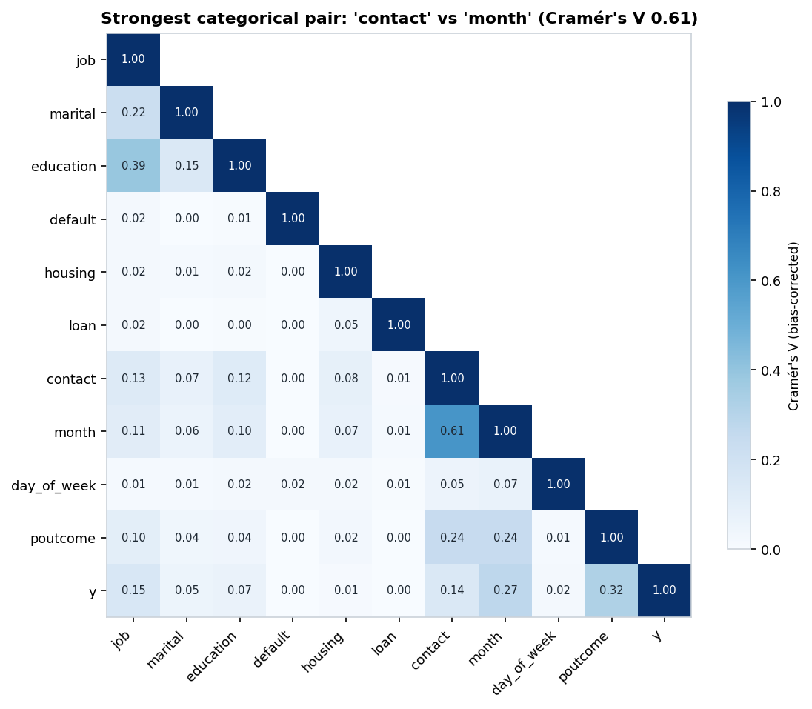

*Figure 21. Strongest categorical pair: 'contact' vs 'month' (Cramér's V 0.61).* Bias-corrected Cramér's V between categorical/binary columns: 0 = unrelated, 1 = one fully predicts the other. Descriptive coefficients only; no hypothesis tests were run.

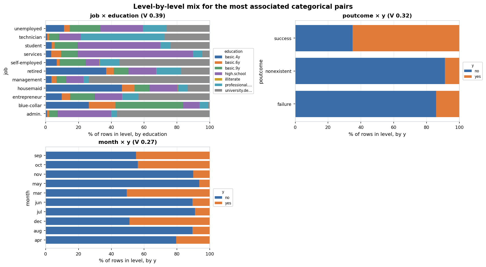

*Figure 22. Level-by-level mix for the most associated categorical pairs.* For each level of the first column, the share of rows in each level of the second column. Descriptive coefficients only; no hypothesis tests were run.

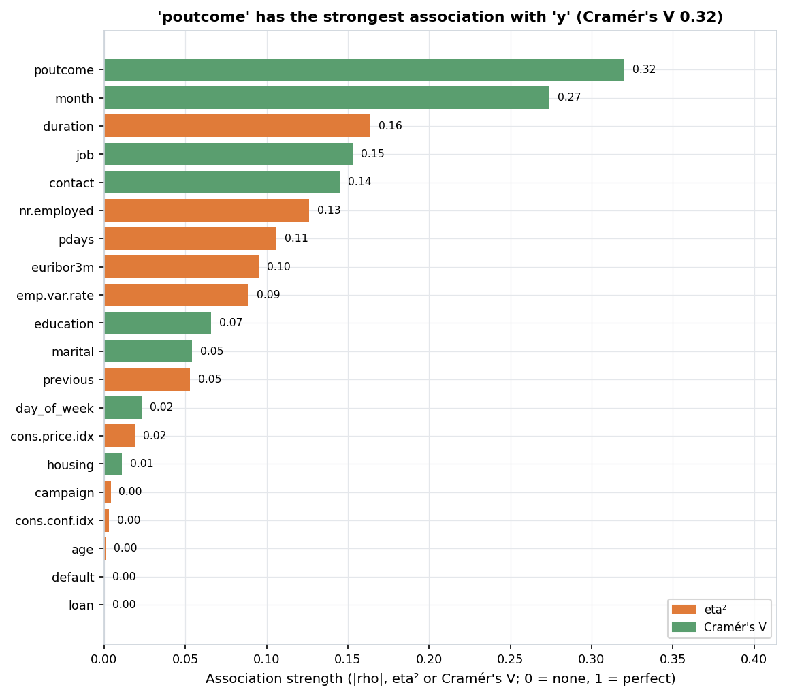

*Figure 23. 'poutcome' has the strongest association with 'y' (Cramér's V 0.32).* Every feature ranked by a descriptive association with the target. Different measures are used for different column types, so compare bars of the same colour most directly. Descriptive coefficients only; no hypothesis tests were run.

**Top numeric pairs**

| Column A | Column B | Pearson r | Spearman rho | Rows used |
| :--- | :--- | ---: | ---: | ---: |
| emp.var.rate | nr.employed | 0.907 | 0.945 | 41,176 |
| emp.var.rate | euribor3m | 0.972 | 0.94 | 41,176 |
| euribor3m | nr.employed | 0.945 | 0.929 | 41,176 |
| emp.var.rate | cons.price.idx | 0.775 | 0.665 | 41,176 |
| pdays | previous | -0.588 | -0.51 | 41,176 |
| cons.price.idx | euribor3m | 0.688 | 0.491 | 41,176 |
| cons.price.idx | nr.employed | 0.522 | 0.465 | 41,176 |
| previous | euribor3m | -0.455 | -0.455 | 41,176 |
| previous | nr.employed | -0.501 | -0.439 | 41,176 |
| previous | emp.var.rate | -0.421 | -0.435 | 41,176 |

Descriptive coefficients only; no hypothesis tests were run.
**Near-collinear numeric pairs**

| Column A | Column B | Pearson r |
| :--- | :--- | ---: |
| emp.var.rate | nr.employed | 0.907 |
| emp.var.rate | euribor3m | 0.972 |
| euribor3m | nr.employed | 0.945 |
**Numeric columns by group (eta²)**

| Numeric | Grouped by | eta² |
| :--- | :--- | ---: |
| pdays | poutcome | 0.907 |
| previous | poutcome | 0.789 |
| cons.price.idx | contact | 0.35 |
| nr.employed | poutcome | 0.262 |
| euribor3m | poutcome | 0.242 |
| emp.var.rate | poutcome | 0.225 |
| age | marital | 0.176 |
| duration | y | 0.164 |
| euribor3m | contact | 0.16 |
| emp.var.rate | contact | 0.155 |

Descriptive coefficients only; no hypothesis tests were run.
**Categorical pairs (Cramér's V)**

| Column A | Column B | Cramér's V |
| :--- | :--- | ---: |
| contact | month | 0.609 |
| job | education | 0.388 |
| poutcome | y | 0.32 |
| month | y | 0.274 |
| contact | poutcome | 0.242 |
| month | poutcome | 0.242 |
| job | marital | 0.222 |
| job | y | 0.153 |
| contact | y | 0.145 |
| marital | education | 0.145 |

Descriptive coefficients only; no hypothesis tests were run.
**Every feature vs. the target**

| Feature | Measure | Value |
| :--- | :--- | ---: |
| poutcome | Cramér's V | 0.32 |
| month | Cramér's V | 0.274 |
| duration | eta² | 0.164 |
| job | Cramér's V | 0.153 |
| contact | Cramér's V | 0.145 |
| nr.employed | eta² | 0.126 |
| pdays | eta² | 0.106 |
| euribor3m | eta² | 0.095 |
| emp.var.rate | eta² | 0.089 |
| education | Cramér's V | 0.066 |
| marital | Cramér's V | 0.054 |
| previous | eta² | 0.053 |
| day_of_week | Cramér's V | 0.023 |
| cons.price.idx | eta² | 0.019 |
| housing | Cramér's V | 0.011 |
| campaign | eta² | 0.004 |
| cons.conf.idx | eta² | 0.003 |
| age | eta² | 0.001 |
| default | Cramér's V | 0 |
| loan | Cramér's V | 0 |

Descriptive coefficients only; no hypothesis tests were run.

## 5. Insights

Automated insights rated **high** or **medium** (19 of 50; the full list is in [insights.md](insights.md) and [insights.json](insights.json)):

- **MEDIUM** (data quality) — 12 exact duplicate rows were removed (the first copy of each was kept).
- **MEDIUM** (data quality) — Column 'default' has 20.88% missing values (n = 8,596 of 41,176 rows). ([figure](figures/missing_bar.png))
- **MEDIUM** (data quality) — Column 'default' used placeholder text for missing values: 'unknown' (8,597); 8,597 cells were turned into real missing values.
- **MEDIUM** (distribution) — 'nr.employed' is left-skewed (skew = -1.04): its median (5,191) is above its mean (5,167.03). ([figure](figures/numeric_detail_nr_employed.png))
- **MEDIUM** (distribution) — 'pdays' is left-skewed (skew = -4.92): its median (999) is above its mean (962.46). ([figure](figures/numeric_detail_pdays.png))
- **MEDIUM** (distribution) — 'campaign' has many outliers: 5.84% of its values (n = 2,406) are beyond 1.5×IQR. They are flagged, not removed. ([figure](figures/outlier_summary.png))
- **MEDIUM** (distribution) — 'duration' has many outliers: 7.2% of its values (n = 2,963) are beyond 1.5×IQR. They are flagged, not removed. ([figure](figures/outlier_summary.png))
- **MEDIUM** (distribution) — 'previous' has many outliers: 13.66% of its values (n = 5,625) are beyond 1.5×IQR. They are flagged, not removed. ([figure](figures/outlier_summary.png))
- **MEDIUM** (distribution) — 'campaign' is right-skewed (skew = 4.76): its median (2) is below its mean (2.57), so a log transform is advisable for plots and parametric models. ([figure](figures/numeric_detail_campaign.png))
- **MEDIUM** (distribution) — 'duration' is right-skewed (skew = 3.26): its median (180) is below its mean (258.32), so a log transform is advisable for plots and parametric models. ([figure](figures/numeric_detail_duration.png))
- **MEDIUM** (distribution) — 'previous' is right-skewed (skew = 3.83): its median (0) is below its mean (0.17), so a log transform is advisable for plots and parametric models. ([figure](figures/numeric_detail_previous.png))
- **MEDIUM** (distribution) — 'previous' is zero-inflated: 86.34% of its values are exactly zero. ([figure](figures/numeric_detail_previous.png))
- **MEDIUM** (class balance) — Target 'y' is mildly imbalanced: the smallest class 'yes' is 11.27% of rows and the largest 'no' is 88.73% (the largest class is 7.88 times the smallest). ([figure](figures/target_balance.png))
- **MEDIUM** (relationship) — 'emp.var.rate' and 'euribor3m' are nearly collinear (Pearson r = +0.97); models should not use both as if they were separate information. ([figure](figures/correlation_heatmap.png))
- **MEDIUM** (relationship) — 'emp.var.rate' and 'nr.employed' are nearly collinear (Pearson r = +0.91); models should not use both as if they were separate information. ([figure](figures/correlation_heatmap.png))
- **MEDIUM** (relationship) — 'euribor3m' and 'nr.employed' are nearly collinear (Pearson r = +0.94); models should not use both as if they were separate information. ([figure](figures/correlation_heatmap.png))
- **MEDIUM** (relationship) — The categorical feature most associated with target 'y' is 'poutcome' (Cramér's V = 0.32; descriptive). ([figure](figures/target_relationships.png))
- **MEDIUM** (testing implication) — Rank-based methods (Spearman, Mann-Whitney, Kruskal-Wallis) are recommended for 5 skewed or outlier-heavy column(s): 'campaign', 'duration', 'nr.employed', 'pdays', 'previous'.
- **MEDIUM** (testing implication) — Because target 'y' is mildly imbalanced, compare groups using rates (% per class) rather than raw counts, and use stratified splits for any later modeling. ([figure](figures/target_balance.png))

### Manual insights (written by the analyst)

- **Explicit `"unknown"` missing placeholders across 6 columns:** Rather than blank cells, missing categorical attributes are encoded as `"unknown"` in `default` (8,597 rows, 20.88%), `education` (1,731 rows, 4.20%), `housing` (990 rows, 2.40%), `loan` (990 rows, 2.40%), `job` (330 rows, 0.80%), and `marital` (80 rows, 0.19%). Enabling `treat_unknown_as_missing: true` converts all 12,718 cells to `NaN` in the conservative output and creates `__was_missing` indicator flags in the imputed output.
- **Co-missingness between `housing` and `loan`:** Missingness in `housing` and `loan` is perfectly correlated ($r = 1.00$, exact same 990 rows), indicating that loan-status questions were skipped together as a single survey block.
- **Target leakage in call `duration`:** Call `duration` is the strongest numeric predictor of subscription `y` ($\eta^2 = 0.16$, Spearman $\rho = +0.35$), and `duration == 0` always implies `y = no`. However, call duration is unknown before placing a telemarketing call and must be excluded from realistic predictive models (kept in Phase 1 for retrospective EDA).
- **Sentinel value `pdays = 999`:** 96.32% of clients have `pdays = 999` (meaning "never previously contacted"). Replacing `999` with `NaN` would wipe out 96% of the column; keeping it as a documented sentinel explains its extreme skewness (`skew = -4.92`) and its near-perfect alignment with `poutcome = nonexistent` ($\eta^2 = 0.90$).
- **Near-collinear macroeconomic indicators:** `euribor3m`, `emp.var.rate`, and `nr.employed` move together across the May 2008–Nov 2010 timeline with Pearson $r$ between $+0.94$ and $+0.97$. During periods of lower Euribor rates and reduced employment variation, term-deposit conversion rates (`y = yes`, 11.27% overall) increase substantially.
- **Target findings for Phase 5 benchmark recovery:** (1) `duration <-> y` (strongest post-call association / leakage feature), (2) `poutcome (success) / pdays <-> y` (prior campaign success), (3) `euribor3m / emp.var.rate / nr.employed <-> y` (macroeconomic regime effect), and (4) `contact (cellular vs telephone) <-> y`.

## 6. Normalization / scaling

| Column | Skew | Recommended transform | Reason |
| :--- | ---: | :--- | :--- |
| `age` | +0.78 | none | Moderate/low skewness (skew=0.78); no non-linear transform needed. |
| `duration` | +3.26 | log1p | Right-skewed (skew=3.26 > 1.0) with non-negative domain (min=0); log1p recommended. |
| `campaign` | +4.76 | log1p | Right-skewed (skew=4.76 > 1.0) with non-negative domain (min=1); log1p recommended. |
| `pdays` | -4.92 | none | Moderate/low skewness (skew=-4.92); no non-linear transform needed. |
| `previous` | +3.83 | log1p | Right-skewed (skew=3.83 > 1.0) with non-negative domain (min=0); log1p recommended. |
| `emp.var.rate` | -0.72 | none | Moderate/low skewness (skew=-0.72); no non-linear transform needed. |
| `cons.price.idx` | -0.23 | none | Moderate/low skewness (skew=-0.23); no non-linear transform needed. |
| `cons.conf.idx` | +0.30 | none | Moderate/low skewness (skew=0.30); no non-linear transform needed. |
| `euribor3m` | -0.71 | none | Moderate/low skewness (skew=-0.71); no non-linear transform needed. |
| `nr.employed` | -1.04 | none | Moderate/low skewness (skew=-1.04); no non-linear transform needed. |

Scale disparity across numeric columns (largest std ÷ smallest std): 523.89. Z-score standardization is recommended only for scale-sensitive methods.

> Primary cleaned output is **not** scaled. The Phase 3 test library is rank-based or scale-invariant (Welch/Mann-Whitney, Spearman, Kruskal, chi-square), so scaling would not change results. Log transforms are recommended for columns [duration, campaign, previous] only for plotting and for parametric/regression use. A scaled copy is provided for TA review and for any future modeling.

Scaled convenience copy (for review and future modeling only, never used for testing): `data/cleaned/bank_marketing_scaled.csv`. Details: [scaling_report.md](scaling_report.md).

## 7. Output files

- [profile.json](profile.json): full profile of the raw file
- [profile_cleaned.json](profile_cleaned.json): profile of the cleaned file
- [column_schema.json](column_schema.json): Phase 2 handoff: type and role of every column
- [cleaning_log.json](cleaning_log.json): every cleaning change (machine-readable)
- [cleaning_log.md](cleaning_log.md): every cleaning change (readable)
- [scaling_report.md](scaling_report.md): scaling and transform decisions
- [scaling_params.json](scaling_params.json): fitted scaling parameters
- [eda_summary.json](eda_summary.json): every EDA number used by the insights
- [insights.json](insights.json): automated insights with evidence
- [insights.md](insights.md): automated + manual insights
- [report.md](report.md): this report (markdown)
- [report.html](report.html): this report (HTML)
- [config_resolved.yaml](config_resolved.yaml): the exact settings used for this run
- `figures/`: 23 PNG figures; `tables/`: EDA tables as markdown
- `data/cleaned/bank_marketing_cleaned.csv`: conservative cleaned data (primary, NaN kept)
- `data/cleaned/bank_marketing_cleaned_imputed.csv`: imputed cleaned data (secondary, with `__was_missing` flags)
- `data/cleaned/bank_marketing_scaled.csv`: scaled convenience copy
