# Phase 1 Dataset Report — `heart_disease`

_Generated by the VeriData Phase 1 pipeline. Every number comes from code (no LLM). Relationship numbers are descriptive only; no hypothesis tests were run in Phase 1._

**Contents:** 1. Overview · 2. Columns · 3. Data cleaning · 4. Exploratory data analysis · 5. Insights · 6. Normalization / scaling · 7. Output files

## 1. Overview

| Item | Value |
| :--- | :--- |
| Source file | `data\raw\heart_disease\heart.csv` |
| SHA-256 | `7c3014365675306819510a49ff289efbec1d1a6a666a2dc7652f1547b383d859` |
| Raw shape | 303 rows × 14 columns |
| Cleaned shape (conservative, primary) | 302 rows × 14 columns |
| Cleaned shape (imputed, secondary) | 302 rows × 14 columns |
| Exact duplicate rows in raw file | 1 |
| Missing cells in raw file (incl. placeholder text) | 0 (0.00%) |
| Memory (raw) | 0.237103 MB |
| Target column | `target` (categorical) |

### Profiling warnings (raw file)

- Info: Column 'target' has a target/outcome-like name.

## 2. Column profile (raw file)

| Column | Raw dtype | Inferred type | Missing % | Unique | Why this type |
| :--- | :--- | :--- | ---: | ---: | :--- |
| `age` | `int64` | `numeric_continuous` | 0.0% | 41 | numeric values (100.0% parseable, 41 unique) |
| `sex` | `int64` | `binary` | 0.0% | 2 | numeric with two values (0, 1) |
| `cp` | `int64` | `categorical_nominal` | 0.0% | 4 | config override: forced_types['cp'] = categorical_nominal |
| `trestbps` | `int64` | `numeric_continuous` | 0.0% | 49 | numeric values (100.0% parseable, 49 unique) |
| `chol` | `int64` | `numeric_continuous` | 0.0% | 152 | numeric values (100.0% parseable, 152 unique) |
| `fbs` | `int64` | `binary` | 0.0% | 2 | numeric with two values (0, 1) |
| `restecg` | `int64` | `categorical_nominal` | 0.0% | 3 | config override: forced_types['restecg'] = categorical_nominal |
| `thalach` | `int64` | `numeric_continuous` | 0.0% | 91 | numeric values (100.0% parseable, 91 unique) |
| `exang` | `int64` | `binary` | 0.0% | 2 | numeric with two values (0, 1) |
| `oldpeak` | `float64` | `numeric_continuous` | 0.0% | 40 | numeric values (100.0% parseable, 40 unique) |
| `slope` | `int64` | `categorical_nominal` | 0.0% | 3 | config override: forced_types['slope'] = categorical_nominal |
| `ca` | `int64` | `numeric_discrete` | 0.0% | 5 | integer values with 5 unique levels (unique ratio 1.7%) |
| `thal` | `int64` | `categorical_nominal` | 0.0% | 4 | config override: forced_types['thal'] = categorical_nominal |
| `target` | `int64` | `binary` | 0.0% | 2 | numeric with two values (0, 1) |

## 3. Data cleaning

2 cleaning steps made 6 logged changes touching 14 cells. Rows: 303 in the raw file → 302 in the conservative output → 302 in the imputed output.

### What the TA asked for

| Requirement | What the pipeline did |
| :--- | :--- |
| Missing values | ✔ checked; nothing to change. Conservative output keeps NaN; imputed output fills gaps and adds `__was_missing` flags |
| Duplicates | ✔ dropped duplicate rows: 1 rows |
| Outliers | ✔ flagged outliers: 44 rows. 6 column(s) flagged; values are kept in the conservative output |
| Inconsistent formats | ✔ checked; nothing to change |
| Empty rows / columns | ✔ checked; nothing to change |

### Changes by step

| Step | Log entries | Cells changed | Rows removed |
| :--- | ---: | ---: | ---: |
| `handle_duplicates` | 1 | 14 | 1 |
| `handle_outliers` | 5 | 0 | 0 |

### Outlier flags (1.5×IQR and modified z-score)

| Column | Flagged | Flagged % | Extreme (3×IQR) | Normal range (1.5×IQR) | Action |
| :--- | ---: | ---: | ---: | :--- | :--- |
| `age` | 0 | 0.00% | 0 | 28.5 to 80.5 | flag |
| `ca` | 24 | 7.95% | 0 | -1.5 to 2.5 | flag |
| `chol` | 5 | 1.66% | 1 | 115.375 to 370.375 | flag |
| `oldpeak` | 5 | 1.66% | 0 | -2.4 to 4 | flag |
| `thalach` | 1 | 0.33% | 0 | 84.125 to 215.125 | flag |
| `trestbps` | 9 | 2.98% | 0 | 90 to 170 | flag |

The full step-by-step log with before/after examples is in [cleaning_log.md](cleaning_log.md) (machine-readable: [cleaning_log.json](cleaning_log.json)).

## 4. Exploratory data analysis

### 4.1 Dataset overview

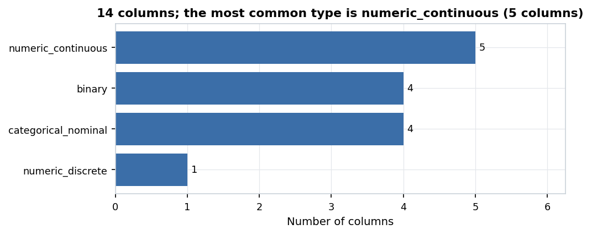

*Figure 1. 14 columns; the most common type is numeric_continuous (5 columns).* Count of columns by the semantic type the pipeline inferred (after cleaning).

| Item | Value |
| :--- | :--- |
| Rows (raw file) | 303 |
| Rows (cleaned, conservative) | 302 |
| Columns | 14 |
| Memory | 0.027 MB |
| Missing cells | 0 (0.0%) |
| Columns typed `numeric_continuous` | 5 |
| Columns typed `binary` | 4 |
| Columns typed `categorical_nominal` | 4 |
| Columns typed `numeric_discrete` | 1 |
| Columns left out of EDA (ID / excluded) | none |

### 4.2 Missing values

No missing values remain in the cleaned data.

**Missing values per column (cleaned data)**

No missing values remain in the cleaned data, so no missingness charts were drawn.

### 4.3 Numeric columns

Red dots in box plots are values beyond 1.5×IQR; they are flagged but kept in the conservative cleaned data.

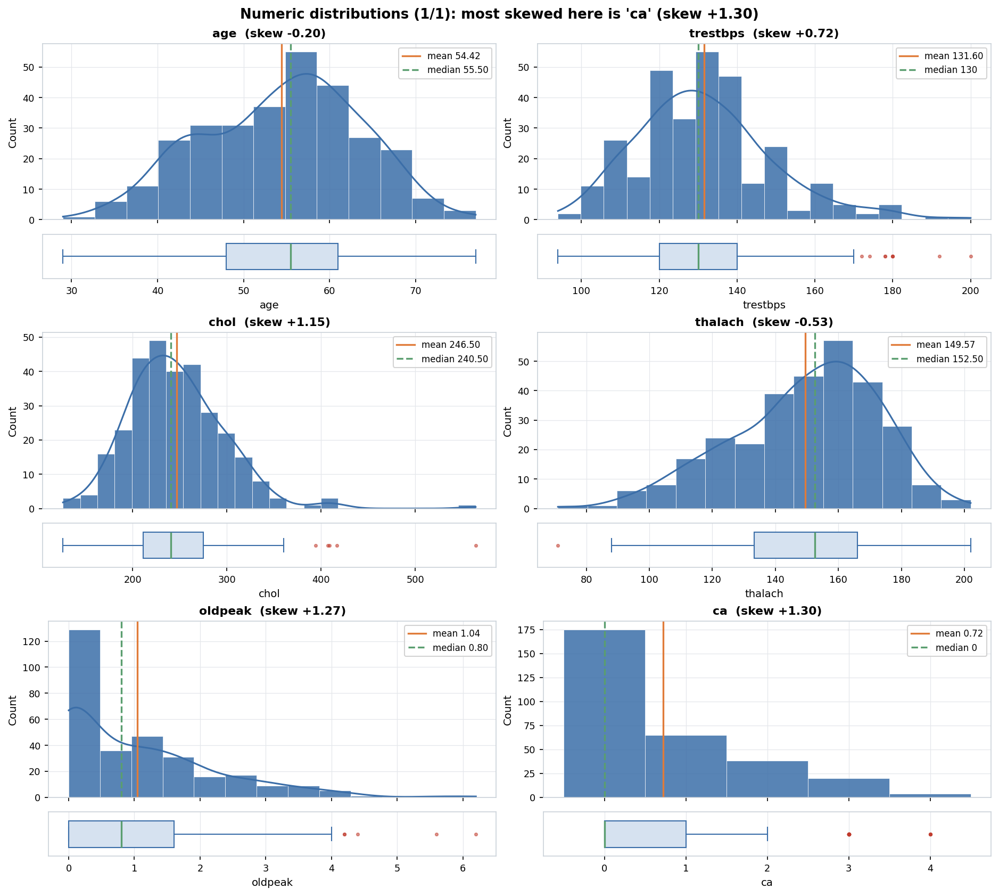

*Figure 2. Numeric distributions (1/1): most skewed here is 'ca' (skew +1.30).* Histogram (with a smooth density curve for many-valued columns) and a box plot per column. Orange line = mean, green dashed line = median; red dots are values beyond 1.5×IQR.

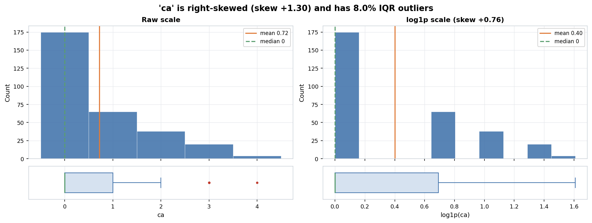

*Figure 3. 'ca' is right-skewed (skew +1.30) and has 8.0% IQR outliers.* Close-up of a skewed or outlier-heavy column. The right panel shows the same values on a log1p scale.

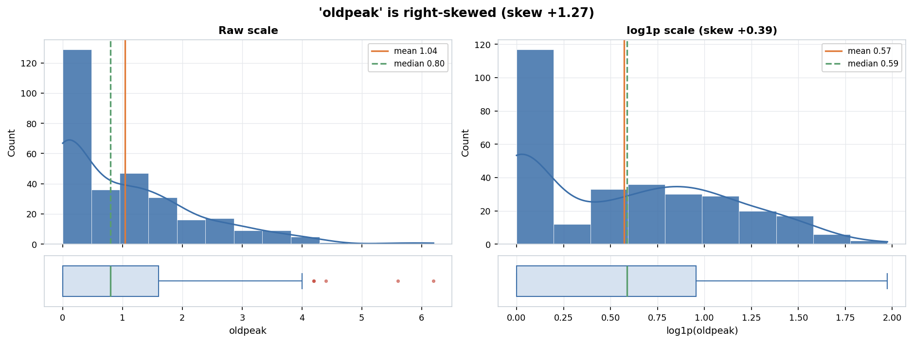

*Figure 4. 'oldpeak' is right-skewed (skew +1.27).* Close-up of a skewed or outlier-heavy column. The right panel shows the same values on a log1p scale.

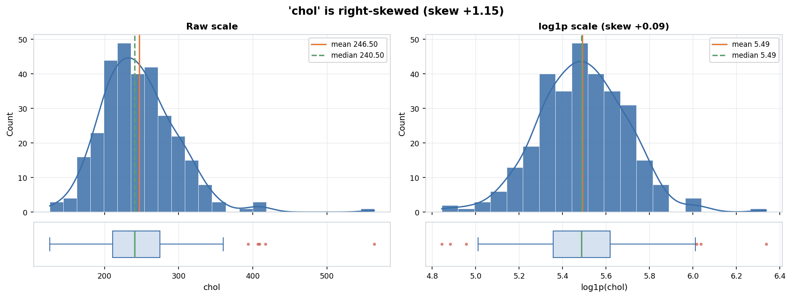

*Figure 5. 'chol' is right-skewed (skew +1.15).* Close-up of a skewed or outlier-heavy column. The right panel shows the same values on a log1p scale.

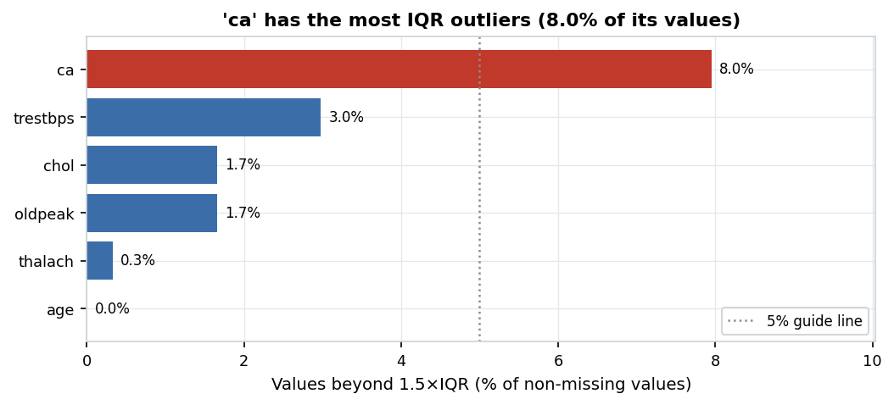

*Figure 6. 'ca' has the most IQR outliers (8.0% of its values).* Share of each numeric column's values outside 1.5×IQR. Outliers are only flagged, not removed, in the conservative cleaned data. Red bars are above the guide line.

**Numeric summary**

| Column | Count | Mean | Std | Min | Q1 | Median | Q3 | Max | Skew | Kurtosis | % zeros | % outliers (1.5×IQR) |
| :--- | ---: | ---: | ---: | ---: | ---: | ---: | ---: | ---: | ---: | ---: | ---: | ---: |
| age | 302 | 54.42 | 9.048 | 29 | 48 | 55.5 | 61 | 77 | -0.204 | -0.528 | 0 | 0 |
| trestbps | 302 | 131.603 | 17.563 | 94 | 120 | 130 | 140 | 200 | 0.717 | 0.923 | 0 | 2.98 |
| chol | 302 | 246.5 | 51.754 | 126 | 211 | 240.5 | 274.75 | 564 | 1.147 | 4.543 | 0 | 1.66 |
| thalach | 302 | 149.57 | 22.904 | 71 | 133.25 | 152.5 | 166 | 202 | -0.533 | -0.062 | 0 | 0.33 |
| oldpeak | 302 | 1.043 | 1.161 | 0 | 0 | 0.8 | 1.6 | 6.2 | 1.266 | 1.568 | 32.45 | 1.66 |
| ca | 302 | 0.719 | 1.007 | 0 | 0 | 0 | 1 | 4 | 1.296 | 0.781 | 57.95 | 7.95 |

### 4.4 Categorical and binary columns

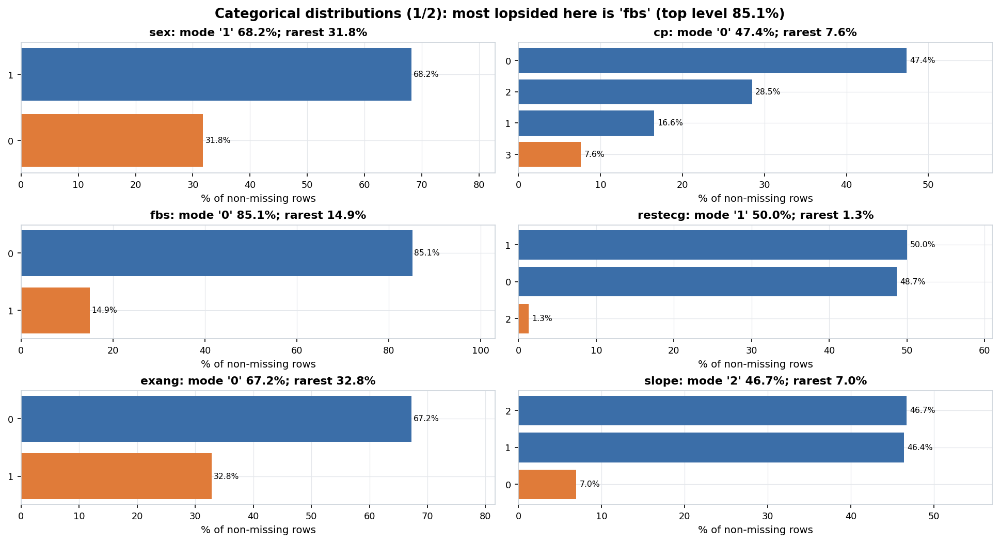

*Figure 7. Categorical distributions (1/2): most lopsided here is 'fbs' (top level 85.1%).* Share of rows per level (top 15 levels; the rest are grouped as 'Other'). The orange bar marks the smallest (minority) level.

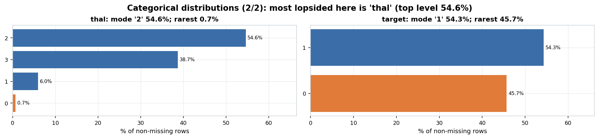

*Figure 8. Categorical distributions (2/2): most lopsided here is 'thal' (top level 54.6%).* Share of rows per level (top 15 levels; the rest are grouped as 'Other'). The orange bar marks the smallest (minority) level.

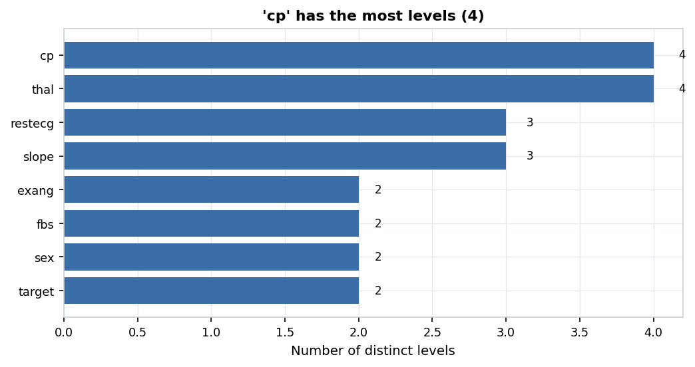

*Figure 9. 'cp' has the most levels (4).* Number of distinct values in each categorical or binary column.

**Categorical summary**

| Column | Levels | Mode | Mode % | Entropy (0-1) | Rarest level | Rarest % | Levels under 1% of rows |
| :--- | ---: | :--- | ---: | ---: | :--- | ---: | ---: |
| sex | 2 | 1 | 68.21 | 0.902 | 0 | 31.79 | 0 |
| cp | 4 | 0 | 47.35 | 0.87 | 3 | 7.62 | 0 |
| fbs | 2 | 0 | 85.1 | 0.607 | 1 | 14.9 | 0 |
| restecg | 3 | 1 | 50 | 0.687 | 2 | 1.32 | 0 |
| exang | 2 | 0 | 67.22 | 0.913 | 1 | 32.78 | 0 |
| slope | 3 | 2 | 46.69 | 0.817 | 0 | 6.95 | 0 |
| thal | 4 | 2 | 54.64 | 0.648 | 0 | 0.66 | 1 |
| target | 2 | 1 | 54.3 | 0.995 | 0 | 45.7 | 0 |

### 4.5 Target / class balance

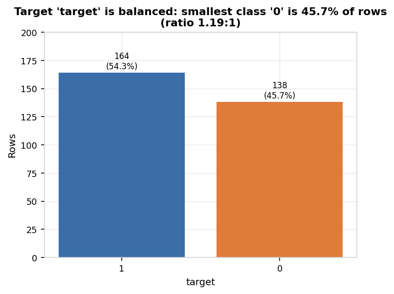

*Figure 10. Target 'target' is balanced: smallest class '0' is 45.7% of rows (ratio 1.19:1).* Rows per target class. The orange bar is the smallest class. Highly imbalanced = smallest class under 10% of rows; mildly = largest/smallest ratio of 1.5 or more.

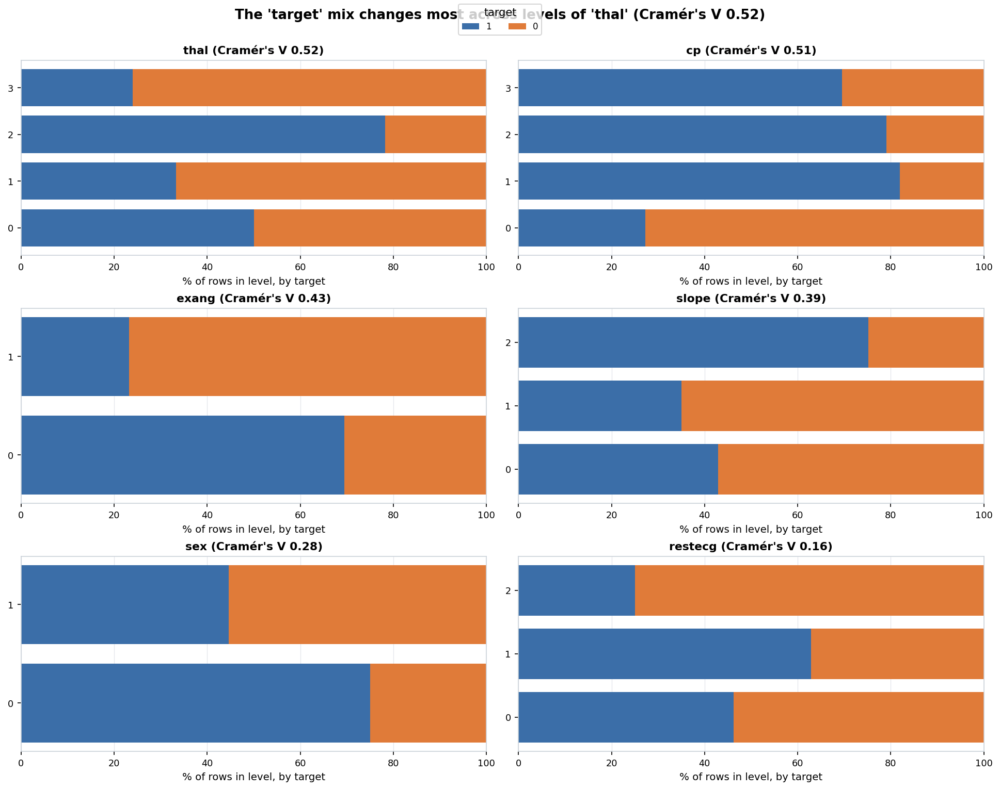

*Figure 11. The 'target' mix changes most across levels of 'thal' (Cramér's V 0.52).* Share of each target class within each level of the categorical features most associated with the target (bias-corrected Cramér's V). Descriptive coefficients only; no hypothesis tests were run.

**Target classes**

| Class | Count | % |
| :--- | ---: | ---: |
| 1 | 164 | 54.3 |
| 0 | 138 | 45.7 |

Imbalance ratio (largest/smallest class) = 1.19: **balanced**.

### 4.6 Relationships between columns (descriptive)

All coefficients here describe the data; none of them is a test result. Spearman rho and Pearson r range from -1 to +1; eta² and Cramér's V range from 0 (no association) to 1.

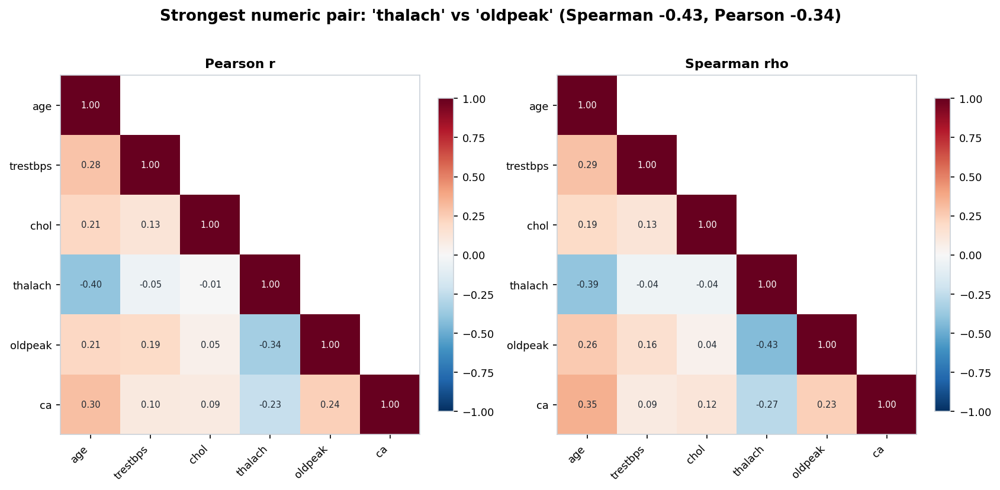

*Figure 12. Strongest numeric pair: 'thalach' vs 'oldpeak' (Spearman -0.43, Pearson -0.34).* Correlation between numeric columns (lower triangle). Left: Pearson (linear). Right: Spearman (rank-based). Descriptive coefficients only; no hypothesis tests were run.

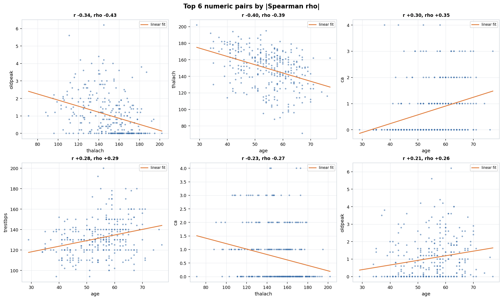

*Figure 13. Top 6 numeric pairs by |Spearman rho|.* Scatter plots with a straight-line fit for the most strongly related numeric pairs. Large datasets are randomly sampled for plotting. Descriptive coefficients only; no hypothesis tests were run.

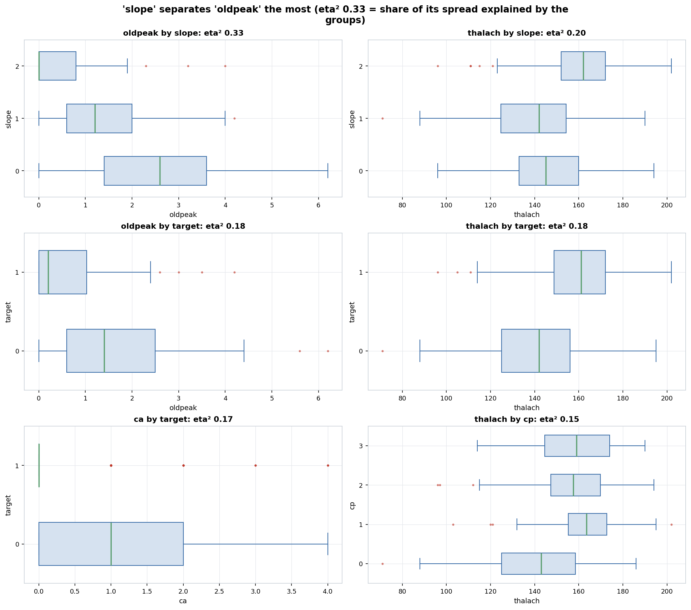

*Figure 14. 'slope' separates 'oldpeak' the most (eta² 0.33 = share of its spread explained by the groups).* Box plots of numeric columns split by categorical columns with up to 8 levels, for the pairs with the largest eta-squared. Descriptive coefficients only; no hypothesis tests were run.

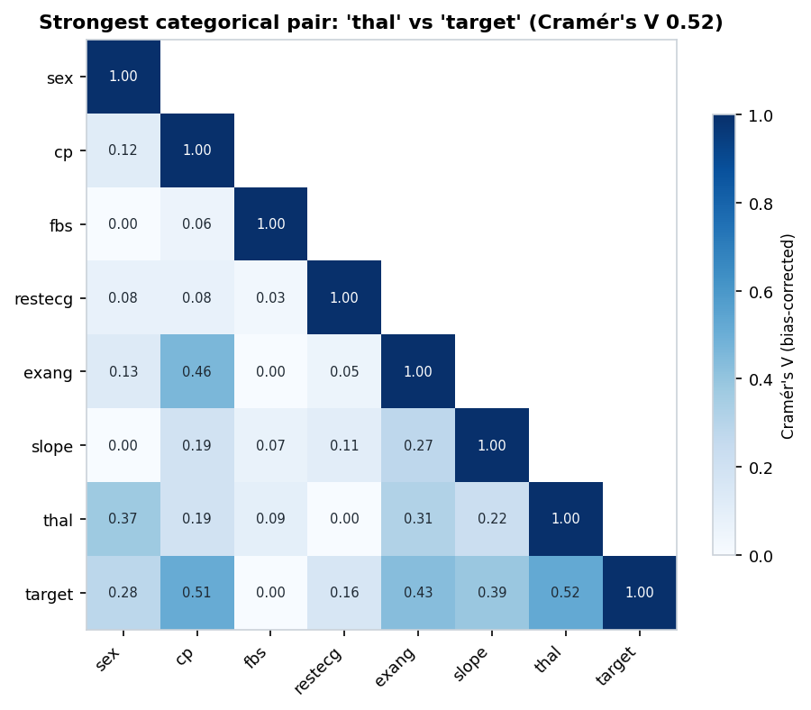

*Figure 15. Strongest categorical pair: 'thal' vs 'target' (Cramér's V 0.52).* Bias-corrected Cramér's V between categorical/binary columns: 0 = unrelated, 1 = one fully predicts the other. Descriptive coefficients only; no hypothesis tests were run.

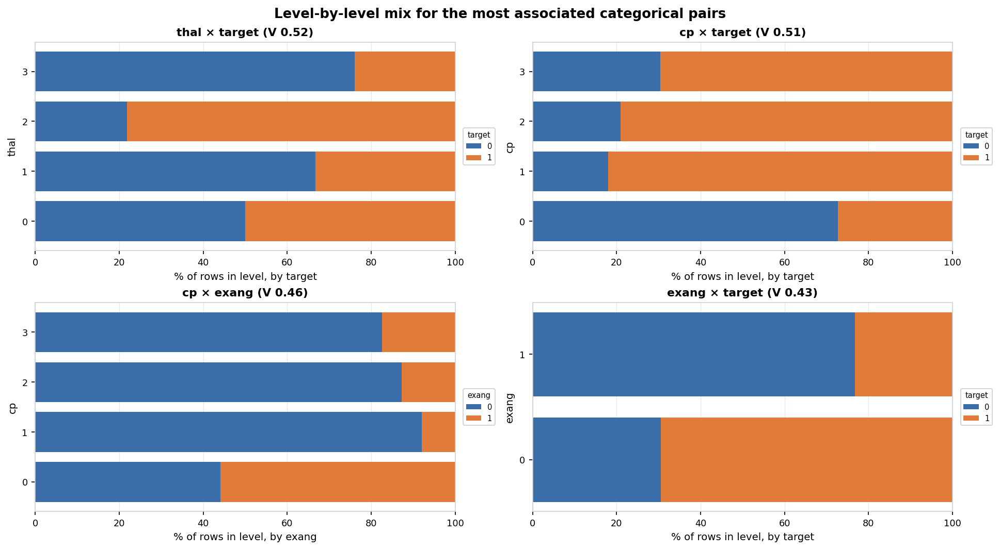

*Figure 16. Level-by-level mix for the most associated categorical pairs.* For each level of the first column, the share of rows in each level of the second column. Descriptive coefficients only; no hypothesis tests were run.

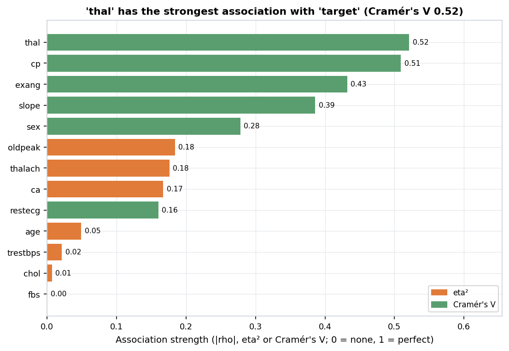

*Figure 17. 'thal' has the strongest association with 'target' (Cramér's V 0.52).* Every feature ranked by a descriptive association with the target. Different measures are used for different column types, so compare bars of the same colour most directly. Descriptive coefficients only; no hypothesis tests were run.

**Top numeric pairs**

| Column A | Column B | Pearson r | Spearman rho | Rows used |
| :--- | :--- | ---: | ---: | ---: |
| thalach | oldpeak | -0.342 | -0.43 | 302 |
| age | thalach | -0.395 | -0.393 | 302 |
| age | ca | 0.302 | 0.355 | 302 |
| age | trestbps | 0.283 | 0.29 | 302 |
| thalach | ca | -0.228 | -0.268 | 302 |
| age | oldpeak | 0.206 | 0.264 | 302 |
| oldpeak | ca | 0.237 | 0.235 | 302 |
| age | chol | 0.207 | 0.189 | 302 |
| trestbps | oldpeak | 0.195 | 0.157 | 302 |
| trestbps | chol | 0.125 | 0.13 | 302 |

Descriptive coefficients only; no hypothesis tests were run.
**Near-collinear numeric pairs**

No numeric pairs have |Pearson r| above 0.9.
**Numeric columns by group (eta²)**

| Numeric | Grouped by | eta² |
| :--- | :--- | ---: |
| oldpeak | slope | 0.334 |
| thalach | slope | 0.203 |
| oldpeak | target | 0.184 |
| thalach | target | 0.176 |
| ca | target | 0.167 |
| thalach | cp | 0.151 |
| thalach | exang | 0.142 |
| oldpeak | cp | 0.125 |
| oldpeak | thal | 0.119 |
| thalach | thal | 0.093 |

Descriptive coefficients only; no hypothesis tests were run.
**Categorical pairs (Cramér's V)**

| Column A | Column B | Cramér's V |
| :--- | :--- | ---: |
| thal | target | 0.521 |
| cp | target | 0.509 |
| cp | exang | 0.46 |
| exang | target | 0.432 |
| slope | target | 0.386 |
| sex | thal | 0.374 |
| exang | thal | 0.313 |
| sex | target | 0.278 |
| exang | slope | 0.275 |
| slope | thal | 0.219 |

Descriptive coefficients only; no hypothesis tests were run.
**Every feature vs. the target**

| Feature | Measure | Value |
| :--- | :--- | ---: |
| thal | Cramér's V | 0.521 |
| cp | Cramér's V | 0.509 |
| exang | Cramér's V | 0.432 |
| slope | Cramér's V | 0.386 |
| sex | Cramér's V | 0.278 |
| oldpeak | eta² | 0.184 |
| thalach | eta² | 0.176 |
| ca | eta² | 0.167 |
| restecg | Cramér's V | 0.16 |
| age | eta² | 0.049 |
| trestbps | eta² | 0.021 |
| chol | eta² | 0.007 |
| fbs | Cramér's V | 0 |

Descriptive coefficients only; no hypothesis tests were run.

## 5. Insights

Automated insights rated **high** or **medium** (9 of 23; the full list is in [insights.md](insights.md) and [insights.json](insights.json)):

- **MEDIUM** (data quality) — 1 exact duplicate rows were removed (the first copy of each was kept).
- **MEDIUM** (distribution) — 'ca' has many outliers: 7.95% of its values (n = 24) are beyond 1.5×IQR. They are flagged, not removed. ([figure](figures/outlier_summary.png))
- **MEDIUM** (distribution) — 'ca' is right-skewed (skew = 1.3): its median (0) is below its mean (0.72), so a log transform is advisable for plots and parametric models. ([figure](figures/numeric_detail_ca.png))
- **MEDIUM** (distribution) — 'chol' is right-skewed (skew = 1.15): its median (240.5) is below its mean (246.5), so a log transform is advisable for plots and parametric models. ([figure](figures/numeric_detail_chol.png))
- **MEDIUM** (distribution) — 'oldpeak' is right-skewed (skew = 1.27): its median (0.8) is below its mean (1.04), so a log transform is advisable for plots and parametric models. ([figure](figures/numeric_detail_oldpeak.png))
- **MEDIUM** (distribution) — 'ca' is zero-inflated: 57.95% of its values are exactly zero. ([figure](figures/numeric_detail_ca.png))
- **MEDIUM** (distribution) — 'oldpeak' is zero-inflated: 32.45% of its values are exactly zero. ([figure](figures/numeric_detail_oldpeak.png))
- **MEDIUM** (relationship) — The categorical feature most associated with target 'target' is 'thal' (Cramér's V = 0.52; descriptive). ([figure](figures/target_relationships.png))
- **MEDIUM** (testing implication) — Rank-based methods (Spearman, Mann-Whitney, Kruskal-Wallis) are recommended for 3 skewed or outlier-heavy column(s): 'ca', 'chol', 'oldpeak'.

### Manual insights (written by the analyst)

- **Integer-encoded nominal categories (`cp`, `restecg`, `slope`, `thal`):** In raw UCI Heart Disease files, chest pain type (`cp`: 0-3), resting ECG (`restecg`: 0-2), ST segment slope (`slope`: 0-2), and thalassemia (`thal`: 0-3) are stored as small integers. Treating them as continuous counts would compute meaningless linear correlations; our `heart_disease.yaml` overrides them to `categorical_nominal`.
- **Data collection quirk in `ca` and `thal`:** In the 303-row Cleveland UCI split, `thal == 0` (2 rows) and `ca == 4` (5 rows) correspond to coded missing values (`?` in the original UCI `.data` file) that were exported as integer codes when converted to CSV.
- **Zero-inflated ST depression (`oldpeak`):** 32.8% of patients have `oldpeak == 0.0` (no exercise-induced ST depression), producing strong zero-inflation and right skewness (`skew = +1.27`). Rank-based non-parametric tests (Mann-Whitney U) are strongly preferred over two-sample t-tests for `oldpeak`.
- **Extreme cholesterol outlier (`chol = 564 mg/dL`):** A single postmenopausal female patient exhibits `chol = 564 mg/dL` (well above the $3.0\times\text{IQR}$ fence), which is a clinically plausible familial hypercholesterolemia value and is rightly flagged rather than deleted.
- **Duplicate record removed:** 1 exact duplicate row (`age=38, sex=1, cp=2, trestbps=138, chol=175, ...`) was detected and removed (`303 -> 302` rows).
- **Target findings for Phase 5 benchmark recovery:** (1) `thal <-> target` (Cramér's $V = 0.52$), (2) `cp <-> target` (Cramér's $V = 0.51$), (3) `exang <-> target` (Cramér's $V = 0.43$), (4) `oldpeak <-> target` (Spearman $\rho = -0.43$), (5) `thalach <-> target` (Spearman $\rho = +0.43$), and (6) `ca <-> target` (Spearman $\rho = -0.46$).

## 6. Normalization / scaling

| Column | Skew | Recommended transform | Reason |
| :--- | ---: | :--- | :--- |
| `age` | -0.20 | none | Moderate/low skewness (skew=-0.20); no non-linear transform needed. |
| `trestbps` | +0.72 | none | Moderate/low skewness (skew=0.72); no non-linear transform needed. |
| `chol` | +1.15 | log1p | Right-skewed (skew=1.15 > 1.0) with non-negative domain (min=126); log1p recommended. |
| `thalach` | -0.53 | none | Moderate/low skewness (skew=-0.53); no non-linear transform needed. |
| `oldpeak` | +1.27 | log1p | Right-skewed (skew=1.27 > 1.0) with non-negative domain (min=0); log1p recommended. |
| `ca` | +1.30 | log1p | Right-skewed (skew=1.30 > 1.0) with non-negative domain (min=0); log1p recommended. |

Scale disparity across numeric columns (largest std ÷ smallest std): 51.41. Z-score standardization is recommended only for scale-sensitive methods.

> Primary cleaned output is **not** scaled. The Phase 3 test library is rank-based or scale-invariant (Welch/Mann-Whitney, Spearman, Kruskal, chi-square), so scaling would not change results. Log transforms are recommended for columns [chol, oldpeak, ca] only for plotting and for parametric/regression use. A scaled copy is provided for TA review and for any future modeling.

Scaled convenience copy (for review and future modeling only, never used for testing): `data/cleaned/heart_disease_scaled.csv`. Details: [scaling_report.md](scaling_report.md).

## 7. Output files

- [profile.json](profile.json): full profile of the raw file
- [profile_cleaned.json](profile_cleaned.json): profile of the cleaned file
- [column_schema.json](column_schema.json): Phase 2 handoff: type and role of every column
- [cleaning_log.json](cleaning_log.json): every cleaning change (machine-readable)
- [cleaning_log.md](cleaning_log.md): every cleaning change (readable)
- [scaling_report.md](scaling_report.md): scaling and transform decisions
- [scaling_params.json](scaling_params.json): fitted scaling parameters
- [eda_summary.json](eda_summary.json): every EDA number used by the insights
- [insights.json](insights.json): automated insights with evidence
- [insights.md](insights.md): automated + manual insights
- [report.md](report.md): this report (markdown)
- [report.html](report.html): this report (HTML)
- [config_resolved.yaml](config_resolved.yaml): the exact settings used for this run
- `figures/`: 17 PNG figures; `tables/`: EDA tables as markdown
- `data/cleaned/heart_disease_cleaned.csv`: conservative cleaned data (primary, NaN kept)
- `data/cleaned/heart_disease_cleaned_imputed.csv`: imputed cleaned data (secondary, with `__was_missing` flags)
- `data/cleaned/heart_disease_scaled.csv`: scaled convenience copy
