# VeriData findings report — `heart_disease`

302 rows × 14 columns after cleaning · VeriData 0.1.0 · config `f54a3d23c121` · generated 2026-11-21

## 1. Executive summary

VeriData tested 91 column pairs. 50 of them had a raw p-value below 0.05, the usual threshold. After correcting for the number of tests (Benjamini-Hochberg method) and requiring an effect that is not negligible, 47 remain as validated findings. The others were rejected for the reasons shown below. Every finding is an association, not evidence of cause and effect.

- Tests run: 91
- Raw p below 0.05: 50
- Validated findings: 47
- Rejected — effect too small: 28
- Rejected — not supported after correction: 44

_A rejected test can have more than a single reason, so these counts can add up to more than the number of rejected tests._

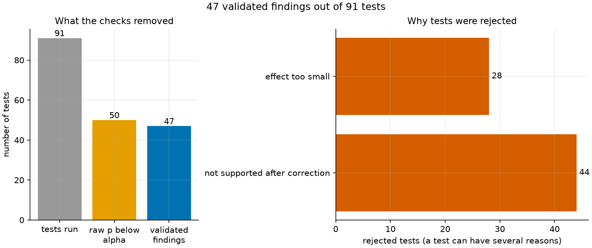

**Highlights** (largest effects):

- `oldpeak` ↔ `target`: large (Hedges' g = 0.95)
- `thalach` ↔ `target`: large (Hedges' g = -0.92)
- `thalach` ↔ `exang`: large (Hedges' g = 0.86)

## 2. Validated findings

### 2.1 `oldpeak` ↔ `target`

Among 302 records, the average oldpeak was 1.59 for target = 0 and 0.59 for target = 1 (difference 1.00, 95% CI 0.75 to 1.25). On average, oldpeak is higher for target = 0. The difference is large (Hedges' g = 0.95, 95% CI 0.71 to 1.19). After correcting for 91 tests (Benjamini-Hochberg method, false discovery rate 5.0%), the association is statistically supported (adjusted p <0.001). This is an association, not evidence of cause and effect.

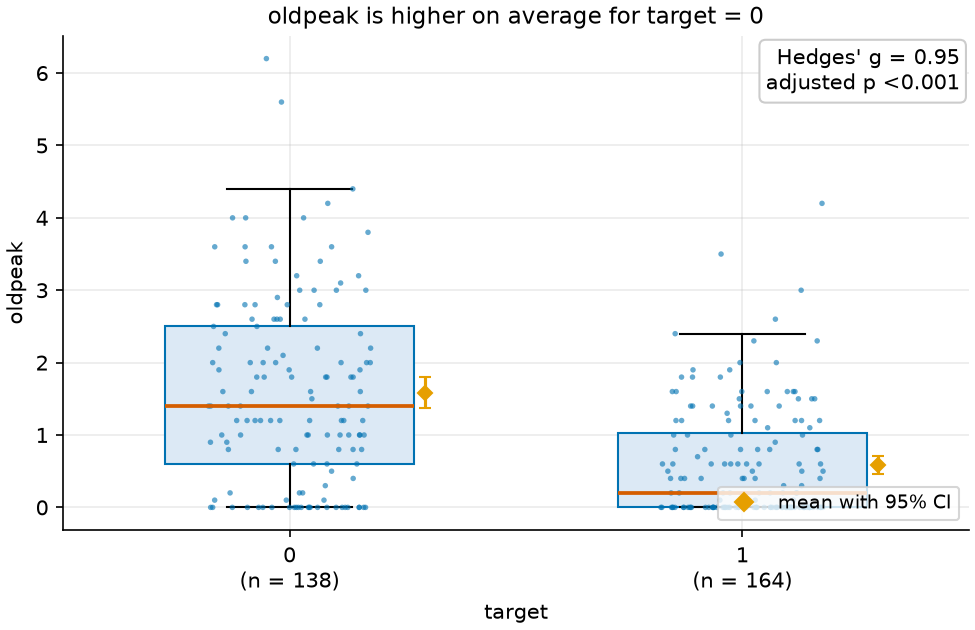

| | |
| :--- | :--- |
| Test used | Welch's t-test |
| Test statistic | 7.90 |
| Degrees of freedom | 216.2 |
| Raw p-value | <0.001 |
| Adjusted p-value (q) | <0.001 |
| Effect size | Hedges' g = 0.95 (95% CI 0.71 to 1.19), large |
| Records used | 302 |

How was this tested?

Both groups looked close enough to normal (or were large enough), so the means were compared with Welch's t-test, which does not assume equal spreads.

Where do the numbers come from?

| Fact | Shown as | Comes from |
| :--- | :--- | :--- |
| `alt_effect_value` | 0.48 | `TestResult.descriptives.sensitivity_alt_test.effect_value` |
| `alt_test_name` | Mann-Whitney U test | `TestResult.descriptives.sensitivity_alt_test.test_name` |
| `ci_high` | 1.19 | `TestResult.effect.ci_high` |
| `ci_low` | 0.71 | `TestResult.effect.ci_low` |
| `col_a` | oldpeak | `Hypothesis.column_a` |
| `col_b` | target | `Hypothesis.column_b` |
| `comparable_value` | 0.95 | `TestResult.effect.comparable_value` |
| `df` | 216.2 | `TestResult.df` |
| `direction_word` | a_greater | `TestResult.direction_observed` |
| `effect_abs` | 0.95 | `abs(TestResult.effect.value)` |
| `effect_name` | Hedges' g | `TestResult.effect.name` |
| `effect_value` | 0.95 | `TestResult.effect.value` |
| `family_size` | 91 | `ValidationDecision.family_size` |
| `g1` | 0 | `TestResult.descriptives.group_order[0]` |
| `g2` | 1 | `TestResult.descriptives.group_order[1]` |
| `group_label0` | 0 | `TestResult.group_sizes key 0` |
| `group_label1` | 1 | `TestResult.group_sizes key 1` |
| `group_size0` | 138 | `TestResult.group_sizes[0]` |
| `group_size1` | 164 | `TestResult.group_sizes[1]` |
| `higher_group` | 0 | `TestResult.descriptives.higher_group` |
| `magnitude_label` | large | `TestResult.effect.magnitude` |
| `mean_diff` | 1.00 | `TestResult.descriptives.mean_diff` |
| `mean_diff_abs` | 1.00 | `abs(TestResult.descriptives.mean_diff)` |
| `mean_diff_ci_high` | 1.25 | `TestResult.descriptives.mean_diff_ci_high` |
| `mean_diff_ci_low` | 0.75 | `TestResult.descriptives.mean_diff_ci_low` |
| `mean_g1` | 1.59 | `TestResult.descriptives.groups[0].mean` |
| `mean_g2` | 0.59 | `TestResult.descriptives.groups[1].mean` |
| `mean_high` | 1.59 | `same as mean_g1` |
| `mean_other` | 0.59 | `same as mean_g2` |
| `median_g1` | 1.40 | `TestResult.descriptives.groups[0].median` |
| `median_g2` | 0.20 | `TestResult.descriptives.groups[1].median` |
| `median_high` | 1.40 | `same as median_g1` |
| `median_other` | 0.20 | `same as median_g2` |
| `n_g1` | 138 | `TestResult.descriptives.groups[0].n` |
| `n_g2` | 164 | `TestResult.descriptives.groups[1].n` |
| `n_groups` | 2 | `len(TestResult.group_sizes)` |
| `n_used` | 302 | `TestResult.n_used` |
| `other_group` | 1 | `the other group in TestResult.descriptives.group_order` |
| `p_raw` | <0.001 | `ValidationDecision.p_raw` |
| `q_value` | <0.001 | `ValidationDecision.q_value` |
| `sd_g1` | 1.30 | `TestResult.descriptives.groups[0].sd` |
| `sd_g2` | 0.78 | `TestResult.descriptives.groups[1].sd` |
| `statistic` | 7.90 | `TestResult.statistic` |
| `test_name` | Welch's t-test | `TestResult.test_name` |

### 2.2 `thalach` ↔ `target`

Among 302 records, the average thalach was 139.10 for target = 0 and 158.38 for target = 1 (difference -19.28, 95% CI -24.08 to -14.47). On average, thalach is higher for target = 1. The difference is large (Hedges' g = -0.92, 95% CI -1.16 to -0.69). After correcting for 91 tests (Benjamini-Hochberg method, false discovery rate 5.0%), the association is statistically supported (adjusted p <0.001). This is an association, not evidence of cause and effect.

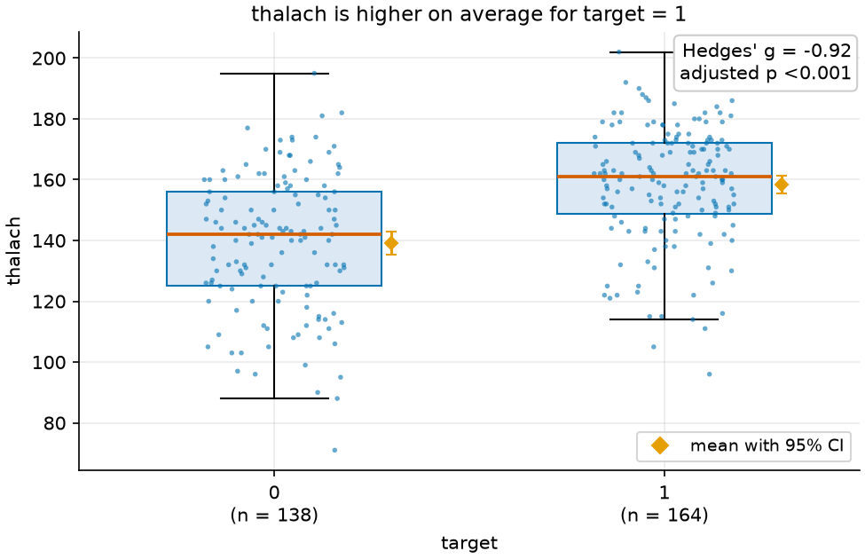

| | |
| :--- | :--- |
| Test used | Welch's t-test |
| Test statistic | -7.90 |
| Degrees of freedom | 270.2 |
| Raw p-value | <0.001 |
| Adjusted p-value (q) | <0.001 |
| Effect size | Hedges' g = -0.92 (95% CI -1.16 to -0.69), large |
| Records used | 302 |

How was this tested?

Both groups looked close enough to normal (or were large enough), so the means were compared with Welch's t-test, which does not assume equal spreads.

Where do the numbers come from?

| Fact | Shown as | Comes from |
| :--- | :--- | :--- |
| `alt_effect_value` | -0.49 | `TestResult.descriptives.sensitivity_alt_test.effect_value` |
| `alt_test_name` | Mann-Whitney U test | `TestResult.descriptives.sensitivity_alt_test.test_name` |
| `ci_high` | -0.69 | `TestResult.effect.ci_high` |
| `ci_low` | -1.16 | `TestResult.effect.ci_low` |
| `col_a` | thalach | `Hypothesis.column_a` |
| `col_b` | target | `Hypothesis.column_b` |
| `comparable_value` | 0.92 | `TestResult.effect.comparable_value` |
| `df` | 270.2 | `TestResult.df` |
| `direction_word` | b_greater | `TestResult.direction_observed` |
| `effect_abs` | 0.92 | `abs(TestResult.effect.value)` |
| `effect_name` | Hedges' g | `TestResult.effect.name` |
| `effect_value` | -0.92 | `TestResult.effect.value` |
| `family_size` | 91 | `ValidationDecision.family_size` |
| `g1` | 0 | `TestResult.descriptives.group_order[0]` |
| `g2` | 1 | `TestResult.descriptives.group_order[1]` |
| `group_label0` | 0 | `TestResult.group_sizes key 0` |
| `group_label1` | 1 | `TestResult.group_sizes key 1` |
| `group_size0` | 138 | `TestResult.group_sizes[0]` |
| `group_size1` | 164 | `TestResult.group_sizes[1]` |
| `higher_group` | 1 | `TestResult.descriptives.higher_group` |
| `magnitude_label` | large | `TestResult.effect.magnitude` |
| `mean_diff` | -19.28 | `TestResult.descriptives.mean_diff` |
| `mean_diff_abs` | 19.28 | `abs(TestResult.descriptives.mean_diff)` |
| `mean_diff_ci_high` | -14.47 | `TestResult.descriptives.mean_diff_ci_high` |
| `mean_diff_ci_low` | -24.08 | `TestResult.descriptives.mean_diff_ci_low` |
| `mean_g1` | 139.10 | `TestResult.descriptives.groups[0].mean` |
| `mean_g2` | 158.38 | `TestResult.descriptives.groups[1].mean` |
| `mean_high` | 158.38 | `same as mean_g2` |
| `mean_other` | 139.10 | `same as mean_g1` |
| `median_g1` | 142.00 | `TestResult.descriptives.groups[0].median` |
| `median_g2` | 161.00 | `TestResult.descriptives.groups[1].median` |
| `median_high` | 161.00 | `same as median_g2` |
| `median_other` | 142.00 | `same as median_g1` |
| `n_g1` | 138 | `TestResult.descriptives.groups[0].n` |
| `n_g2` | 164 | `TestResult.descriptives.groups[1].n` |
| `n_groups` | 2 | `len(TestResult.group_sizes)` |
| `n_used` | 302 | `TestResult.n_used` |
| `other_group` | 0 | `the other group in TestResult.descriptives.group_order` |
| `p_raw` | <0.001 | `ValidationDecision.p_raw` |
| `q_value` | <0.001 | `ValidationDecision.q_value` |
| `sd_g1` | 22.60 | `TestResult.descriptives.groups[0].sd` |
| `sd_g2` | 19.20 | `TestResult.descriptives.groups[1].sd` |
| `statistic` | -7.90 | `TestResult.statistic` |
| `test_name` | Welch's t-test | `TestResult.test_name` |

### 2.3 `thalach` ↔ `exang`

Among 302 records, the average thalach was 155.60 for exang = 0 and 137.21 for exang = 1 (difference 18.38, 95% CI 13.27 to 23.50). On average, thalach is higher for exang = 0. The difference is large (Hedges' g = 0.86, 95% CI 0.61 to 1.11). After correcting for 91 tests (Benjamini-Hochberg method, false discovery rate 5.0%), the association is statistically supported (adjusted p <0.001). This is an association, not evidence of cause and effect.

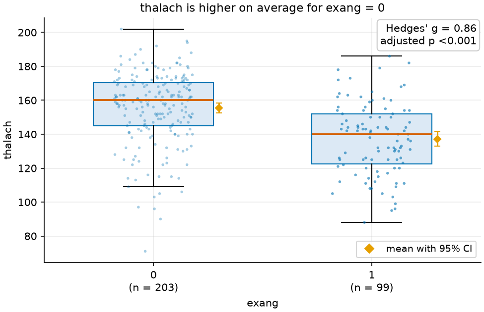

| | |
| :--- | :--- |
| Test used | Welch's t-test |
| Test statistic | 7.09 |
| Degrees of freedom | 196.5 |
| Raw p-value | <0.001 |
| Adjusted p-value (q) | <0.001 |
| Effect size | Hedges' g = 0.86 (95% CI 0.61 to 1.11), large |
| Records used | 302 |

How was this tested?

Both groups looked close enough to normal (or were large enough), so the means were compared with Welch's t-test, which does not assume equal spreads.

Where do the numbers come from?

| Fact | Shown as | Comes from |
| :--- | :--- | :--- |
| `alt_effect_value` | 0.49 | `TestResult.descriptives.sensitivity_alt_test.effect_value` |
| `alt_test_name` | Mann-Whitney U test | `TestResult.descriptives.sensitivity_alt_test.test_name` |
| `ci_high` | 1.11 | `TestResult.effect.ci_high` |
| `ci_low` | 0.61 | `TestResult.effect.ci_low` |
| `col_a` | thalach | `Hypothesis.column_a` |
| `col_b` | exang | `Hypothesis.column_b` |
| `comparable_value` | 0.86 | `TestResult.effect.comparable_value` |
| `df` | 196.5 | `TestResult.df` |
| `direction_word` | a_greater | `TestResult.direction_observed` |
| `effect_abs` | 0.86 | `abs(TestResult.effect.value)` |
| `effect_name` | Hedges' g | `TestResult.effect.name` |
| `effect_value` | 0.86 | `TestResult.effect.value` |
| `family_size` | 91 | `ValidationDecision.family_size` |
| `g1` | 0 | `TestResult.descriptives.group_order[0]` |
| `g2` | 1 | `TestResult.descriptives.group_order[1]` |
| `group_label0` | 0 | `TestResult.group_sizes key 0` |
| `group_label1` | 1 | `TestResult.group_sizes key 1` |
| `group_size0` | 203 | `TestResult.group_sizes[0]` |
| `group_size1` | 99 | `TestResult.group_sizes[1]` |
| `higher_group` | 0 | `TestResult.descriptives.higher_group` |
| `magnitude_label` | large | `TestResult.effect.magnitude` |
| `mean_diff` | 18.38 | `TestResult.descriptives.mean_diff` |
| `mean_diff_abs` | 18.38 | `abs(TestResult.descriptives.mean_diff)` |
| `mean_diff_ci_high` | 23.50 | `TestResult.descriptives.mean_diff_ci_high` |
| `mean_diff_ci_low` | 13.27 | `TestResult.descriptives.mean_diff_ci_low` |
| `mean_g1` | 155.60 | `TestResult.descriptives.groups[0].mean` |
| `mean_g2` | 137.21 | `TestResult.descriptives.groups[1].mean` |
| `mean_high` | 155.60 | `same as mean_g1` |
| `mean_other` | 137.21 | `same as mean_g2` |
| `median_g1` | 160.00 | `TestResult.descriptives.groups[0].median` |
| `median_g2` | 140.00 | `TestResult.descriptives.groups[1].median` |
| `median_high` | 160.00 | `same as median_g1` |
| `median_other` | 140.00 | `same as median_g2` |
| `n_g1` | 203 | `TestResult.descriptives.groups[0].n` |
| `n_g2` | 99 | `TestResult.descriptives.groups[1].n` |
| `n_groups` | 2 | `len(TestResult.group_sizes)` |
| `n_used` | 302 | `TestResult.n_used` |
| `other_group` | 1 | `the other group in TestResult.descriptives.group_order` |
| `p_raw` | <0.001 | `ValidationDecision.p_raw` |
| `q_value` | <0.001 | `ValidationDecision.q_value` |
| `sd_g1` | 21.33 | `TestResult.descriptives.groups[0].sd` |
| `sd_g2` | 21.08 | `TestResult.descriptives.groups[1].sd` |
| `statistic` | 7.09 | `TestResult.statistic` |
| `test_name` | Welch's t-test | `TestResult.test_name` |

### 2.4 `oldpeak` ↔ `exang`

Among 302 records, the average oldpeak was 0.81 for exang = 0 and 1.52 for exang = 1 (difference -0.71, 95% CI -0.99 to -0.42). On average, oldpeak is higher for exang = 1. The difference is medium (Hedges' g = -0.63, 95% CI -0.88 to -0.39). After correcting for 91 tests (Benjamini-Hochberg method, false discovery rate 5.0%), the association is statistically supported (adjusted p <0.001). This is an association, not evidence of cause and effect.

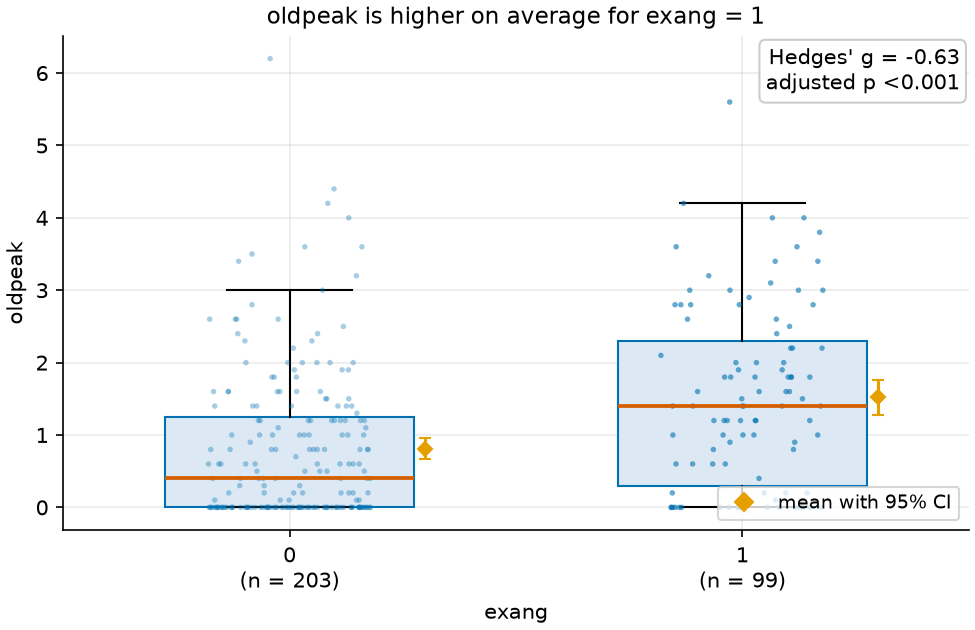

| | |
| :--- | :--- |
| Test used | Welch's t-test |
| Test statistic | -4.88 |
| Degrees of freedom | 167.2 |
| Raw p-value | <0.001 |
| Adjusted p-value (q) | <0.001 |
| Effect size | Hedges' g = -0.63 (95% CI -0.88 to -0.39), medium |
| Records used | 302 |

How was this tested?

Both groups looked close enough to normal (or were large enough), so the means were compared with Welch's t-test, which does not assume equal spreads.

Where do the numbers come from?

| Fact | Shown as | Comes from |
| :--- | :--- | :--- |
| `alt_effect_value` | -0.36 | `TestResult.descriptives.sensitivity_alt_test.effect_value` |
| `alt_test_name` | Mann-Whitney U test | `TestResult.descriptives.sensitivity_alt_test.test_name` |
| `ci_high` | -0.39 | `TestResult.effect.ci_high` |
| `ci_low` | -0.88 | `TestResult.effect.ci_low` |
| `col_a` | oldpeak | `Hypothesis.column_a` |
| `col_b` | exang | `Hypothesis.column_b` |
| `comparable_value` | 0.63 | `TestResult.effect.comparable_value` |
| `df` | 167.2 | `TestResult.df` |
| `direction_word` | b_greater | `TestResult.direction_observed` |
| `effect_abs` | 0.63 | `abs(TestResult.effect.value)` |
| `effect_name` | Hedges' g | `TestResult.effect.name` |
| `effect_value` | -0.63 | `TestResult.effect.value` |
| `family_size` | 91 | `ValidationDecision.family_size` |
| `g1` | 0 | `TestResult.descriptives.group_order[0]` |
| `g2` | 1 | `TestResult.descriptives.group_order[1]` |
| `group_label0` | 0 | `TestResult.group_sizes key 0` |
| `group_label1` | 1 | `TestResult.group_sizes key 1` |
| `group_size0` | 203 | `TestResult.group_sizes[0]` |
| `group_size1` | 99 | `TestResult.group_sizes[1]` |
| `higher_group` | 1 | `TestResult.descriptives.higher_group` |
| `magnitude_label` | medium | `TestResult.effect.magnitude` |
| `mean_diff` | -0.71 | `TestResult.descriptives.mean_diff` |
| `mean_diff_abs` | 0.71 | `abs(TestResult.descriptives.mean_diff)` |
| `mean_diff_ci_high` | -0.42 | `TestResult.descriptives.mean_diff_ci_high` |
| `mean_diff_ci_low` | -0.99 | `TestResult.descriptives.mean_diff_ci_low` |
| `mean_g1` | 0.81 | `TestResult.descriptives.groups[0].mean` |
| `mean_g2` | 1.52 | `TestResult.descriptives.groups[1].mean` |
| `mean_high` | 1.52 | `same as mean_g2` |
| `mean_other` | 0.81 | `same as mean_g1` |
| `median_g1` | 0.40 | `TestResult.descriptives.groups[0].median` |
| `median_g2` | 1.40 | `TestResult.descriptives.groups[1].median` |
| `median_high` | 1.40 | `same as median_g2` |
| `median_other` | 0.40 | `same as median_g1` |
| `n_g1` | 203 | `TestResult.descriptives.groups[0].n` |
| `n_g2` | 99 | `TestResult.descriptives.groups[1].n` |
| `n_groups` | 2 | `len(TestResult.group_sizes)` |
| `n_used` | 302 | `TestResult.n_used` |
| `other_group` | 0 | `the other group in TestResult.descriptives.group_order` |
| `p_raw` | <0.001 | `ValidationDecision.p_raw` |
| `q_value` | <0.001 | `ValidationDecision.q_value` |
| `sd_g1` | 1.04 | `TestResult.descriptives.groups[0].sd` |
| `sd_g2` | 1.25 | `TestResult.descriptives.groups[1].sd` |
| `statistic` | -4.88 | `TestResult.statistic` |
| `test_name` | Welch's t-test | `TestResult.test_name` |

### 2.5 `target` ↔ `thal`

target and thal are associated (Cramér's V = 0.53, 95% CI 0.43 to 0.62, large; n = 300). The largest departure from independence: fewer records with target = 0 and thal = 2 than expected if the columns were unrelated (36 observed vs 75.35 expected). After correcting for 91 tests (Benjamini-Hochberg method, false discovery rate 5.0%), the association is statistically supported (adjusted p <0.001). Rare levels with fewer than 8 records were left out of this test (thal:0). This is an association, not evidence of cause and effect.

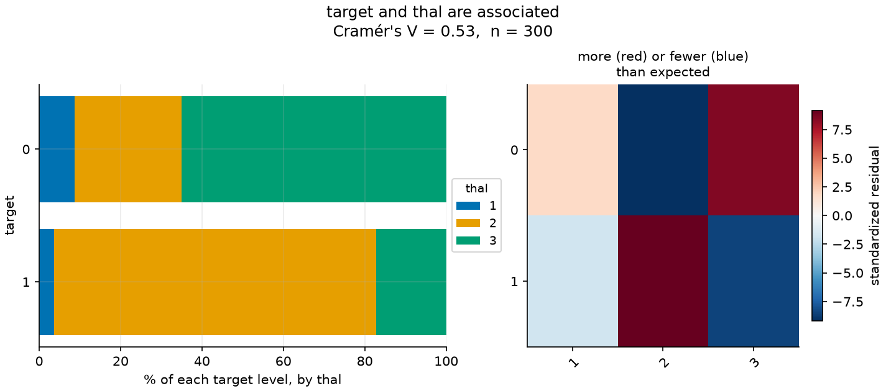

| | |
| :--- | :--- |
| Test used | chi-square test of independence |
| Test statistic | 84.60 |
| Degrees of freedom | 2 |
| Raw p-value | <0.001 |
| Adjusted p-value (q) | <0.001 |
| Effect size | Cramér's V = 0.53 (95% CI 0.43 to 0.62), large |
| Records used | 300 |

How was this tested?

Every cell of the table had enough expected records, so the standard chi-square test of independence was used.

Where do the numbers come from?

| Fact | Shown as | Comes from |
| :--- | :--- | :--- |
| `cell1_col` | 2 | `TestResult.descriptives.top_residual_cells[0].col` |
| `cell1_expected` | 75.35 | `TestResult.descriptives.top_residual_cells[0].expected` |
| `cell1_more_or_fewer` | fewer | `observed vs expected count` |
| `cell1_observed` | 36 | `TestResult.descriptives.top_residual_cells[0].observed` |
| `cell1_row` | 0 | `TestResult.descriptives.top_residual_cells[0].row` |
| `cell2_col` | 2 | `TestResult.descriptives.top_residual_cells[1].col` |
| `cell2_expected` | 89.65 | `TestResult.descriptives.top_residual_cells[1].expected` |
| `cell2_more_or_fewer` | more | `observed vs expected count` |
| `cell2_observed` | 129 | `TestResult.descriptives.top_residual_cells[1].observed` |
| `cell2_row` | 1 | `TestResult.descriptives.top_residual_cells[1].row` |
| `ci_high` | 0.62 | `TestResult.effect.ci_high` |
| `ci_low` | 0.43 | `TestResult.effect.ci_low` |
| `col_a` | target | `Hypothesis.column_a` |
| `col_b` | thal | `Hypothesis.column_b` |
| `col_label0` | 1 | `TestResult.descriptives.col_labels[0]` |
| `col_label1` | 2 | `TestResult.descriptives.col_labels[1]` |
| `col_label2` | 3 | `TestResult.descriptives.col_labels[2]` |
| `comparable_value` | 0.53 | `TestResult.effect.comparable_value` |
| `df` | 2 | `TestResult.df` |
| `direction_word` | any | `TestResult.direction_observed` |
| `dropped_level0` | thal:0 | `TestResult.descriptives.dropped_levels[0]` |
| `effect_abs` | 0.53 | `abs(TestResult.effect.value)` |
| `effect_name` | Cramér's V | `TestResult.effect.name` |
| `effect_value` | 0.53 | `TestResult.effect.value` |
| `family_size` | 91 | `ValidationDecision.family_size` |
| `magnitude_label` | large | `TestResult.effect.magnitude` |
| `n_cols_table` | 3 | `len(TestResult.descriptives.col_labels)` |
| `n_rows_table` | 2 | `len(TestResult.descriptives.row_labels)` |
| `n_used` | 300 | `TestResult.n_used` |
| `p_raw` | <0.001 | `ValidationDecision.p_raw` |
| `q_value` | <0.001 | `ValidationDecision.q_value` |
| `row_label0` | 0 | `TestResult.descriptives.row_labels[0]` |
| `row_label1` | 1 | `TestResult.descriptives.row_labels[1]` |
| `statistic` | 84.60 | `TestResult.statistic` |
| `test_name` | chi-square test of independence | `TestResult.test_name` |

### 2.6 `cp` ↔ `target`

cp and target are associated (Cramér's V = 0.51, 95% CI 0.41 to 0.61, large; n = 302). The largest departure from independence: more records with cp = 0 and target = 0 than expected if the columns were unrelated (104 observed vs 65.34 expected). After correcting for 91 tests (Benjamini-Hochberg method, false discovery rate 5.0%), the association is statistically supported (adjusted p <0.001). This is an association, not evidence of cause and effect.

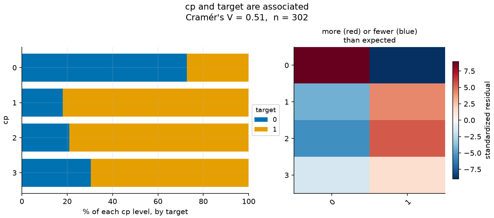

| | |
| :--- | :--- |
| Test used | chi-square test of independence |
| Test statistic | 80.98 |
| Degrees of freedom | 3 |
| Raw p-value | <0.001 |
| Adjusted p-value (q) | <0.001 |
| Effect size | Cramér's V = 0.51 (95% CI 0.41 to 0.61), large |
| Records used | 302 |

How was this tested?

Every cell of the table had enough expected records, so the standard chi-square test of independence was used.

Where do the numbers come from?

| Fact | Shown as | Comes from |
| :--- | :--- | :--- |
| `cell1_col` | 0 | `TestResult.descriptives.top_residual_cells[0].col` |
| `cell1_expected` | 65.34 | `TestResult.descriptives.top_residual_cells[0].expected` |
| `cell1_more_or_fewer` | more | `observed vs expected count` |
| `cell1_observed` | 104 | `TestResult.descriptives.top_residual_cells[0].observed` |
| `cell1_row` | 0 | `TestResult.descriptives.top_residual_cells[0].row` |
| `cell2_col` | 1 | `TestResult.descriptives.top_residual_cells[1].col` |
| `cell2_expected` | 77.66 | `TestResult.descriptives.top_residual_cells[1].expected` |
| `cell2_more_or_fewer` | fewer | `observed vs expected count` |
| `cell2_observed` | 39 | `TestResult.descriptives.top_residual_cells[1].observed` |
| `cell2_row` | 0 | `TestResult.descriptives.top_residual_cells[1].row` |
| `ci_high` | 0.61 | `TestResult.effect.ci_high` |
| `ci_low` | 0.41 | `TestResult.effect.ci_low` |
| `col_a` | cp | `Hypothesis.column_a` |
| `col_b` | target | `Hypothesis.column_b` |
| `col_label0` | 0 | `TestResult.descriptives.col_labels[0]` |
| `col_label1` | 1 | `TestResult.descriptives.col_labels[1]` |
| `comparable_value` | 0.51 | `TestResult.effect.comparable_value` |
| `df` | 3 | `TestResult.df` |
| `direction_word` | any | `TestResult.direction_observed` |
| `effect_abs` | 0.51 | `abs(TestResult.effect.value)` |
| `effect_name` | Cramér's V | `TestResult.effect.name` |
| `effect_value` | 0.51 | `TestResult.effect.value` |
| `family_size` | 91 | `ValidationDecision.family_size` |
| `magnitude_label` | large | `TestResult.effect.magnitude` |
| `n_cols_table` | 2 | `len(TestResult.descriptives.col_labels)` |
| `n_rows_table` | 4 | `len(TestResult.descriptives.row_labels)` |
| `n_used` | 302 | `TestResult.n_used` |
| `p_raw` | <0.001 | `ValidationDecision.p_raw` |
| `q_value` | <0.001 | `ValidationDecision.q_value` |
| `row_label0` | 0 | `TestResult.descriptives.row_labels[0]` |
| `row_label1` | 1 | `TestResult.descriptives.row_labels[1]` |
| `row_label2` | 2 | `TestResult.descriptives.row_labels[2]` |
| `row_label3` | 3 | `TestResult.descriptives.row_labels[3]` |
| `statistic` | 80.98 | `TestResult.statistic` |
| `test_name` | chi-square test of independence | `TestResult.test_name` |

### 2.7 `trestbps` ↔ `fbs`

Among 302 records, the average trestbps was 130.30 for fbs = 0 and 139.07 for fbs = 1 (difference -8.77, 95% CI -15.15 to -2.39). On average, trestbps is higher for fbs = 1. The difference is medium (Hedges' g = -0.51, 95% CI -0.82 to -0.19). After correcting for 91 tests (Benjamini-Hochberg method, false discovery rate 5.0%), the association is statistically supported (adjusted p = 0.018). This is an association, not evidence of cause and effect.

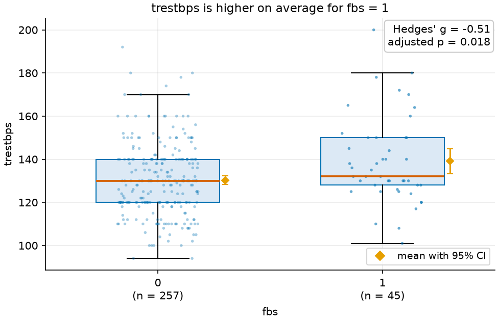

| | |
| :--- | :--- |
| Test used | Welch's t-test |
| Test statistic | -2.76 |
| Degrees of freedom | 55.2 |
| Raw p-value | 0.008 |
| Adjusted p-value (q) | 0.018 |
| Effect size | Hedges' g = -0.51 (95% CI -0.82 to -0.19), medium |
| Records used | 302 |

How was this tested?

Both groups looked close enough to normal (or were large enough), so the means were compared with Welch's t-test, which does not assume equal spreads.

Where do the numbers come from?

| Fact | Shown as | Comes from |
| :--- | :--- | :--- |
| `alt_effect_value` | -0.25 | `TestResult.descriptives.sensitivity_alt_test.effect_value` |
| `alt_test_name` | Mann-Whitney U test | `TestResult.descriptives.sensitivity_alt_test.test_name` |
| `ci_high` | -0.19 | `TestResult.effect.ci_high` |
| `ci_low` | -0.82 | `TestResult.effect.ci_low` |
| `col_a` | trestbps | `Hypothesis.column_a` |
| `col_b` | fbs | `Hypothesis.column_b` |
| `comparable_value` | 0.51 | `TestResult.effect.comparable_value` |
| `df` | 55.2 | `TestResult.df` |
| `direction_word` | b_greater | `TestResult.direction_observed` |
| `effect_abs` | 0.51 | `abs(TestResult.effect.value)` |
| `effect_name` | Hedges' g | `TestResult.effect.name` |
| `effect_value` | -0.51 | `TestResult.effect.value` |
| `family_size` | 91 | `ValidationDecision.family_size` |
| `g1` | 0 | `TestResult.descriptives.group_order[0]` |
| `g2` | 1 | `TestResult.descriptives.group_order[1]` |
| `group_label0` | 0 | `TestResult.group_sizes key 0` |
| `group_label1` | 1 | `TestResult.group_sizes key 1` |
| `group_size0` | 257 | `TestResult.group_sizes[0]` |
| `group_size1` | 45 | `TestResult.group_sizes[1]` |
| `higher_group` | 1 | `TestResult.descriptives.higher_group` |
| `magnitude_label` | medium | `TestResult.effect.magnitude` |
| `mean_diff` | -8.77 | `TestResult.descriptives.mean_diff` |
| `mean_diff_abs` | 8.77 | `abs(TestResult.descriptives.mean_diff)` |
| `mean_diff_ci_high` | -2.39 | `TestResult.descriptives.mean_diff_ci_high` |
| `mean_diff_ci_low` | -15.15 | `TestResult.descriptives.mean_diff_ci_low` |
| `mean_g1` | 130.30 | `TestResult.descriptives.groups[0].mean` |
| `mean_g2` | 139.07 | `TestResult.descriptives.groups[1].mean` |
| `mean_high` | 139.07 | `same as mean_g2` |
| `mean_other` | 130.30 | `same as mean_g1` |
| `median_g1` | 130.00 | `TestResult.descriptives.groups[0].median` |
| `median_g2` | 132.00 | `TestResult.descriptives.groups[1].median` |
| `median_high` | 132.00 | `same as median_g2` |
| `median_other` | 130.00 | `same as median_g1` |
| `n_g1` | 257 | `TestResult.descriptives.groups[0].n` |
| `n_g2` | 45 | `TestResult.descriptives.groups[1].n` |
| `n_groups` | 2 | `len(TestResult.group_sizes)` |
| `n_used` | 302 | `TestResult.n_used` |
| `other_group` | 0 | `the other group in TestResult.descriptives.group_order` |
| `p_raw` | 0.008 | `ValidationDecision.p_raw` |
| `q_value` | 0.018 | `ValidationDecision.q_value` |
| `sd_g1` | 16.77 | `TestResult.descriptives.groups[0].sd` |
| `sd_g2` | 20.16 | `TestResult.descriptives.groups[1].sd` |
| `statistic` | -2.76 | `TestResult.statistic` |
| `test_name` | Welch's t-test | `TestResult.test_name` |

### 2.8 `ca` ↔ `target`

ca and target are associated (Cramér's V = 0.49, 95% CI 0.40 to 0.58, medium; n = 298). The largest departure from independence: fewer records with ca = 0 and target = 0 than expected if the columns were unrelated (45 observed vs 80.45 expected). After correcting for 91 tests (Benjamini-Hochberg method, false discovery rate 5.0%), the association is statistically supported (adjusted p <0.001). Rare levels with fewer than 8 records were left out of this test (ca:4). This is an association, not evidence of cause and effect.

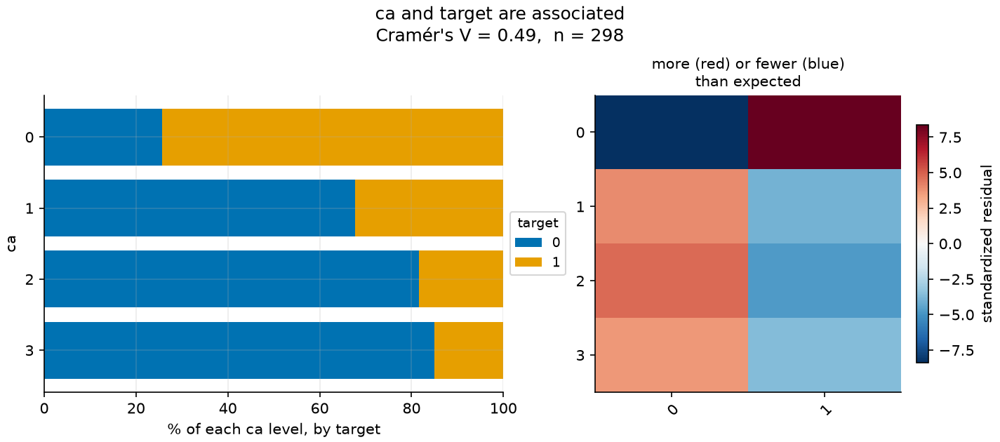

| | |
| :--- | :--- |
| Test used | chi-square test of independence |
| Test statistic | 72.92 |
| Degrees of freedom | 3 |
| Raw p-value | <0.001 |
| Adjusted p-value (q) | <0.001 |
| Effect size | Cramér's V = 0.49 (95% CI 0.40 to 0.58), medium |
| Records used | 298 |

How was this tested?

Every cell of the table had enough expected records, so the standard chi-square test of independence was used.

Where do the numbers come from?

| Fact | Shown as | Comes from |
| :--- | :--- | :--- |
| `cell1_col` | 0 | `TestResult.descriptives.top_residual_cells[0].col` |
| `cell1_expected` | 80.45 | `TestResult.descriptives.top_residual_cells[0].expected` |
| `cell1_more_or_fewer` | fewer | `observed vs expected count` |
| `cell1_observed` | 45 | `TestResult.descriptives.top_residual_cells[0].observed` |
| `cell1_row` | 0 | `TestResult.descriptives.top_residual_cells[0].row` |
| `cell2_col` | 1 | `TestResult.descriptives.top_residual_cells[1].col` |
| `cell2_expected` | 94.55 | `TestResult.descriptives.top_residual_cells[1].expected` |
| `cell2_more_or_fewer` | more | `observed vs expected count` |
| `cell2_observed` | 130 | `TestResult.descriptives.top_residual_cells[1].observed` |
| `cell2_row` | 0 | `TestResult.descriptives.top_residual_cells[1].row` |
| `ci_high` | 0.58 | `TestResult.effect.ci_high` |
| `ci_low` | 0.40 | `TestResult.effect.ci_low` |
| `col_a` | ca | `Hypothesis.column_a` |
| `col_b` | target | `Hypothesis.column_b` |
| `col_label0` | 0 | `TestResult.descriptives.col_labels[0]` |
| `col_label1` | 1 | `TestResult.descriptives.col_labels[1]` |
| `comparable_value` | 0.49 | `TestResult.effect.comparable_value` |
| `df` | 3 | `TestResult.df` |
| `direction_word` | any | `TestResult.direction_observed` |
| `dropped_level0` | ca:4 | `TestResult.descriptives.dropped_levels[0]` |
| `effect_abs` | 0.49 | `abs(TestResult.effect.value)` |
| `effect_name` | Cramér's V | `TestResult.effect.name` |
| `effect_value` | 0.49 | `TestResult.effect.value` |
| `family_size` | 91 | `ValidationDecision.family_size` |
| `magnitude_label` | medium | `TestResult.effect.magnitude` |
| `n_cols_table` | 2 | `len(TestResult.descriptives.col_labels)` |
| `n_rows_table` | 4 | `len(TestResult.descriptives.row_labels)` |
| `n_used` | 298 | `TestResult.n_used` |
| `p_raw` | <0.001 | `ValidationDecision.p_raw` |
| `q_value` | <0.001 | `ValidationDecision.q_value` |
| `row_label0` | 0 | `TestResult.descriptives.row_labels[0]` |
| `row_label1` | 1 | `TestResult.descriptives.row_labels[1]` |
| `row_label2` | 2 | `TestResult.descriptives.row_labels[2]` |
| `row_label3` | 3 | `TestResult.descriptives.row_labels[3]` |
| `statistic` | 72.92 | `TestResult.statistic` |
| `test_name` | chi-square test of independence | `TestResult.test_name` |

### 2.9 `cp` ↔ `exang`

cp and exang are associated (Cramér's V = 0.46, 95% CI 0.37 to 0.56, medium; n = 302). The largest departure from independence: fewer records with cp = 0 and exang = 0 than expected if the columns were unrelated (63 observed vs 96.12 expected). After correcting for 91 tests (Benjamini-Hochberg method, false discovery rate 5.0%), the association is statistically supported (adjusted p <0.001). This is an association, not evidence of cause and effect.

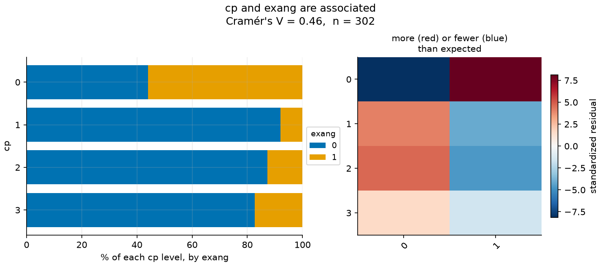

| | |
| :--- | :--- |
| Test used | chi-square test of independence |
| Test statistic | 66.82 |
| Degrees of freedom | 3 |
| Raw p-value | <0.001 |
| Adjusted p-value (q) | <0.001 |
| Effect size | Cramér's V = 0.46 (95% CI 0.37 to 0.56), medium |
| Records used | 302 |

How was this tested?

Every cell of the table had enough expected records, so the standard chi-square test of independence was used.

Where do the numbers come from?

| Fact | Shown as | Comes from |
| :--- | :--- | :--- |
| `cell1_col` | 0 | `TestResult.descriptives.top_residual_cells[0].col` |
| `cell1_expected` | 96.12 | `TestResult.descriptives.top_residual_cells[0].expected` |
| `cell1_more_or_fewer` | fewer | `observed vs expected count` |
| `cell1_observed` | 63 | `TestResult.descriptives.top_residual_cells[0].observed` |
| `cell1_row` | 0 | `TestResult.descriptives.top_residual_cells[0].row` |
| `cell2_col` | 1 | `TestResult.descriptives.top_residual_cells[1].col` |
| `cell2_expected` | 46.88 | `TestResult.descriptives.top_residual_cells[1].expected` |
| `cell2_more_or_fewer` | more | `observed vs expected count` |
| `cell2_observed` | 80 | `TestResult.descriptives.top_residual_cells[1].observed` |
| `cell2_row` | 0 | `TestResult.descriptives.top_residual_cells[1].row` |
| `ci_high` | 0.56 | `TestResult.effect.ci_high` |
| `ci_low` | 0.37 | `TestResult.effect.ci_low` |
| `col_a` | cp | `Hypothesis.column_a` |
| `col_b` | exang | `Hypothesis.column_b` |
| `col_label0` | 0 | `TestResult.descriptives.col_labels[0]` |
| `col_label1` | 1 | `TestResult.descriptives.col_labels[1]` |
| `comparable_value` | 0.46 | `TestResult.effect.comparable_value` |
| `df` | 3 | `TestResult.df` |
| `direction_word` | any | `TestResult.direction_observed` |
| `effect_abs` | 0.46 | `abs(TestResult.effect.value)` |
| `effect_name` | Cramér's V | `TestResult.effect.name` |
| `effect_value` | 0.46 | `TestResult.effect.value` |
| `family_size` | 91 | `ValidationDecision.family_size` |
| `magnitude_label` | medium | `TestResult.effect.magnitude` |
| `n_cols_table` | 2 | `len(TestResult.descriptives.col_labels)` |
| `n_rows_table` | 4 | `len(TestResult.descriptives.row_labels)` |
| `n_used` | 302 | `TestResult.n_used` |
| `p_raw` | <0.001 | `ValidationDecision.p_raw` |
| `q_value` | <0.001 | `ValidationDecision.q_value` |
| `row_label0` | 0 | `TestResult.descriptives.row_labels[0]` |
| `row_label1` | 1 | `TestResult.descriptives.row_labels[1]` |
| `row_label2` | 2 | `TestResult.descriptives.row_labels[2]` |
| `row_label3` | 3 | `TestResult.descriptives.row_labels[3]` |
| `statistic` | 66.82 | `TestResult.statistic` |
| `test_name` | chi-square test of independence | `TestResult.test_name` |

### 2.10 `age` ↔ `target`

Among 302 records, the average age was 56.60 for target = 0 and 52.59 for target = 1 (difference 4.02, 95% CI 2.04 to 5.99). On average, age is higher for target = 0. The difference is small (Hedges' g = 0.45, 95% CI 0.22 to 0.68). After correcting for 91 tests (Benjamini-Hochberg method, false discovery rate 5.0%), the association is statistically supported (adjusted p <0.001). This is an association, not evidence of cause and effect.

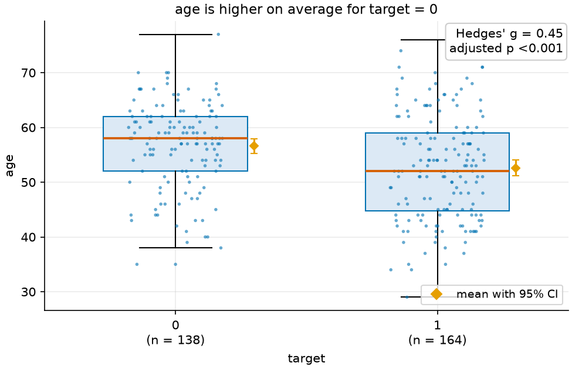

| | |
| :--- | :--- |
| Test used | Welch's t-test |
| Test statistic | 3.99 |
| Degrees of freedom | 300.0 |
| Raw p-value | <0.001 |
| Adjusted p-value (q) | <0.001 |
| Effect size | Hedges' g = 0.45 (95% CI 0.22 to 0.68), small |
| Records used | 302 |

How was this tested?

Both groups looked close enough to normal (or were large enough), so the means were compared with Welch's t-test, which does not assume equal spreads.

Where do the numbers come from?

| Fact | Shown as | Comes from |
| :--- | :--- | :--- |
| `alt_effect_value` | 0.27 | `TestResult.descriptives.sensitivity_alt_test.effect_value` |
| `alt_test_name` | Mann-Whitney U test | `TestResult.descriptives.sensitivity_alt_test.test_name` |
| `ci_high` | 0.68 | `TestResult.effect.ci_high` |
| `ci_low` | 0.22 | `TestResult.effect.ci_low` |
| `col_a` | age | `Hypothesis.column_a` |
| `col_b` | target | `Hypothesis.column_b` |
| `comparable_value` | 0.45 | `TestResult.effect.comparable_value` |
| `df` | 300.0 | `TestResult.df` |
| `direction_word` | a_greater | `TestResult.direction_observed` |
| `effect_abs` | 0.45 | `abs(TestResult.effect.value)` |
| `effect_name` | Hedges' g | `TestResult.effect.name` |
| `effect_value` | 0.45 | `TestResult.effect.value` |
| `family_size` | 91 | `ValidationDecision.family_size` |
| `g1` | 0 | `TestResult.descriptives.group_order[0]` |
| `g2` | 1 | `TestResult.descriptives.group_order[1]` |
| `group_label0` | 0 | `TestResult.group_sizes key 0` |
| `group_label1` | 1 | `TestResult.group_sizes key 1` |
| `group_size0` | 138 | `TestResult.group_sizes[0]` |
| `group_size1` | 164 | `TestResult.group_sizes[1]` |
| `higher_group` | 0 | `TestResult.descriptives.higher_group` |
| `magnitude_label` | small | `TestResult.effect.magnitude` |
| `mean_diff` | 4.02 | `TestResult.descriptives.mean_diff` |
| `mean_diff_abs` | 4.02 | `abs(TestResult.descriptives.mean_diff)` |
| `mean_diff_ci_high` | 5.99 | `TestResult.descriptives.mean_diff_ci_high` |
| `mean_diff_ci_low` | 2.04 | `TestResult.descriptives.mean_diff_ci_low` |
| `mean_g1` | 56.60 | `TestResult.descriptives.groups[0].mean` |
| `mean_g2` | 52.59 | `TestResult.descriptives.groups[1].mean` |
| `mean_high` | 56.60 | `same as mean_g1` |
| `mean_other` | 52.59 | `same as mean_g2` |
| `median_g1` | 58.00 | `TestResult.descriptives.groups[0].median` |
| `median_g2` | 52.00 | `TestResult.descriptives.groups[1].median` |
| `median_high` | 58.00 | `same as median_g1` |
| `median_other` | 52.00 | `same as median_g2` |
| `n_g1` | 138 | `TestResult.descriptives.groups[0].n` |
| `n_g2` | 164 | `TestResult.descriptives.groups[1].n` |
| `n_groups` | 2 | `len(TestResult.group_sizes)` |
| `n_used` | 302 | `TestResult.n_used` |
| `other_group` | 1 | `the other group in TestResult.descriptives.group_order` |
| `p_raw` | <0.001 | `ValidationDecision.p_raw` |
| `q_value` | <0.001 | `ValidationDecision.q_value` |
| `sd_g1` | 7.96 | `TestResult.descriptives.groups[0].sd` |
| `sd_g2` | 9.51 | `TestResult.descriptives.groups[1].sd` |
| `statistic` | 3.99 | `TestResult.statistic` |
| `test_name` | Welch's t-test | `TestResult.test_name` |

### 2.11 `exang` ↔ `target`

exang and target are associated (Cramér's V = 0.43, 95% CI 0.33 to 0.53, medium; n = 302). The largest departure from independence: fewer records with exang = 0 and target = 0 than expected if the columns were unrelated (62 observed vs 92.76 expected). The odds ratio is 0.13 (95% CI 0.08 to 0.23). After correcting for 91 tests (Benjamini-Hochberg method, false discovery rate 5.0%), the association is statistically supported (adjusted p <0.001). This is an association, not evidence of cause and effect.

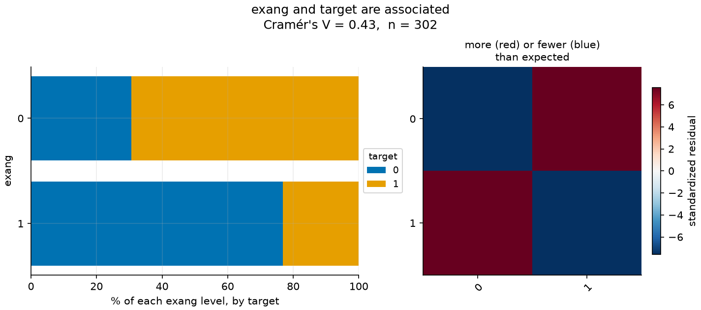

| | |
| :--- | :--- |
| Test used | chi-square test of independence |
| Test statistic | 57.30 |
| Degrees of freedom | 1 |
| Raw p-value | <0.001 |
| Adjusted p-value (q) | <0.001 |
| Effect size | Cramér's V = 0.43 (95% CI 0.33 to 0.53), medium |
| Records used | 302 |

How was this tested?

Every cell of the table had enough expected records, so the standard chi-square test of independence was used.

Where do the numbers come from?

| Fact | Shown as | Comes from |
| :--- | :--- | :--- |
| `cell1_col` | 0 | `TestResult.descriptives.top_residual_cells[0].col` |
| `cell1_expected` | 92.76 | `TestResult.descriptives.top_residual_cells[0].expected` |
| `cell1_more_or_fewer` | fewer | `observed vs expected count` |
| `cell1_observed` | 62 | `TestResult.descriptives.top_residual_cells[0].observed` |
| `cell1_row` | 0 | `TestResult.descriptives.top_residual_cells[0].row` |
| `cell2_col` | 1 | `TestResult.descriptives.top_residual_cells[1].col` |
| `cell2_expected` | 110.24 | `TestResult.descriptives.top_residual_cells[1].expected` |
| `cell2_more_or_fewer` | more | `observed vs expected count` |
| `cell2_observed` | 141 | `TestResult.descriptives.top_residual_cells[1].observed` |
| `cell2_row` | 0 | `TestResult.descriptives.top_residual_cells[1].row` |
| `ci_high` | 0.53 | `TestResult.effect.ci_high` |
| `ci_low` | 0.33 | `TestResult.effect.ci_low` |
| `col_a` | exang | `Hypothesis.column_a` |
| `col_b` | target | `Hypothesis.column_b` |
| `col_label0` | 0 | `TestResult.descriptives.col_labels[0]` |
| `col_label1` | 1 | `TestResult.descriptives.col_labels[1]` |
| `comparable_value` | 0.43 | `TestResult.effect.comparable_value` |
| `df` | 1 | `TestResult.df` |
| `direction_word` | any | `TestResult.direction_observed` |
| `effect_abs` | 0.43 | `abs(TestResult.effect.value)` |
| `effect_name` | Cramér's V | `TestResult.effect.name` |
| `effect_value` | 0.43 | `TestResult.effect.value` |
| `family_size` | 91 | `ValidationDecision.family_size` |
| `magnitude_label` | medium | `TestResult.effect.magnitude` |
| `n_cols_table` | 2 | `len(TestResult.descriptives.col_labels)` |
| `n_rows_table` | 2 | `len(TestResult.descriptives.row_labels)` |
| `n_used` | 302 | `TestResult.n_used` |
| `odds_ratio` | 0.13 | `TestResult.descriptives.odds_ratio` |
| `odds_ratio_ci_high` | 0.23 | `TestResult.descriptives.odds_ratio_ci_high` |
| `odds_ratio_ci_low` | 0.08 | `TestResult.descriptives.odds_ratio_ci_low` |
| `p_raw` | <0.001 | `ValidationDecision.p_raw` |
| `q_value` | <0.001 | `ValidationDecision.q_value` |
| `row_label0` | 0 | `TestResult.descriptives.row_labels[0]` |
| `row_label1` | 1 | `TestResult.descriptives.row_labels[1]` |
| `statistic` | 57.30 | `TestResult.statistic` |
| `test_name` | chi-square test of independence | `TestResult.test_name` |

### 2.12 `oldpeak` ↔ `thalach`

oldpeak and thalach are negatively associated (Spearman rank correlation rho = -0.43, 95% CI -0.52 to -0.33; n = 302). The relationship is monotonic and may not be linear. The association is medium. After correcting for 91 tests (Benjamini-Hochberg method, false discovery rate 5.0%), the association is statistically supported (adjusted p <0.001). The data were not close enough to the shape a parametric test needs, so a rank-based test was used instead. This is an association, not evidence of cause and effect.

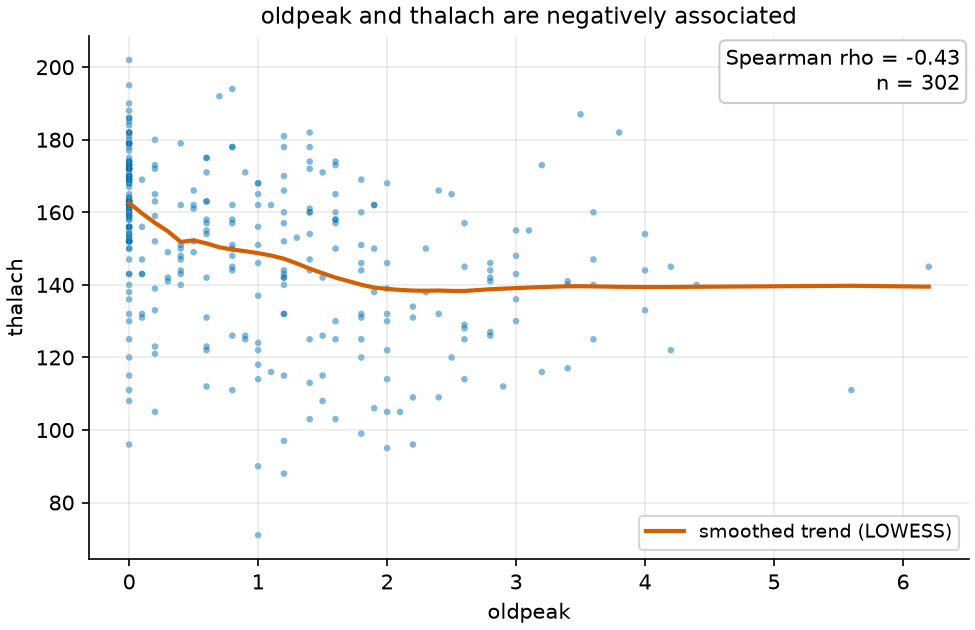

| | |
| :--- | :--- |
| Test used | Spearman rank correlation test |
| Test statistic | -0.43 |
| Degrees of freedom | 300 |
| Raw p-value | <0.001 |
| Adjusted p-value (q) | <0.001 |
| Effect size | Spearman rho = -0.43 (95% CI -0.52 to -0.33), medium |
| Records used | 302 |

How was this tested?

The columns were skewed, had outliers or many ties, so the rank-based Spearman correlation was used.

Where do the numbers come from?

| Fact | Shown as | Comes from |
| :--- | :--- | :--- |
| `alt_effect_value` | -0.34 | `TestResult.descriptives.sensitivity_alt_test.effect_value` |
| `alt_test_name` | Pearson correlation test | `TestResult.descriptives.sensitivity_alt_test.test_name` |
| `ci_high` | -0.33 | `TestResult.effect.ci_high` |
| `ci_low` | -0.52 | `TestResult.effect.ci_low` |
| `col_a` | oldpeak | `Hypothesis.column_a` |
| `col_b` | thalach | `Hypothesis.column_b` |
| `comparable_value` | 0.43 | `TestResult.effect.comparable_value` |
| `df` | 300 | `TestResult.df` |
| `direction_word` | negative | `TestResult.direction_observed` |
| `effect_abs` | 0.43 | `abs(TestResult.effect.value)` |
| `effect_name` | Spearman rho | `TestResult.effect.name` |
| `effect_value` | -0.43 | `TestResult.effect.value` |
| `family_size` | 91 | `ValidationDecision.family_size` |
| `magnitude_label` | medium | `TestResult.effect.magnitude` |
| `n_used` | 302 | `TestResult.n_used` |
| `ols_slope` | -6.75 | `TestResult.descriptives.ols_slope` |
| `p_raw` | <0.001 | `ValidationDecision.p_raw` |
| `q_value` | <0.001 | `ValidationDecision.q_value` |
| `statistic` | -0.43 | `TestResult.statistic` |
| `test_name` | Spearman rank correlation test | `TestResult.test_name` |

### 2.13 `chol` ↔ `sex`

Among 302 records, the average chol was 261.30 for sex = 0 and 239.60 for sex = 1 (difference 21.70, 95% CI 7.31 to 36.09). On average, chol is higher for sex = 0. The difference is small (Hedges' g = 0.43, 95% CI 0.18 to 0.67). After correcting for 91 tests (Benjamini-Hochberg method, false discovery rate 5.0%), the association is statistically supported (adjusted p = 0.009). This is an association, not evidence of cause and effect.

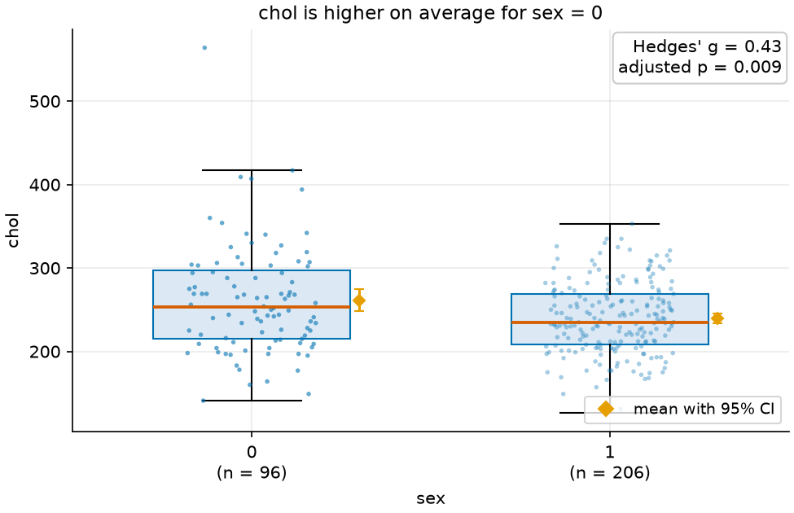

| | |
| :--- | :--- |
| Test used | Welch's t-test |
| Test statistic | 2.98 |
| Degrees of freedom | 134.3 |
| Raw p-value | 0.003 |
| Adjusted p-value (q) | 0.009 |
| Effect size | Hedges' g = 0.43 (95% CI 0.18 to 0.67), small |
| Records used | 302 |

How was this tested?

Both groups looked close enough to normal (or were large enough), so the means were compared with Welch's t-test, which does not assume equal spreads.

Where do the numbers come from?

| Fact | Shown as | Comes from |
| :--- | :--- | :--- |
| `alt_effect_value` | 0.18 | `TestResult.descriptives.sensitivity_alt_test.effect_value` |
| `alt_test_name` | Mann-Whitney U test | `TestResult.descriptives.sensitivity_alt_test.test_name` |
| `ci_high` | 0.67 | `TestResult.effect.ci_high` |
| `ci_low` | 0.18 | `TestResult.effect.ci_low` |
| `col_a` | chol | `Hypothesis.column_a` |
| `col_b` | sex | `Hypothesis.column_b` |
| `comparable_value` | 0.43 | `TestResult.effect.comparable_value` |
| `df` | 134.3 | `TestResult.df` |
| `direction_word` | a_greater | `TestResult.direction_observed` |
| `effect_abs` | 0.43 | `abs(TestResult.effect.value)` |
| `effect_name` | Hedges' g | `TestResult.effect.name` |
| `effect_value` | 0.43 | `TestResult.effect.value` |
| `family_size` | 91 | `ValidationDecision.family_size` |
| `g1` | 0 | `TestResult.descriptives.group_order[0]` |
| `g2` | 1 | `TestResult.descriptives.group_order[1]` |
| `group_label0` | 0 | `TestResult.group_sizes key 0` |
| `group_label1` | 1 | `TestResult.group_sizes key 1` |
| `group_size0` | 96 | `TestResult.group_sizes[0]` |
| `group_size1` | 206 | `TestResult.group_sizes[1]` |
| `higher_group` | 0 | `TestResult.descriptives.higher_group` |
| `magnitude_label` | small | `TestResult.effect.magnitude` |
| `mean_diff` | 21.70 | `TestResult.descriptives.mean_diff` |
| `mean_diff_abs` | 21.70 | `abs(TestResult.descriptives.mean_diff)` |
| `mean_diff_ci_high` | 36.09 | `TestResult.descriptives.mean_diff_ci_high` |
| `mean_diff_ci_low` | 7.31 | `TestResult.descriptives.mean_diff_ci_low` |
| `mean_g1` | 261.30 | `TestResult.descriptives.groups[0].mean` |
| `mean_g2` | 239.60 | `TestResult.descriptives.groups[1].mean` |
| `mean_high` | 261.30 | `same as mean_g1` |
| `mean_other` | 239.60 | `same as mean_g2` |
| `median_g1` | 253.00 | `TestResult.descriptives.groups[0].median` |
| `median_g2` | 235.00 | `TestResult.descriptives.groups[1].median` |
| `median_high` | 253.00 | `same as median_g1` |
| `median_other` | 235.00 | `same as median_g2` |
| `n_g1` | 96 | `TestResult.descriptives.groups[0].n` |
| `n_g2` | 206 | `TestResult.descriptives.groups[1].n` |
| `n_groups` | 2 | `len(TestResult.group_sizes)` |
| `n_used` | 302 | `TestResult.n_used` |
| `other_group` | 1 | `the other group in TestResult.descriptives.group_order` |
| `p_raw` | 0.003 | `ValidationDecision.p_raw` |
| `q_value` | 0.009 | `ValidationDecision.q_value` |
| `sd_g1` | 65.09 | `TestResult.descriptives.groups[0].sd` |
| `sd_g2` | 42.65 | `TestResult.descriptives.groups[1].sd` |
| `statistic` | 2.98 | `TestResult.statistic` |
| `test_name` | Welch's t-test | `TestResult.test_name` |

### 2.14 `age` ↔ `thalach`

age and thalach are negatively associated (Spearman rank correlation rho = -0.39, 95% CI -0.49 to -0.29; n = 302). The relationship is monotonic and may not be linear. The association is medium. After correcting for 91 tests (Benjamini-Hochberg method, false discovery rate 5.0%), the association is statistically supported (adjusted p <0.001). The data were not close enough to the shape a parametric test needs, so a rank-based test was used instead. This is an association, not evidence of cause and effect.

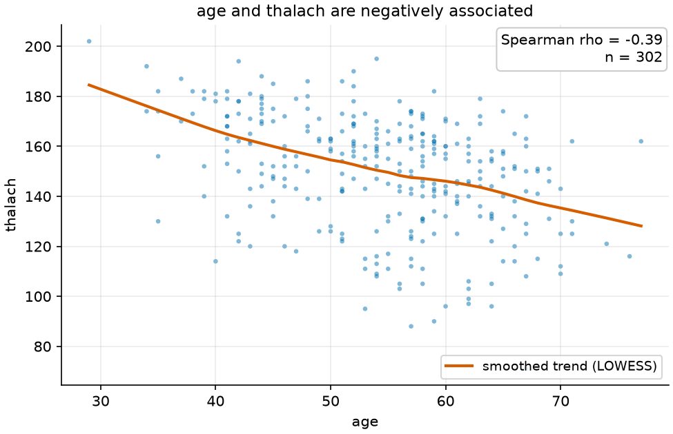

| | |
| :--- | :--- |
| Test used | Spearman rank correlation test |
| Test statistic | -0.39 |
| Degrees of freedom | 300 |
| Raw p-value | <0.001 |
| Adjusted p-value (q) | <0.001 |
| Effect size | Spearman rho = -0.39 (95% CI -0.49 to -0.29), medium |
| Records used | 302 |

How was this tested?

The columns were skewed, had outliers or many ties, so the rank-based Spearman correlation was used.

Where do the numbers come from?

| Fact | Shown as | Comes from |
| :--- | :--- | :--- |
| `alt_effect_value` | -0.40 | `TestResult.descriptives.sensitivity_alt_test.effect_value` |
| `alt_test_name` | Pearson correlation test | `TestResult.descriptives.sensitivity_alt_test.test_name` |
| `ci_high` | -0.29 | `TestResult.effect.ci_high` |
| `ci_low` | -0.49 | `TestResult.effect.ci_low` |
| `col_a` | age | `Hypothesis.column_a` |
| `col_b` | thalach | `Hypothesis.column_b` |
| `comparable_value` | 0.39 | `TestResult.effect.comparable_value` |
| `df` | 300 | `TestResult.df` |
| `direction_word` | negative | `TestResult.direction_observed` |
| `effect_abs` | 0.39 | `abs(TestResult.effect.value)` |
| `effect_name` | Spearman rho | `TestResult.effect.name` |
| `effect_value` | -0.39 | `TestResult.effect.value` |
| `family_size` | 91 | `ValidationDecision.family_size` |
| `magnitude_label` | medium | `TestResult.effect.magnitude` |
| `n_used` | 302 | `TestResult.n_used` |
| `ols_slope` | -1.00 | `TestResult.descriptives.ols_slope` |
| `p_raw` | <0.001 | `ValidationDecision.p_raw` |
| `q_value` | <0.001 | `ValidationDecision.q_value` |
| `statistic` | -0.39 | `TestResult.statistic` |
| `test_name` | Spearman rank correlation test | `TestResult.test_name` |

### 2.15 `slope` ↔ `target`

slope and target are associated (Cramér's V = 0.39, 95% CI 0.28 to 0.49, medium; n = 302). The largest departure from independence: fewer records with slope = 2 and target = 0 than expected if the columns were unrelated (35 observed vs 64.43 expected). After correcting for 91 tests (Benjamini-Hochberg method, false discovery rate 5.0%), the association is statistically supported (adjusted p <0.001). This is an association, not evidence of cause and effect.

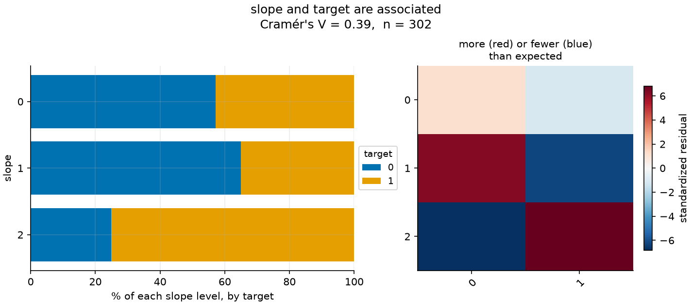

| | |
| :--- | :--- |
| Test used | chi-square test of independence |
| Test statistic | 46.89 |
| Degrees of freedom | 2 |
| Raw p-value | <0.001 |
| Adjusted p-value (q) | <0.001 |
| Effect size | Cramér's V = 0.39 (95% CI 0.28 to 0.49), medium |
| Records used | 302 |

How was this tested?

Every cell of the table had enough expected records, so the standard chi-square test of independence was used.

Where do the numbers come from?

| Fact | Shown as | Comes from |
| :--- | :--- | :--- |
| `cell1_col` | 0 | `TestResult.descriptives.top_residual_cells[0].col` |
| `cell1_expected` | 64.43 | `TestResult.descriptives.top_residual_cells[0].expected` |
| `cell1_more_or_fewer` | fewer | `observed vs expected count` |
| `cell1_observed` | 35 | `TestResult.descriptives.top_residual_cells[0].observed` |
| `cell1_row` | 2 | `TestResult.descriptives.top_residual_cells[0].row` |
| `cell2_col` | 1 | `TestResult.descriptives.top_residual_cells[1].col` |
| `cell2_expected` | 76.57 | `TestResult.descriptives.top_residual_cells[1].expected` |
| `cell2_more_or_fewer` | more | `observed vs expected count` |
| `cell2_observed` | 106 | `TestResult.descriptives.top_residual_cells[1].observed` |
| `cell2_row` | 2 | `TestResult.descriptives.top_residual_cells[1].row` |
| `ci_high` | 0.49 | `TestResult.effect.ci_high` |
| `ci_low` | 0.28 | `TestResult.effect.ci_low` |
| `col_a` | slope | `Hypothesis.column_a` |
| `col_b` | target | `Hypothesis.column_b` |
| `col_label0` | 0 | `TestResult.descriptives.col_labels[0]` |
| `col_label1` | 1 | `TestResult.descriptives.col_labels[1]` |
| `comparable_value` | 0.39 | `TestResult.effect.comparable_value` |
| `df` | 2 | `TestResult.df` |
| `direction_word` | any | `TestResult.direction_observed` |
| `effect_abs` | 0.39 | `abs(TestResult.effect.value)` |
| `effect_name` | Cramér's V | `TestResult.effect.name` |
| `effect_value` | 0.39 | `TestResult.effect.value` |
| `family_size` | 91 | `ValidationDecision.family_size` |
| `magnitude_label` | medium | `TestResult.effect.magnitude` |
| `n_cols_table` | 2 | `len(TestResult.descriptives.col_labels)` |
| `n_rows_table` | 3 | `len(TestResult.descriptives.row_labels)` |
| `n_used` | 302 | `TestResult.n_used` |
| `p_raw` | <0.001 | `ValidationDecision.p_raw` |
| `q_value` | <0.001 | `ValidationDecision.q_value` |
| `row_label0` | 0 | `TestResult.descriptives.row_labels[0]` |
| `row_label1` | 1 | `TestResult.descriptives.row_labels[1]` |
| `row_label2` | 2 | `TestResult.descriptives.row_labels[2]` |
| `statistic` | 46.89 | `TestResult.statistic` |
| `test_name` | chi-square test of independence | `TestResult.test_name` |

### 2.16 `sex` ↔ `thal`

sex and thal are associated (Cramér's V = 0.38, 95% CI 0.29 to 0.48, medium; n = 300). The largest departure from independence: more records with sex = 0 and thal = 2 than expected if the columns were unrelated (79 observed vs 52.25 expected). After correcting for 91 tests (Benjamini-Hochberg method, false discovery rate 5.0%), the association is statistically supported (adjusted p <0.001). Rare levels with fewer than 8 records were left out of this test (thal:0). This is an association, not evidence of cause and effect.

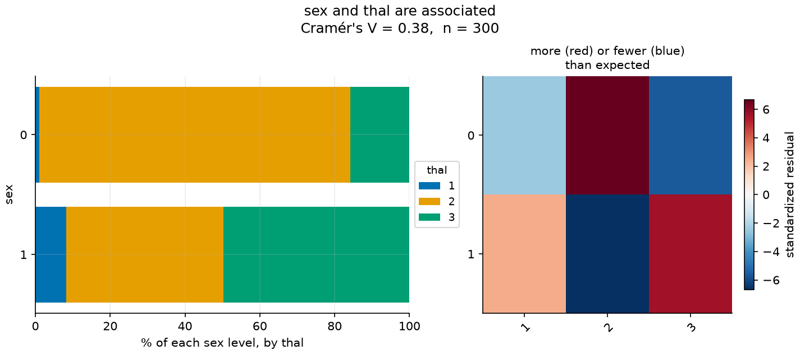

| | |
| :--- | :--- |
| Test used | chi-square test of independence |
| Test statistic | 44.92 |
| Degrees of freedom | 2 |
| Raw p-value | <0.001 |
| Adjusted p-value (q) | <0.001 |
| Effect size | Cramér's V = 0.38 (95% CI 0.29 to 0.48), medium |
| Records used | 300 |

How was this tested?

Every cell of the table had enough expected records, so the standard chi-square test of independence was used.

Where do the numbers come from?

| Fact | Shown as | Comes from |
| :--- | :--- | :--- |
| `cell1_col` | 2 | `TestResult.descriptives.top_residual_cells[0].col` |
| `cell1_expected` | 52.25 | `TestResult.descriptives.top_residual_cells[0].expected` |
| `cell1_more_or_fewer` | more | `observed vs expected count` |
| `cell1_observed` | 79 | `TestResult.descriptives.top_residual_cells[0].observed` |
| `cell1_row` | 0 | `TestResult.descriptives.top_residual_cells[0].row` |
| `cell2_col` | 2 | `TestResult.descriptives.top_residual_cells[1].col` |
| `cell2_expected` | 112.75 | `TestResult.descriptives.top_residual_cells[1].expected` |
| `cell2_more_or_fewer` | fewer | `observed vs expected count` |
| `cell2_observed` | 86 | `TestResult.descriptives.top_residual_cells[1].observed` |
| `cell2_row` | 1 | `TestResult.descriptives.top_residual_cells[1].row` |
| `ci_high` | 0.48 | `TestResult.effect.ci_high` |
| `ci_low` | 0.29 | `TestResult.effect.ci_low` |
| `col_a` | sex | `Hypothesis.column_a` |
| `col_b` | thal | `Hypothesis.column_b` |
| `col_label0` | 1 | `TestResult.descriptives.col_labels[0]` |
| `col_label1` | 2 | `TestResult.descriptives.col_labels[1]` |
| `col_label2` | 3 | `TestResult.descriptives.col_labels[2]` |
| `comparable_value` | 0.38 | `TestResult.effect.comparable_value` |
| `df` | 2 | `TestResult.df` |
| `direction_word` | any | `TestResult.direction_observed` |
| `dropped_level0` | thal:0 | `TestResult.descriptives.dropped_levels[0]` |
| `effect_abs` | 0.38 | `abs(TestResult.effect.value)` |
| `effect_name` | Cramér's V | `TestResult.effect.name` |
| `effect_value` | 0.38 | `TestResult.effect.value` |
| `family_size` | 91 | `ValidationDecision.family_size` |
| `magnitude_label` | medium | `TestResult.effect.magnitude` |
| `n_cols_table` | 3 | `len(TestResult.descriptives.col_labels)` |
| `n_rows_table` | 2 | `len(TestResult.descriptives.row_labels)` |
| `n_used` | 300 | `TestResult.n_used` |
| `p_raw` | <0.001 | `ValidationDecision.p_raw` |
| `q_value` | <0.001 | `ValidationDecision.q_value` |
| `row_label0` | 0 | `TestResult.descriptives.row_labels[0]` |
| `row_label1` | 1 | `TestResult.descriptives.row_labels[1]` |
| `statistic` | 44.92 | `TestResult.statistic` |
| `test_name` | chi-square test of independence | `TestResult.test_name` |

### 2.17 `oldpeak` ↔ `slope`

Values of oldpeak tend to differ across the 3 groups of slope: highest for 0 (median 2.60) and lowest for 2 (median 0). About 35.2% of the variation in the ranks of oldpeak is associated with slope (epsilon squared = 0.35, 95% CI 0.27 to 0.45, large). After correcting for 91 tests (Benjamini-Hochberg method, false discovery rate 5.0%), the association is statistically supported (adjusted p <0.001). The data were not close enough to the shape a parametric test needs, so a rank-based test was used instead. This is an association, not evidence of cause and effect.

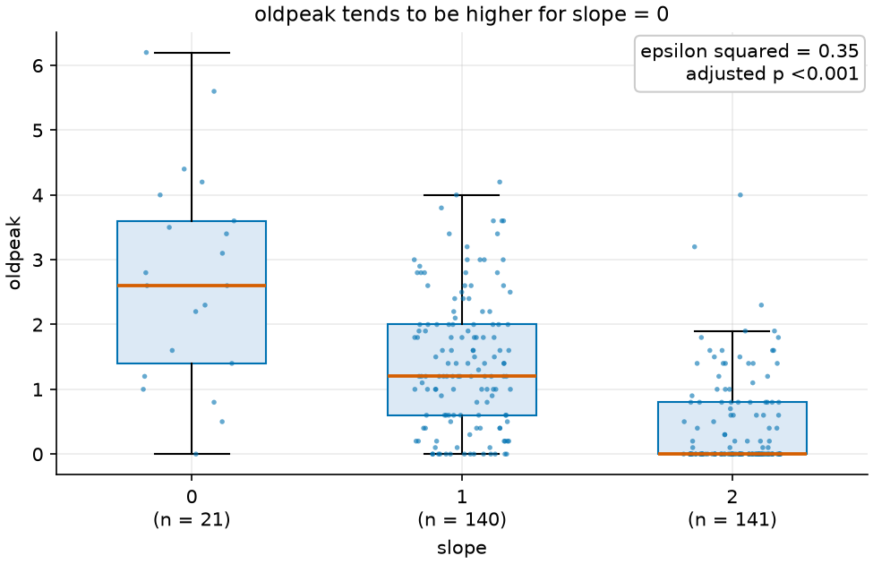

| | |
| :--- | :--- |
| Test used | Kruskal-Wallis test |
| Test statistic | 105.90 |
| Degrees of freedom | 2 |
| Raw p-value | <0.001 |
| Adjusted p-value (q) | <0.001 |
| Effect size | epsilon squared = 0.35 (95% CI 0.27 to 0.45), large |
| Records used | 302 |

How was this tested?

Some groups were not close enough to normal, so the rank-based Kruskal-Wallis test was used.

Where do the numbers come from?

| Fact | Shown as | Comes from |
| :--- | :--- | :--- |
| `ci_high` | 0.45 | `TestResult.effect.ci_high` |
| `ci_low` | 0.27 | `TestResult.effect.ci_low` |
| `col_a` | oldpeak | `Hypothesis.column_a` |
| `col_b` | slope | `Hypothesis.column_b` |
| `comparable_value` | 0.35 | `TestResult.effect.comparable_value` |
| `df` | 2 | `TestResult.df` |
| `direction_word` | any | `TestResult.direction_observed` |
| `effect_abs` | 0.35 | `abs(TestResult.effect.value)` |
| `effect_name` | epsilon squared | `TestResult.effect.name` |
| `effect_value` | 0.35 | `TestResult.effect.value` |
| `eta_sq_pct` | 35.2% | `100 * TestResult.effect.value (epsilon_squared)` |
| `family_size` | 91 | `ValidationDecision.family_size` |
| `g1` | 0 | `TestResult.descriptives.group_order[0]` |
| `g2` | 1 | `TestResult.descriptives.group_order[1]` |
| `g3` | 2 | `TestResult.descriptives.group_order[2]` |
| `group_label0` | 0 | `TestResult.group_sizes key 0` |
| `group_label1` | 1 | `TestResult.group_sizes key 1` |
| `group_label2` | 2 | `TestResult.group_sizes key 2` |
| `group_size0` | 21 | `TestResult.group_sizes[0]` |
| `group_size1` | 140 | `TestResult.group_sizes[1]` |
| `group_size2` | 141 | `TestResult.group_sizes[2]` |
| `highest_group` | 0 | `TestResult.descriptives.highest_group` |
| `lowest_group` | 2 | `TestResult.descriptives.lowest_group` |
| `magnitude_label` | large | `TestResult.effect.magnitude` |
| `mean_g1` | 2.71 | `TestResult.descriptives.groups[0].mean` |
| `mean_g2` | 1.43 | `TestResult.descriptives.groups[1].mean` |
| `mean_g3` | 0.41 | `TestResult.descriptives.groups[2].mean` |
| `mean_high` | 2.71 | `same as mean_g1` |
| `mean_low` | 0.41 | `same as mean_g3` |
| `median_g1` | 2.60 | `TestResult.descriptives.groups[0].median` |
| `median_g2` | 1.20 | `TestResult.descriptives.groups[1].median` |
| `median_g3` | 0 | `TestResult.descriptives.groups[2].median` |
| `median_high` | 2.60 | `same as median_g1` |
| `median_low` | 0 | `same as median_g3` |
| `n_g1` | 21 | `TestResult.descriptives.groups[0].n` |
| `n_g2` | 140 | `TestResult.descriptives.groups[1].n` |
| `n_g3` | 141 | `TestResult.descriptives.groups[2].n` |
| `n_groups` | 3 | `len(TestResult.group_sizes)` |
| `n_used` | 302 | `TestResult.n_used` |
| `other_group` | 1 | `the other group in TestResult.descriptives.group_order` |
| `p_raw` | <0.001 | `ValidationDecision.p_raw` |
| `q_value` | <0.001 | `ValidationDecision.q_value` |
| `sd_g1` | 1.64 | `TestResult.descriptives.groups[0].sd` |
| `sd_g2` | 1.04 | `TestResult.descriptives.groups[1].sd` |
| `sd_g3` | 0.69 | `TestResult.descriptives.groups[2].sd` |
| `statistic` | 105.90 | `TestResult.statistic` |
| `test_name` | Kruskal-Wallis test | `TestResult.test_name` |

### 2.18 `chol` ↔ `restecg`

Among 298 records, the average chol was 255.14 for restecg = 0 and 237.68 for restecg = 1 (difference 17.46, 95% CI 5.82 to 29.10). On average, chol is higher for restecg = 0. The difference is small (Hedges' g = 0.34, 95% CI 0.11 to 0.57). After correcting for 91 tests (Benjamini-Hochberg method, false discovery rate 5.0%), the association is statistically supported (adjusted p = 0.009). Rare levels with fewer than 8 records were left out of this test (2). This is an association, not evidence of cause and effect.

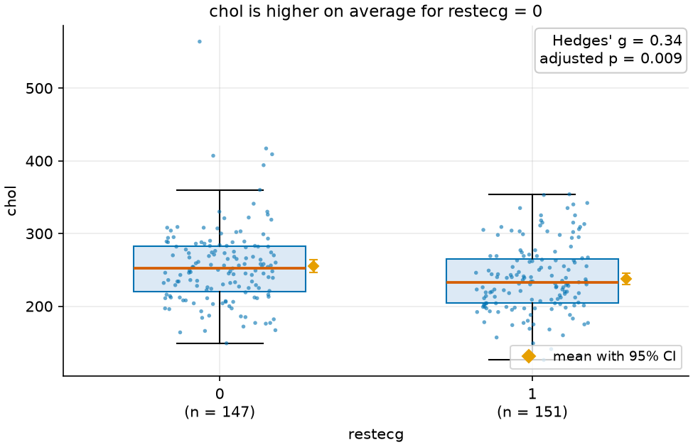

| | |
| :--- | :--- |
| Test used | Welch's t-test |
| Test statistic | 2.95 |
| Degrees of freedom | 286.8 |
| Raw p-value | 0.003 |
| Adjusted p-value (q) | 0.009 |
| Effect size | Hedges' g = 0.34 (95% CI 0.11 to 0.57), small |
| Records used | 298 |

How was this tested?

Both groups looked close enough to normal (or were large enough), so the means were compared with Welch's t-test, which does not assume equal spreads.

Where do the numbers come from?

| Fact | Shown as | Comes from |
| :--- | :--- | :--- |
| `alt_effect_value` | 0.20 | `TestResult.descriptives.sensitivity_alt_test.effect_value` |
| `alt_test_name` | Mann-Whitney U test | `TestResult.descriptives.sensitivity_alt_test.test_name` |
| `ci_high` | 0.57 | `TestResult.effect.ci_high` |
| `ci_low` | 0.11 | `TestResult.effect.ci_low` |
| `col_a` | chol | `Hypothesis.column_a` |
| `col_b` | restecg | `Hypothesis.column_b` |
| `comparable_value` | 0.34 | `TestResult.effect.comparable_value` |
| `df` | 286.8 | `TestResult.df` |
| `direction_word` | a_greater | `TestResult.direction_observed` |
| `dropped_level0` | 2 | `TestResult.descriptives.dropped_levels[0]` |
| `effect_abs` | 0.34 | `abs(TestResult.effect.value)` |
| `effect_name` | Hedges' g | `TestResult.effect.name` |
| `effect_value` | 0.34 | `TestResult.effect.value` |
| `family_size` | 91 | `ValidationDecision.family_size` |
| `g1` | 0 | `TestResult.descriptives.group_order[0]` |
| `g2` | 1 | `TestResult.descriptives.group_order[1]` |
| `group_label0` | 0 | `TestResult.group_sizes key 0` |
| `group_label1` | 1 | `TestResult.group_sizes key 1` |
| `group_size0` | 147 | `TestResult.group_sizes[0]` |
| `group_size1` | 151 | `TestResult.group_sizes[1]` |
| `higher_group` | 0 | `TestResult.descriptives.higher_group` |
| `magnitude_label` | small | `TestResult.effect.magnitude` |
| `mean_diff` | 17.46 | `TestResult.descriptives.mean_diff` |
| `mean_diff_abs` | 17.46 | `abs(TestResult.descriptives.mean_diff)` |
| `mean_diff_ci_high` | 29.10 | `TestResult.descriptives.mean_diff_ci_high` |
| `mean_diff_ci_low` | 5.82 | `TestResult.descriptives.mean_diff_ci_low` |
| `mean_g1` | 255.14 | `TestResult.descriptives.groups[0].mean` |
| `mean_g2` | 237.68 | `TestResult.descriptives.groups[1].mean` |
| `mean_high` | 255.14 | `same as mean_g1` |
| `mean_other` | 237.68 | `same as mean_g2` |
| `median_g1` | 252.00 | `TestResult.descriptives.groups[0].median` |
| `median_g2` | 233.00 | `TestResult.descriptives.groups[1].median` |
| `median_high` | 252.00 | `same as median_g1` |
| `median_other` | 233.00 | `same as median_g2` |
| `n_g1` | 147 | `TestResult.descriptives.groups[0].n` |
| `n_g2` | 151 | `TestResult.descriptives.groups[1].n` |
| `n_groups` | 2 | `len(TestResult.group_sizes)` |
| `n_used` | 298 | `TestResult.n_used` |
| `other_group` | 1 | `the other group in TestResult.descriptives.group_order` |
| `p_raw` | 0.003 | `ValidationDecision.p_raw` |
| `q_value` | 0.009 | `ValidationDecision.q_value` |
| `sd_g1` | 54.73 | `TestResult.descriptives.groups[0].sd` |
| `sd_g2` | 46.93 | `TestResult.descriptives.groups[1].sd` |
| `statistic` | 2.95 | `TestResult.statistic` |
| `test_name` | Welch's t-test | `TestResult.test_name` |

### 2.19 `cp` ↔ `thal`

cp and thal are associated (Cramér's V = 0.24, 95% CI 0.18 to 0.33, medium; n = 300). The largest departure from independence: fewer records with cp = 0 and thal = 2 than expected if the columns were unrelated (52 observed vs 78.10 expected). After correcting for 91 tests (Benjamini-Hochberg method, false discovery rate 5.0%), the association is statistically supported (adjusted p <0.001). Rare levels with fewer than 8 records were left out of this test (thal:0). This is an association, not evidence of cause and effect.

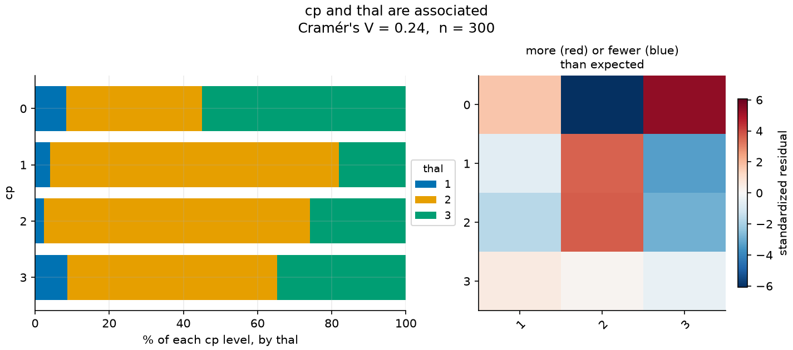

| | |
| :--- | :--- |
| Test used | chi-square test of independence |
| Test statistic | 40.55 |
| Degrees of freedom | 6 |
| Raw p-value | <0.001 |
| Adjusted p-value (q) | <0.001 |
| Effect size | Cramér's V = 0.24 (95% CI 0.18 to 0.33), medium |
| Records used | 300 |

How was this tested?

Every cell of the table had enough expected records, so the standard chi-square test of independence was used.

Where do the numbers come from?

| Fact | Shown as | Comes from |
| :--- | :--- | :--- |
| `cell1_col` | 2 | `TestResult.descriptives.top_residual_cells[0].col` |
| `cell1_expected` | 78.10 | `TestResult.descriptives.top_residual_cells[0].expected` |
| `cell1_more_or_fewer` | fewer | `observed vs expected count` |
| `cell1_observed` | 52 | `TestResult.descriptives.top_residual_cells[0].observed` |
| `cell1_row` | 0 | `TestResult.descriptives.top_residual_cells[0].row` |
| `cell2_col` | 3 | `TestResult.descriptives.top_residual_cells[1].col` |
| `cell2_expected` | 55.38 | `TestResult.descriptives.top_residual_cells[1].expected` |
| `cell2_more_or_fewer` | more | `observed vs expected count` |
| `cell2_observed` | 78 | `TestResult.descriptives.top_residual_cells[1].observed` |
| `cell2_row` | 0 | `TestResult.descriptives.top_residual_cells[1].row` |
| `ci_high` | 0.33 | `TestResult.effect.ci_high` |
| `ci_low` | 0.18 | `TestResult.effect.ci_low` |
| `col_a` | cp | `Hypothesis.column_a` |
| `col_b` | thal | `Hypothesis.column_b` |
| `col_label0` | 1 | `TestResult.descriptives.col_labels[0]` |
| `col_label1` | 2 | `TestResult.descriptives.col_labels[1]` |
| `col_label2` | 3 | `TestResult.descriptives.col_labels[2]` |
| `comparable_value` | 0.34 | `TestResult.effect.comparable_value` |
| `df` | 6 | `TestResult.df` |
| `direction_word` | any | `TestResult.direction_observed` |
| `dropped_level0` | thal:0 | `TestResult.descriptives.dropped_levels[0]` |
| `effect_abs` | 0.24 | `abs(TestResult.effect.value)` |
| `effect_name` | Cramér's V | `TestResult.effect.name` |
| `effect_value` | 0.24 | `TestResult.effect.value` |
| `family_size` | 91 | `ValidationDecision.family_size` |
| `magnitude_label` | medium | `TestResult.effect.magnitude` |
| `n_cols_table` | 3 | `len(TestResult.descriptives.col_labels)` |
| `n_rows_table` | 4 | `len(TestResult.descriptives.row_labels)` |
| `n_used` | 300 | `TestResult.n_used` |
| `p_raw` | <0.001 | `ValidationDecision.p_raw` |
| `q_value` | <0.001 | `ValidationDecision.q_value` |
| `row_label0` | 0 | `TestResult.descriptives.row_labels[0]` |
| `row_label1` | 1 | `TestResult.descriptives.row_labels[1]` |
| `row_label2` | 2 | `TestResult.descriptives.row_labels[2]` |
| `row_label3` | 3 | `TestResult.descriptives.row_labels[3]` |
| `statistic` | 40.55 | `TestResult.statistic` |
| `test_name` | chi-square test of independence | `TestResult.test_name` |

### 2.20 `age` ↔ `fbs`

Among 302 records, the average age was 53.97 for fbs = 0 and 57.00 for fbs = 1 (difference -3.03, 95% CI -5.43 to -0.64). On average, age is higher for fbs = 1. The difference is small (Hedges' g = -0.34, 95% CI -0.65 to -0.02). After correcting for 91 tests (Benjamini-Hochberg method, false discovery rate 5.0%), the association is statistically supported (adjusted p = 0.027). A second test (Mann-Whitney U test) did not fully agree, so treat this result with some caution. This is an association, not evidence of cause and effect.

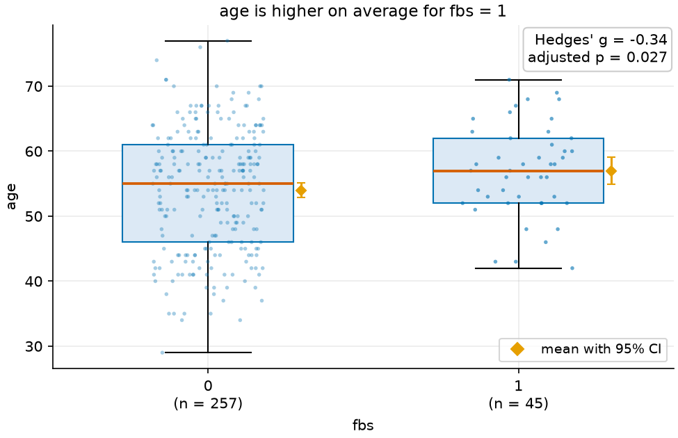

| | |
| :--- | :--- |
| Test used | Welch's t-test |
| Test statistic | -2.52 |
| Degrees of freedom | 73.6 |
| Raw p-value | 0.014 |
| Adjusted p-value (q) | 0.027 |
| Effect size | Hedges' g = -0.34 (95% CI -0.65 to -0.02), small |
| Records used | 302 |
| Flags | test sensitive |

How was this tested?

Both groups looked close enough to normal (or were large enough), so the means were compared with Welch's t-test, which does not assume equal spreads.

Where do the numbers come from?

| Fact | Shown as | Comes from |
| :--- | :--- | :--- |
| `alt_effect_value` | -0.18 | `TestResult.descriptives.sensitivity_alt_test.effect_value` |
| `alt_test_name` | Mann-Whitney U test | `TestResult.descriptives.sensitivity_alt_test.test_name` |
| `ci_high` | -0.02 | `TestResult.effect.ci_high` |
| `ci_low` | -0.65 | `TestResult.effect.ci_low` |
| `col_a` | age | `Hypothesis.column_a` |
| `col_b` | fbs | `Hypothesis.column_b` |
| `comparable_value` | 0.34 | `TestResult.effect.comparable_value` |
| `df` | 73.6 | `TestResult.df` |
| `direction_word` | b_greater | `TestResult.direction_observed` |
| `effect_abs` | 0.34 | `abs(TestResult.effect.value)` |
| `effect_name` | Hedges' g | `TestResult.effect.name` |
| `effect_value` | -0.34 | `TestResult.effect.value` |
| `family_size` | 91 | `ValidationDecision.family_size` |
| `g1` | 0 | `TestResult.descriptives.group_order[0]` |
| `g2` | 1 | `TestResult.descriptives.group_order[1]` |
| `group_label0` | 0 | `TestResult.group_sizes key 0` |
| `group_label1` | 1 | `TestResult.group_sizes key 1` |
| `group_size0` | 257 | `TestResult.group_sizes[0]` |
| `group_size1` | 45 | `TestResult.group_sizes[1]` |
| `higher_group` | 1 | `TestResult.descriptives.higher_group` |
| `magnitude_label` | small | `TestResult.effect.magnitude` |
| `mean_diff` | -3.03 | `TestResult.descriptives.mean_diff` |
| `mean_diff_abs` | 3.03 | `abs(TestResult.descriptives.mean_diff)` |
| `mean_diff_ci_high` | -0.64 | `TestResult.descriptives.mean_diff_ci_high` |
| `mean_diff_ci_low` | -5.43 | `TestResult.descriptives.mean_diff_ci_low` |
| `mean_g1` | 53.97 | `TestResult.descriptives.groups[0].mean` |
| `mean_g2` | 57.00 | `TestResult.descriptives.groups[1].mean` |
| `mean_high` | 57.00 | `same as mean_g2` |
| `mean_other` | 53.97 | `same as mean_g1` |
| `median_g1` | 55.00 | `TestResult.descriptives.groups[0].median` |
| `median_g2` | 57.00 | `TestResult.descriptives.groups[1].median` |
| `median_high` | 57.00 | `same as median_g2` |
| `median_other` | 55.00 | `same as median_g1` |
| `n_g1` | 257 | `TestResult.descriptives.groups[0].n` |
| `n_g2` | 45 | `TestResult.descriptives.groups[1].n` |
| `n_groups` | 2 | `len(TestResult.group_sizes)` |
| `n_used` | 302 | `TestResult.n_used` |
| `other_group` | 0 | `the other group in TestResult.descriptives.group_order` |
| `p_raw` | 0.014 | `ValidationDecision.p_raw` |
| `q_value` | 0.027 | `ValidationDecision.q_value` |
| `sd_g1` | 9.29 | `TestResult.descriptives.groups[0].sd` |
| `sd_g2` | 7.06 | `TestResult.descriptives.groups[1].sd` |
| `statistic` | -2.52 | `TestResult.statistic` |
| `test_name` | Welch's t-test | `TestResult.test_name` |

### 2.21 `slope` ↔ `thal`

slope and thal are associated (Cramér's V = 0.23, 95% CI 0.16 to 0.31, medium; n = 300). The largest departure from independence: more records with slope = 2 and thal = 2 than expected if the columns were unrelated (101 observed vs 77.00 expected). After correcting for 91 tests (Benjamini-Hochberg method, false discovery rate 5.0%), the association is statistically supported (adjusted p <0.001). Rare levels with fewer than 8 records were left out of this test (thal:0). This is an association, not evidence of cause and effect.

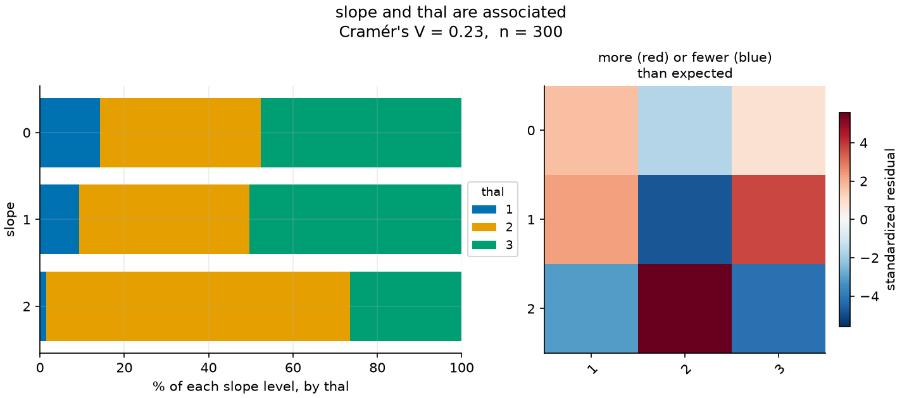

| | |
| :--- | :--- |
| Test used | chi-square test of independence |
| Test statistic | 34.60 |
| Degrees of freedom | 4 |
| Raw p-value | <0.001 |
| Adjusted p-value (q) | <0.001 |
| Effect size | Cramér's V = 0.23 (95% CI 0.16 to 0.31), medium |
| Records used | 300 |

How was this tested?

Every cell of the table had enough expected records, so the standard chi-square test of independence was used.

Where do the numbers come from?

| Fact | Shown as | Comes from |
| :--- | :--- | :--- |
| `cell1_col` | 2 | `TestResult.descriptives.top_residual_cells[0].col` |
| `cell1_expected` | 77.00 | `TestResult.descriptives.top_residual_cells[0].expected` |
| `cell1_more_or_fewer` | more | `observed vs expected count` |
| `cell1_observed` | 101 | `TestResult.descriptives.top_residual_cells[0].observed` |
| `cell1_row` | 2 | `TestResult.descriptives.top_residual_cells[0].row` |
| `cell2_col` | 2 | `TestResult.descriptives.top_residual_cells[1].col` |
| `cell2_expected` | 76.45 | `TestResult.descriptives.top_residual_cells[1].expected` |
| `cell2_more_or_fewer` | fewer | `observed vs expected count` |
| `cell2_observed` | 56 | `TestResult.descriptives.top_residual_cells[1].observed` |
| `cell2_row` | 1 | `TestResult.descriptives.top_residual_cells[1].row` |
| `ci_high` | 0.31 | `TestResult.effect.ci_high` |
| `ci_low` | 0.16 | `TestResult.effect.ci_low` |
| `col_a` | slope | `Hypothesis.column_a` |
| `col_b` | thal | `Hypothesis.column_b` |
| `col_label0` | 1 | `TestResult.descriptives.col_labels[0]` |
| `col_label1` | 2 | `TestResult.descriptives.col_labels[1]` |
| `col_label2` | 3 | `TestResult.descriptives.col_labels[2]` |
| `comparable_value` | 0.32 | `TestResult.effect.comparable_value` |
| `df` | 4 | `TestResult.df` |
| `direction_word` | any | `TestResult.direction_observed` |
| `dropped_level0` | thal:0 | `TestResult.descriptives.dropped_levels[0]` |
| `effect_abs` | 0.23 | `abs(TestResult.effect.value)` |
| `effect_name` | Cramér's V | `TestResult.effect.name` |
| `effect_value` | 0.23 | `TestResult.effect.value` |
| `family_size` | 91 | `ValidationDecision.family_size` |
| `magnitude_label` | medium | `TestResult.effect.magnitude` |
| `n_cols_table` | 3 | `len(TestResult.descriptives.col_labels)` |
| `n_rows_table` | 3 | `len(TestResult.descriptives.row_labels)` |
| `n_used` | 300 | `TestResult.n_used` |
| `p_raw` | <0.001 | `ValidationDecision.p_raw` |
| `q_value` | <0.001 | `ValidationDecision.q_value` |
| `row_label0` | 0 | `TestResult.descriptives.row_labels[0]` |
| `row_label1` | 1 | `TestResult.descriptives.row_labels[1]` |
| `row_label2` | 2 | `TestResult.descriptives.row_labels[2]` |
| `statistic` | 34.60 | `TestResult.statistic` |
| `test_name` | chi-square test of independence | `TestResult.test_name` |

### 2.22 `exang` ↔ `thal`

exang and thal are associated (Cramér's V = 0.32, 95% CI 0.22 to 0.44, medium; n = 300). The largest departure from independence: more records with exang = 0 and thal = 2 than expected if the columns were unrelated (134 observed vs 111.10 expected). After correcting for 91 tests (Benjamini-Hochberg method, false discovery rate 5.0%), the association is statistically supported (adjusted p <0.001). Rare levels with fewer than 8 records were left out of this test (thal:0). This is an association, not evidence of cause and effect.

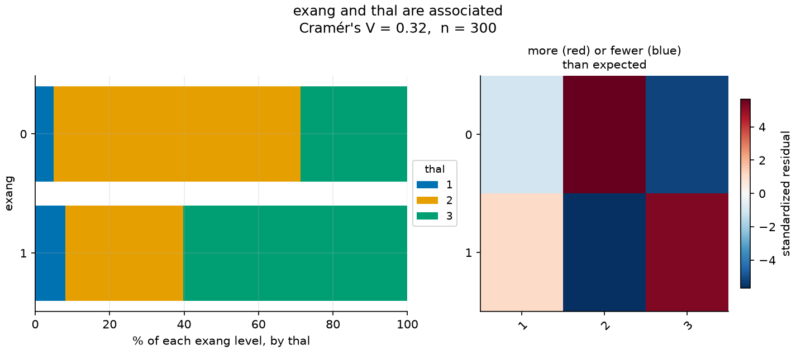

| | |
| :--- | :--- |
| Test used | chi-square test of independence |
| Test statistic | 32.36 |
| Degrees of freedom | 2 |
| Raw p-value | <0.001 |
| Adjusted p-value (q) | <0.001 |
| Effect size | Cramér's V = 0.32 (95% CI 0.22 to 0.44), medium |
| Records used | 300 |

How was this tested?

Every cell of the table had enough expected records, so the standard chi-square test of independence was used.

Where do the numbers come from?

| Fact | Shown as | Comes from |
| :--- | :--- | :--- |
| `cell1_col` | 2 | `TestResult.descriptives.top_residual_cells[0].col` |
| `cell1_expected` | 111.10 | `TestResult.descriptives.top_residual_cells[0].expected` |
| `cell1_more_or_fewer` | more | `observed vs expected count` |
| `cell1_observed` | 134 | `TestResult.descriptives.top_residual_cells[0].observed` |
| `cell1_row` | 0 | `TestResult.descriptives.top_residual_cells[0].row` |
| `cell2_col` | 2 | `TestResult.descriptives.top_residual_cells[1].col` |
| `cell2_expected` | 53.90 | `TestResult.descriptives.top_residual_cells[1].expected` |
| `cell2_more_or_fewer` | fewer | `observed vs expected count` |
| `cell2_observed` | 31 | `TestResult.descriptives.top_residual_cells[1].observed` |
| `cell2_row` | 1 | `TestResult.descriptives.top_residual_cells[1].row` |
| `ci_high` | 0.44 | `TestResult.effect.ci_high` |
| `ci_low` | 0.22 | `TestResult.effect.ci_low` |
| `col_a` | exang | `Hypothesis.column_a` |
| `col_b` | thal | `Hypothesis.column_b` |
| `col_label0` | 1 | `TestResult.descriptives.col_labels[0]` |
| `col_label1` | 2 | `TestResult.descriptives.col_labels[1]` |
| `col_label2` | 3 | `TestResult.descriptives.col_labels[2]` |
| `comparable_value` | 0.32 | `TestResult.effect.comparable_value` |
| `df` | 2 | `TestResult.df` |
| `direction_word` | any | `TestResult.direction_observed` |
| `dropped_level0` | thal:0 | `TestResult.descriptives.dropped_levels[0]` |
| `effect_abs` | 0.32 | `abs(TestResult.effect.value)` |
| `effect_name` | Cramér's V | `TestResult.effect.name` |
| `effect_value` | 0.32 | `TestResult.effect.value` |
| `family_size` | 91 | `ValidationDecision.family_size` |
| `magnitude_label` | medium | `TestResult.effect.magnitude` |
| `n_cols_table` | 3 | `len(TestResult.descriptives.col_labels)` |
| `n_rows_table` | 2 | `len(TestResult.descriptives.row_labels)` |
| `n_used` | 300 | `TestResult.n_used` |
| `p_raw` | <0.001 | `ValidationDecision.p_raw` |
| `q_value` | <0.001 | `ValidationDecision.q_value` |
| `row_label0` | 0 | `TestResult.descriptives.row_labels[0]` |
| `row_label1` | 1 | `TestResult.descriptives.row_labels[1]` |
| `statistic` | 32.36 | `TestResult.statistic` |
| `test_name` | chi-square test of independence | `TestResult.test_name` |

### 2.23 `age` ↔ `restecg`

Among 298 records, the average age was 55.69 for restecg = 0 and 53.01 for restecg = 1 (difference 2.67, 95% CI 0.64 to 4.71). On average, age is higher for restecg = 0. The difference is small (Hedges' g = 0.30, 95% CI 0.07 to 0.53). After correcting for 91 tests (Benjamini-Hochberg method, false discovery rate 5.0%), the association is statistically supported (adjusted p = 0.022). Rare levels with fewer than 8 records were left out of this test (2). This is an association, not evidence of cause and effect.

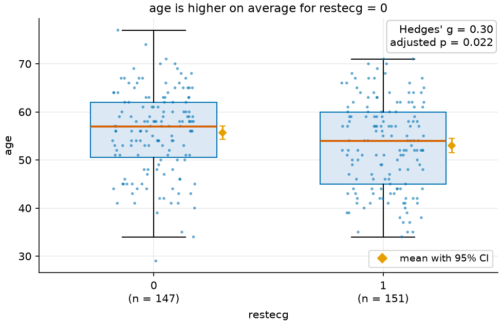

| | |
| :--- | :--- |
| Test used | Welch's t-test |
| Test statistic | 2.58 |
| Degrees of freedom | 295.7 |
| Raw p-value | 0.010 |
| Adjusted p-value (q) | 0.022 |
| Effect size | Hedges' g = 0.30 (95% CI 0.07 to 0.53), small |
| Records used | 298 |

How was this tested?

Both groups looked close enough to normal (or were large enough), so the means were compared with Welch's t-test, which does not assume equal spreads.

Where do the numbers come from?

| Fact | Shown as | Comes from |
| :--- | :--- | :--- |
| `alt_effect_value` | 0.17 | `TestResult.descriptives.sensitivity_alt_test.effect_value` |
| `alt_test_name` | Mann-Whitney U test | `TestResult.descriptives.sensitivity_alt_test.test_name` |
| `ci_high` | 0.53 | `TestResult.effect.ci_high` |
| `ci_low` | 0.07 | `TestResult.effect.ci_low` |
| `col_a` | age | `Hypothesis.column_a` |
| `col_b` | restecg | `Hypothesis.column_b` |
| `comparable_value` | 0.30 | `TestResult.effect.comparable_value` |
| `df` | 295.7 | `TestResult.df` |
| `direction_word` | a_greater | `TestResult.direction_observed` |
| `dropped_level0` | 2 | `TestResult.descriptives.dropped_levels[0]` |
| `effect_abs` | 0.30 | `abs(TestResult.effect.value)` |
| `effect_name` | Hedges' g | `TestResult.effect.name` |
| `effect_value` | 0.30 | `TestResult.effect.value` |
| `family_size` | 91 | `ValidationDecision.family_size` |
| `g1` | 0 | `TestResult.descriptives.group_order[0]` |
| `g2` | 1 | `TestResult.descriptives.group_order[1]` |
| `group_label0` | 0 | `TestResult.group_sizes key 0` |
| `group_label1` | 1 | `TestResult.group_sizes key 1` |
| `group_size0` | 147 | `TestResult.group_sizes[0]` |
| `group_size1` | 151 | `TestResult.group_sizes[1]` |
| `higher_group` | 0 | `TestResult.descriptives.higher_group` |
| `magnitude_label` | small | `TestResult.effect.magnitude` |
| `mean_diff` | 2.67 | `TestResult.descriptives.mean_diff` |
| `mean_diff_abs` | 2.67 | `abs(TestResult.descriptives.mean_diff)` |
| `mean_diff_ci_high` | 4.71 | `TestResult.descriptives.mean_diff_ci_high` |
| `mean_diff_ci_low` | 0.64 | `TestResult.descriptives.mean_diff_ci_low` |
| `mean_g1` | 55.69 | `TestResult.descriptives.groups[0].mean` |
| `mean_g2` | 53.01 | `TestResult.descriptives.groups[1].mean` |
| `mean_high` | 55.69 | `same as mean_g1` |
| `mean_other` | 53.01 | `same as mean_g2` |
| `median_g1` | 57.00 | `TestResult.descriptives.groups[0].median` |
| `median_g2` | 54.00 | `TestResult.descriptives.groups[1].median` |
| `median_high` | 57.00 | `same as median_g1` |
| `median_other` | 54.00 | `same as median_g2` |
| `n_g1` | 147 | `TestResult.descriptives.groups[0].n` |
| `n_g2` | 151 | `TestResult.descriptives.groups[1].n` |
| `n_groups` | 2 | `len(TestResult.group_sizes)` |
| `n_used` | 298 | `TestResult.n_used` |
| `other_group` | 1 | `the other group in TestResult.descriptives.group_order` |
| `p_raw` | 0.010 | `ValidationDecision.p_raw` |
| `q_value` | 0.022 | `ValidationDecision.q_value` |
| `sd_g1` | 8.68 | `TestResult.descriptives.groups[0].sd` |
| `sd_g2` | 9.18 | `TestResult.descriptives.groups[1].sd` |
| `statistic` | 2.58 | `TestResult.statistic` |
| `test_name` | Welch's t-test | `TestResult.test_name` |

### 2.24 `trestbps` ↔ `target`

Among 302 records, the average trestbps was 134.40 for target = 0 and 129.25 for target = 1 (difference 5.15, 95% CI 1.14 to 9.16). On average, trestbps is higher for target = 0. The difference is small (Hedges' g = 0.30, 95% CI 0.07 to 0.52). After correcting for 91 tests (Benjamini-Hochberg method, false discovery rate 5.0%), the association is statistically supported (adjusted p = 0.025). This is an association, not evidence of cause and effect.

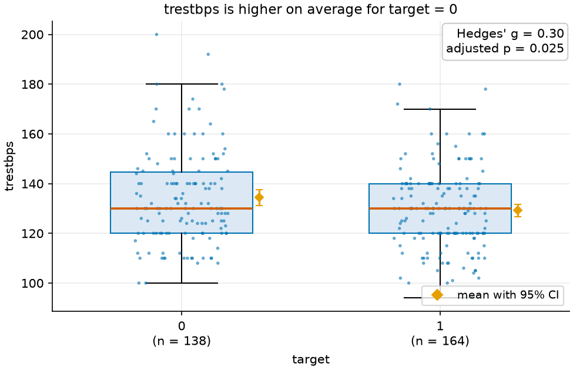

| | |
| :--- | :--- |
| Test used | Welch's t-test |
| Test statistic | 2.53 |
| Degrees of freedom | 272.9 |
| Raw p-value | 0.012 |
| Adjusted p-value (q) | 0.025 |
| Effect size | Hedges' g = 0.30 (95% CI 0.07 to 0.52), small |
| Records used | 302 |

How was this tested?

Both groups looked close enough to normal (or were large enough), so the means were compared with Welch's t-test, which does not assume equal spreads.

Where do the numbers come from?

| Fact | Shown as | Comes from |
| :--- | :--- | :--- |
| `alt_effect_value` | 0.14 | `TestResult.descriptives.sensitivity_alt_test.effect_value` |
| `alt_test_name` | Mann-Whitney U test | `TestResult.descriptives.sensitivity_alt_test.test_name` |
| `ci_high` | 0.52 | `TestResult.effect.ci_high` |
| `ci_low` | 0.07 | `TestResult.effect.ci_low` |
| `col_a` | trestbps | `Hypothesis.column_a` |
| `col_b` | target | `Hypothesis.column_b` |
| `comparable_value` | 0.30 | `TestResult.effect.comparable_value` |
| `df` | 272.9 | `TestResult.df` |
| `direction_word` | a_greater | `TestResult.direction_observed` |
| `effect_abs` | 0.30 | `abs(TestResult.effect.value)` |
| `effect_name` | Hedges' g | `TestResult.effect.name` |
| `effect_value` | 0.30 | `TestResult.effect.value` |
| `family_size` | 91 | `ValidationDecision.family_size` |
| `g1` | 0 | `TestResult.descriptives.group_order[0]` |
| `g2` | 1 | `TestResult.descriptives.group_order[1]` |
| `group_label0` | 0 | `TestResult.group_sizes key 0` |
| `group_label1` | 1 | `TestResult.group_sizes key 1` |
| `group_size0` | 138 | `TestResult.group_sizes[0]` |
| `group_size1` | 164 | `TestResult.group_sizes[1]` |
| `higher_group` | 0 | `TestResult.descriptives.higher_group` |
| `magnitude_label` | small | `TestResult.effect.magnitude` |
| `mean_diff` | 5.15 | `TestResult.descriptives.mean_diff` |
| `mean_diff_abs` | 5.15 | `abs(TestResult.descriptives.mean_diff)` |
| `mean_diff_ci_high` | 9.16 | `TestResult.descriptives.mean_diff_ci_high` |
| `mean_diff_ci_low` | 1.14 | `TestResult.descriptives.mean_diff_ci_low` |
| `mean_g1` | 134.40 | `TestResult.descriptives.groups[0].mean` |
| `mean_g2` | 129.25 | `TestResult.descriptives.groups[1].mean` |
| `mean_high` | 134.40 | `same as mean_g1` |
| `mean_other` | 129.25 | `same as mean_g2` |
| `median_g1` | 130.00 | `TestResult.descriptives.groups[0].median` |
| `median_g2` | 130.00 | `TestResult.descriptives.groups[1].median` |
| `median_high` | 130.00 | `same as median_g1` |
| `median_other` | 130.00 | `same as median_g2` |
| `n_g1` | 138 | `TestResult.descriptives.groups[0].n` |
| `n_g2` | 164 | `TestResult.descriptives.groups[1].n` |
| `n_groups` | 2 | `len(TestResult.group_sizes)` |
| `n_used` | 302 | `TestResult.n_used` |
| `other_group` | 1 | `the other group in TestResult.descriptives.group_order` |
| `p_raw` | 0.012 | `ValidationDecision.p_raw` |
| `q_value` | 0.025 | `ValidationDecision.q_value` |
| `sd_g1` | 18.73 | `TestResult.descriptives.groups[0].sd` |
| `sd_g2` | 16.20 | `TestResult.descriptives.groups[1].sd` |
| `statistic` | 2.53 | `TestResult.statistic` |
| `test_name` | Welch's t-test | `TestResult.test_name` |

### 2.25 `trestbps` ↔ `restecg`

Among 298 records, the average trestbps was 134.03 for restecg = 0 and 129.01 for restecg = 1 (difference 5.02, 95% CI 1.08 to 8.96). On average, trestbps is higher for restecg = 0. The difference is small (Hedges' g = 0.29, 95% CI 0.06 to 0.52). After correcting for 91 tests (Benjamini-Hochberg method, false discovery rate 5.0%), the association is statistically supported (adjusted p = 0.026). Rare levels with fewer than 8 records were left out of this test (2). This is an association, not evidence of cause and effect.

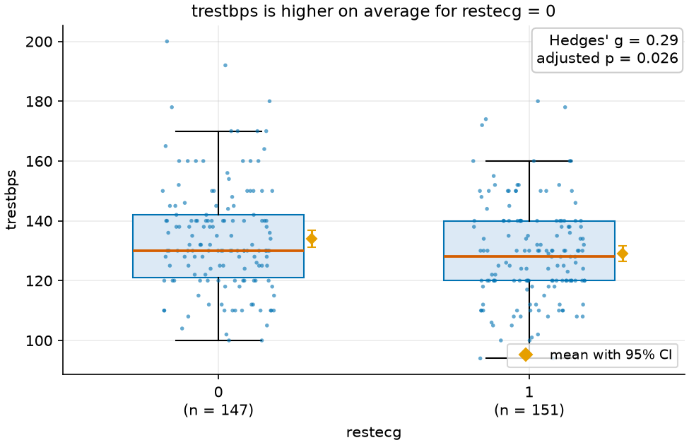

| | |
| :--- | :--- |
| Test used | Welch's t-test |
| Test statistic | 2.51 |
| Degrees of freedom | 291.9 |
| Raw p-value | 0.013 |
| Adjusted p-value (q) | 0.026 |
| Effect size | Hedges' g = 0.29 (95% CI 0.06 to 0.52), small |
| Records used | 298 |

How was this tested?

Both groups looked close enough to normal (or were large enough), so the means were compared with Welch's t-test, which does not assume equal spreads.

Where do the numbers come from?

| Fact | Shown as | Comes from |
| :--- | :--- | :--- |
| `alt_effect_value` | 0.16 | `TestResult.descriptives.sensitivity_alt_test.effect_value` |
| `alt_test_name` | Mann-Whitney U test | `TestResult.descriptives.sensitivity_alt_test.test_name` |
| `ci_high` | 0.52 | `TestResult.effect.ci_high` |
| `ci_low` | 0.06 | `TestResult.effect.ci_low` |
| `col_a` | trestbps | `Hypothesis.column_a` |
| `col_b` | restecg | `Hypothesis.column_b` |
| `comparable_value` | 0.29 | `TestResult.effect.comparable_value` |
| `df` | 291.9 | `TestResult.df` |
| `direction_word` | a_greater | `TestResult.direction_observed` |
| `dropped_level0` | 2 | `TestResult.descriptives.dropped_levels[0]` |
| `effect_abs` | 0.29 | `abs(TestResult.effect.value)` |
| `effect_name` | Hedges' g | `TestResult.effect.name` |
| `effect_value` | 0.29 | `TestResult.effect.value` |
| `family_size` | 91 | `ValidationDecision.family_size` |
| `g1` | 0 | `TestResult.descriptives.group_order[0]` |
| `g2` | 1 | `TestResult.descriptives.group_order[1]` |
| `group_label0` | 0 | `TestResult.group_sizes key 0` |
| `group_label1` | 1 | `TestResult.group_sizes key 1` |
| `group_size0` | 147 | `TestResult.group_sizes[0]` |
| `group_size1` | 151 | `TestResult.group_sizes[1]` |
| `higher_group` | 0 | `TestResult.descriptives.higher_group` |
| `magnitude_label` | small | `TestResult.effect.magnitude` |
| `mean_diff` | 5.02 | `TestResult.descriptives.mean_diff` |
| `mean_diff_abs` | 5.02 | `abs(TestResult.descriptives.mean_diff)` |
| `mean_diff_ci_high` | 8.96 | `TestResult.descriptives.mean_diff_ci_high` |
| `mean_diff_ci_low` | 1.08 | `TestResult.descriptives.mean_diff_ci_low` |
| `mean_g1` | 134.03 | `TestResult.descriptives.groups[0].mean` |
| `mean_g2` | 129.01 | `TestResult.descriptives.groups[1].mean` |
| `mean_high` | 134.03 | `same as mean_g1` |
| `mean_other` | 129.01 | `same as mean_g2` |
| `median_g1` | 130.00 | `TestResult.descriptives.groups[0].median` |
| `median_g2` | 128.00 | `TestResult.descriptives.groups[1].median` |
| `median_high` | 130.00 | `same as median_g1` |
| `median_other` | 128.00 | `same as median_g2` |
| `n_g1` | 147 | `TestResult.descriptives.groups[0].n` |
| `n_g2` | 151 | `TestResult.descriptives.groups[1].n` |
| `n_groups` | 2 | `len(TestResult.group_sizes)` |
| `n_used` | 298 | `TestResult.n_used` |
| `other_group` | 1 | `the other group in TestResult.descriptives.group_order` |
| `p_raw` | 0.013 | `ValidationDecision.p_raw` |
| `q_value` | 0.026 | `ValidationDecision.q_value` |
| `sd_g1` | 18.05 | `TestResult.descriptives.groups[0].sd` |
| `sd_g2` | 16.46 | `TestResult.descriptives.groups[1].sd` |
| `statistic` | 2.51 | `TestResult.statistic` |
| `test_name` | Welch's t-test | `TestResult.test_name` |

### 2.26 `age` ↔ `trestbps`

age and trestbps are positively associated (Spearman rank correlation rho = 0.29, 95% CI 0.18 to 0.40; n = 302). The relationship is monotonic and may not be linear. The association is small. After correcting for 91 tests (Benjamini-Hochberg method, false discovery rate 5.0%), the association is statistically supported (adjusted p <0.001). The data were not close enough to the shape a parametric test needs, so a rank-based test was used instead. This is an association, not evidence of cause and effect.

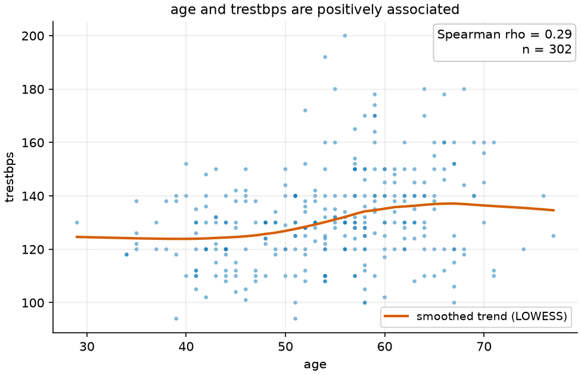

| | |
| :--- | :--- |
| Test used | Spearman rank correlation test |
| Test statistic | 0.29 |
| Degrees of freedom | 300 |
| Raw p-value | <0.001 |
| Adjusted p-value (q) | <0.001 |
| Effect size | Spearman rho = 0.29 (95% CI 0.18 to 0.40), small |
| Records used | 302 |

How was this tested?

The columns were skewed, had outliers or many ties, so the rank-based Spearman correlation was used.

Where do the numbers come from?

| Fact | Shown as | Comes from |
| :--- | :--- | :--- |
| `alt_effect_value` | 0.28 | `TestResult.descriptives.sensitivity_alt_test.effect_value` |
| `alt_test_name` | Pearson correlation test | `TestResult.descriptives.sensitivity_alt_test.test_name` |
| `ci_high` | 0.40 | `TestResult.effect.ci_high` |
| `ci_low` | 0.18 | `TestResult.effect.ci_low` |
| `col_a` | age | `Hypothesis.column_a` |
| `col_b` | trestbps | `Hypothesis.column_b` |
| `comparable_value` | 0.29 | `TestResult.effect.comparable_value` |
| `df` | 300 | `TestResult.df` |
| `direction_word` | positive | `TestResult.direction_observed` |
| `effect_abs` | 0.29 | `abs(TestResult.effect.value)` |
| `effect_name` | Spearman rho | `TestResult.effect.name` |
| `effect_value` | 0.29 | `TestResult.effect.value` |
| `family_size` | 91 | `ValidationDecision.family_size` |
| `magnitude_label` | small | `TestResult.effect.magnitude` |
| `n_used` | 302 | `TestResult.n_used` |
| `ols_slope` | 0.55 | `TestResult.descriptives.ols_slope` |
| `p_raw` | <0.001 | `ValidationDecision.p_raw` |
| `q_value` | <0.001 | `ValidationDecision.q_value` |
| `statistic` | 0.29 | `TestResult.statistic` |
| `test_name` | Spearman rank correlation test | `TestResult.test_name` |

### 2.27 `sex` ↔ `target`

sex and target are associated (Cramér's V = 0.28, 95% CI 0.16 to 0.39, small; n = 302). The largest departure from independence: fewer records with sex = 0 and target = 0 than expected if the columns were unrelated (24 observed vs 43.87 expected). The odds ratio is 0.27 (95% CI 0.16 to 0.46). After correcting for 91 tests (Benjamini-Hochberg method, false discovery rate 5.0%), the association is statistically supported (adjusted p <0.001). This is an association, not evidence of cause and effect.

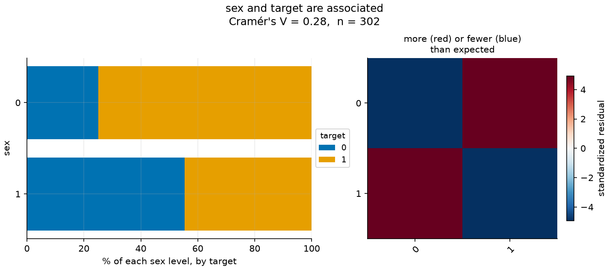

| | |
| :--- | :--- |
| Test used | chi-square test of independence |
| Test statistic | 24.29 |
| Degrees of freedom | 1 |
| Raw p-value | <0.001 |
| Adjusted p-value (q) | <0.001 |
| Effect size | Cramér's V = 0.28 (95% CI 0.16 to 0.39), small |
| Records used | 302 |

How was this tested?

Every cell of the table had enough expected records, so the standard chi-square test of independence was used.

Where do the numbers come from?

| Fact | Shown as | Comes from |
| :--- | :--- | :--- |
| `cell1_col` | 0 | `TestResult.descriptives.top_residual_cells[0].col` |
| `cell1_expected` | 43.87 | `TestResult.descriptives.top_residual_cells[0].expected` |
| `cell1_more_or_fewer` | fewer | `observed vs expected count` |
| `cell1_observed` | 24 | `TestResult.descriptives.top_residual_cells[0].observed` |
| `cell1_row` | 0 | `TestResult.descriptives.top_residual_cells[0].row` |
| `cell2_col` | 1 | `TestResult.descriptives.top_residual_cells[1].col` |
| `cell2_expected` | 52.13 | `TestResult.descriptives.top_residual_cells[1].expected` |
| `cell2_more_or_fewer` | more | `observed vs expected count` |
| `cell2_observed` | 72 | `TestResult.descriptives.top_residual_cells[1].observed` |
| `cell2_row` | 0 | `TestResult.descriptives.top_residual_cells[1].row` |
| `ci_high` | 0.39 | `TestResult.effect.ci_high` |
| `ci_low` | 0.16 | `TestResult.effect.ci_low` |
| `col_a` | sex | `Hypothesis.column_a` |
| `col_b` | target | `Hypothesis.column_b` |
| `col_label0` | 0 | `TestResult.descriptives.col_labels[0]` |
| `col_label1` | 1 | `TestResult.descriptives.col_labels[1]` |
| `comparable_value` | 0.28 | `TestResult.effect.comparable_value` |
| `df` | 1 | `TestResult.df` |
| `direction_word` | any | `TestResult.direction_observed` |
| `effect_abs` | 0.28 | `abs(TestResult.effect.value)` |
| `effect_name` | Cramér's V | `TestResult.effect.name` |
| `effect_value` | 0.28 | `TestResult.effect.value` |
| `family_size` | 91 | `ValidationDecision.family_size` |
| `magnitude_label` | small | `TestResult.effect.magnitude` |
| `n_cols_table` | 2 | `len(TestResult.descriptives.col_labels)` |
| `n_rows_table` | 2 | `len(TestResult.descriptives.row_labels)` |
| `n_used` | 302 | `TestResult.n_used` |
| `odds_ratio` | 0.27 | `TestResult.descriptives.odds_ratio` |
| `odds_ratio_ci_high` | 0.46 | `TestResult.descriptives.odds_ratio_ci_high` |
| `odds_ratio_ci_low` | 0.16 | `TestResult.descriptives.odds_ratio_ci_low` |
| `p_raw` | <0.001 | `ValidationDecision.p_raw` |
| `q_value` | <0.001 | `ValidationDecision.q_value` |
| `row_label0` | 0 | `TestResult.descriptives.row_labels[0]` |
| `row_label1` | 1 | `TestResult.descriptives.row_labels[1]` |
| `statistic` | 24.29 | `TestResult.statistic` |
| `test_name` | chi-square test of independence | `TestResult.test_name` |

### 2.28 `exang` ↔ `slope`

exang and slope are associated (Cramér's V = 0.27, 95% CI 0.17 to 0.39, small; n = 302). The largest departure from independence: more records with exang = 0 and slope = 2 than expected if the columns were unrelated (115 observed vs 94.78 expected). After correcting for 91 tests (Benjamini-Hochberg method, false discovery rate 5.0%), the association is statistically supported (adjusted p <0.001). This is an association, not evidence of cause and effect.

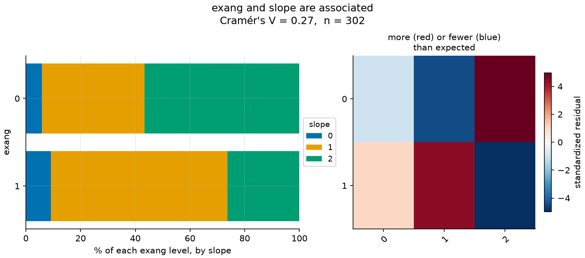

| | |
| :--- | :--- |
| Test used | chi-square test of independence |
| Test statistic | 24.76 |
| Degrees of freedom | 2 |
| Raw p-value | <0.001 |
| Adjusted p-value (q) | <0.001 |
| Effect size | Cramér's V = 0.27 (95% CI 0.17 to 0.39), small |
| Records used | 302 |

How was this tested?

Every cell of the table had enough expected records, so the standard chi-square test of independence was used.

Where do the numbers come from?

| Fact | Shown as | Comes from |
| :--- | :--- | :--- |
| `cell1_col` | 2 | `TestResult.descriptives.top_residual_cells[0].col` |
| `cell1_expected` | 94.78 | `TestResult.descriptives.top_residual_cells[0].expected` |
| `cell1_more_or_fewer` | more | `observed vs expected count` |
| `cell1_observed` | 115 | `TestResult.descriptives.top_residual_cells[0].observed` |
| `cell1_row` | 0 | `TestResult.descriptives.top_residual_cells[0].row` |
| `cell2_col` | 2 | `TestResult.descriptives.top_residual_cells[1].col` |
| `cell2_expected` | 46.22 | `TestResult.descriptives.top_residual_cells[1].expected` |
| `cell2_more_or_fewer` | fewer | `observed vs expected count` |
| `cell2_observed` | 26 | `TestResult.descriptives.top_residual_cells[1].observed` |
| `cell2_row` | 1 | `TestResult.descriptives.top_residual_cells[1].row` |
| `ci_high` | 0.39 | `TestResult.effect.ci_high` |
| `ci_low` | 0.17 | `TestResult.effect.ci_low` |
| `col_a` | exang | `Hypothesis.column_a` |
| `col_b` | slope | `Hypothesis.column_b` |
| `col_label0` | 0 | `TestResult.descriptives.col_labels[0]` |
| `col_label1` | 1 | `TestResult.descriptives.col_labels[1]` |
| `col_label2` | 2 | `TestResult.descriptives.col_labels[2]` |
| `comparable_value` | 0.27 | `TestResult.effect.comparable_value` |
| `df` | 2 | `TestResult.df` |
| `direction_word` | any | `TestResult.direction_observed` |
| `effect_abs` | 0.27 | `abs(TestResult.effect.value)` |
| `effect_name` | Cramér's V | `TestResult.effect.name` |
| `effect_value` | 0.27 | `TestResult.effect.value` |
| `family_size` | 91 | `ValidationDecision.family_size` |
| `magnitude_label` | small | `TestResult.effect.magnitude` |
| `n_cols_table` | 3 | `len(TestResult.descriptives.col_labels)` |
| `n_rows_table` | 2 | `len(TestResult.descriptives.row_labels)` |
| `n_used` | 302 | `TestResult.n_used` |
| `p_raw` | <0.001 | `ValidationDecision.p_raw` |
| `q_value` | <0.001 | `ValidationDecision.q_value` |
| `row_label0` | 0 | `TestResult.descriptives.row_labels[0]` |
| `row_label1` | 1 | `TestResult.descriptives.row_labels[1]` |
| `statistic` | 24.76 | `TestResult.statistic` |
| `test_name` | chi-square test of independence | `TestResult.test_name` |

### 2.29 `ca` ↔ `cp`

ca and cp are associated (Cramér's V = 0.16, 95% CI 0.12 to 0.24, small; n = 298). The largest departure from independence: fewer records with ca = 0 and cp = 0 than expected if the columns were unrelated (65 observed vs 83.39 expected). After correcting for 91 tests (Benjamini-Hochberg method, false discovery rate 5.0%), the association is statistically supported (adjusted p <0.001). Rare levels with fewer than 8 records were left out of this test (ca:4). This is an association, not evidence of cause and effect.

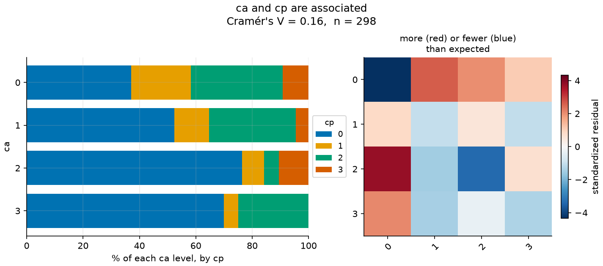

| | |
| :--- | :--- |
| Test used | chi-square test of independence |
| Test statistic | 31.01 |
| Degrees of freedom | 9 |
| Raw p-value | <0.001 |
| Adjusted p-value (q) | <0.001 |
| Effect size | Cramér's V = 0.16 (95% CI 0.12 to 0.24), small |
| Records used | 298 |

How was this tested?

Every cell of the table had enough expected records, so the standard chi-square test of independence was used.

Where do the numbers come from?

| Fact | Shown as | Comes from |
| :--- | :--- | :--- |
| `cell1_col` | 0 | `TestResult.descriptives.top_residual_cells[0].col` |
| `cell1_expected` | 83.39 | `TestResult.descriptives.top_residual_cells[0].expected` |
| `cell1_more_or_fewer` | fewer | `observed vs expected count` |
| `cell1_observed` | 65 | `TestResult.descriptives.top_residual_cells[0].observed` |
| `cell1_row` | 0 | `TestResult.descriptives.top_residual_cells[0].row` |
| `cell2_col` | 0 | `TestResult.descriptives.top_residual_cells[1].col` |
| `cell2_expected` | 18.11 | `TestResult.descriptives.top_residual_cells[1].expected` |
| `cell2_more_or_fewer` | more | `observed vs expected count` |
| `cell2_observed` | 29 | `TestResult.descriptives.top_residual_cells[1].observed` |
| `cell2_row` | 2 | `TestResult.descriptives.top_residual_cells[1].row` |
| `ci_high` | 0.24 | `TestResult.effect.ci_high` |
| `ci_low` | 0.12 | `TestResult.effect.ci_low` |
| `col_a` | ca | `Hypothesis.column_a` |
| `col_b` | cp | `Hypothesis.column_b` |
| `col_label0` | 0 | `TestResult.descriptives.col_labels[0]` |
| `col_label1` | 1 | `TestResult.descriptives.col_labels[1]` |
| `col_label2` | 2 | `TestResult.descriptives.col_labels[2]` |
| `col_label3` | 3 | `TestResult.descriptives.col_labels[3]` |
| `comparable_value` | 0.27 | `TestResult.effect.comparable_value` |
| `df` | 9 | `TestResult.df` |
| `direction_word` | any | `TestResult.direction_observed` |
| `dropped_level0` | ca:4 | `TestResult.descriptives.dropped_levels[0]` |
| `effect_abs` | 0.16 | `abs(TestResult.effect.value)` |
| `effect_name` | Cramér's V | `TestResult.effect.name` |
| `effect_value` | 0.16 | `TestResult.effect.value` |
| `family_size` | 91 | `ValidationDecision.family_size` |
| `magnitude_label` | small | `TestResult.effect.magnitude` |
| `n_cols_table` | 4 | `len(TestResult.descriptives.col_labels)` |
| `n_rows_table` | 4 | `len(TestResult.descriptives.row_labels)` |
| `n_used` | 298 | `TestResult.n_used` |
| `p_raw` | <0.001 | `ValidationDecision.p_raw` |
| `q_value` | <0.001 | `ValidationDecision.q_value` |
| `row_label0` | 0 | `TestResult.descriptives.row_labels[0]` |
| `row_label1` | 1 | `TestResult.descriptives.row_labels[1]` |
| `row_label2` | 2 | `TestResult.descriptives.row_labels[2]` |
| `row_label3` | 3 | `TestResult.descriptives.row_labels[3]` |
| `statistic` | 31.01 | `TestResult.statistic` |
| `test_name` | chi-square test of independence | `TestResult.test_name` |

### 2.30 `cp` ↔ `slope`

cp and slope are associated (Cramér's V = 0.19, 95% CI 0.12 to 0.29, small; n = 302). The largest departure from independence: fewer records with cp = 0 and slope = 2 than expected if the columns were unrelated (48 observed vs 66.76 expected). After correcting for 91 tests (Benjamini-Hochberg method, false discovery rate 5.0%), the association is statistically supported (adjusted p <0.001). This is an association, not evidence of cause and effect.

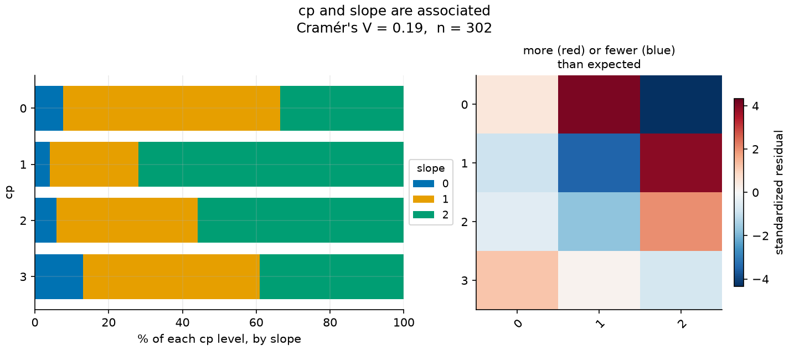

| | |
| :--- | :--- |
| Test used | chi-square test of independence |
| Test statistic | 27.39 |
| Degrees of freedom | 6 |
| Raw p-value | <0.001 |
| Adjusted p-value (q) | <0.001 |
| Effect size | Cramér's V = 0.19 (95% CI 0.12 to 0.29), small |
| Records used | 302 |

How was this tested?

Every cell of the table had enough expected records, so the standard chi-square test of independence was used.

Where do the numbers come from?

| Fact | Shown as | Comes from |
| :--- | :--- | :--- |
| `cell1_col` | 2 | `TestResult.descriptives.top_residual_cells[0].col` |
| `cell1_expected` | 66.76 | `TestResult.descriptives.top_residual_cells[0].expected` |
| `cell1_more_or_fewer` | fewer | `observed vs expected count` |
| `cell1_observed` | 48 | `TestResult.descriptives.top_residual_cells[0].observed` |
| `cell1_row` | 0 | `TestResult.descriptives.top_residual_cells[0].row` |
| `cell2_col` | 1 | `TestResult.descriptives.top_residual_cells[1].col` |
| `cell2_expected` | 66.29 | `TestResult.descriptives.top_residual_cells[1].expected` |
| `cell2_more_or_fewer` | more | `observed vs expected count` |
| `cell2_observed` | 84 | `TestResult.descriptives.top_residual_cells[1].observed` |
| `cell2_row` | 0 | `TestResult.descriptives.top_residual_cells[1].row` |
| `ci_high` | 0.29 | `TestResult.effect.ci_high` |
| `ci_low` | 0.12 | `TestResult.effect.ci_low` |
| `col_a` | cp | `Hypothesis.column_a` |
| `col_b` | slope | `Hypothesis.column_b` |
| `col_label0` | 0 | `TestResult.descriptives.col_labels[0]` |
| `col_label1` | 1 | `TestResult.descriptives.col_labels[1]` |
| `col_label2` | 2 | `TestResult.descriptives.col_labels[2]` |
| `comparable_value` | 0.27 | `TestResult.effect.comparable_value` |
| `df` | 6 | `TestResult.df` |
| `direction_word` | any | `TestResult.direction_observed` |
| `effect_abs` | 0.19 | `abs(TestResult.effect.value)` |
| `effect_name` | Cramér's V | `TestResult.effect.name` |
| `effect_value` | 0.19 | `TestResult.effect.value` |
| `family_size` | 91 | `ValidationDecision.family_size` |
| `magnitude_label` | small | `TestResult.effect.magnitude` |
| `n_cols_table` | 3 | `len(TestResult.descriptives.col_labels)` |
| `n_rows_table` | 4 | `len(TestResult.descriptives.row_labels)` |
| `n_used` | 302 | `TestResult.n_used` |
| `p_raw` | <0.001 | `ValidationDecision.p_raw` |
| `q_value` | <0.001 | `ValidationDecision.q_value` |
| `row_label0` | 0 | `TestResult.descriptives.row_labels[0]` |
| `row_label1` | 1 | `TestResult.descriptives.row_labels[1]` |
| `row_label2` | 2 | `TestResult.descriptives.row_labels[2]` |
| `row_label3` | 3 | `TestResult.descriptives.row_labels[3]` |
| `statistic` | 27.39 | `TestResult.statistic` |
| `test_name` | chi-square test of independence | `TestResult.test_name` |

**Further validated findings** (not shown in full):

| Columns | Test | Effect | Adjusted p |
| :--- | :--- | :--- | :--- |
| `age` ↔ `oldpeak` | Spearman rank correlation test | Spearman rho = 0.26 | <0.001 |
| `ca` ↔ `thal` | Monte Carlo (permutation) chi-square test | Cramér's V = 0.16 | 0.005 |
| `thalach` ↔ `slope` | Welch's ANOVA | eta squared = 0.20 | <0.001 |
| `age` ↔ `chol` | Spearman rank correlation test | Spearman rho = 0.19 | 0.003 |
| `ca` ↔ `exang` | chi-square test of independence | Cramér's V = 0.18 | 0.015 |
| `restecg` ↔ `target` | chi-square test of independence | Cramér's V = 0.16 | 0.010 |
| `oldpeak` ↔ `trestbps` | Spearman rank correlation test | Spearman rho = 0.16 | 0.015 |
| `thalach` ↔ `cp` | Welch's ANOVA | eta squared = 0.15 | <0.001 |
| `age` ↔ `ca` | Welch's ANOVA | eta squared = 0.15 | <0.001 |
| `oldpeak` ↔ `cp` | Kruskal-Wallis test | epsilon squared = 0.14 | <0.001 |
| `oldpeak` ↔ `thal` | Kruskal-Wallis test | epsilon squared = 0.13 | <0.001 |
| `exang` ↔ `sex` | chi-square test of independence | Cramér's V = 0.13 | 0.026 |
| `chol` ↔ `trestbps` | Spearman rank correlation test | Spearman rho = 0.13 | 0.046 |
| `thalach` ↔ `ca` | Welch's ANOVA | eta squared = 0.09 | <0.001 |
| `thalach` ↔ `thal` | Welch's ANOVA | eta squared = 0.09 | <0.001 |
| `oldpeak` ↔ `ca` | Kruskal-Wallis test | epsilon squared = 0.08 | <0.001 |
| `age` ↔ `slope` | Welch's ANOVA | eta squared = 0.04 | 0.017 |

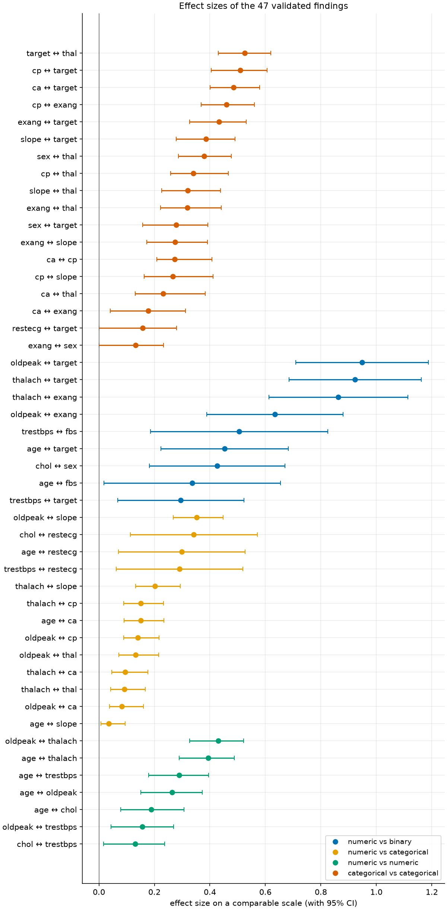

## 3. Patterns that looked interesting but were rejected

These patterns had the lowest raw p-values among the rejected tests. Each of them would look like a discovery to a naive analysis that tests 91 pairs without correction.

| Columns | Test | Raw p | Adjusted p | Effect | Why it was rejected |
| :--- | :--- | :--- | :--- | :--- | :--- |
| `age` ↔ `cp` | Welch's ANOVA | 0.032 | 0.060 | eta squared = 0.03 | Raw p = 0.032, but after correcting for 91 tests the adjusted p is 0.060. With this many comparisons, a pattern like this is expected by chance, so it is not reported as a finding. |
| `oldpeak` ↔ `restecg` | Welch's t-test | 0.039 | 0.072 | Hedges' g = 0.24 | Raw p = 0.039, but after correcting for 91 tests the adjusted p is 0.072. With this many comparisons, a pattern like this is expected by chance, so it is not reported as a finding. |
| `restecg` ↔ `slope` | chi-square test of independence | 0.046 | 0.084 | Cramér's V = 0.12 | Raw p = 0.046, but after correcting for 91 tests the adjusted p is 0.084. With this many comparisons, a pattern like this is expected by chance, so it is not reported as a finding. |
| `trestbps` ↔ `thal` | Welch's ANOVA | 0.050 | 0.089 | eta squared = 0.02 | Raw p = 0.050, but after correcting for 91 tests the adjusted p is 0.089. With this many comparisons, a pattern like this is expected by chance, so it is not reported as a finding. |
| `trestbps` ↔ `cp` | Kruskal-Wallis test | 0.052 | 0.089 | epsilon squared = 0.03 | Raw p = 0.052, but after correcting for 91 tests the adjusted p is 0.089. With this many comparisons, a pattern like this is expected by chance, so it is not reported as a finding. |
| `cp` ↔ `restecg` | chi-square test of independence | 0.052 | 0.089 | Cramér's V = 0.13 | Raw p = 0.052, but after correcting for 91 tests the adjusted p is 0.089. With this many comparisons, a pattern like this is expected by chance, so it is not reported as a finding. |
| `age` ↔ `thal` | Welch's ANOVA | 0.062 | 0.105 | eta squared = 0.02 | Raw p = 0.062, but after correcting for 91 tests the adjusted p is 0.105. With this many comparisons, a pattern like this is expected by chance, so it is not reported as a finding. |
| `ca` ↔ `fbs` | chi-square test of independence | 0.063 | 0.105 | Cramér's V = 0.12 | Raw p = 0.063, but after correcting for 91 tests the adjusted p is 0.105. With this many comparisons, a pattern like this is expected by chance, so it is not reported as a finding. |
| `cp` ↔ `sex` | chi-square test of independence | 0.069 | 0.112 | Cramér's V = 0.12 | Raw p = 0.069, but after correcting for 91 tests the adjusted p is 0.112. With this many comparisons, a pattern like this is expected by chance, so it is not reported as a finding. |
| `oldpeak` ↔ `sex` | Welch's t-test | 0.083 | 0.133 | Hedges' g = -0.21 | Raw p = 0.083, but after correcting for 91 tests the adjusted p is 0.133. With this many comparisons, a pattern like this is expected by chance, so it is not reported as a finding. |

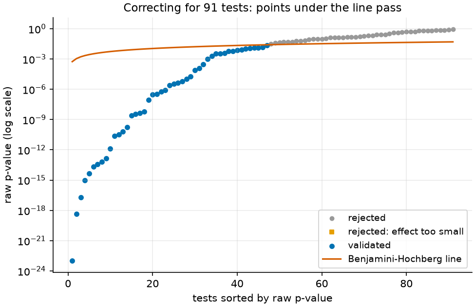

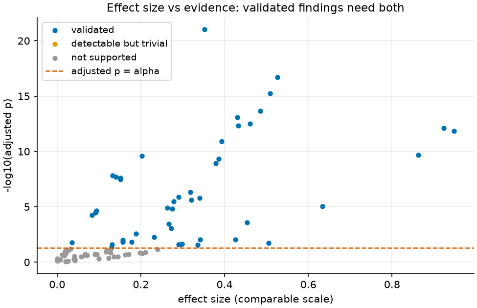

## 4. Likely derived or duplicated columns

None found.

## 5. Data quality summary

- Raw file: 303 rows × 14 columns; after cleaning: 302 rows × 14 columns.
- Missing cells in the raw file: 0.0%.
- Exact duplicate rows removed: 1.
- Logged cleaning changes: 6, touching 14 cells (see the cleaning log).

## 6. Methods

**Hypotheses.** Hypotheses were generated in exhaustive mode from the column types only, before any test was run. 14 of 14 columns were eligible and 91 pairs were tested. A language model was not used to choose or change the tests.

**Tests.** Each pair is tested with a fixed, unit-tested test chosen by rules that check the data's shape first:

| Relationship | Default test | Fallback when assumptions fail |
| :--- | :--- | :--- |
| numeric vs a binary column | Welch's t-test | Mann-Whitney U test |
| numeric vs several groups | Welch's ANOVA | Kruskal-Wallis test |
| numeric vs numeric | Pearson correlation | Spearman rank correlation |
| category vs category | chi-square test | Fisher's exact test or a Monte Carlo (permutation) chi-square test |

Groups with fewer than 8 records are left out, and a pair needs at least 20 complete records. Groups of at least 50 records may use the parametric test when skewness stays below 2.00. Confidence intervals use 2,000 bootstrap resamples; permutation tests use 9,999 resamples.

**Correction.** All tests form a single family. The Benjamini-Hochberg method controls the false discovery rate at 5.0%: on average, at most this share of the reported findings should be false.

**Effect-size floors.** A result must also have an effect that is not negligible:

| Effect measure | Smallest effect reported |
| :--- | :--- |
| Hedges' g (binary groups) | 0.20 |
| rank-biserial correlation | 0.10 |
| Pearson r / Spearman rho | 0.10 |
| eta squared | 0.01 |
| epsilon squared | 0.01 |
| Cramér's V (comparable scale) | 0.10 |

**What 'validated' means.** A finding is validated when its adjusted p-value is below the false discovery rate, its effect is above the floor, and its test's assumptions were met or a suitable fallback test was used.

## 7. Limitations

- **Association, not causation.** Every finding describes how columns move together in this data. None of them shows that a column is the reason for another.
- **Rows are assumed independent.** The tests assume each row is a separate, unrelated record. Repeated measurements of the same person, place or time period break this assumption and make the results look more reliable than they are.
- **Pairwise only.** Each test looks at a single pair of columns. Interactions between several columns and confounding by a third column are not controlled for.
- **Correction under dependence.** The Benjamini-Hochberg correction assumes the tests are independent or positively dependent. Tests that share columns are dependent. In the planted-truth calibration it still kept the false discovery rate near the target with strongly correlated columns, but unusual (negative) dependence is not covered; the Benjamini-Yekutieli option (`stats.correction: by`) is the safer choice then.
- **Adjusted p-values are not per-finding error chances.** The correction controls the share of false findings across the whole list. A finding whose adjusted p-value is close to the cut-off is more likely to be a false lead than a finding far below it.
- **Effects of selected findings are optimistic.** Effect sizes and confidence intervals are reported for the findings that passed the checks, so they tend to be somewhat larger than the true effects. The intervals are not adjusted for this selection.
- **Missing data.** Each test uses the rows where both columns are present (pairwise deletion). If values are missing for a reason related to the columns, results can be biased.
- **Cleaning choices matter.** The results depend on the cleaning steps listed in the data quality section, such as removing duplicates and turning placeholder text into missing values.
- **Role of the language model.** No language model produced or changed any number in this report. The explanations are filled from fixed templates and every number is checked against the computed results.

## 8. Appendix

### All results

| Columns | Test | Raw p | Adjusted p | Effect | Decision |
| :--- | :--- | :--- | :--- | :--- | :--- |
| `oldpeak` ↔ `slope` | Kruskal-Wallis test | <0.001 | <0.001 | epsilon squared = 0.35 | validated |
| `target` ↔ `thal` | chi-square test of independence | <0.001 | <0.001 | Cramér's V = 0.53 | validated |
| `cp` ↔ `target` | chi-square test of independence | <0.001 | <0.001 | Cramér's V = 0.51 | validated |
| `ca` ↔ `target` | chi-square test of independence | <0.001 | <0.001 | Cramér's V = 0.49 | validated |
| `oldpeak` ↔ `thalach` | Spearman rank correlation test | <0.001 | <0.001 | Spearman rho = -0.43 | validated |
| `cp` ↔ `exang` | chi-square test of independence | <0.001 | <0.001 | Cramér's V = 0.46 | validated |
| `exang` ↔ `target` | chi-square test of independence | <0.001 | <0.001 | Cramér's V = 0.43 | validated |
| `thalach` ↔ `target` | Welch's t-test | <0.001 | <0.001 | Hedges' g = -0.92 | validated |
| `oldpeak` ↔ `target` | Welch's t-test | <0.001 | <0.001 | Hedges' g = 0.95 | validated |
| `age` ↔ `thalach` | Spearman rank correlation test | <0.001 | <0.001 | Spearman rho = -0.39 | validated |
| `thalach` ↔ `exang` | Welch's t-test | <0.001 | <0.001 | Hedges' g = 0.86 | validated |
| `thalach` ↔ `slope` | Welch's ANOVA | <0.001 | <0.001 | eta squared = 0.20 | validated |
| `slope` ↔ `target` | chi-square test of independence | <0.001 | <0.001 | Cramér's V = 0.39 | validated |
| `sex` ↔ `thal` | chi-square test of independence | <0.001 | <0.001 | Cramér's V = 0.38 | validated |
| `oldpeak` ↔ `thal` | Kruskal-Wallis test | <0.001 | <0.001 | epsilon squared = 0.13 | validated |
| `oldpeak` ↔ `cp` | Kruskal-Wallis test | <0.001 | <0.001 | epsilon squared = 0.14 | validated |
| `age` ↔ `ca` | Welch's ANOVA | <0.001 | <0.001 | eta squared = 0.15 | validated |
| `thalach` ↔ `cp` | Welch's ANOVA | <0.001 | <0.001 | eta squared = 0.15 | validated |
| `exang` ↔ `thal` | chi-square test of independence | <0.001 | <0.001 | Cramér's V = 0.32 | validated |
| `age` ↔ `trestbps` | Spearman rank correlation test | <0.001 | <0.001 | Spearman rho = 0.29 | validated |
| `cp` ↔ `thal` | chi-square test of independence | <0.001 | <0.001 | Cramér's V = 0.24 | validated |
| `slope` ↔ `thal` | chi-square test of independence | <0.001 | <0.001 | Cramér's V = 0.23 | validated |
| `sex` ↔ `target` | chi-square test of independence | <0.001 | <0.001 | Cramér's V = 0.28 | validated |
| `oldpeak` ↔ `exang` | Welch's t-test | <0.001 | <0.001 | Hedges' g = -0.63 | validated |
| `age` ↔ `oldpeak` | Spearman rank correlation test | <0.001 | <0.001 | Spearman rho = 0.26 | validated |
| `exang` ↔ `slope` | chi-square test of independence | <0.001 | <0.001 | Cramér's V = 0.27 | validated |
| `thalach` ↔ `ca` | Welch's ANOVA | <0.001 | <0.001 | eta squared = 0.09 | validated |
| `thalach` ↔ `thal` | Welch's ANOVA | <0.001 | <0.001 | eta squared = 0.09 | validated |
| `oldpeak` ↔ `ca` | Kruskal-Wallis test | <0.001 | <0.001 | epsilon squared = 0.08 | validated |
| `age` ↔ `target` | Welch's t-test | <0.001 | <0.001 | Hedges' g = 0.45 | validated |
| `cp` ↔ `slope` | chi-square test of independence | <0.001 | <0.001 | Cramér's V = 0.19 | validated |
| `ca` ↔ `cp` | chi-square test of independence | <0.001 | <0.001 | Cramér's V = 0.16 | validated |
| `age` ↔ `chol` | Spearman rank correlation test | <0.001 | 0.003 | Spearman rho = 0.19 | validated |
| `ca` ↔ `thal` | Monte Carlo (permutation) chi-square test | 0.002 | 0.005 | Cramér's V = 0.16 | validated |
| `chol` ↔ `sex` | Welch's t-test | 0.003 | 0.009 | Hedges' g = 0.43 | validated |
| `chol` ↔ `restecg` | Welch's t-test | 0.003 | 0.009 | Hedges' g = 0.34 | validated |
| `restecg` ↔ `target` | chi-square test of independence | 0.004 | 0.010 | Cramér's V = 0.16 | validated |
| `ca` ↔ `exang` | chi-square test of independence | 0.006 | 0.015 | Cramér's V = 0.18 | validated |
| `oldpeak` ↔ `trestbps` | Spearman rank correlation test | 0.006 | 0.015 | Spearman rho = 0.16 | validated |
| `age` ↔ `slope` | Welch's ANOVA | 0.007 | 0.017 | eta squared = 0.04 | validated |
| `trestbps` ↔ `fbs` | Welch's t-test | 0.008 | 0.018 | Hedges' g = -0.51 | validated |
| `age` ↔ `restecg` | Welch's t-test | 0.010 | 0.022 | Hedges' g = 0.30 | validated |
| `trestbps` ↔ `target` | Welch's t-test | 0.012 | 0.025 | Hedges' g = 0.30 | validated |
| `exang` ↔ `sex` | chi-square test of independence | 0.013 | 0.026 | Cramér's V = 0.13 | validated |
| `trestbps` ↔ `restecg` | Welch's t-test | 0.013 | 0.026 | Hedges' g = 0.29 | validated |
| `age` ↔ `fbs` | Welch's t-test | 0.014 | 0.027 | Hedges' g = -0.34 | validated |
| `chol` ↔ `trestbps` | Spearman rank correlation test | 0.024 | 0.046 | Spearman rho = 0.13 | validated |
| `age` ↔ `cp` | Welch's ANOVA | 0.032 | 0.060 | eta squared = 0.03 | rejected: not supported after correction |
| `oldpeak` ↔ `restecg` | Welch's t-test | 0.039 | 0.072 | Hedges' g = 0.24 | rejected: not supported after correction |
| `restecg` ↔ `slope` | chi-square test of independence | 0.046 | 0.084 | Cramér's V = 0.12 | rejected: not supported after correction |
| `trestbps` ↔ `thal` | Welch's ANOVA | 0.050 | 0.089 | eta squared = 0.02 | rejected: not supported after correction |
| `trestbps` ↔ `cp` | Kruskal-Wallis test | 0.052 | 0.089 | epsilon squared = 0.03 | rejected: not supported after correction |
| `cp` ↔ `restecg` | chi-square test of independence | 0.052 | 0.089 | Cramér's V = 0.13 | rejected: not supported after correction |
| `age` ↔ `thal` | Welch's ANOVA | 0.062 | 0.105 | eta squared = 0.02 | rejected: not supported after correction |
| `ca` ↔ `fbs` | chi-square test of independence | 0.063 | 0.105 | Cramér's V = 0.12 | rejected: not supported after correction |
| `cp` ↔ `sex` | chi-square test of independence | 0.069 | 0.112 | Cramér's V = 0.12 | rejected: not supported after correction |
| `oldpeak` ↔ `sex` | Welch's t-test | 0.083 | 0.133 | Hedges' g = -0.21 | rejected: not supported after correction |
| `chol` ↔ `ca` | Kruskal-Wallis test | 0.091 | 0.142 | epsilon squared = 0.02 | rejected: not supported after correction |
| `ca` ↔ `slope` | Monte Carlo (permutation) chi-square test | 0.093 | 0.142 | Cramér's V = 0.09 | rejected: not supported after correction |
| `age` ↔ `exang` | Welch's t-test | 0.094 | 0.142 | Hedges' g = -0.20 | rejected: not supported after correction, effect too small |
| `age` ↔ `sex` | Welch's t-test | 0.108 | 0.161 | Hedges' g = 0.20 | rejected: not supported after correction |
| `exang` ↔ `restecg` | chi-square test of independence | 0.128 | 0.188 | Cramér's V = 0.07 | rejected: not supported after correction, effect too small |
| `ca` ↔ `restecg` | chi-square test of independence | 0.131 | 0.189 | Cramér's V = 0.09 | rejected: not supported after correction, effect too small |
| `thalach` ↔ `restecg` | Welch's t-test | 0.139 | 0.198 | Hedges' g = -0.17 | rejected: not supported after correction, effect too small |
| `ca` ↔ `sex` | chi-square test of independence | 0.142 | 0.199 | Cramér's V = 0.09 | rejected: not supported after correction, effect too small |
| `trestbps` ↔ `slope` | Welch's ANOVA | 0.149 | 0.205 | eta squared = 0.02 | rejected: not supported after correction |
| `chol` ↔ `target` | Welch's t-test | 0.155 | 0.209 | Hedges' g = 0.16 | rejected: not supported after correction, effect too small |
| `chol` ↔ `thal` | Kruskal-Wallis test | 0.156 | 0.209 | epsilon squared = 0.01 | rejected: not supported after correction |
| `fbs` ↔ `thal` | chi-square test of independence | 0.169 | 0.223 | Cramér's V = 0.07 | rejected: not supported after correction, effect too small |
| `fbs` ↔ `slope` | chi-square test of independence | 0.188 | 0.244 | Cramér's V = 0.07 | rejected: not supported after correction, effect too small |
| `trestbps` ↔ `ca` | Welch's ANOVA | 0.201 | 0.258 | eta squared = 0.02 | rejected: not supported after correction |
| `fbs` ↔ `restecg` | chi-square test of independence | 0.219 | 0.276 | Cramér's V = 0.04 | rejected: not supported after correction, effect too small |
| `chol` ↔ `exang` | Welch's t-test | 0.256 | 0.319 | Hedges' g = -0.14 | rejected: not supported after correction, effect too small |
| `cp` ↔ `fbs` | chi-square test of independence | 0.261 | 0.319 | Cramér's V = 0.06 | rejected: not supported after correction, effect too small |
| `trestbps` ↔ `exang` | Welch's t-test | 0.263 | 0.319 | Hedges' g = -0.15 | rejected: not supported after correction, effect too small |
| `trestbps` ↔ `sex` | Welch's t-test | 0.344 | 0.412 | Hedges' g = 0.12 | rejected: not supported after correction, effect too small |
| `thalach` ↔ `sex` | Welch's t-test | 0.390 | 0.461 | Hedges' g = 0.10 | rejected: not supported after correction, effect too small |
| `fbs` ↔ `sex` | chi-square test of independence | 0.424 | 0.494 | Cramér's V = 0.00 | rejected: not supported after correction, effect too small |
| `thalach` ↔ `trestbps` | Spearman rank correlation test | 0.460 | 0.530 | Spearman rho = -0.04 | rejected: not supported after correction, effect too small |
| `chol` ↔ `thalach` | Spearman rank correlation test | 0.485 | 0.551 | Spearman rho = -0.04 | rejected: not supported after correction, effect too small |
| `chol` ↔ `oldpeak` | Spearman rank correlation test | 0.493 | 0.554 | Spearman rho = 0.04 | rejected: not supported after correction, effect too small |
| `chol` ↔ `cp` | Kruskal-Wallis test | 0.515 | 0.571 | epsilon squared = 0.01 | rejected: not supported after correction, effect too small |
| `restecg` ↔ `sex` | chi-square test of independence | 0.639 | 0.689 | Cramér's V = 0.00 | rejected: not supported after correction, effect too small |
| `fbs` ↔ `target` | chi-square test of independence | 0.641 | 0.689 | Cramér's V = 0.00 | rejected: not supported after correction, effect too small |
| `oldpeak` ↔ `fbs` | Mann-Whitney U test | 0.644 | 0.689 | rank-biserial correlation = -0.04 | rejected: not supported after correction, effect too small |
| `exang` ↔ `fbs` | chi-square test of independence | 0.667 | 0.706 | Cramér's V = 0.00 | rejected: not supported after correction, effect too small |
| `restecg` ↔ `thal` | chi-square test of independence | 0.678 | 0.710 | Cramér's V = 0.00 | rejected: not supported after correction, effect too small |
| `sex` ↔ `slope` | chi-square test of independence | 0.715 | 0.739 | Cramér's V = 0.00 | rejected: not supported after correction, effect too small |
| `chol` ↔ `slope` | Kruskal-Wallis test | 0.723 | 0.739 | epsilon squared = 0.00 | rejected: not supported after correction, effect too small |
| `chol` ↔ `fbs` | Mann-Whitney U test | 0.778 | 0.787 | rank-biserial correlation = -0.03 | rejected: not supported after correction, effect too small |
| `thalach` ↔ `fbs` | Welch's t-test | 0.899 | 0.899 | Hedges' g = 0.02 | rejected: not supported after correction, effect too small |

### Reproducibility

- VeriData version: 0.1.0; resolved config hash: `f54a3d23c121`.
- Dataset SHA-256: `7c3014365675306819510a49ff289efbec1d1a6a666a2dc7652f1547b383d859`.
- Narration: deterministic templates (no language model).
