# Phase 1 Dataset Report — `insurance`

_Generated by the VeriData Phase 1 pipeline. Every number comes from code (no LLM). Relationship numbers are descriptive only; no hypothesis tests were run in Phase 1._

**Contents:** 1. Overview · 2. Columns · 3. Data cleaning · 4. Exploratory data analysis · 5. Insights · 6. Normalization / scaling · 7. Output files

## 1. Overview

| Item | Value |
| :--- | :--- |
| Source file | `data\raw\insurance\insurance.csv` |
| SHA-256 | `505c1cbc2e63d0363bac59501563df2530aadf4cdb9cfee226f4ef32f5468281` |
| Raw shape | 1,338 rows × 7 columns |
| Cleaned shape (conservative, primary) | 1,337 rows × 7 columns |
| Cleaned shape (imputed, secondary) | 1,337 rows × 7 columns |
| Exact duplicate rows in raw file | 1 |
| Missing cells in raw file (incl. placeholder text) | 0 (0.00%) |
| Memory (raw) | 0.552053 MB |
| Target column | `charges` (numeric) |

## 2. Column profile (raw file)

| Column | Raw dtype | Inferred type | Missing % | Unique | Why this type |
| :--- | :--- | :--- | ---: | ---: | :--- |
| `age` | `int64` | `numeric_continuous` | 0.0% | 47 | numeric values (100.0% parseable, 47 unique) |
| `sex` | `object` | `binary` | 0.0% | 2 | binary string/mixed encoding (gender binary (Male/Female): ['female', 'male']) |
| `bmi` | `float64` | `numeric_continuous` | 0.0% | 548 | numeric values (100.0% parseable, 548 unique) |
| `children` | `int64` | `numeric_discrete` | 0.0% | 6 | integer values with 6 unique levels (unique ratio 0.4%) |
| `smoker` | `object` | `binary` | 0.0% | 2 | binary string/mixed encoding (boolean-like (Yes/No/1/0): ['no', 'yes']) |
| `region` | `object` | `categorical_nominal` | 0.0% | 4 | string categorical with 4 normalized unique values (raw=4) |
| `charges` | `float64` | `numeric_continuous` | 0.0% | 1,337 | numeric values (100.0% parseable, 1337 unique) |

## 3. Data cleaning

2 cleaning steps made 3 logged changes touching 7 cells. Rows: 1,338 in the raw file → 1,337 in the conservative output → 1,337 in the imputed output.

### What the TA asked for

| Requirement | What the pipeline did |
| :--- | :--- |
| Missing values | ✔ checked; nothing to change. Conservative output keeps NaN; imputed output fills gaps and adds `__was_missing` flags |
| Duplicates | ✔ dropped duplicate rows: 1 rows |
| Outliers | ✔ flagged outliers: 148 rows. 4 column(s) flagged; values are kept in the conservative output |
| Inconsistent formats | ✔ checked; nothing to change |
| Empty rows / columns | ✔ checked; nothing to change |

### Changes by step

| Step | Log entries | Cells changed | Rows removed |
| :--- | ---: | ---: | ---: |
| `handle_duplicates` | 1 | 7 | 1 |
| `handle_outliers` | 2 | 0 | 0 |

### Outlier flags (1.5×IQR and modified z-score)

| Column | Flagged | Flagged % | Extreme (3×IQR) | Normal range (1.5×IQR) | Action |
| :--- | ---: | ---: | ---: | :--- | :--- |
| `age` | 0 | 0.00% | 0 | -9 to 87 | flag |
| `bmi` | 9 | 0.67% | 0 | 13.675 to 47.315 | flag |
| `charges` | 139 | 10.40% | 6 | -13,120.716 to 34,524.778 | flag |
| `children` | 0 | 0.00% | 0 | -3 to 5 | flag |

The full step-by-step log with before/after examples is in [cleaning_log.md](cleaning_log.md) (machine-readable: [cleaning_log.json](cleaning_log.json)).

## 4. Exploratory data analysis

### 4.1 Dataset overview

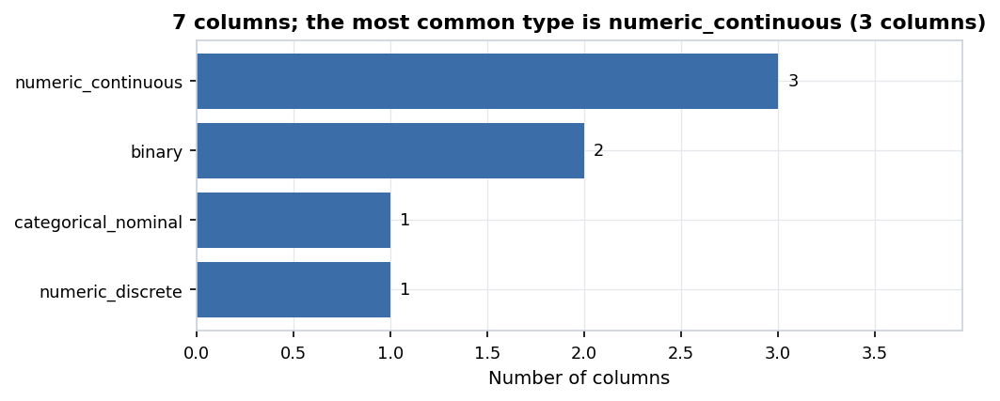

*Figure 1. 7 columns; the most common type is numeric_continuous (3 columns).* Count of columns by the semantic type the pipeline inferred (after cleaning).

| Item | Value |
| :--- | :--- |
| Rows (raw file) | 1,338 |
| Rows (cleaned, conservative) | 1,337 |
| Columns | 7 |
| Memory | 0.198 MB |
| Missing cells | 0 (0.0%) |
| Columns typed `numeric_continuous` | 3 |
| Columns typed `binary` | 2 |
| Columns typed `categorical_nominal` | 1 |
| Columns typed `numeric_discrete` | 1 |
| Columns left out of EDA (ID / excluded) | none |

### 4.2 Missing values

No missing values remain in the cleaned data.

**Missing values per column (cleaned data)**

No missing values remain in the cleaned data, so no missingness charts were drawn.

### 4.3 Numeric columns

Red dots in box plots are values beyond 1.5×IQR; they are flagged but kept in the conservative cleaned data.

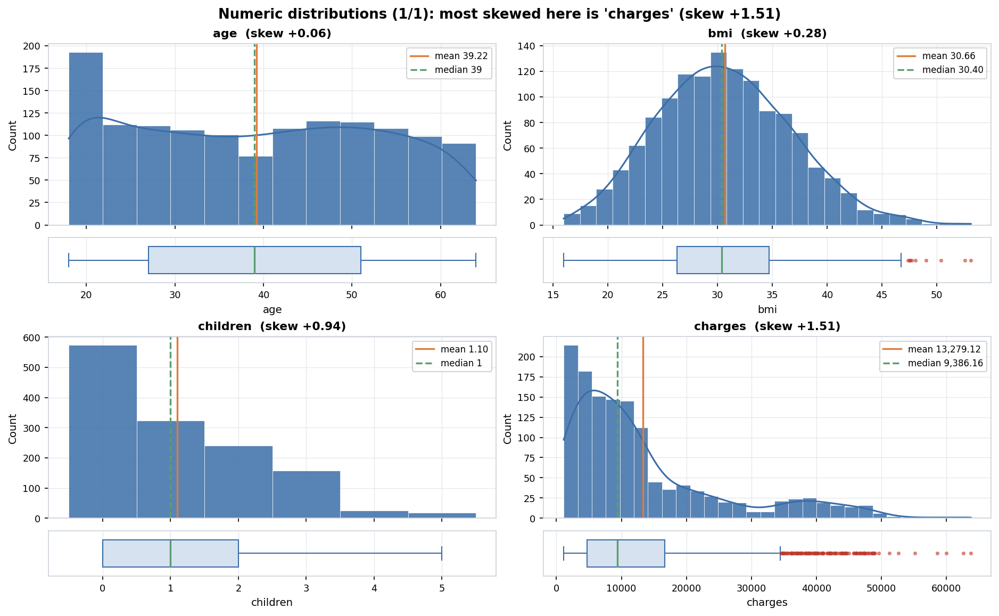

*Figure 2. Numeric distributions (1/1): most skewed here is 'charges' (skew +1.51).* Histogram (with a smooth density curve for many-valued columns) and a box plot per column. Orange line = mean, green dashed line = median; red dots are values beyond 1.5×IQR.

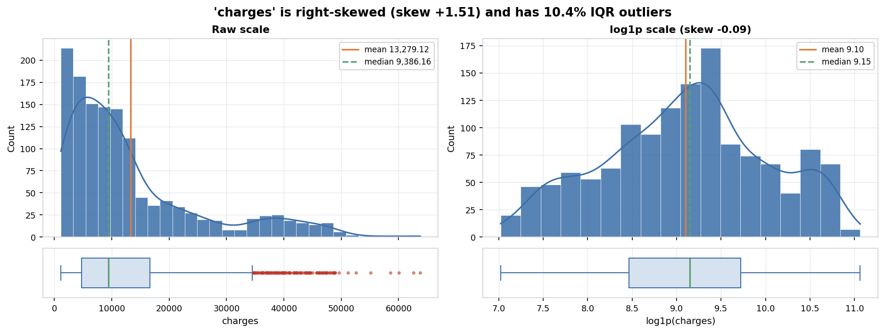

*Figure 3. 'charges' is right-skewed (skew +1.51) and has 10.4% IQR outliers.* Close-up of a skewed or outlier-heavy column. The right panel shows the same values on a log1p scale.

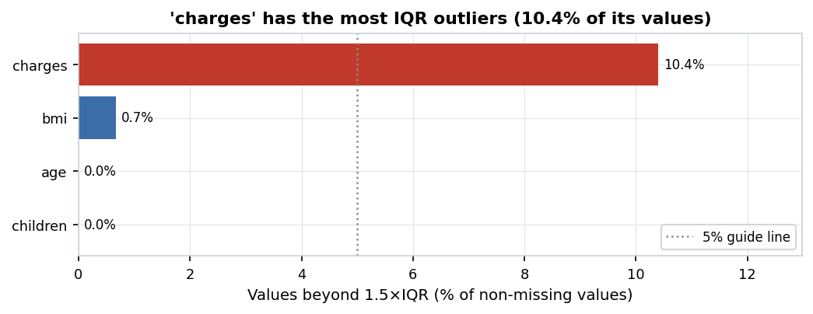

*Figure 4. 'charges' has the most IQR outliers (10.4% of its values).* Share of each numeric column's values outside 1.5×IQR. Outliers are only flagged, not removed, in the conservative cleaned data. Red bars are above the guide line.

**Numeric summary**

| Column | Count | Mean | Std | Min | Q1 | Median | Q3 | Max | Skew | Kurtosis | % zeros | % outliers (1.5×IQR) |
| :--- | ---: | ---: | ---: | ---: | ---: | ---: | ---: | ---: | ---: | ---: | ---: | ---: |
| age | 1,337 | 39.222 | 14.044 | 18 | 27 | 39 | 51 | 64 | 0.055 | -1.244 | 0 | 0 |
| bmi | 1,337 | 30.663 | 6.101 | 15.96 | 26.29 | 30.4 | 34.7 | 53.13 | 0.284 | -0.053 | 0 | 0.67 |
| children | 1,337 | 1.096 | 1.206 | 0 | 0 | 1 | 2 | 5 | 0.937 | 0.201 | 42.86 | 0 |
| charges | 1,337 | 13,279.121 | 12,110.36 | 1,121.874 | 4,746.344 | 9,386.161 | 16,657.717 | 63,770.428 | 1.515 | 1.604 | 0 | 10.4 |

### 4.4 Categorical and binary columns

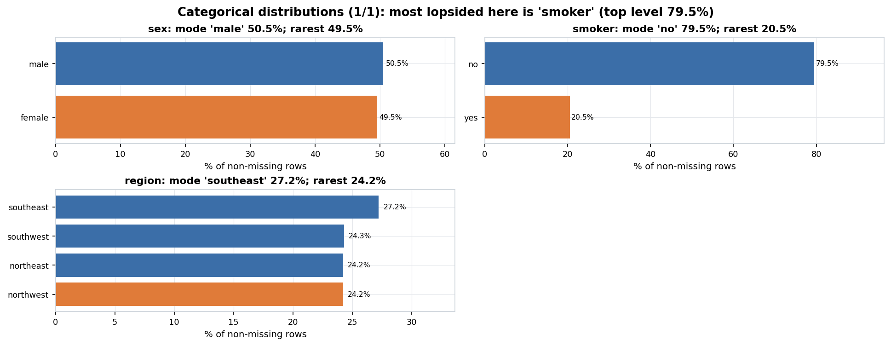

*Figure 5. Categorical distributions (1/1): most lopsided here is 'smoker' (top level 79.5%).* Share of rows per level (top 15 levels; the rest are grouped as 'Other'). The orange bar marks the smallest (minority) level.

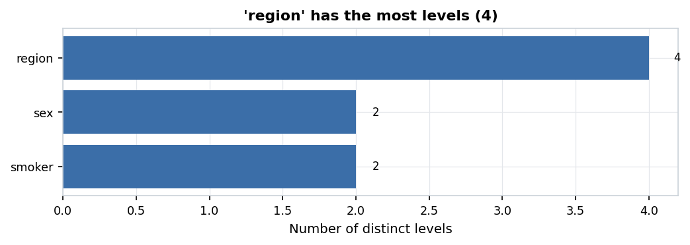

*Figure 6. 'region' has the most levels (4).* Number of distinct values in each categorical or binary column.

**Categorical summary**

| Column | Levels | Mode | Mode % | Entropy (0-1) | Rarest level | Rarest % | Levels under 1% of rows |
| :--- | ---: | :--- | ---: | ---: | :--- | ---: | ---: |
| sex | 2 | male | 50.49 | 1 | female | 49.51 | 0 |
| smoker | 2 | no | 79.51 | 0.732 | yes | 20.49 | 0 |
| region | 4 | southeast | 27.23 | 0.999 | northwest | 24.23 | 0 |

### 4.5 Target / class balance

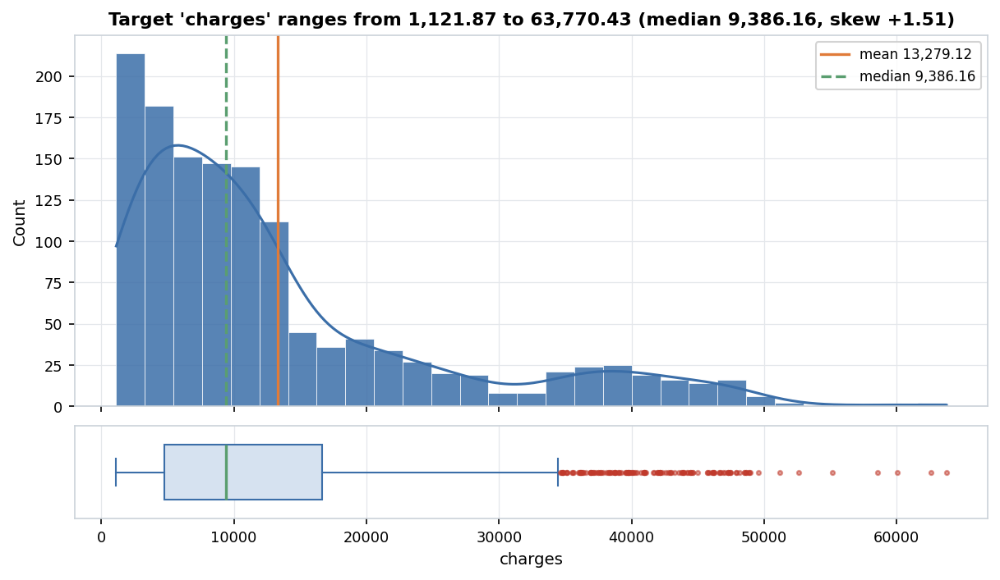

*Figure 7. Target 'charges' ranges from 1,121.87 to 63,770.43 (median 9,386.16, skew +1.51).* Distribution of the target column.

### 4.6 Relationships between columns (descriptive)

All coefficients here describe the data; none of them is a test result. Spearman rho and Pearson r range from -1 to +1; eta² and Cramér's V range from 0 (no association) to 1.

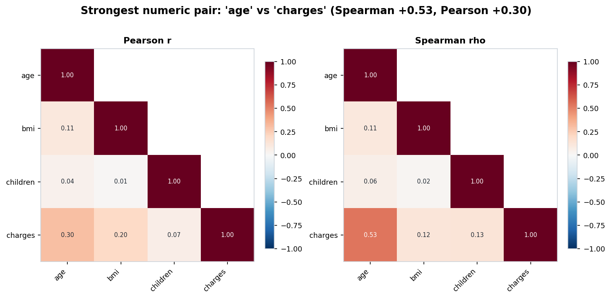

*Figure 8. Strongest numeric pair: 'age' vs 'charges' (Spearman +0.53, Pearson +0.30).* Correlation between numeric columns (lower triangle). Left: Pearson (linear). Right: Spearman (rank-based). Descriptive coefficients only; no hypothesis tests were run.

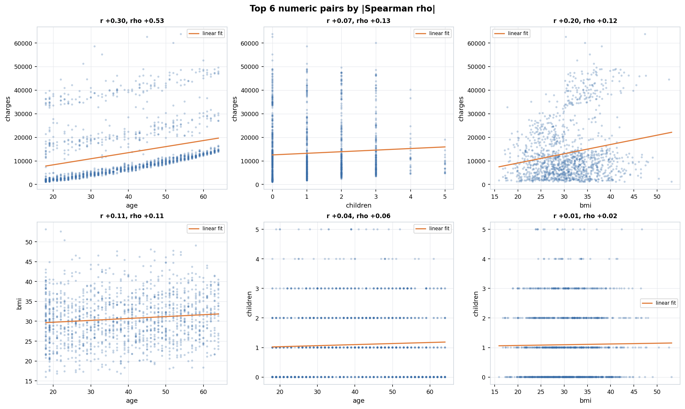

*Figure 9. Top 6 numeric pairs by |Spearman rho|.* Scatter plots with a straight-line fit for the most strongly related numeric pairs. Large datasets are randomly sampled for plotting. Descriptive coefficients only; no hypothesis tests were run.

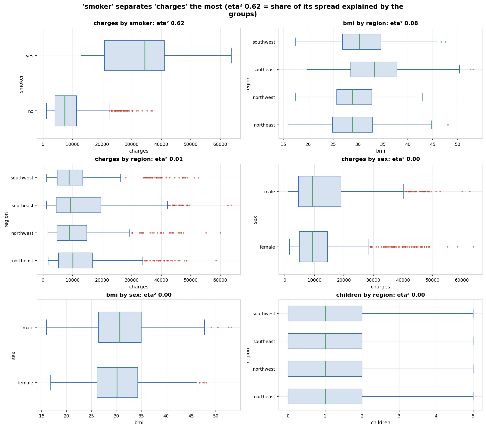

*Figure 10. 'smoker' separates 'charges' the most (eta² 0.62 = share of its spread explained by the groups).* Box plots of numeric columns split by categorical columns with up to 8 levels, for the pairs with the largest eta-squared. Descriptive coefficients only; no hypothesis tests were run.

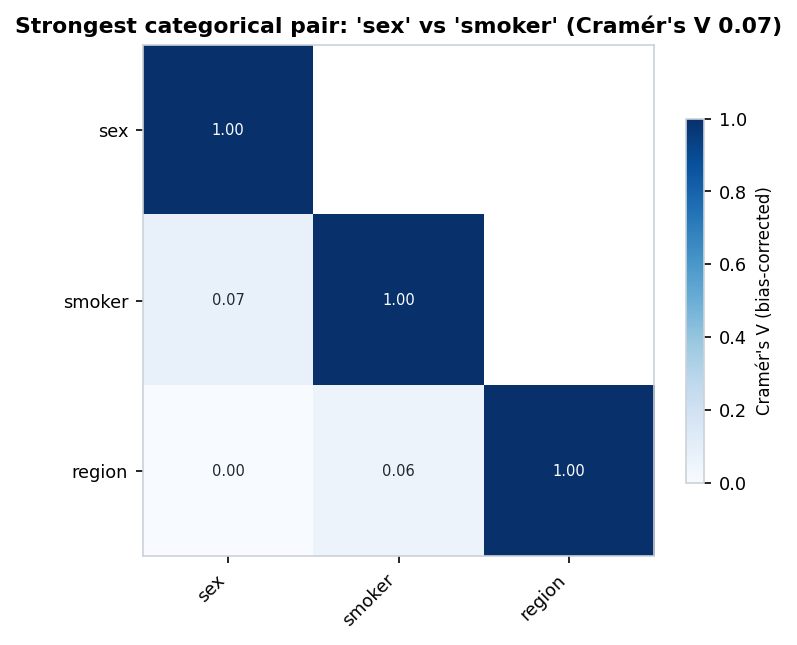

*Figure 11. Strongest categorical pair: 'sex' vs 'smoker' (Cramér's V 0.07).* Bias-corrected Cramér's V between categorical/binary columns: 0 = unrelated, 1 = one fully predicts the other. Descriptive coefficients only; no hypothesis tests were run.

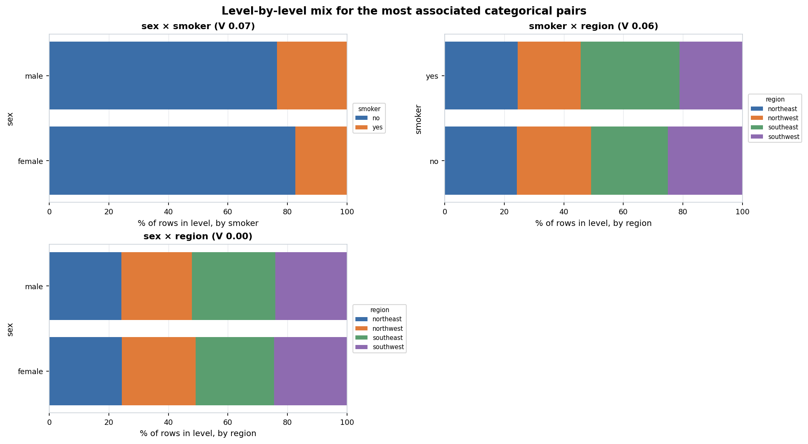

*Figure 12. Level-by-level mix for the most associated categorical pairs.* For each level of the first column, the share of rows in each level of the second column. Descriptive coefficients only; no hypothesis tests were run.

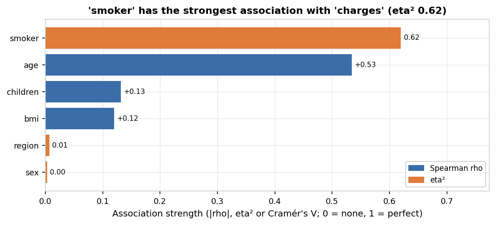

*Figure 13. 'smoker' has the strongest association with 'charges' (eta² 0.62).* Every feature ranked by a descriptive association with the target. Different measures are used for different column types, so compare bars of the same colour most directly. Descriptive coefficients only; no hypothesis tests were run.

**Top numeric pairs**

| Column A | Column B | Pearson r | Spearman rho | Rows used |
| :--- | :--- | ---: | ---: | ---: |
| age | charges | 0.298 | 0.534 | 1,337 |
| children | charges | 0.067 | 0.132 | 1,337 |
| bmi | charges | 0.198 | 0.12 | 1,337 |
| age | bmi | 0.109 | 0.108 | 1,337 |
| age | children | 0.042 | 0.056 | 1,337 |
| bmi | children | 0.013 | 0.016 | 1,337 |

Descriptive coefficients only; no hypothesis tests were run.
**Near-collinear numeric pairs**

No numeric pairs have |Pearson r| above 0.9.
**Numeric columns by group (eta²)**

| Numeric | Grouped by | eta² |
| :--- | :--- | ---: |
| charges | smoker | 0.62 |
| bmi | region | 0.082 |
| charges | region | 0.007 |
| charges | sex | 0.003 |
| bmi | sex | 0.002 |
| children | region | 0.002 |
| age | smoker | 0.001 |
| age | region | 0 |
| age | sex | 0 |
| bmi | smoker | 0 |

Descriptive coefficients only; no hypothesis tests were run.
**Categorical pairs (Cramér's V)**

| Column A | Column B | Cramér's V |
| :--- | :--- | ---: |
| sex | smoker | 0.072 |
| smoker | region | 0.057 |
| sex | region | 0 |

Descriptive coefficients only; no hypothesis tests were run.
**Every feature vs. the target**

| Feature | Measure | Value |
| :--- | :--- | ---: |
| smoker | eta² | 0.62 |
| age | Spearman rho | 0.534 |
| children | Spearman rho | 0.132 |
| bmi | Spearman rho | 0.12 |
| region | eta² | 0.007 |
| sex | eta² | 0.003 |

Descriptive coefficients only; no hypothesis tests were run.

## 5. Insights

Automated insights rated **high** or **medium** (7 of 13; the full list is in [insights.md](insights.md) and [insights.json](insights.json)):

- **MEDIUM** (data quality) — 1 exact duplicate rows were removed (the first copy of each was kept).
- **MEDIUM** (distribution) — 'charges' has many outliers: 10.4% of its values (n = 139) are beyond 1.5×IQR. They are flagged, not removed. ([figure](figures/outlier_summary.png))
- **MEDIUM** (distribution) — 'charges' is right-skewed (skew = 1.51): its median (9,386.16) is below its mean (13,279.12), so a log transform is advisable for plots and parametric models. ([figure](figures/numeric_detail_charges.png))
- **MEDIUM** (distribution) — 'children' is zero-inflated: 42.86% of its values are exactly zero. ([figure](figures/numeric_distributions_1.png))
- **MEDIUM** (relationship) — The categorical feature most associated with target 'charges' is 'smoker' (eta² = 0.62; descriptive). ([figure](figures/target_relationships.png))
- **MEDIUM** (relationship) — The numeric feature most associated with target 'charges' is 'age' (Spearman rho = +0.53; descriptive). ([figure](figures/target_relationships.png))
- **MEDIUM** (testing implication) — Rank-based methods (Spearman, Mann-Whitney, Kruskal-Wallis) are recommended for 1 skewed or outlier-heavy column(s): 'charges'.

### Manual insights (written by the analyst)

- **Strongest primary effect (`smoker -> charges`):** Smokers incur dramatically higher medical charges (mean ~$32,050 vs. ~$8,441 for non-smokers, $\eta^2 = 0.62$), creating a distinct multimodal right tail in `charges`.
- **Non-linear interaction (`smoker x bmi -> charges`):** Among non-smokers, higher `bmi` increases `charges` only modestly; however, among smokers, crossing the obesity threshold (`bmi >= 30`) triggers a steep step-change jump in medical charges (clustering between $35,000 and $63,770).
- **Monotonic baseline drift (`age -> charges`):** Within each smoking/BMI stratum, `charges` increases linearly with `age` (Spearman $\rho = +0.53$) along three parallel bands corresponding to baseline plan/comorbidity tiers.
- **Duplicate row removal (`drop_duplicates: auto`):** The raw dataset contains 1 exact duplicate row (`age=19, sex=male, bmi=30.59, children=0, smoker=no, region=northwest, charges=1639.5631`), which is removed in Step 7 (`1,338 -> 1,337` rows).
- **Distributional & scaling implications:** `charges` is strongly right-skewed (`skew = +1.52`) with positive support (`min = $1,121.87`), making `log1p` transformation ideal for visualization and linear regression (`insurance_scaled.csv`), while Phase 3 should prefer Mann-Whitney U / Kruskal-Wallis and Spearman rank correlation.
- **Target findings for Phase 5 benchmark recovery:** (1) `smoker <-> charges` (large positive effect), (2) `age <-> charges` (positive monotonic correlation), (3) `bmi <-> charges` (positive correlation, amplified by `smoker`), and (4) `children <-> charges` (small positive effect).

## 6. Normalization / scaling

| Column | Skew | Recommended transform | Reason |
| :--- | ---: | :--- | :--- |
| `age` | +0.05 | none | Moderate/low skewness (skew=0.05); no non-linear transform needed. |
| `bmi` | +0.28 | none | Moderate/low skewness (skew=0.28); no non-linear transform needed. |
| `children` | +0.94 | none | Moderate/low skewness (skew=0.94); no non-linear transform needed. |
| `charges` | +1.52 | log1p | Right-skewed (skew=1.52 > 1.0) with non-negative domain (min=1121.87); log1p recommended. |

Scale disparity across numeric columns (largest std ÷ smallest std): 10,045.33. Z-score standardization is recommended only for scale-sensitive methods.

> Primary cleaned output is **not** scaled. The Phase 3 test library is rank-based or scale-invariant (Welch/Mann-Whitney, Spearman, Kruskal, chi-square), so scaling would not change results. Log transforms are recommended for columns [charges] only for plotting and for parametric/regression use. A scaled copy is provided for TA review and for any future modeling.

Scaled convenience copy (for review and future modeling only, never used for testing): `data/cleaned/insurance_scaled.csv`. Details: [scaling_report.md](scaling_report.md).

## 7. Output files

- [profile.json](profile.json): full profile of the raw file
- [profile_cleaned.json](profile_cleaned.json): profile of the cleaned file
- [column_schema.json](column_schema.json): Phase 2 handoff: type and role of every column
- [cleaning_log.json](cleaning_log.json): every cleaning change (machine-readable)
- [cleaning_log.md](cleaning_log.md): every cleaning change (readable)
- [scaling_report.md](scaling_report.md): scaling and transform decisions
- [scaling_params.json](scaling_params.json): fitted scaling parameters
- [eda_summary.json](eda_summary.json): every EDA number used by the insights
- [insights.json](insights.json): automated insights with evidence
- [insights.md](insights.md): automated + manual insights
- [report.md](report.md): this report (markdown)
- [report.html](report.html): this report (HTML)
- [config_resolved.yaml](config_resolved.yaml): the exact settings used for this run
- `figures/`: 13 PNG figures; `tables/`: EDA tables as markdown
- `data/cleaned/insurance_cleaned.csv`: conservative cleaned data (primary, NaN kept)
- `data/cleaned/insurance_cleaned_imputed.csv`: imputed cleaned data (secondary, with `__was_missing` flags)
- `data/cleaned/insurance_scaled.csv`: scaled convenience copy
