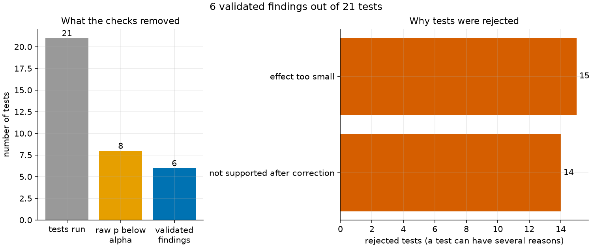
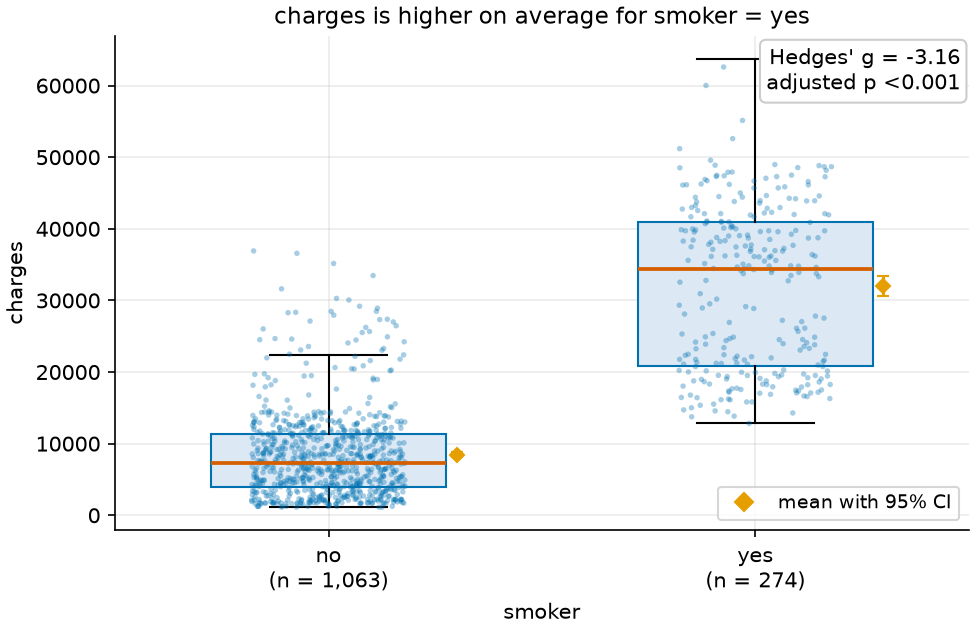
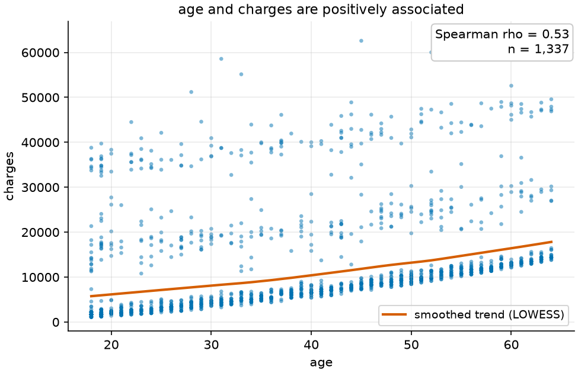
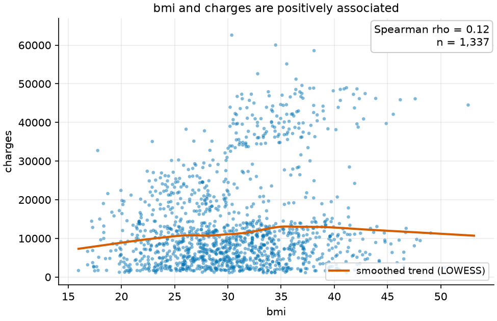
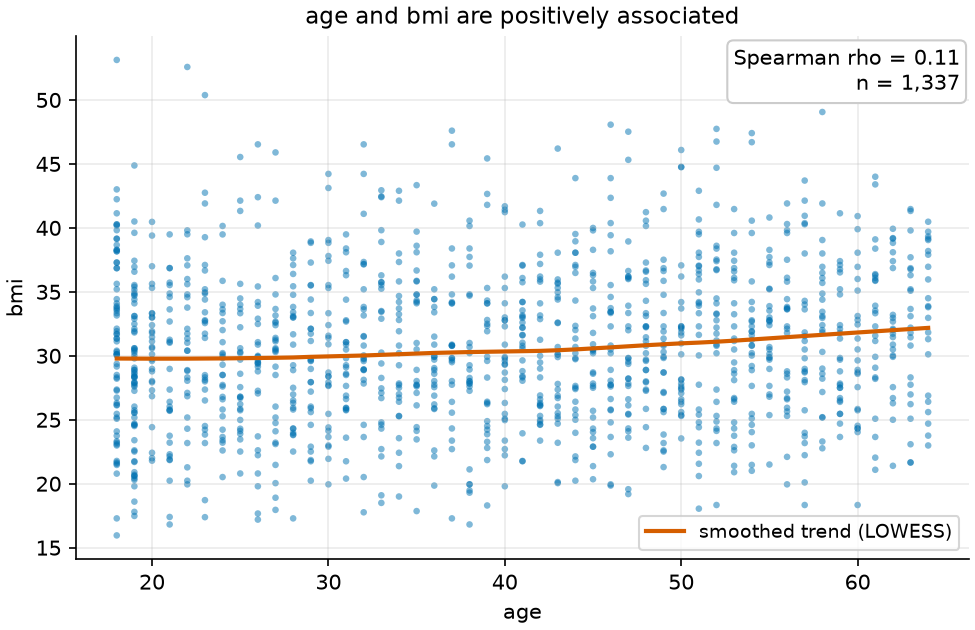
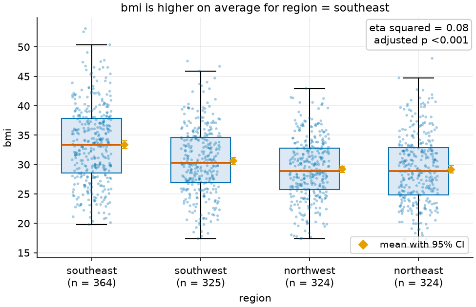
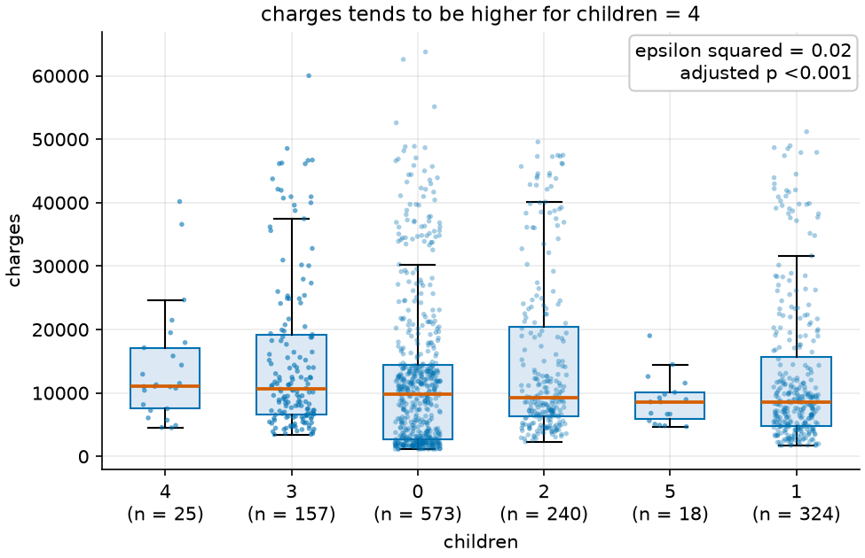
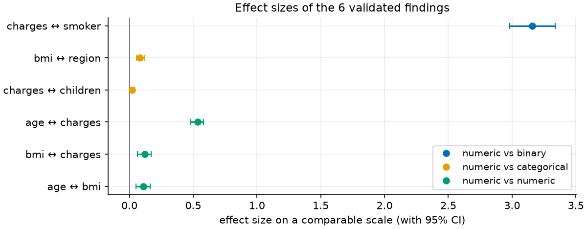
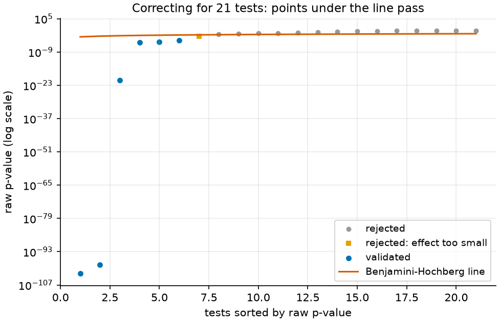
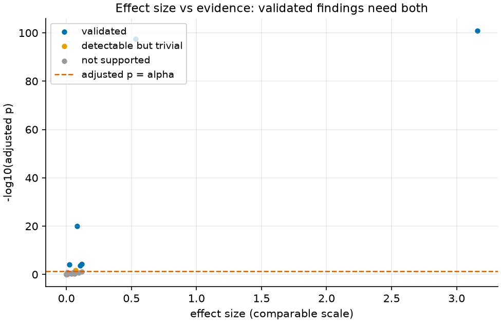

# VeriData findings report — `insurance`

1,337 rows × 7 columns after cleaning · VeriData 0.1.0 · config `75ec094493ce` · generated 2026-11-21

## 1. Executive summary

VeriData tested 21 column pairs. 8 of them had a raw p-value below 0.05, the usual threshold. After correcting for the number of tests (Benjamini-Hochberg method) and requiring an effect that is not negligible, 6 remain as validated findings. The others were rejected for the reasons shown below. Every finding is an association, not evidence of cause and effect.

- Tests run: 21
- Raw p below 0.05: 8
- Validated findings: 6
- Rejected — effect too small: 15
- Rejected — not supported after correction: 14

_A rejected test can have more than a single reason, so these counts can add up to more than the number of rejected tests._

**Highlights** (largest effects):

- `charges` ↔ `smoker`: large (Hedges' g = -3.16)
- `age` ↔ `charges`: large (Spearman rho = 0.53)
- `bmi` ↔ `charges`: small (Spearman rho = 0.12)

## 2. Validated findings

### 2.1 `charges` ↔ `smoker`

Among 1,337 records, the average charges was 8,440.66 for smoker = no and 32,050.23 for smoker = yes (difference -23,609.57, 95% CI -25,028.35 to -22,190.79). On average, charges is higher for smoker = yes. The difference is large (Hedges' g = -3.16, 95% CI -3.34 to -2.98). After correcting for 21 tests (Benjamini-Hochberg method, false discovery rate 5.0%), the association is statistically supported (adjusted p <0.001). This is an association, not evidence of cause and effect.

| | |
| :--- | :--- |
| Test used | Welch's t-test |
| Test statistic | -32.74 |
| Degrees of freedom | 311.9 |
| Raw p-value | <0.001 |
| Adjusted p-value (q) | <0.001 |
| Effect size | Hedges' g = -3.16 (95% CI -3.34 to -2.98), large |
| Records used | 1,337 |

How was this tested?

Both groups looked close enough to normal (or were large enough), so the means were compared with Welch's t-test, which does not assume equal spreads.

Where do the numbers come from?

| Fact | Shown as | Comes from |
| :--- | :--- | :--- |
| `alt_effect_value` | -0.95 | `TestResult.descriptives.sensitivity_alt_test.effect_value` |
| `alt_test_name` | Mann-Whitney U test | `TestResult.descriptives.sensitivity_alt_test.test_name` |
| `ci_high` | -2.98 | `TestResult.effect.ci_high` |
| `ci_low` | -3.34 | `TestResult.effect.ci_low` |
| `col_a` | charges | `Hypothesis.column_a` |
| `col_b` | smoker | `Hypothesis.column_b` |
| `comparable_value` | 3.16 | `TestResult.effect.comparable_value` |
| `df` | 311.9 | `TestResult.df` |
| `direction_word` | b_greater | `TestResult.direction_observed` |
| `effect_abs` | 3.16 | `abs(TestResult.effect.value)` |
| `effect_name` | Hedges' g | `TestResult.effect.name` |
| `effect_value` | -3.16 | `TestResult.effect.value` |
| `family_size` | 21 | `ValidationDecision.family_size` |
| `g1` | no | `TestResult.descriptives.group_order[0]` |
| `g2` | yes | `TestResult.descriptives.group_order[1]` |
| `group_label0` | no | `TestResult.group_sizes key 0` |
| `group_label1` | yes | `TestResult.group_sizes key 1` |
| `group_size0` | 1,063 | `TestResult.group_sizes[no]` |
| `group_size1` | 274 | `TestResult.group_sizes[yes]` |
| `higher_group` | yes | `TestResult.descriptives.higher_group` |
| `magnitude_label` | large | `TestResult.effect.magnitude` |
| `mean_diff` | -23,609.57 | `TestResult.descriptives.mean_diff` |
| `mean_diff_abs` | 23,609.57 | `abs(TestResult.descriptives.mean_diff)` |
| `mean_diff_ci_high` | -22,190.79 | `TestResult.descriptives.mean_diff_ci_high` |
| `mean_diff_ci_low` | -25,028.35 | `TestResult.descriptives.mean_diff_ci_low` |
| `mean_g1` | 8,440.66 | `TestResult.descriptives.groups[no].mean` |
| `mean_g2` | 32,050.23 | `TestResult.descriptives.groups[yes].mean` |
| `mean_high` | 32,050.23 | `same as mean_g2` |
| `mean_other` | 8,440.66 | `same as mean_g1` |
| `median_g1` | 7,345.73 | `TestResult.descriptives.groups[no].median` |
| `median_g2` | 34,456.35 | `TestResult.descriptives.groups[yes].median` |
| `median_high` | 34,456.35 | `same as median_g2` |
| `median_other` | 7,345.73 | `same as median_g1` |
| `n_g1` | 1,063 | `TestResult.descriptives.groups[no].n` |
| `n_g2` | 274 | `TestResult.descriptives.groups[yes].n` |
| `n_groups` | 2 | `len(TestResult.group_sizes)` |
| `n_used` | 1,337 | `TestResult.n_used` |
| `other_group` | no | `the other group in TestResult.descriptives.group_order` |
| `p_raw` | <0.001 | `ValidationDecision.p_raw` |
| `q_value` | <0.001 | `ValidationDecision.q_value` |
| `sd_g1` | 5,992.97 | `TestResult.descriptives.groups[no].sd` |
| `sd_g2` | 11,541.55 | `TestResult.descriptives.groups[yes].sd` |
| `statistic` | -32.74 | `TestResult.statistic` |
| `test_name` | Welch's t-test | `TestResult.test_name` |

### 2.2 `age` ↔ `charges`

age and charges are positively associated (Spearman rank correlation rho = 0.53, 95% CI 0.48 to 0.58; n = 1,337). The relationship is monotonic and may not be linear. The association is large. After correcting for 21 tests (Benjamini-Hochberg method, false discovery rate 5.0%), the association is statistically supported (adjusted p <0.001). The data were not close enough to the shape a parametric test needs, so a rank-based test was used instead. This is an association, not evidence of cause and effect.

| | |
| :--- | :--- |
| Test used | Spearman rank correlation test |
| Test statistic | 0.53 |
| Degrees of freedom | 1,335 |
| Raw p-value | <0.001 |
| Adjusted p-value (q) | <0.001 |
| Effect size | Spearman rho = 0.53 (95% CI 0.48 to 0.58), large |
| Records used | 1,337 |

How was this tested?

The columns were skewed, had outliers or many ties, so the rank-based Spearman correlation was used.

Where do the numbers come from?

| Fact | Shown as | Comes from |
| :--- | :--- | :--- |
| `alt_effect_value` | 0.30 | `TestResult.descriptives.sensitivity_alt_test.effect_value` |
| `alt_test_name` | Pearson correlation test | `TestResult.descriptives.sensitivity_alt_test.test_name` |
| `ci_high` | 0.58 | `TestResult.effect.ci_high` |
| `ci_low` | 0.48 | `TestResult.effect.ci_low` |
| `col_a` | age | `Hypothesis.column_a` |
| `col_b` | charges | `Hypothesis.column_b` |
| `comparable_value` | 0.53 | `TestResult.effect.comparable_value` |
| `df` | 1,335 | `TestResult.df` |
| `direction_word` | positive | `TestResult.direction_observed` |
| `effect_abs` | 0.53 | `abs(TestResult.effect.value)` |
| `effect_name` | Spearman rho | `TestResult.effect.name` |
| `effect_value` | 0.53 | `TestResult.effect.value` |
| `family_size` | 21 | `ValidationDecision.family_size` |
| `magnitude_label` | large | `TestResult.effect.magnitude` |
| `n_used` | 1,337 | `TestResult.n_used` |
| `ols_slope` | 257.23 | `TestResult.descriptives.ols_slope` |
| `p_raw` | <0.001 | `ValidationDecision.p_raw` |
| `q_value` | <0.001 | `ValidationDecision.q_value` |
| `statistic` | 0.53 | `TestResult.statistic` |
| `test_name` | Spearman rank correlation test | `TestResult.test_name` |

### 2.3 `bmi` ↔ `charges`

bmi and charges are positively associated (Spearman rank correlation rho = 0.12, 95% CI 0.06 to 0.17; n = 1,337). The relationship is monotonic and may not be linear. The association is small. After correcting for 21 tests (Benjamini-Hochberg method, false discovery rate 5.0%), the association is statistically supported (adjusted p <0.001). The data were not close enough to the shape a parametric test needs, so a rank-based test was used instead. This is an association, not evidence of cause and effect.

| | |
| :--- | :--- |
| Test used | Spearman rank correlation test |
| Test statistic | 0.12 |
| Degrees of freedom | 1,335 |
| Raw p-value | <0.001 |
| Adjusted p-value (q) | <0.001 |
| Effect size | Spearman rho = 0.12 (95% CI 0.06 to 0.17), small |
| Records used | 1,337 |

How was this tested?

The columns were skewed, had outliers or many ties, so the rank-based Spearman correlation was used.

Where do the numbers come from?

| Fact | Shown as | Comes from |
| :--- | :--- | :--- |
| `alt_effect_value` | 0.20 | `TestResult.descriptives.sensitivity_alt_test.effect_value` |
| `alt_test_name` | Pearson correlation test | `TestResult.descriptives.sensitivity_alt_test.test_name` |
| `ci_high` | 0.17 | `TestResult.effect.ci_high` |
| `ci_low` | 0.06 | `TestResult.effect.ci_low` |
| `col_a` | bmi | `Hypothesis.column_a` |
| `col_b` | charges | `Hypothesis.column_b` |
| `comparable_value` | 0.12 | `TestResult.effect.comparable_value` |
| `df` | 1,335 | `TestResult.df` |
| `direction_word` | positive | `TestResult.direction_observed` |
| `effect_abs` | 0.12 | `abs(TestResult.effect.value)` |
| `effect_name` | Spearman rho | `TestResult.effect.name` |
| `effect_value` | 0.12 | `TestResult.effect.value` |
| `family_size` | 21 | `ValidationDecision.family_size` |
| `magnitude_label` | small | `TestResult.effect.magnitude` |
| `n_used` | 1,337 | `TestResult.n_used` |
| `ols_slope` | 393.86 | `TestResult.descriptives.ols_slope` |
| `p_raw` | <0.001 | `ValidationDecision.p_raw` |
| `q_value` | <0.001 | `ValidationDecision.q_value` |
| `statistic` | 0.12 | `TestResult.statistic` |
| `test_name` | Spearman rank correlation test | `TestResult.test_name` |

### 2.4 `age` ↔ `bmi`

age and bmi are positively associated (Spearman rank correlation rho = 0.11, 95% CI 0.05 to 0.16; n = 1,337). The relationship is monotonic and may not be linear. The association is small. After correcting for 21 tests (Benjamini-Hochberg method, false discovery rate 5.0%), the association is statistically supported (adjusted p <0.001). The data were not close enough to the shape a parametric test needs, so a rank-based test was used instead. This is an association, not evidence of cause and effect.

| | |
| :--- | :--- |
| Test used | Spearman rank correlation test |
| Test statistic | 0.11 |
| Degrees of freedom | 1,335 |
| Raw p-value | <0.001 |
| Adjusted p-value (q) | <0.001 |
| Effect size | Spearman rho = 0.11 (95% CI 0.05 to 0.16), small |
| Records used | 1,337 |

How was this tested?

The columns were skewed, had outliers or many ties, so the rank-based Spearman correlation was used.

Where do the numbers come from?

| Fact | Shown as | Comes from |
| :--- | :--- | :--- |
| `alt_effect_value` | 0.11 | `TestResult.descriptives.sensitivity_alt_test.effect_value` |
| `alt_test_name` | Pearson correlation test | `TestResult.descriptives.sensitivity_alt_test.test_name` |
| `ci_high` | 0.16 | `TestResult.effect.ci_high` |
| `ci_low` | 0.05 | `TestResult.effect.ci_low` |
| `col_a` | age | `Hypothesis.column_a` |
| `col_b` | bmi | `Hypothesis.column_b` |
| `comparable_value` | 0.11 | `TestResult.effect.comparable_value` |
| `df` | 1,335 | `TestResult.df` |
| `direction_word` | positive | `TestResult.direction_observed` |
| `effect_abs` | 0.11 | `abs(TestResult.effect.value)` |
| `effect_name` | Spearman rho | `TestResult.effect.name` |
| `effect_value` | 0.11 | `TestResult.effect.value` |
| `family_size` | 21 | `ValidationDecision.family_size` |
| `magnitude_label` | small | `TestResult.effect.magnitude` |
| `n_used` | 1,337 | `TestResult.n_used` |
| `ols_slope` | 0.047 | `TestResult.descriptives.ols_slope` |
| `p_raw` | <0.001 | `ValidationDecision.p_raw` |
| `q_value` | <0.001 | `ValidationDecision.q_value` |
| `statistic` | 0.11 | `TestResult.statistic` |
| `test_name` | Spearman rank correlation test | `TestResult.test_name` |

### 2.5 `bmi` ↔ `region`

The average bmi differs across the 4 groups of region: highest for southeast (mean 33.36) and lowest for northeast (mean 29.17). About 8.2% of the variation in bmi is associated with region (eta squared = 0.08, 95% CI 0.06 to 0.12, medium). After correcting for 21 tests (Benjamini-Hochberg method, false discovery rate 5.0%), the association is statistically supported (adjusted p <0.001). This is an association, not evidence of cause and effect.

| | |
| :--- | :--- |
| Test used | Welch's ANOVA |
| Test statistic | 35.84 |
| Degrees of freedom | 3 and 739.1 |
| Raw p-value | <0.001 |
| Adjusted p-value (q) | <0.001 |
| Effect size | eta squared = 0.08 (95% CI 0.06 to 0.12), medium |
| Records used | 1,337 |

How was this tested?

All groups looked close enough to normal (or were large enough), so the group means were compared with Welch's ANOVA, which does not assume equal spreads.

Where do the numbers come from?

| Fact | Shown as | Comes from |
| :--- | :--- | :--- |
| `ci_high` | 0.12 | `TestResult.effect.ci_high` |
| `ci_low` | 0.06 | `TestResult.effect.ci_low` |
| `col_a` | bmi | `Hypothesis.column_a` |
| `col_b` | region | `Hypothesis.column_b` |
| `comparable_value` | 0.08 | `TestResult.effect.comparable_value` |
| `df1` | 3 | `TestResult.df[0]` |
| `df2` | 739.1 | `TestResult.df[1]` |
| `direction_word` | any | `TestResult.direction_observed` |
| `effect_abs` | 0.08 | `abs(TestResult.effect.value)` |
| `effect_name` | eta squared | `TestResult.effect.name` |
| `effect_value` | 0.08 | `TestResult.effect.value` |
| `eta_sq_pct` | 8.2% | `100 * TestResult.effect.value (eta_squared)` |
| `family_size` | 21 | `ValidationDecision.family_size` |
| `g1` | northeast | `TestResult.descriptives.group_order[0]` |
| `g2` | northwest | `TestResult.descriptives.group_order[1]` |
| `g3` | southeast | `TestResult.descriptives.group_order[2]` |
| `g4` | southwest | `TestResult.descriptives.group_order[3]` |
| `group_label0` | northeast | `TestResult.group_sizes key 0` |
| `group_label1` | northwest | `TestResult.group_sizes key 1` |
| `group_label2` | southeast | `TestResult.group_sizes key 2` |
| `group_label3` | southwest | `TestResult.group_sizes key 3` |
| `group_size0` | 324 | `TestResult.group_sizes[northeast]` |
| `group_size1` | 324 | `TestResult.group_sizes[northwest]` |
| `group_size2` | 364 | `TestResult.group_sizes[southeast]` |
| `group_size3` | 325 | `TestResult.group_sizes[southwest]` |
| `highest_group` | southeast | `TestResult.descriptives.highest_group` |
| `lowest_group` | northeast | `TestResult.descriptives.lowest_group` |
| `magnitude_label` | medium | `TestResult.effect.magnitude` |
| `mean_g1` | 29.17 | `TestResult.descriptives.groups[northeast].mean` |
| `mean_g2` | 29.20 | `TestResult.descriptives.groups[northwest].mean` |
| `mean_g3` | 33.36 | `TestResult.descriptives.groups[southeast].mean` |
| `mean_g4` | 30.60 | `TestResult.descriptives.groups[southwest].mean` |
| `mean_high` | 33.36 | `same as mean_g3` |
| `mean_low` | 29.17 | `same as mean_g1` |
| `median_g1` | 28.88 | `TestResult.descriptives.groups[northeast].median` |
| `median_g2` | 28.88 | `TestResult.descriptives.groups[northwest].median` |
| `median_g3` | 33.33 | `TestResult.descriptives.groups[southeast].median` |
| `median_g4` | 30.30 | `TestResult.descriptives.groups[southwest].median` |
| `median_high` | 33.33 | `same as median_g3` |
| `median_low` | 28.88 | `same as median_g1` |
| `n_g1` | 324 | `TestResult.descriptives.groups[northeast].n` |
| `n_g2` | 324 | `TestResult.descriptives.groups[northwest].n` |
| `n_g3` | 364 | `TestResult.descriptives.groups[southeast].n` |
| `n_g4` | 325 | `TestResult.descriptives.groups[southwest].n` |
| `n_groups` | 4 | `len(TestResult.group_sizes)` |
| `n_used` | 1,337 | `TestResult.n_used` |
| `omega_squared` | 0.08 | `TestResult.descriptives.omega_squared` |
| `other_group` | northeast | `the other group in TestResult.descriptives.group_order` |
| `p_raw` | <0.001 | `ValidationDecision.p_raw` |
| `q_value` | <0.001 | `ValidationDecision.q_value` |
| `sd_g1` | 5.94 | `TestResult.descriptives.groups[northeast].sd` |
| `sd_g2` | 5.14 | `TestResult.descriptives.groups[northwest].sd` |
| `sd_g3` | 6.48 | `TestResult.descriptives.groups[southeast].sd` |
| `sd_g4` | 5.69 | `TestResult.descriptives.groups[southwest].sd` |
| `statistic` | 35.84 | `TestResult.statistic` |
| `test_name` | Welch's ANOVA | `TestResult.test_name` |

### 2.6 `charges` ↔ `children`

Values of charges tend to differ across the 6 groups of children: highest for 4 (median 11,033.66) and lowest for 1 (median 8,483.87). About 2.2% of the variation in the ranks of charges is associated with children (epsilon squared = 0.02, 95% CI 0.01 to 0.04, small). After correcting for 21 tests (Benjamini-Hochberg method, false discovery rate 5.0%), the association is statistically supported (adjusted p <0.001). The data were not close enough to the shape a parametric test needs, so a rank-based test was used instead. This is an association, not evidence of cause and effect.

| | |
| :--- | :--- |
| Test used | Kruskal-Wallis test |
| Test statistic | 29.12 |
| Degrees of freedom | 5 |
| Raw p-value | <0.001 |
| Adjusted p-value (q) | <0.001 |
| Effect size | epsilon squared = 0.02 (95% CI 0.01 to 0.04), small |
| Records used | 1,337 |

How was this tested?

Some groups were not close enough to normal, so the rank-based Kruskal-Wallis test was used.

Where do the numbers come from?

| Fact | Shown as | Comes from |
| :--- | :--- | :--- |
| `ci_high` | 0.04 | `TestResult.effect.ci_high` |
| `ci_low` | 0.01 | `TestResult.effect.ci_low` |
| `col_a` | charges | `Hypothesis.column_a` |
| `col_b` | children | `Hypothesis.column_b` |
| `comparable_value` | 0.02 | `TestResult.effect.comparable_value` |
| `df` | 5 | `TestResult.df` |
| `direction_word` | any | `TestResult.direction_observed` |
| `effect_abs` | 0.02 | `abs(TestResult.effect.value)` |
| `effect_name` | epsilon squared | `TestResult.effect.name` |
| `effect_value` | 0.02 | `TestResult.effect.value` |
| `eta_sq_pct` | 2.2% | `100 * TestResult.effect.value (epsilon_squared)` |
| `family_size` | 21 | `ValidationDecision.family_size` |
| `g1` | 0 | `TestResult.descriptives.group_order[0]` |
| `g2` | 1 | `TestResult.descriptives.group_order[1]` |
| `g3` | 2 | `TestResult.descriptives.group_order[2]` |
| `g4` | 3 | `TestResult.descriptives.group_order[3]` |
| `g5` | 4 | `TestResult.descriptives.group_order[4]` |
| `g6` | 5 | `TestResult.descriptives.group_order[5]` |
| `group_label0` | 0 | `TestResult.group_sizes key 0` |
| `group_label1` | 1 | `TestResult.group_sizes key 1` |
| `group_label2` | 2 | `TestResult.group_sizes key 2` |
| `group_label3` | 3 | `TestResult.group_sizes key 3` |
| `group_label4` | 4 | `TestResult.group_sizes key 4` |
| `group_label5` | 5 | `TestResult.group_sizes key 5` |
| `group_size0` | 573 | `TestResult.group_sizes[0]` |
| `group_size1` | 324 | `TestResult.group_sizes[1]` |
| `group_size2` | 240 | `TestResult.group_sizes[2]` |
| `group_size3` | 157 | `TestResult.group_sizes[3]` |
| `group_size4` | 25 | `TestResult.group_sizes[4]` |
| `group_size5` | 18 | `TestResult.group_sizes[5]` |
| `highest_group` | 4 | `TestResult.descriptives.highest_group` |
| `lowest_group` | 1 | `TestResult.descriptives.lowest_group` |
| `magnitude_label` | small | `TestResult.effect.magnitude` |
| `mean_g1` | 12,384.70 | `TestResult.descriptives.groups[0].mean` |
| `mean_g2` | 12,731.17 | `TestResult.descriptives.groups[1].mean` |
| `mean_g3` | 15,073.56 | `TestResult.descriptives.groups[2].mean` |
| `mean_g4` | 15,355.32 | `TestResult.descriptives.groups[3].mean` |
| `mean_g5` | 13,850.66 | `TestResult.descriptives.groups[4].mean` |
| `mean_g6` | 8,786.04 | `TestResult.descriptives.groups[5].mean` |
| `mean_high` | 13,850.66 | `same as mean_g5` |
| `mean_low` | 12,731.17 | `same as mean_g2` |
| `median_g1` | 9,863.47 | `TestResult.descriptives.groups[0].median` |
| `median_g2` | 8,483.87 | `TestResult.descriptives.groups[1].median` |
| `median_g3` | 9,264.98 | `TestResult.descriptives.groups[2].median` |
| `median_g4` | 10,600.55 | `TestResult.descriptives.groups[3].median` |
| `median_g5` | 11,033.66 | `TestResult.descriptives.groups[4].median` |
| `median_g6` | 8,589.57 | `TestResult.descriptives.groups[5].median` |
| `median_high` | 11,033.66 | `same as median_g5` |
| `median_low` | 8,483.87 | `same as median_g2` |
| `n_g1` | 573 | `TestResult.descriptives.groups[0].n` |
| `n_g2` | 324 | `TestResult.descriptives.groups[1].n` |
| `n_g3` | 240 | `TestResult.descriptives.groups[2].n` |
| `n_g4` | 157 | `TestResult.descriptives.groups[3].n` |
| `n_g5` | 25 | `TestResult.descriptives.groups[4].n` |
| `n_g6` | 18 | `TestResult.descriptives.groups[5].n` |
| `n_groups` | 6 | `len(TestResult.group_sizes)` |
| `n_used` | 1,337 | `TestResult.n_used` |
| `other_group` | 0 | `the other group in TestResult.descriptives.group_order` |
| `p_raw` | <0.001 | `ValidationDecision.p_raw` |
| `q_value` | <0.001 | `ValidationDecision.q_value` |
| `sd_g1` | 12,025.42 | `TestResult.descriptives.groups[0].sd` |
| `sd_g2` | 11,823.63 | `TestResult.descriptives.groups[1].sd` |
| `sd_g3` | 12,891.37 | `TestResult.descriptives.groups[2].sd` |
| `sd_g4` | 12,330.87 | `TestResult.descriptives.groups[3].sd` |
| `sd_g5` | 9,139.22 | `TestResult.descriptives.groups[4].sd` |
| `sd_g6` | 3,808.44 | `TestResult.descriptives.groups[5].sd` |
| `statistic` | 29.12 | `TestResult.statistic` |
| `test_name` | Kruskal-Wallis test | `TestResult.test_name` |

## 3. Patterns that looked interesting but were rejected

These patterns had the lowest raw p-values among the rejected tests. Each of them would look like a discovery to a naive analysis that tests 21 pairs without correction.

| Columns | Test | Raw p | Adjusted p | Effect | Why it was rejected |
| :--- | :--- | :--- | :--- | :--- | :--- |
| `sex` ↔ `smoker` | chi-square test of independence | 0.005 | 0.015 | Cramér's V = 0.07 | Statistically detectable (adjusted p = 0.015) but the effect is negligible (Cramér's V = 0.07 (comparable value 0.07), below the 0.10 threshold), so it has little practical importance. |
| `charges` ↔ `sex` | Welch's t-test | 0.034 | 0.088 | Hedges' g = -0.12 | Raw p = 0.034, but after correcting for 21 tests the adjusted p is 0.088. With this many comparisons, a pattern like this is expected by chance, so it is not reported as a finding. Also, the effect is tiny but the effect is negligible (Hedges' g = -0.12, below the 0.20 threshold), so it has little practical importance. |
| `charges` ↔ `region` | Welch's ANOVA | 0.053 | 0.125 | eta squared = 0.01 | Raw p = 0.053, but after correcting for 21 tests the adjusted p is 0.125. With this many comparisons, a pattern like this is expected by chance, so it is not reported as a finding. Also, the effect is tiny but the effect is negligible (eta squared = 0.01, below the 0.01 threshold), so it has little practical importance. |
| `region` ↔ `smoker` | chi-square test of independence | 0.064 | 0.133 | Cramér's V = 0.06 | Raw p = 0.064, but after correcting for 21 tests the adjusted p is 0.133. With this many comparisons, a pattern like this is expected by chance, so it is not reported as a finding. Also, the effect is tiny but the effect is negligible (Cramér's V = 0.06 (comparable value 0.06), below the 0.10 threshold), so it has little practical importance. |
| `bmi` ↔ `sex` | Welch's t-test | 0.090 | 0.172 | Hedges' g = -0.09 | Raw p = 0.090, but after correcting for 21 tests the adjusted p is 0.172. With this many comparisons, a pattern like this is expected by chance, so it is not reported as a finding. Also, the effect is tiny but the effect is negligible (Hedges' g = -0.09, below the 0.20 threshold), so it has little practical importance. |
| `age` ↔ `children` | Welch's ANOVA | 0.115 | 0.202 | eta squared = 0.01 | Raw p = 0.115, but after correcting for 21 tests the adjusted p is 0.202. With this many comparisons, a pattern like this is expected by chance, so it is not reported as a finding. Also, the effect is tiny but the effect is negligible (eta squared = 0.01, below the 0.01 threshold), so it has little practical importance. |
| `children` ↔ `smoker` | chi-square test of independence | 0.230 | 0.372 | Cramér's V = 0.04 | Raw p = 0.230, but after correcting for 21 tests the adjusted p is 0.372. With this many comparisons, a pattern like this is expected by chance, so it is not reported as a finding. Also, the effect is tiny but the effect is negligible (Cramér's V = 0.04 (comparable value 0.04), below the 0.10 threshold), so it has little practical importance. |
| `age` ↔ `smoker` | Welch's t-test | 0.347 | 0.521 | Hedges' g = 0.06 | Raw p = 0.347, but after correcting for 21 tests the adjusted p is 0.521. With this many comparisons, a pattern like this is expected by chance, so it is not reported as a finding. Also, the effect is tiny but the effect is negligible (Hedges' g = 0.06, below the 0.20 threshold), so it has little practical importance. |
| `age` ↔ `sex` | Welch's t-test | 0.469 | 0.657 | Hedges' g = 0.04 | Raw p = 0.469, but after correcting for 21 tests the adjusted p is 0.657. With this many comparisons, a pattern like this is expected by chance, so it is not reported as a finding. Also, the effect is tiny but the effect is negligible (Hedges' g = 0.04, below the 0.20 threshold), so it has little practical importance. |
| `children` ↔ `region` | chi-square test of independence | 0.534 | 0.701 | Cramér's V = 0.00 | Raw p = 0.534, but after correcting for 21 tests the adjusted p is 0.701. With this many comparisons, a pattern like this is expected by chance, so it is not reported as a finding. Also, the effect is tiny but the effect is negligible (Cramér's V = 0.00 (comparable value 0.00), below the 0.10 threshold), so it has little practical importance. |

## 4. Likely derived or duplicated columns

None found.

## 5. Data quality summary

- Raw file: 1,338 rows × 7 columns; after cleaning: 1,337 rows × 7 columns.
- Missing cells in the raw file: 0.0%.
- Exact duplicate rows removed: 1.
- Logged cleaning changes: 3, touching 7 cells (see the cleaning log).

## 6. Methods

**Hypotheses.** Hypotheses were generated in exhaustive mode from the column types only, before any test was run. 7 of 7 columns were eligible and 21 pairs were tested. A language model was not used to choose or change the tests.

**Tests.** Each pair is tested with a fixed, unit-tested test chosen by rules that check the data's shape first:

| Relationship | Default test | Fallback when assumptions fail |
| :--- | :--- | :--- |
| numeric vs a binary column | Welch's t-test | Mann-Whitney U test |
| numeric vs several groups | Welch's ANOVA | Kruskal-Wallis test |
| numeric vs numeric | Pearson correlation | Spearman rank correlation |
| category vs category | chi-square test | Fisher's exact test or a Monte Carlo (permutation) chi-square test |

Groups with fewer than 8 records are left out, and a pair needs at least 20 complete records. Groups of at least 50 records may use the parametric test when skewness stays below 2.00. Confidence intervals use 2,000 bootstrap resamples; permutation tests use 9,999 resamples.

**Correction.** All tests form a single family. The Benjamini-Hochberg method controls the false discovery rate at 5.0%: on average, at most this share of the reported findings should be false.

**Effect-size floors.** A result must also have an effect that is not negligible:

| Effect measure | Smallest effect reported |
| :--- | :--- |
| Hedges' g (binary groups) | 0.20 |
| rank-biserial correlation | 0.10 |
| Pearson r / Spearman rho | 0.10 |
| eta squared | 0.01 |
| epsilon squared | 0.01 |
| Cramér's V (comparable scale) | 0.10 |

**What 'validated' means.** A finding is validated when its adjusted p-value is below the false discovery rate, its effect is above the floor, and its test's assumptions were met or a suitable fallback test was used.

## 7. Limitations

- **Association, not causation.** Every finding describes how columns move together in this data. None of them shows that a column is the reason for another.
- **Rows are assumed independent.** The tests assume each row is a separate, unrelated record. Repeated measurements of the same person, place or time period break this assumption and make the results look more reliable than they are.
- **Pairwise only.** Each test looks at a single pair of columns. Interactions between several columns and confounding by a third column are not controlled for.
- **Correction under dependence.** The Benjamini-Hochberg correction assumes the tests are independent or positively dependent. Tests that share columns are dependent. In the planted-truth calibration it still kept the false discovery rate near the target with strongly correlated columns, but unusual (negative) dependence is not covered; the Benjamini-Yekutieli option (`stats.correction: by`) is the safer choice then.
- **Adjusted p-values are not per-finding error chances.** The correction controls the share of false findings across the whole list. A finding whose adjusted p-value is close to the cut-off is more likely to be a false lead than a finding far below it.
- **Effects of selected findings are optimistic.** Effect sizes and confidence intervals are reported for the findings that passed the checks, so they tend to be somewhat larger than the true effects. The intervals are not adjusted for this selection.
- **Missing data.** Each test uses the rows where both columns are present (pairwise deletion). If values are missing for a reason related to the columns, results can be biased.
- **Cleaning choices matter.** The results depend on the cleaning steps listed in the data quality section, such as removing duplicates and turning placeholder text into missing values.
- **Role of the language model.** No language model produced or changed any number in this report. The explanations are filled from fixed templates and every number is checked against the computed results.

## 8. Appendix

### All results

| Columns | Test | Raw p | Adjusted p | Effect | Decision |
| :--- | :--- | :--- | :--- | :--- | :--- |
| `charges` ↔ `smoker` | Welch's t-test | <0.001 | <0.001 | Hedges' g = -3.16 | validated |
| `age` ↔ `charges` | Spearman rank correlation test | <0.001 | <0.001 | Spearman rho = 0.53 | validated |
| `bmi` ↔ `region` | Welch's ANOVA | <0.001 | <0.001 | eta squared = 0.08 | validated |
| `bmi` ↔ `charges` | Spearman rank correlation test | <0.001 | <0.001 | Spearman rho = 0.12 | validated |
| `charges` ↔ `children` | Kruskal-Wallis test | <0.001 | <0.001 | epsilon squared = 0.02 | validated |
| `age` ↔ `bmi` | Spearman rank correlation test | <0.001 | <0.001 | Spearman rho = 0.11 | validated |
| `sex` ↔ `smoker` | chi-square test of independence | 0.005 | 0.015 | Cramér's V = 0.07 | rejected: effect too small |
| `charges` ↔ `sex` | Welch's t-test | 0.034 | 0.088 | Hedges' g = -0.12 | rejected: not supported after correction, effect too small |
| `charges` ↔ `region` | Welch's ANOVA | 0.053 | 0.125 | eta squared = 0.01 | rejected: not supported after correction, effect too small |
| `region` ↔ `smoker` | chi-square test of independence | 0.064 | 0.133 | Cramér's V = 0.06 | rejected: not supported after correction, effect too small |
| `bmi` ↔ `sex` | Welch's t-test | 0.090 | 0.172 | Hedges' g = -0.09 | rejected: not supported after correction, effect too small |
| `age` ↔ `children` | Welch's ANOVA | 0.115 | 0.202 | eta squared = 0.01 | rejected: not supported after correction, effect too small |
| `children` ↔ `smoker` | chi-square test of independence | 0.230 | 0.372 | Cramér's V = 0.04 | rejected: not supported after correction, effect too small |
| `age` ↔ `smoker` | Welch's t-test | 0.347 | 0.521 | Hedges' g = 0.06 | rejected: not supported after correction, effect too small |
| `age` ↔ `sex` | Welch's t-test | 0.469 | 0.657 | Hedges' g = 0.04 | rejected: not supported after correction, effect too small |
| `children` ↔ `region` | chi-square test of independence | 0.534 | 0.701 | Cramér's V = 0.00 | rejected: not supported after correction, effect too small |
| `bmi` ↔ `children` | Welch's ANOVA | 0.882 | 0.979 | eta squared = 0.00 | rejected: not supported after correction, effect too small |
| `bmi` ↔ `smoker` | Welch's t-test | 0.894 | 0.979 | Hedges' g = -0.01 | rejected: not supported after correction, effect too small |
| `region` ↔ `sex` | chi-square test of independence | 0.924 | 0.979 | Cramér's V = 0.00 | rejected: not supported after correction, effect too small |
| `age` ↔ `region` | Welch's ANOVA | 0.971 | 0.979 | eta squared = 0.00 | rejected: not supported after correction, effect too small |
| `children` ↔ `sex` | chi-square test of independence | 0.979 | 0.979 | Cramér's V = 0.00 | rejected: not supported after correction, effect too small |

### Reproducibility

- VeriData version: 0.1.0; resolved config hash: `75ec094493ce`.
- Dataset SHA-256: `505c1cbc2e63d0363bac59501563df2530aadf4cdb9cfee226f4ef32f5468281`.
- Narration: deterministic templates (no language model).
