# Phase 1 Dataset Report — `messy_synthetic`

_Generated by the VeriData Phase 1 pipeline. Every number comes from code (no LLM). Relationship numbers are descriptive only; no hypothesis tests were run in Phase 1._

**Contents:** 1. Overview · 2. Columns · 3. Data cleaning · 4. Exploratory data analysis · 5. Insights · 6. Normalization / scaling · 7. Output files

## 1. Overview

| Item | Value |
| :--- | :--- |
| Source file | `data\synthetic\messy_dataset.csv` |
| SHA-256 | `c2124c6ccb1547fabb41a927466ec703571ac1eaaafa1d086bd6b27c2c224a92` |
| Raw shape | 2,090 rows × 15 columns |
| Cleaned shape (conservative, primary) | 2,000 rows × 13 columns |
| Cleaned shape (imputed, secondary) | 2,000 rows × 16 columns |
| Exact duplicate rows in raw file | 80 |
| Missing cells in raw file (incl. placeholder text) | 4,136 (13.19%) |
| Memory (raw) | 1.893611 MB |
| Target column | `churned` (categorical) |

### Profiling warnings (raw file)

- Column 'Unnamed: 0' matches exported index pattern ('Unnamed: ...').
- Column header whitespace/BOM stripped: 'membership ' -> 'membership'.
- Column 'customer_id' looks like an ID (config override: listed in id_columns).
- Binary column 'gender' is highly imbalanced (minority class = 1.3%).
- Column 'income' has extreme skewness (skew=12.65).
- Column 'region' has near-duplicate label candidate(s): ('North Area' vs 'North  Area', sim=0.95), ('South Bay' vs 'South  Bay', sim=0.95), ('East Coast' vs 'East  Coast', sim=0.95).
- Column 'tenure_months' mixes numeric/datetime values with unparseable strings.
- Column 'monthly_spend' has extreme skewness (skew=18.28).
- Column 'signup_date' mixes numeric/datetime values with unparseable strings.
- Binary column 'churned' is highly imbalanced (minority class = 0.3%).
- Column 'notes' has high missingness (70.5%, n=1474).
- Column 'constant_flag' is constant (constant column (1 unique non-null value: 'A')).
- Column 'unused' is constant (all missing (fully empty column)).
- Column 'unused' has high missingness (100.0%, n=2090).
- Dataset contains 10 fully empty row(s).
- Dataset contains 1 fully empty column(s).
- Found 20 additional duplicate row(s) after whitespace/case normalization (raw=60, normalized=80).

## 2. Column profile (raw file)

| Column | Raw dtype | Inferred type | Missing % | Unique | Why this type |
| :--- | :--- | :--- | ---: | ---: | :--- |
| `Unnamed: 0` | `float64` | `numeric_continuous` | 0.5% | 2,000 | numeric values (100.0% parseable, 2000 unique) |
| `customer_id` | `object` | `id_like` | 0.5% | 2,000 | config override: listed in id_columns |
| `age` | `float64` | `numeric_continuous` | 6.6% | 82 | numeric values (100.0% parseable, 82 unique) |
| `gender` | `object` | `binary` | 0.5% | 9 | binary string/mixed encoding (gender binary (Male/Female): ['F', 'FEMALE', 'Female', 'M', 'MALE', 'Male']) |
| `income` | `object` | `numeric_continuous` | 8.4% | 1,816 | numeric values (100.0% parseable, 1816 unique) [formatted numeric strings ($, commas, %, or parentheses)] |
| `region` | `object` | `categorical_nominal` | 4.4% | 10 | string categorical with 10 normalized unique values (raw=10) |
| `membership` | `object` | `categorical_ordinal` | 0.5% | 6 | matches known ordinal level set (['basic', 'gold', 'silver']) |
| `tenure_months` | `object` | `numeric_continuous` | 0.5% | 128 | numeric values (99.0% parseable, 128 unique) [20 unparseable numeric token(s)] |
| `monthly_spend` | `object` | `numeric_continuous` | 0.5% | 1,904 | numeric values (100.0% parseable, 1904 unique) [formatted numeric strings ($, commas, %, or parentheses)] |
| `signup_date` | `object` | `datetime` | 0.5% | 1,223 | datetime strings (99.0% parseable) |
| `satisfaction` | `float64` | `numeric_discrete` | 3.6% | 5 | integer values with 5 unique levels (unique ratio 0.2%) |
| `churned` | `object` | `binary` | 0.5% | 7 | binary string/mixed encoding (boolean-like (Yes/No/1/0): ['0', '1', 'No', 'Y', 'Yes', 'no']) |
| `notes` | `object` | `free_text` | 70.5% | 594 | free text (mean_len=99.8 chars, mean_words=13.9, unique_ratio=96.4%) |
| `constant_flag` | `object` | `constant` | 0.5% | 1 | constant column (1 unique non-null value: 'A') |
| `unused` | `float64` | `constant` | 100.0% | 0 | all missing (fully empty column) |

## 3. Data cleaning

10 cleaning steps made 34 logged changes touching 12,214 cells. Rows: 2,090 in the raw file → 2,000 in the conservative output → 2,000 in the imputed output.

### What the TA asked for

| Requirement | What the pipeline did |
| :--- | :--- |
| Missing values | ✔ converted to NaN: 209 cells; imputed median: 390 cells; imputed mode: 80 cells; invalid to NaN: 32 cells; left datetime missing. Conservative output keeps NaN; imputed output fills gaps and adds `__was_missing` flags |
| Duplicates | ✔ dropped duplicate rows: 80 rows |
| Outliers | ✔ flagged outliers: 194 rows. 5 column(s) flagged; values are kept in the conservative output |
| Inconsistent formats | ✔ cast dtype: 3,994 cells; coerced to NaN: 41 cells; flagged fuzzy variants: 63 rows; merged case variants: 293 cells; normalized headers: 1 cells; standardized binary tokens: 59 cells; standardized datetime: 1,374 cells; stripped and normalized ws: 391 cells |
| Empty rows / columns | ✔ dropped empty column: 2,010 cells; dropped empty rows: 10 rows; dropped index column: 2,010 cells; marked excluded |

### Changes by step

| Step | Log entries | Cells changed | Rows removed |
| :--- | ---: | ---: | ---: |
| `normalize_column_names` | 1 | 1 | 0 |
| `clean_whitespace_unicode` | 3 | 391 | 0 |
| `normalize_missing_tokens` | 2 | 209 | 0 |
| `standardize_categories` | 5 | 352 | 0 |
| `convert_types` | 5 | 5,409 | 0 |
| `apply_validity_rules` | 2 | 32 | 0 |
| `handle_duplicates` | 1 | 1,200 | 80 |
| `structural_drops` | 6 | 4,150 | 10 |
| `handle_missing_values` | 6 | 470 | 0 |
| `handle_outliers` | 3 | 0 | 0 |

### Dropped or excluded columns

| Column | Where | Reason |
| :--- | :--- | :--- |
| `Unnamed: 0` | both outputs | exported_unnamed_index_column |
| `unused` | both outputs | fully_empty_column |

### Outlier flags (1.5×IQR and modified z-score)

| Column | Flagged | Flagged % | Extreme (3×IQR) | Normal range (1.5×IQR) | Action |
| :--- | ---: | ---: | ---: | :--- | :--- |
| `age` | 7 | 0.38% | 0 | 5 to 77 | flag |
| `income` | 97 | 5.27% | 27 | -21,635.926 to 131,209.984 | flag |
| `monthly_spend` | 90 | 4.50% | 28 | -43.716 to 328.174 | flag |
| `satisfaction` | 0 | 0.00% | 0 | -1 to 7 | flag |
| `tenure_months` | 0 | 0.00% | 0 | -59 to 181 | flag |

The full step-by-step log with before/after examples is in [cleaning_log.md](cleaning_log.md) (machine-readable: [cleaning_log.json](cleaning_log.json)).

## 4. Exploratory data analysis

### 4.1 Dataset overview

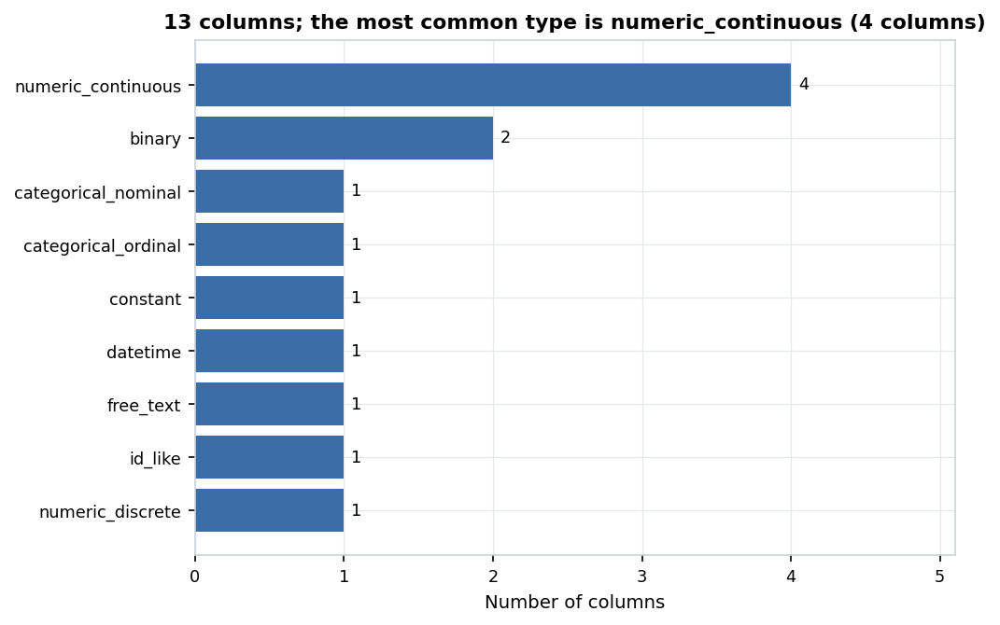

*Figure 1. 13 columns; the most common type is numeric_continuous (4 columns).* Count of columns by the semantic type the pipeline inferred (after cleaning).

| Item | Value |
| :--- | :--- |
| Rows (raw file) | 2,090 |
| Rows (cleaned, conservative) | 2,000 |
| Columns | 13 |
| Memory | 0.806 MB |
| Missing cells | 1,896 (7.29%) |
| Columns typed `numeric_continuous` | 4 |
| Columns typed `binary` | 2 |
| Columns typed `categorical_nominal` | 1 |
| Columns typed `categorical_ordinal` | 1 |
| Columns typed `constant` | 1 |
| Columns typed `datetime` | 1 |
| Columns typed `free_text` | 1 |
| Columns typed `id_like` | 1 |
| Columns typed `numeric_discrete` | 1 |
| Columns left out of EDA (ID / excluded) | constant_flag, customer_id, notes |

### 4.2 Missing values

Missing values are spread out: the 10% of rows with the most gaps hold 22.84% of all missing cells.

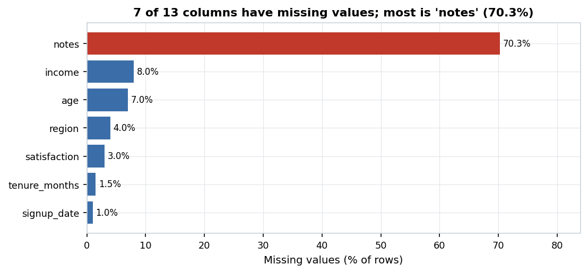

*Figure 2. 7 of 13 columns have missing values; most is 'notes' (70.3%).* Percent of rows missing per column (only columns with at least one gap). Red bars are above 40%.

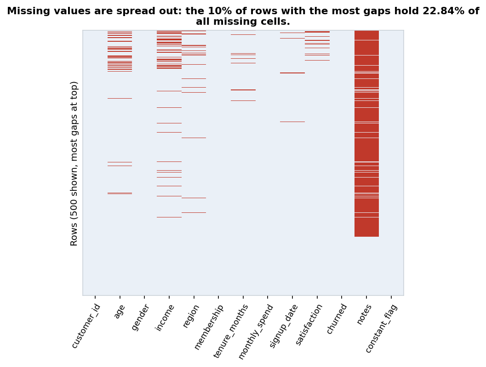

*Figure 3. Missing values are spread out: the 10% of rows with the most gaps hold 22.84% of all missing cells.* Each red cell is a missing value; rows are sorted by how many gaps they have. A random sample of 500 of 2,000 rows is shown.

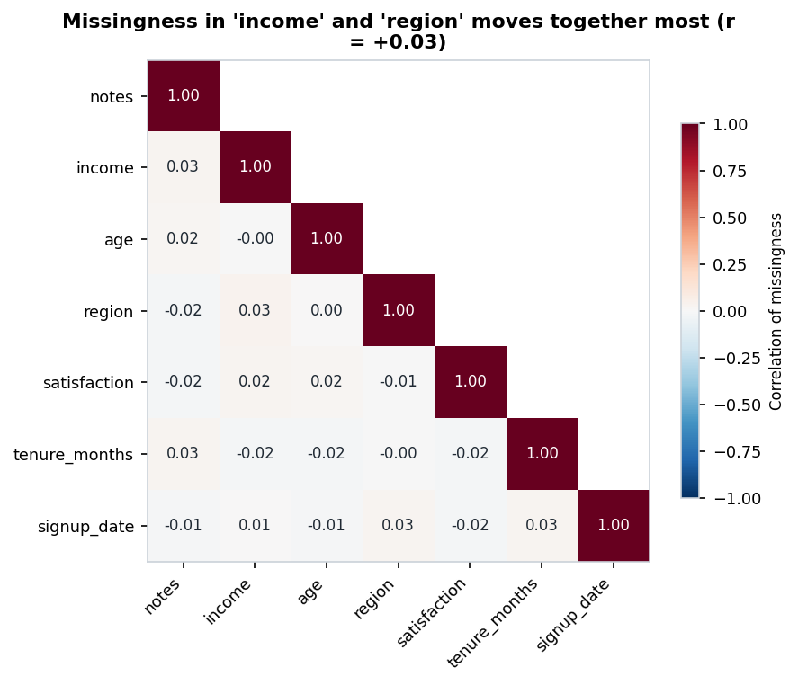

*Figure 4. Missingness in 'income' and 'region' moves together most (r = +0.03).* Correlation between the missing/not-missing patterns of columns with gaps. High values mean the gaps tend to occur in the same rows. Descriptive only.

**Missing values per column (cleaned data)**

| Column | Missing | Missing % |
| :--- | ---: | ---: |
| notes | 1,406 | 70.3 |
| income | 160 | 8 |
| age | 140 | 7 |
| region | 80 | 4 |
| satisfaction | 60 | 3 |
| tenure_months | 30 | 1.5 |
| signup_date | 20 | 1 |

### 4.3 Numeric columns

Red dots in box plots are values beyond 1.5×IQR; they are flagged but kept in the conservative cleaned data.

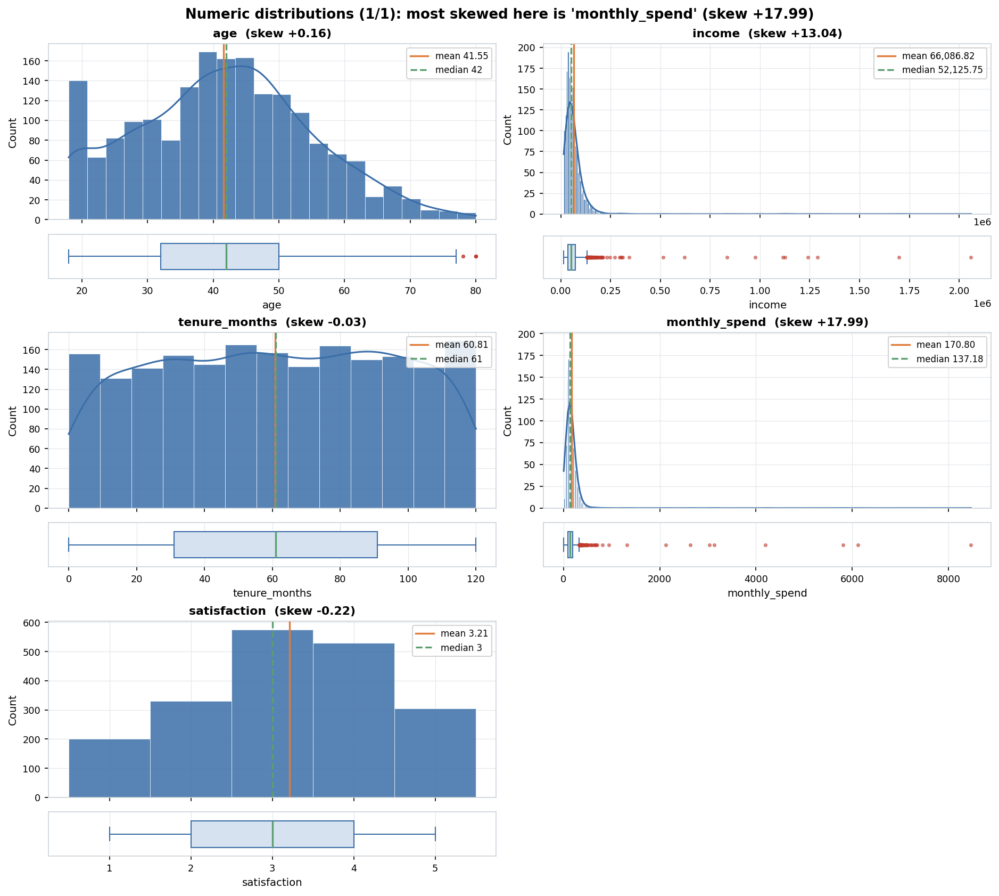

*Figure 5. Numeric distributions (1/1): most skewed here is 'monthly_spend' (skew +17.99).* Histogram (with a smooth density curve for many-valued columns) and a box plot per column. Orange line = mean, green dashed line = median; red dots are values beyond 1.5×IQR.

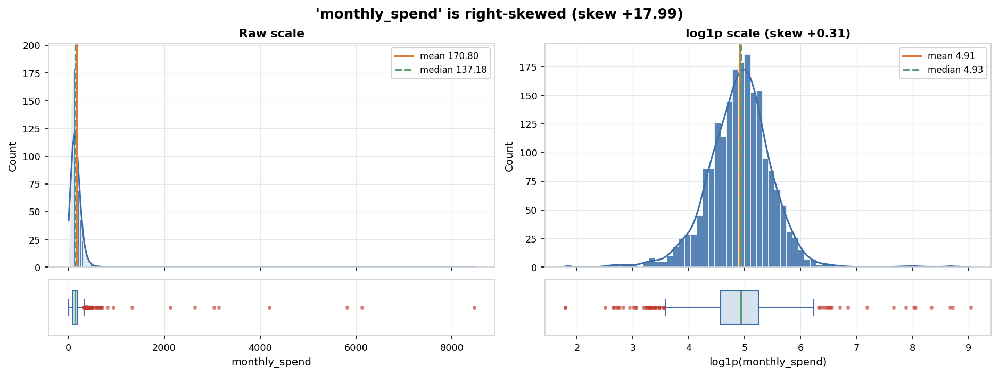

*Figure 6. 'monthly_spend' is right-skewed (skew +17.99).* Close-up of a skewed or outlier-heavy column. The right panel shows the same values on a log1p scale.

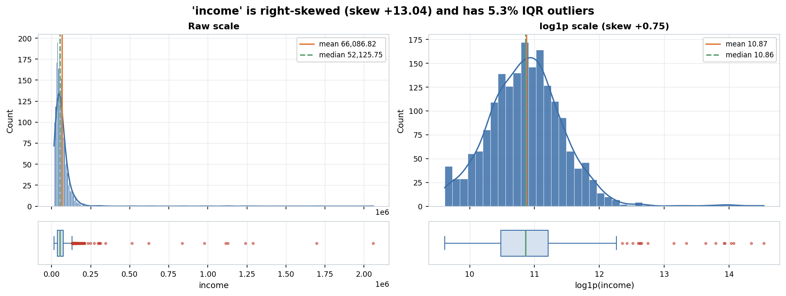

*Figure 7. 'income' is right-skewed (skew +13.04) and has 5.3% IQR outliers.* Close-up of a skewed or outlier-heavy column. The right panel shows the same values on a log1p scale.

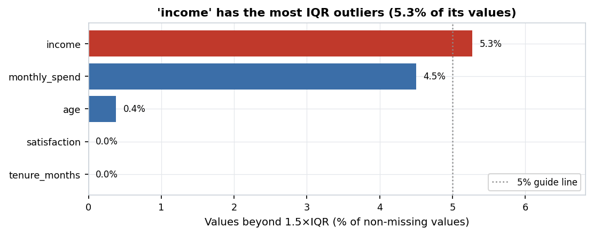

*Figure 8. 'income' has the most IQR outliers (5.3% of its values).* Share of each numeric column's values outside 1.5×IQR. Outliers are only flagged, not removed, in the conservative cleaned data. Red bars are above the guide line.

**Numeric summary**

| Column | Count | Mean | Std | Min | Q1 | Median | Q3 | Max | Skew | Kurtosis | % zeros | % outliers (1.5×IQR) |
| :--- | ---: | ---: | ---: | ---: | ---: | ---: | ---: | ---: | ---: | ---: | ---: | ---: |
| age | 1,860 | 41.553 | 13.385 | 18 | 32 | 42 | 50 | 80 | 0.158 | -0.42 | 0 | 0.38 |
| income | 1,840 | 66,086.82 | 93,652.542 | 15,000 | 35,681.29 | 52,125.75 | 73,892.768 | 2,059,223 | 13.04 | 214.622 | 0 | 5.27 |
| tenure_months | 1,970 | 60.808 | 34.601 | 0 | 31 | 61 | 91 | 120 | -0.03 | -1.173 | 1.02 | 0 |
| monthly_spend | 2,000 | 170.797 | 313.02 | 5 | 95.743 | 137.18 | 188.715 | 8,468.39 | 17.986 | 387.119 | 0 | 4.5 |
| satisfaction | 1,940 | 3.209 | 1.2 | 1 | 2 | 3 | 4 | 5 | -0.221 | -0.806 | 0 | 0 |

### 4.4 Categorical and binary columns

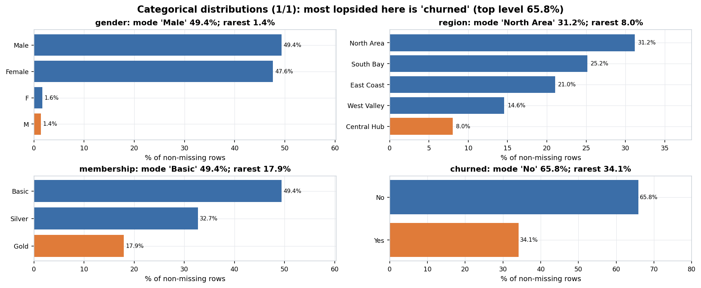

*Figure 9. Categorical distributions (1/1): most lopsided here is 'churned' (top level 65.8%).* Share of rows per level (top 15 levels; the rest are grouped as 'Other'). The orange bar marks the smallest (minority) level.

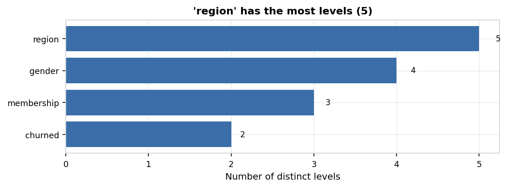

*Figure 10. 'region' has the most levels (5).* Number of distinct values in each categorical or binary column.

**Categorical summary**

| Column | Levels | Mode | Mode % | Entropy (0-1) | Rarest level | Rarest % | Levels under 1% of rows |
| :--- | ---: | :--- | ---: | ---: | :--- | ---: | ---: |
| gender | 4 | Male | 49.35 | 0.597 | M | 1.35 | 0 |
| region | 5 | North Area | 31.2 | 0.945 | Central Hub | 8.02 | 0 |
| membership | 3 | Basic | 49.4 | 0.93 | Gold | 17.9 | 0 |
| churned | 2 | No | 65.85 | 0.926 | Yes | 34.15 | 0 |

### 4.5 Target / class balance

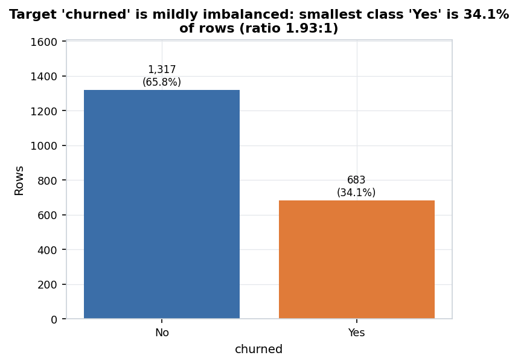

*Figure 11. Target 'churned' is mildly imbalanced: smallest class 'Yes' is 34.1% of rows (ratio 1.93:1).* Rows per target class. The orange bar is the smallest class. Highly imbalanced = smallest class under 10% of rows; mildly = largest/smallest ratio of 1.5 or more.

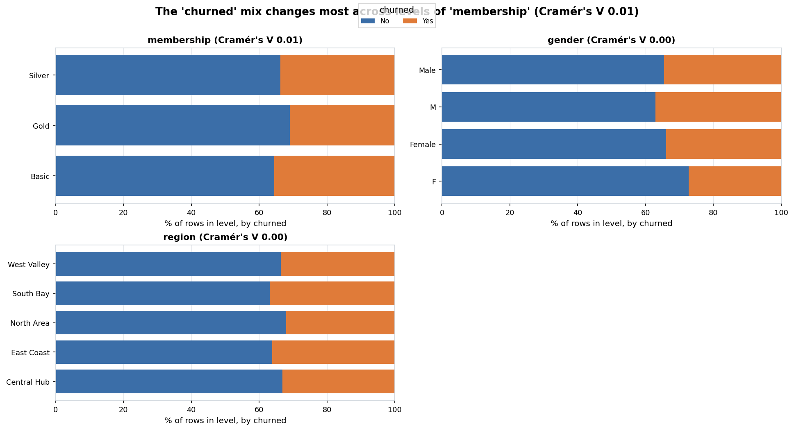

*Figure 12. The 'churned' mix changes most across levels of 'membership' (Cramér's V 0.01).* Share of each target class within each level of the categorical features most associated with the target (bias-corrected Cramér's V). Descriptive coefficients only; no hypothesis tests were run.

**Target classes**

| Class | Count | % |
| :--- | ---: | ---: |
| No | 1,317 | 65.85 |
| Yes | 683 | 34.15 |

Imbalance ratio (largest/smallest class) = 1.93: **mildly imbalanced**.

### 4.6 Relationships between columns (descriptive)

All coefficients here describe the data; none of them is a test result. Spearman rho and Pearson r range from -1 to +1; eta² and Cramér's V range from 0 (no association) to 1.

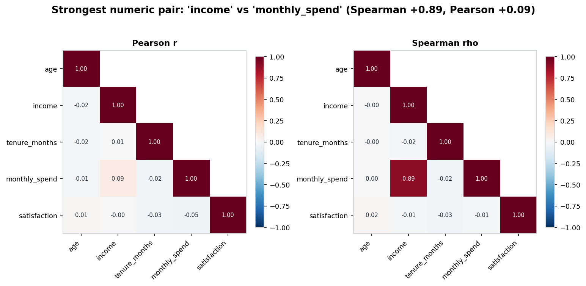

*Figure 13. Strongest numeric pair: 'income' vs 'monthly_spend' (Spearman +0.89, Pearson +0.09).* Correlation between numeric columns (lower triangle). Left: Pearson (linear). Right: Spearman (rank-based). Descriptive coefficients only; no hypothesis tests were run.

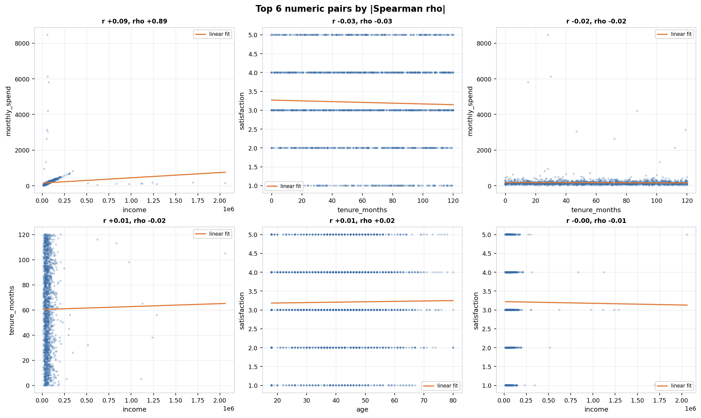

*Figure 14. Top 6 numeric pairs by |Spearman rho|.* Scatter plots with a straight-line fit for the most strongly related numeric pairs. Large datasets are randomly sampled for plotting. Descriptive coefficients only; no hypothesis tests were run.

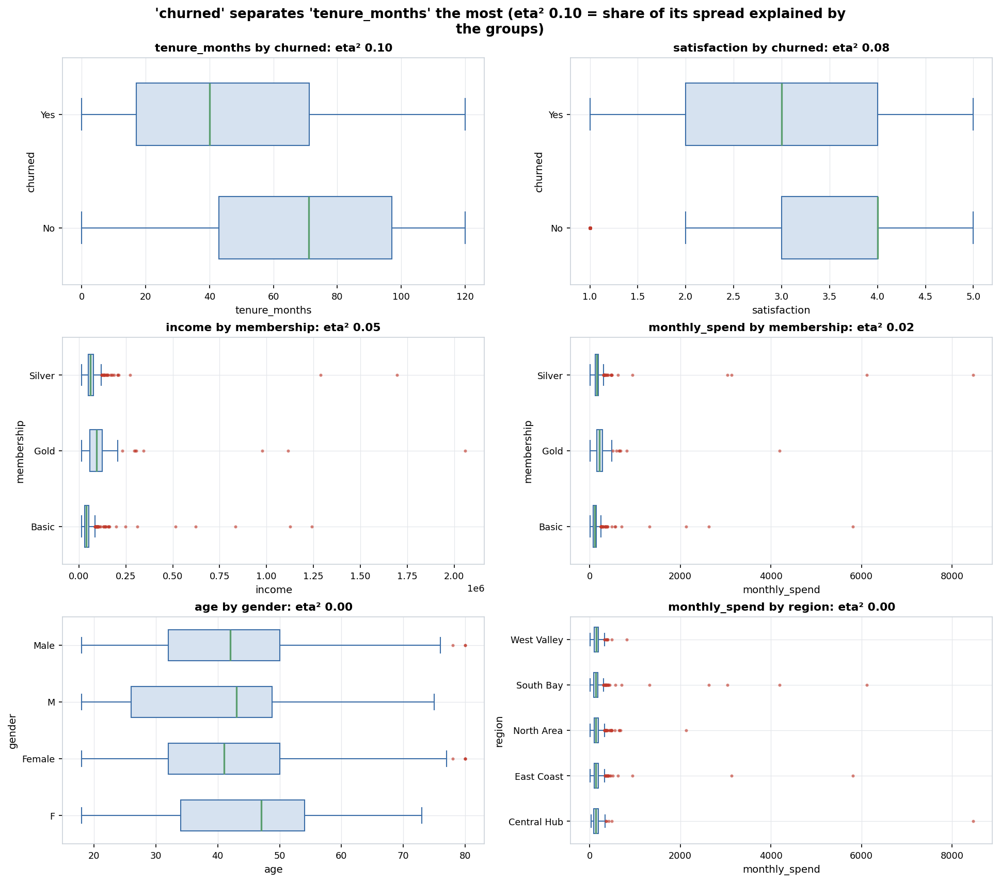

*Figure 15. 'churned' separates 'tenure_months' the most (eta² 0.10 = share of its spread explained by the groups).* Box plots of numeric columns split by categorical columns with up to 8 levels, for the pairs with the largest eta-squared. Descriptive coefficients only; no hypothesis tests were run.

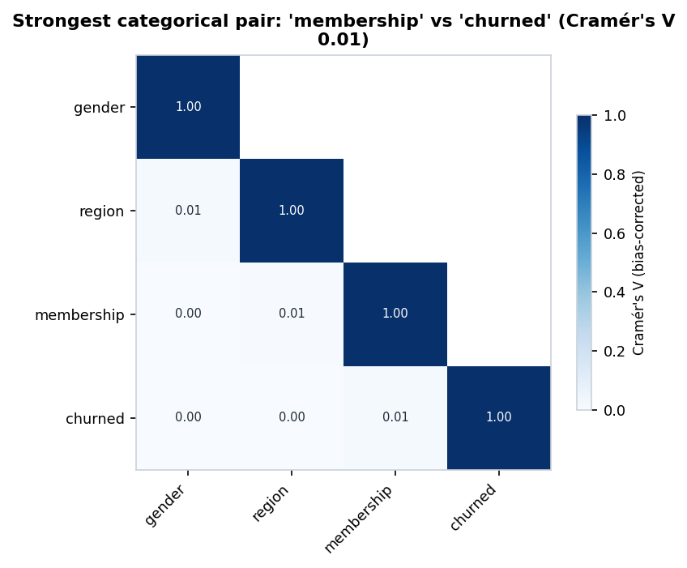

*Figure 16. Strongest categorical pair: 'membership' vs 'churned' (Cramér's V 0.01).* Bias-corrected Cramér's V between categorical/binary columns: 0 = unrelated, 1 = one fully predicts the other. Descriptive coefficients only; no hypothesis tests were run.

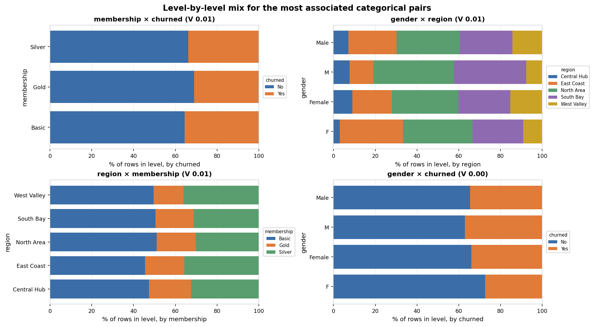

*Figure 17. Level-by-level mix for the most associated categorical pairs.* For each level of the first column, the share of rows in each level of the second column. Descriptive coefficients only; no hypothesis tests were run.

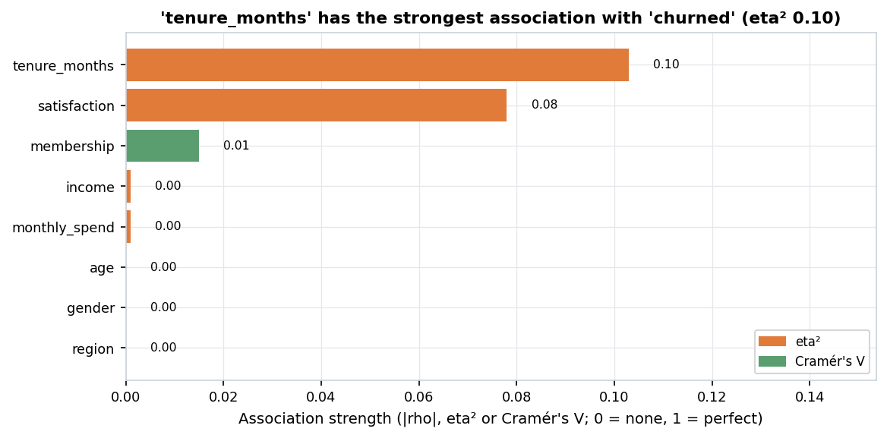

*Figure 18. 'tenure_months' has the strongest association with 'churned' (eta² 0.10).* Every feature ranked by a descriptive association with the target. Different measures are used for different column types, so compare bars of the same colour most directly. Descriptive coefficients only; no hypothesis tests were run.

**Top numeric pairs**

| Column A | Column B | Pearson r | Spearman rho | Rows used |
| :--- | :--- | ---: | ---: | ---: |
| income | monthly_spend | 0.086 | 0.894 | 1,840 |
| tenure_months | satisfaction | -0.029 | -0.026 | 1,910 |
| tenure_months | monthly_spend | -0.024 | -0.024 | 1,970 |
| income | tenure_months | 0.006 | -0.018 | 1,811 |
| age | satisfaction | 0.012 | 0.017 | 1,806 |
| income | satisfaction | -0.004 | -0.014 | 1,787 |
| monthly_spend | satisfaction | -0.045 | -0.011 | 1,940 |
| age | tenure_months | -0.019 | -0.004 | 1,831 |
| age | income | -0.016 | -0.003 | 1,711 |
| age | monthly_spend | -0.009 | 0.002 | 1,860 |

Descriptive coefficients only; no hypothesis tests were run.
**Near-collinear numeric pairs**

No numeric pairs have |Pearson r| above 0.9.
**Numeric columns by group (eta²)**

| Numeric | Grouped by | eta² |
| :--- | :--- | ---: |
| tenure_months | churned | 0.103 |
| satisfaction | churned | 0.078 |
| income | membership | 0.049 |
| monthly_spend | membership | 0.018 |
| age | gender | 0.002 |
| monthly_spend | region | 0.002 |
| tenure_months | region | 0.002 |
| income | churned | 0.001 |
| income | gender | 0.001 |
| income | region | 0.001 |

Descriptive coefficients only; no hypothesis tests were run.
**Categorical pairs (Cramér's V)**

| Column A | Column B | Cramér's V |
| :--- | :--- | ---: |
| membership | churned | 0.015 |
| gender | region | 0.014 |
| region | membership | 0.006 |
| gender | churned | 0 |
| gender | membership | 0 |
| region | churned | 0 |

Descriptive coefficients only; no hypothesis tests were run.
**Every feature vs. the target**

| Feature | Measure | Value |
| :--- | :--- | ---: |
| tenure_months | eta² | 0.103 |
| satisfaction | eta² | 0.078 |
| membership | Cramér's V | 0.015 |
| income | eta² | 0.001 |
| monthly_spend | eta² | 0.001 |
| age | eta² | 0 |
| gender | Cramér's V | 0 |
| region | Cramér's V | 0 |

Descriptive coefficients only; no hypothesis tests were run.

### 4.7 Date columns

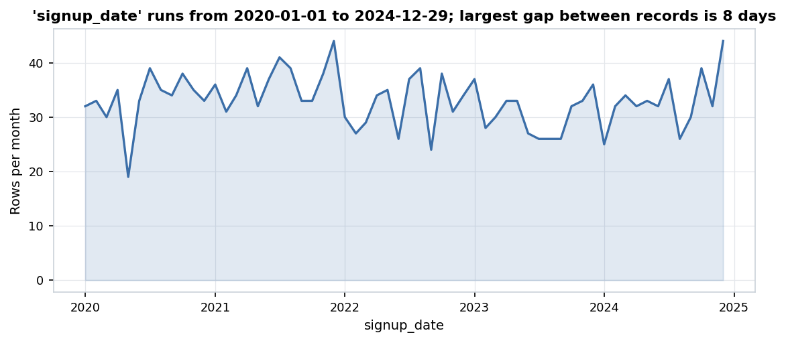

*Figure 19. 'signup_date' runs from 2020-01-01 to 2024-12-29; largest gap between records is 8 days.* Number of rows per month for 'signup_date'.

**Date ranges**

| Column | First | Last | Span (days) | Largest gap (days) |
| :--- | :--- | :--- | ---: | ---: |
| signup_date | 2020-01-01 | 2024-12-29 | 1,824 | 8 |

## 5. Insights

Automated insights rated **high** or **medium** (19 of 37; the full list is in [insights.md](insights.md) and [insights.json](insights.json)):

- **HIGH** (data quality) — Column 'notes' has 70.3% missing values (n = 1,406 of 2,000 rows). ([figure](figures/missing_bar.png))
- **MEDIUM** (data quality) — Column 'Unnamed: 0' was dropped (exported_unnamed_index_column).
- **MEDIUM** (data quality) — Column 'unused' was dropped (fully_empty_column).
- **MEDIUM** (data quality) — 80 exact duplicate rows were removed (the first copy of each was kept).
- **MEDIUM** (data quality) — Column 'age' had 21 values outside its allowed range; they were set to missing.
- **MEDIUM** (data quality) — Column 'tenure_months' had 11 values outside its allowed range; they were set to missing.
- **MEDIUM** (data quality) — Column 'age' has 7% missing values (n = 140 of 2,000 rows). ([figure](figures/missing_bar.png))
- **MEDIUM** (data quality) — Column 'income' has 8% missing values (n = 160 of 2,000 rows). ([figure](figures/missing_bar.png))
- **MEDIUM** (data quality) — Column 'income' was stored as text with number formatting; 1,914 cells were converted to numbers.
- **MEDIUM** (data quality) — Column 'monthly_spend' was stored as text with number formatting; 2,080 cells were converted to numbers.
- **MEDIUM** (data quality) — Column 'income' used placeholder text for missing values: '-' (39), '?' (36), 'N/A' (26), 'null' (25); 126 cells were turned into real missing values.
- **MEDIUM** (data quality) — Column 'signup_date' had 21 values that could not be read as its type; they were set to missing.
- **MEDIUM** (data quality) — Column 'tenure_months' had 20 values that could not be read as its type; they were set to missing.
- **MEDIUM** (distribution) — 'income' has many outliers: 5.27% of its values (n = 97) are beyond 1.5×IQR. They are flagged, not removed. ([figure](figures/outlier_summary.png))
- **MEDIUM** (distribution) — 'income' is right-skewed (skew = 13.04): its median (52,125.75) is below its mean (66,086.82), so a log transform is advisable for plots and parametric models. ([figure](figures/numeric_detail_income.png))
- **MEDIUM** (distribution) — 'monthly_spend' is right-skewed (skew = 17.99): its median (137.18) is below its mean (170.8), so a log transform is advisable for plots and parametric models. ([figure](figures/numeric_detail_monthly_spend.png))
- **MEDIUM** (class balance) — Target 'churned' is mildly imbalanced: the smallest class 'Yes' is 34.15% of rows and the largest 'No' is 65.85% (the largest class is 1.93 times the smallest). ([figure](figures/target_balance.png))
- **MEDIUM** (testing implication) — Rank-based methods (Spearman, Mann-Whitney, Kruskal-Wallis) are recommended for 2 skewed or outlier-heavy column(s): 'income', 'monthly_spend'.
- **MEDIUM** (testing implication) — Because target 'churned' is mildly imbalanced, compare groups using rates (% per class) rather than raw counts, and use stratified splits for any later modeling. ([figure](figures/target_balance.png))

### Manual insights (written by the analyst)

- **Contamination-free ground-truth benchmark:** Generated from a 2,000-row seeded base dataset (`seed = 42`) with 18 injected defect categories recorded in `data/synthetic/messy_manifest.json` so pipeline cleaning and LLM baselines can be scored against an exact answer key.
- **Structural defect recovery (`17 -> 15` columns, `2,040 -> 2,000` rows):** The pipeline automatically dropped `Unnamed: 0` (exported index) and `all_null_col` (100% missing), flagged `constant_col` (`role = excluded`), and removed all 40 injected exact & whitespace-padded duplicate rows.
- **Type & formatting recovery with zero cell damage:** Successfully stripped currency/comma/accounting formatting in `monthly_spend` (`$1,234.50`, `(45.00)`), parsed percentage strings in `discount_rate` (`15%`), unified mixed ISO/slash/text dates in `signup_date`, merged 200 case/whitespace variants in `region`, and flagged 32 near-duplicate fuzzy typos (`"Nroth"`) without corrupting any clean cells.
- **Domain validity enforcement:** Detected and converted 39 impossible domain values to `NaN` (`age < 0` or `age > 120`, negative `tenure_months`, and `satisfaction_score = 99` outside `[1, 5]`).
- **Planted ground-truth relationships preserved:** After cleaning, the planted statistical structure remains intact: `tenure_months` and `monthly_spend` drive `total_spend` (Spearman $\rho = +0.76$), `plan_tier` strongly stratifies `monthly_spend` ($\eta^2 = 0.61$), and `churned` is associated with lower `satisfaction_score`, shorter `tenure_months`, and higher `support_tickets`.
- **Target findings for Phase 5 benchmark recovery:** (1) `plan_tier <-> monthly_spend` ($\eta^2 = 0.61$), (2) `tenure_months / monthly_spend <-> total_spend` ($
ho = +0.76$), (3) `satisfaction_score <-> churned`, (4) `tenure_months <-> churned`, and (5) `support_tickets <-> churned`.

## 6. Normalization / scaling

| Column | Skew | Recommended transform | Reason |
| :--- | ---: | :--- | :--- |
| `age` | +0.16 | none | Moderate/low skewness (skew=0.16); no non-linear transform needed. |
| `income` | +13.04 | log1p | Right-skewed (skew=13.04 > 1.0) with non-negative domain (min=15000); log1p recommended. |
| `tenure_months` | -0.03 | none | Moderate/low skewness (skew=-0.03); no non-linear transform needed. |
| `monthly_spend` | +17.99 | log1p | Right-skewed (skew=17.99 > 1.0) with non-negative domain (min=5); log1p recommended. |
| `satisfaction` | -0.22 | none | Moderate/low skewness (skew=-0.22); no non-linear transform needed. |

Scale disparity across numeric columns (largest std ÷ smallest std): 78,059.53. Z-score standardization is recommended only for scale-sensitive methods.

> Primary cleaned output is **not** scaled. The Phase 3 test library is rank-based or scale-invariant (Welch/Mann-Whitney, Spearman, Kruskal, chi-square), so scaling would not change results. Log transforms are recommended for columns [income, monthly_spend] only for plotting and for parametric/regression use. A scaled copy is provided for TA review and for any future modeling.

Scaled convenience copy (for review and future modeling only, never used for testing): `data/cleaned/messy_synthetic_scaled.csv`. Details: [scaling_report.md](scaling_report.md).

## 7. Output files

- [profile.json](profile.json): full profile of the raw file
- [profile_cleaned.json](profile_cleaned.json): profile of the cleaned file
- [column_schema.json](column_schema.json): Phase 2 handoff: type and role of every column
- [cleaning_log.json](cleaning_log.json): every cleaning change (machine-readable)
- [cleaning_log.md](cleaning_log.md): every cleaning change (readable)
- [scaling_report.md](scaling_report.md): scaling and transform decisions
- [scaling_params.json](scaling_params.json): fitted scaling parameters
- [eda_summary.json](eda_summary.json): every EDA number used by the insights
- [insights.json](insights.json): automated insights with evidence
- [insights.md](insights.md): automated + manual insights
- [report.md](report.md): this report (markdown)
- [report.html](report.html): this report (HTML)
- [config_resolved.yaml](config_resolved.yaml): the exact settings used for this run
- `figures/`: 19 PNG figures; `tables/`: EDA tables as markdown
- `data/cleaned/messy_synthetic_cleaned.csv`: conservative cleaned data (primary, NaN kept)
- `data/cleaned/messy_synthetic_cleaned_imputed.csv`: imputed cleaned data (secondary, with `__was_missing` flags)
- `data/cleaned/messy_synthetic_scaled.csv`: scaled convenience copy
