# Phase 1 Dataset Report — `student_performance`

_Generated by the VeriData Phase 1 pipeline. Every number comes from code (no LLM). Relationship numbers are descriptive only; no hypothesis tests were run in Phase 1._

**Contents:** 1. Overview · 2. Columns · 3. Data cleaning · 4. Exploratory data analysis · 5. Insights · 6. Normalization / scaling · 7. Output files

## 1. Overview

| Item | Value |
| :--- | :--- |
| Source file | `data\raw\student_performance\student-mat.csv` |
| SHA-256 | `659f3984643c2def53ba5e49f551c6ce3657039f9c25306cacb8f43b818a5190` |
| Raw shape | 395 rows × 33 columns |
| Cleaned shape (conservative, primary) | 395 rows × 33 columns |
| Cleaned shape (imputed, secondary) | 395 rows × 33 columns |
| Exact duplicate rows in raw file | 0 |
| Missing cells in raw file (incl. placeholder text) | 0 (0.00%) |
| Memory (raw) | 0.736087 MB |
| Target column | `G3` (numeric) |

### Profiling warnings (raw file)

- Column 'guardian' has near-duplicate label candidate(s): ('mother' vs 'other', sim=0.91).
- Column 'failures' has extreme skewness (skew=2.39).
- Binary column 'higher' is highly imbalanced (minority class = 5.1%).
- Column 'Dalc' has extreme skewness (skew=2.19).
- Column 'absences' has extreme skewness (skew=3.67).

## 2. Column profile (raw file)

| Column | Raw dtype | Inferred type | Missing % | Unique | Why this type |
| :--- | :--- | :--- | ---: | ---: | :--- |
| `school` | `object` | `binary` | 0.0% | 2 | string column with 2 distinct normalized values ('GP', 'MS') |
| `sex` | `object` | `binary` | 0.0% | 2 | binary string/mixed encoding (gender binary (Male/Female): ['F', 'M']) |
| `age` | `int64` | `numeric_discrete` | 0.0% | 8 | integer values with 8 unique levels (unique ratio 2.0%) |
| `address` | `object` | `binary` | 0.0% | 2 | string column with 2 distinct normalized values ('U', 'R') |
| `famsize` | `object` | `binary` | 0.0% | 2 | string column with 2 distinct normalized values ('GT3', 'LE3') |
| `Pstatus` | `object` | `binary` | 0.0% | 2 | string column with 2 distinct normalized values ('T', 'A') |
| `Medu` | `int64` | `numeric_discrete` | 0.0% | 5 | integer values with 5 unique levels (unique ratio 1.3%) |
| `Fedu` | `int64` | `numeric_discrete` | 0.0% | 5 | integer values with 5 unique levels (unique ratio 1.3%) |
| `Mjob` | `object` | `categorical_nominal` | 0.0% | 5 | string categorical with 5 normalized unique values (raw=5) |
| `Fjob` | `object` | `categorical_nominal` | 0.0% | 5 | string categorical with 5 normalized unique values (raw=5) |
| `reason` | `object` | `categorical_nominal` | 0.0% | 4 | string categorical with 4 normalized unique values (raw=4) |
| `guardian` | `object` | `categorical_nominal` | 0.0% | 3 | string categorical with 3 normalized unique values (raw=3) |
| `traveltime` | `int64` | `numeric_discrete` | 0.0% | 4 | integer values with 4 unique levels (unique ratio 1.0%) |
| `studytime` | `int64` | `numeric_discrete` | 0.0% | 4 | integer values with 4 unique levels (unique ratio 1.0%) |
| `failures` | `int64` | `numeric_discrete` | 0.0% | 4 | integer values with 4 unique levels (unique ratio 1.0%) |
| `schoolsup` | `object` | `binary` | 0.0% | 2 | binary string/mixed encoding (boolean-like (Yes/No/1/0): ['no', 'yes']) |
| `famsup` | `object` | `binary` | 0.0% | 2 | binary string/mixed encoding (boolean-like (Yes/No/1/0): ['no', 'yes']) |
| `paid` | `object` | `binary` | 0.0% | 2 | binary string/mixed encoding (boolean-like (Yes/No/1/0): ['no', 'yes']) |
| `activities` | `object` | `binary` | 0.0% | 2 | binary string/mixed encoding (boolean-like (Yes/No/1/0): ['no', 'yes']) |
| `nursery` | `object` | `binary` | 0.0% | 2 | binary string/mixed encoding (boolean-like (Yes/No/1/0): ['no', 'yes']) |
| `higher` | `object` | `binary` | 0.0% | 2 | binary string/mixed encoding (boolean-like (Yes/No/1/0): ['no', 'yes']) |
| `internet` | `object` | `binary` | 0.0% | 2 | binary string/mixed encoding (boolean-like (Yes/No/1/0): ['no', 'yes']) |
| `romantic` | `object` | `binary` | 0.0% | 2 | binary string/mixed encoding (boolean-like (Yes/No/1/0): ['no', 'yes']) |
| `famrel` | `int64` | `numeric_discrete` | 0.0% | 5 | integer values with 5 unique levels (unique ratio 1.3%) |
| `freetime` | `int64` | `numeric_discrete` | 0.0% | 5 | integer values with 5 unique levels (unique ratio 1.3%) |
| `goout` | `int64` | `numeric_discrete` | 0.0% | 5 | integer values with 5 unique levels (unique ratio 1.3%) |
| `Dalc` | `int64` | `numeric_discrete` | 0.0% | 5 | integer values with 5 unique levels (unique ratio 1.3%) |
| `Walc` | `int64` | `numeric_discrete` | 0.0% | 5 | integer values with 5 unique levels (unique ratio 1.3%) |
| `health` | `int64` | `numeric_discrete` | 0.0% | 5 | integer values with 5 unique levels (unique ratio 1.3%) |
| `absences` | `int64` | `numeric_continuous` | 0.0% | 34 | numeric values (100.0% parseable, 34 unique) |
| `G1` | `int64` | `numeric_discrete` | 0.0% | 17 | integer values with 17 unique levels (unique ratio 4.3%) |
| `G2` | `int64` | `numeric_discrete` | 0.0% | 17 | integer values with 17 unique levels (unique ratio 4.3%) |
| `G3` | `int64` | `numeric_discrete` | 0.0% | 18 | integer values with 18 unique levels (unique ratio 4.6%) |

## 3. Data cleaning

2 cleaning steps made 11 logged changes touching 0 cells. Rows: 395 in the raw file → 395 in the conservative output → 395 in the imputed output.

### What the TA asked for

| Requirement | What the pipeline did |
| :--- | :--- |
| Missing values | ✔ checked; nothing to change. Conservative output keeps NaN; imputed output fills gaps and adds `__was_missing` flags |
| Duplicates | ✔ checked; nothing to change |
| Outliers | ✔ flagged outliers: 185 rows. 16 column(s) flagged; values are kept in the conservative output |
| Inconsistent formats | ✔ flagged fuzzy variants: 32 rows |
| Empty rows / columns | ✔ checked; nothing to change |

### Changes by step

| Step | Log entries | Cells changed | Rows removed |
| :--- | ---: | ---: | ---: |
| `standardize_categories` | 1 | 0 | 0 |
| `handle_outliers` | 10 | 0 | 0 |

### Outlier flags (1.5×IQR and modified z-score)

| Column | Flagged | Flagged % | Extreme (3×IQR) | Normal range (1.5×IQR) | Action |
| :--- | ---: | ---: | ---: | :--- | :--- |
| `Dalc` | 18 | 4.56% | 0 | -0.5 to 3.5 | flag |
| `Fedu` | 2 | 0.51% | 0 | 0.5 to 4.5 | flag |
| `G1` | 0 | 0.00% | 0 | 0.5 to 20.5 | flag |
| `G2` | 13 | 3.29% | 0 | 3 to 19 | flag |
| `G3` | 0 | 0.00% | 0 | -1 to 23 | flag |
| `Medu` | 0 | 0.00% | 0 | -1 to 7 | flag |
| `Walc` | 0 | 0.00% | 0 | -2 to 6 | flag |
| `absences` | 15 | 3.80% | 5 | -12 to 20 | flag |
| `age` | 1 | 0.25% | 0 | 13 to 21 | flag |
| `failures` | 33 | 8.35% | 0 |  | flag |
| `famrel` | 26 | 6.58% | 0 | 2.5 to 6.5 | flag |
| `freetime` | 19 | 4.81% | 0 | 1.5 to 5.5 | flag |
| `goout` | 0 | 0.00% | 0 | -1 to 7 | flag |
| `health` | 0 | 0.00% | 0 | 0 to 8 | flag |
| `studytime` | 27 | 6.84% | 0 | -0.5 to 3.5 | flag |
| `traveltime` | 31 | 7.85% | 0 | -0.5 to 3.5 | flag |

The full step-by-step log with before/after examples is in [cleaning_log.md](cleaning_log.md) (machine-readable: [cleaning_log.json](cleaning_log.json)).

## 4. Exploratory data analysis

### 4.1 Dataset overview

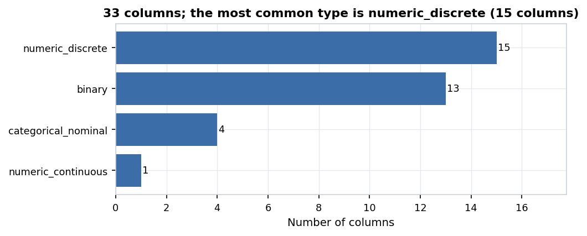

*Figure 1. 33 columns; the most common type is numeric_discrete (15 columns).* Count of columns by the semantic type the pipeline inferred (after cleaning).

| Item | Value |
| :--- | :--- |
| Rows (raw file) | 395 |
| Rows (cleaned, conservative) | 395 |
| Columns | 33 |
| Memory | 0.347 MB |
| Missing cells | 0 (0.0%) |
| Columns typed `numeric_discrete` | 15 |
| Columns typed `binary` | 13 |
| Columns typed `categorical_nominal` | 4 |
| Columns typed `numeric_continuous` | 1 |
| Columns left out of EDA (ID / excluded) | none |

### 4.2 Missing values

No missing values remain in the cleaned data.

**Missing values per column (cleaned data)**

No missing values remain in the cleaned data, so no missingness charts were drawn.

### 4.3 Numeric columns

Red dots in box plots are values beyond 1.5×IQR; they are flagged but kept in the conservative cleaned data.

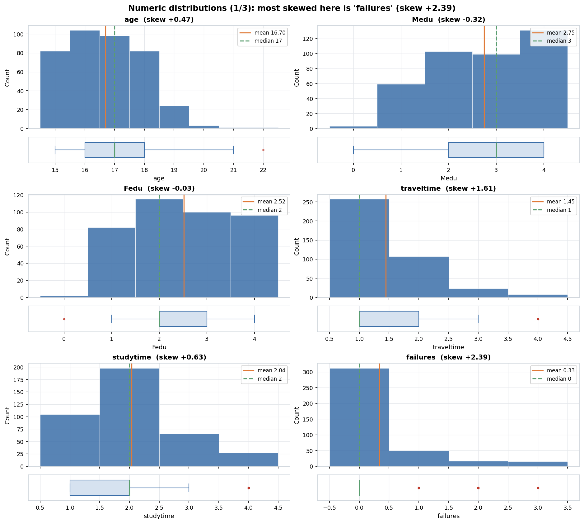

*Figure 2. Numeric distributions (1/3): most skewed here is 'failures' (skew +2.39).* Histogram (with a smooth density curve for many-valued columns) and a box plot per column. Orange line = mean, green dashed line = median; red dots are values beyond 1.5×IQR.

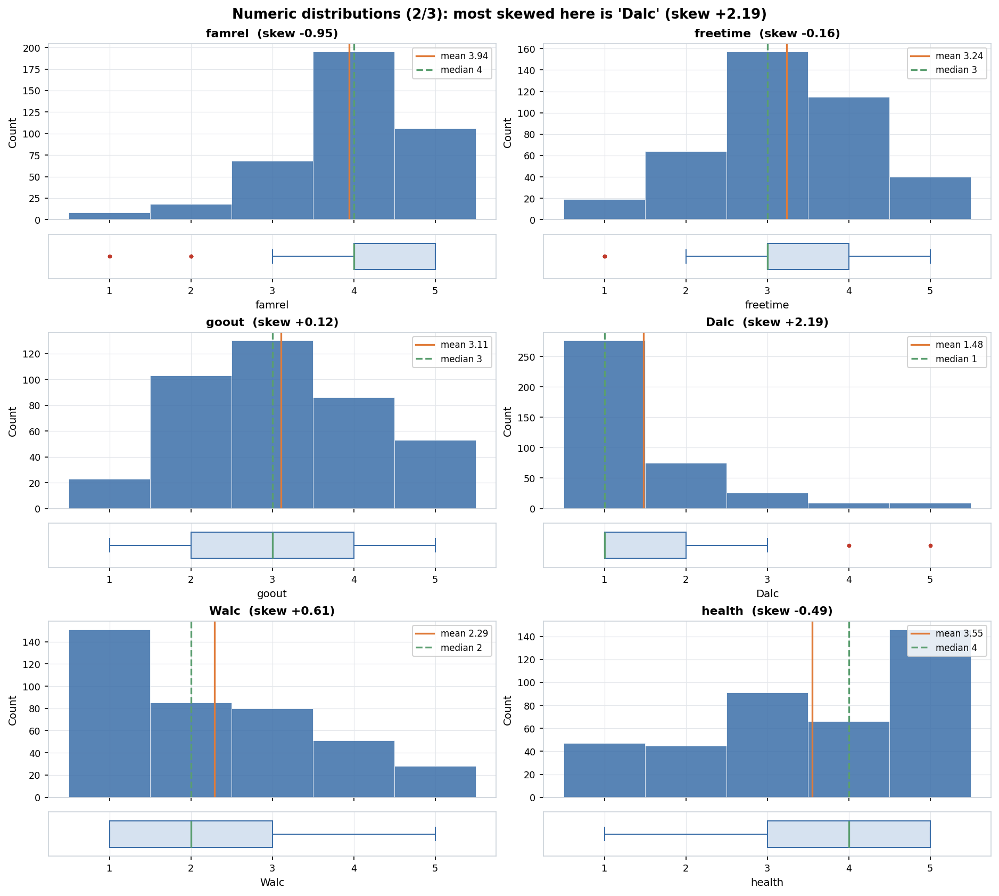

*Figure 3. Numeric distributions (2/3): most skewed here is 'Dalc' (skew +2.19).* Histogram (with a smooth density curve for many-valued columns) and a box plot per column. Orange line = mean, green dashed line = median; red dots are values beyond 1.5×IQR.

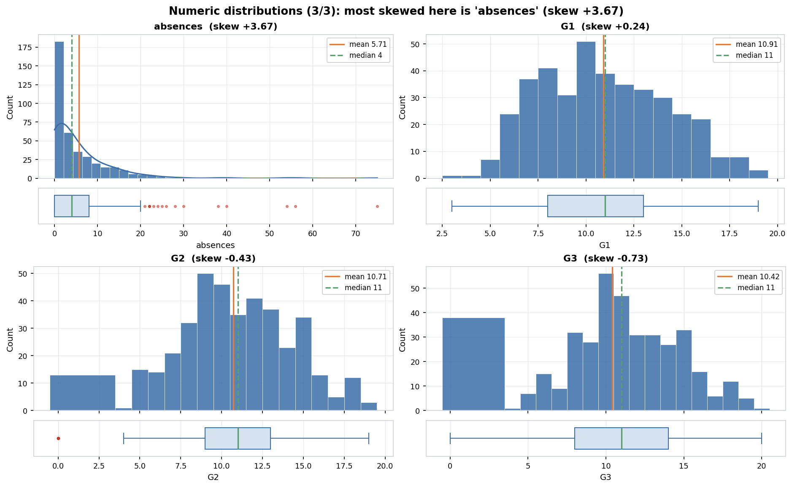

*Figure 4. Numeric distributions (3/3): most skewed here is 'absences' (skew +3.67).* Histogram (with a smooth density curve for many-valued columns) and a box plot per column. Orange line = mean, green dashed line = median; red dots are values beyond 1.5×IQR.

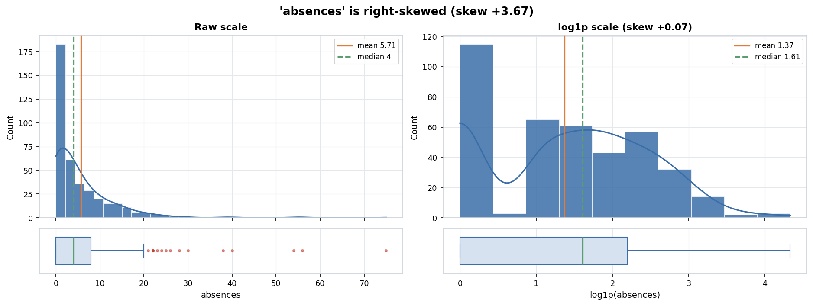

*Figure 5. 'absences' is right-skewed (skew +3.67).* Close-up of a skewed or outlier-heavy column. The right panel shows the same values on a log1p scale.

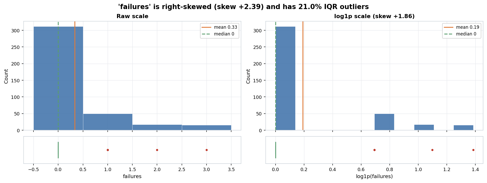

*Figure 6. 'failures' is right-skewed (skew +2.39) and has 21.0% IQR outliers.* Close-up of a skewed or outlier-heavy column. The right panel shows the same values on a log1p scale.

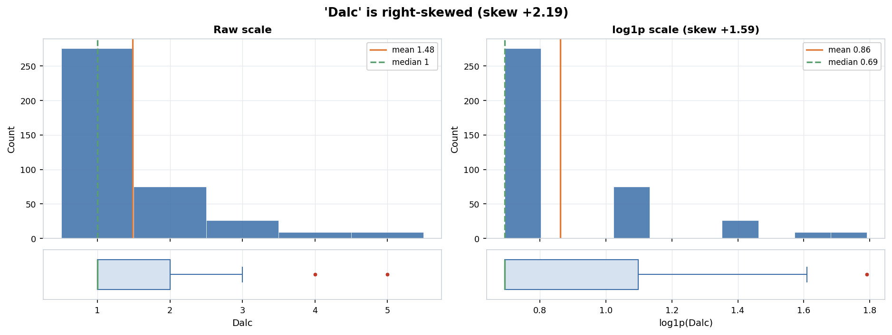

*Figure 7. 'Dalc' is right-skewed (skew +2.19).* Close-up of a skewed or outlier-heavy column. The right panel shows the same values on a log1p scale.

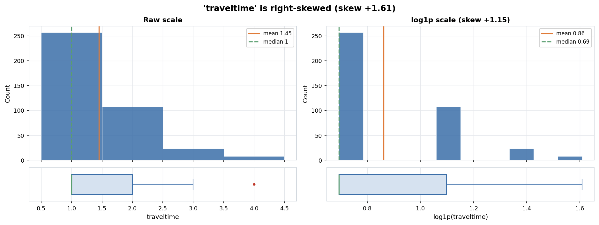

*Figure 8. 'traveltime' is right-skewed (skew +1.61).* Close-up of a skewed or outlier-heavy column. The right panel shows the same values on a log1p scale.

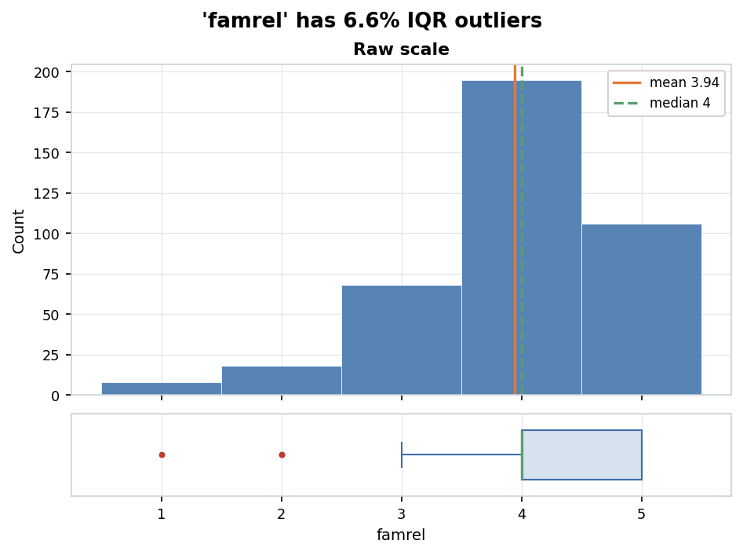

*Figure 9. 'famrel' has 6.6% IQR outliers.* Close-up of a skewed or outlier-heavy column.

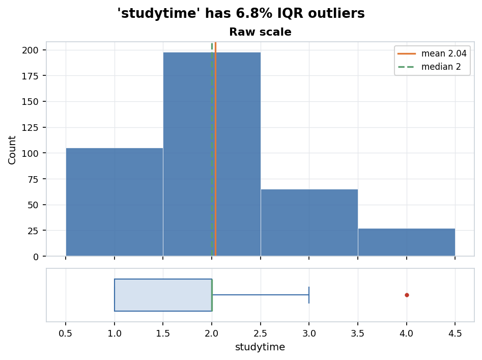

*Figure 10. 'studytime' has 6.8% IQR outliers.* Close-up of a skewed or outlier-heavy column.

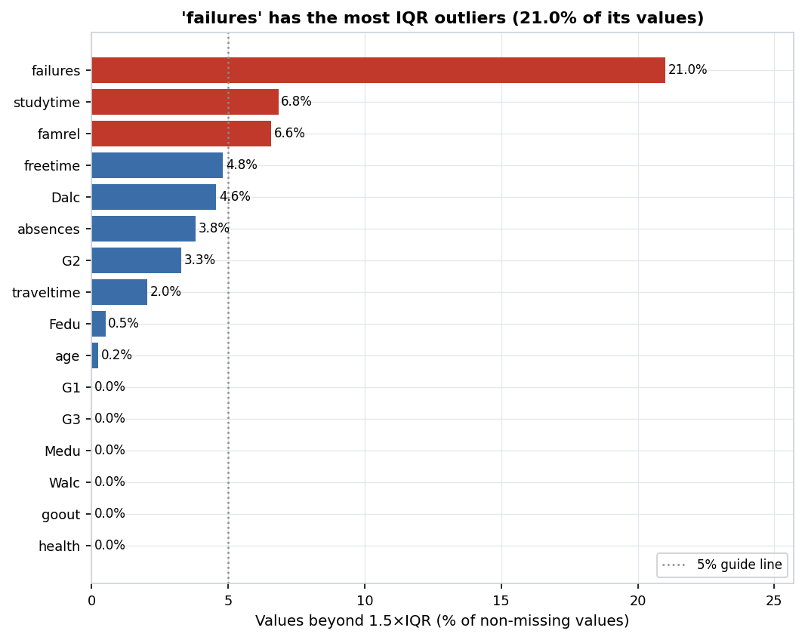

*Figure 11. 'failures' has the most IQR outliers (21.0% of its values).* Share of each numeric column's values outside 1.5×IQR. Outliers are only flagged, not removed, in the conservative cleaned data. Red bars are above the guide line.

**Numeric summary**

| Column | Count | Mean | Std | Min | Q1 | Median | Q3 | Max | Skew | Kurtosis | % zeros | % outliers (1.5×IQR) |
| :--- | ---: | ---: | ---: | ---: | ---: | ---: | ---: | ---: | ---: | ---: | ---: | ---: |
| age | 395 | 16.696 | 1.276 | 15 | 16 | 17 | 18 | 22 | 0.466 | -0.001 | 0 | 0.25 |
| Medu | 395 | 2.749 | 1.095 | 0 | 2 | 3 | 4 | 4 | -0.318 | -1.09 | 0.76 | 0 |
| Fedu | 395 | 2.522 | 1.088 | 0 | 2 | 2 | 3 | 4 | -0.032 | -1.199 | 0.51 | 0.51 |
| traveltime | 395 | 1.448 | 0.698 | 1 | 1 | 1 | 2 | 4 | 1.607 | 2.344 | 0 | 2.03 |
| studytime | 395 | 2.035 | 0.839 | 1 | 1 | 2 | 2 | 4 | 0.632 | -0.014 | 0 | 6.84 |
| failures | 395 | 0.334 | 0.744 | 0 | 0 | 0 | 0 | 3 | 2.387 | 5.005 | 78.99 | 21.01 |
| famrel | 395 | 3.944 | 0.897 | 1 | 4 | 4 | 5 | 5 | -0.952 | 1.14 | 0 | 6.58 |
| freetime | 395 | 3.235 | 0.999 | 1 | 3 | 3 | 4 | 5 | -0.163 | -0.302 | 0 | 4.81 |
| goout | 395 | 3.109 | 1.113 | 1 | 2 | 3 | 4 | 5 | 0.117 | -0.77 | 0 | 0 |
| Dalc | 395 | 1.481 | 0.891 | 1 | 1 | 1 | 2 | 5 | 2.191 | 4.759 | 0 | 4.56 |
| Walc | 395 | 2.291 | 1.288 | 1 | 1 | 2 | 3 | 5 | 0.612 | -0.791 | 0 | 0 |
| health | 395 | 3.554 | 1.39 | 1 | 3 | 4 | 5 | 5 | -0.495 | -1.014 | 0 | 0 |
| absences | 395 | 5.709 | 8.003 | 0 | 0 | 4 | 8 | 75 | 3.672 | 21.719 | 29.11 | 3.8 |
| G1 | 395 | 10.909 | 3.319 | 3 | 8 | 11 | 13 | 19 | 0.241 | -0.694 | 0 | 0 |
| G2 | 395 | 10.714 | 3.761 | 0 | 9 | 11 | 13 | 19 | -0.432 | 0.628 | 3.29 | 3.29 |
| G3 | 395 | 10.415 | 4.581 | 0 | 8 | 11 | 14 | 20 | -0.733 | 0.403 | 9.62 | 0 |

### 4.4 Categorical and binary columns

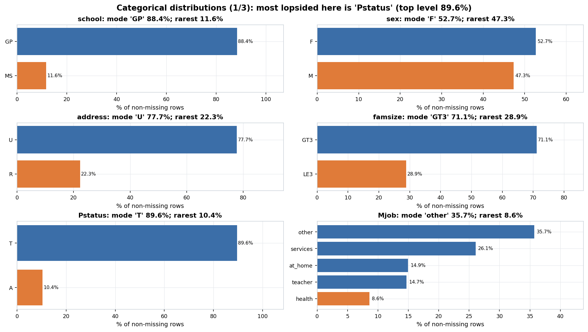

*Figure 12. Categorical distributions (1/3): most lopsided here is 'Pstatus' (top level 89.6%).* Share of rows per level (top 15 levels; the rest are grouped as 'Other'). The orange bar marks the smallest (minority) level.

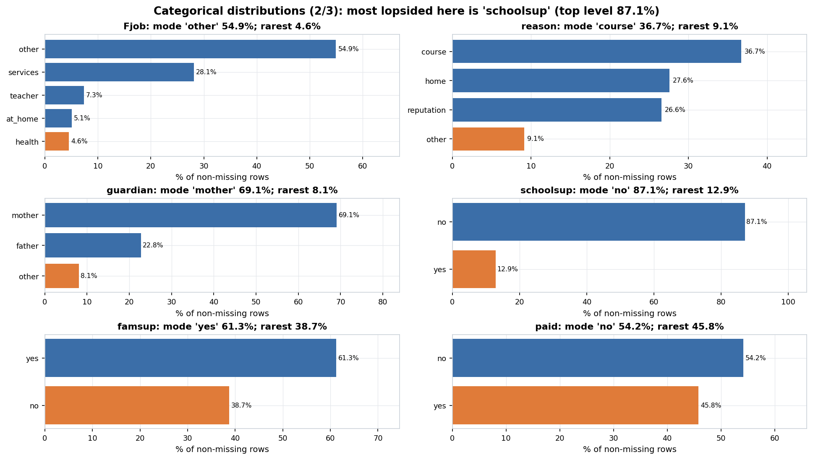

*Figure 13. Categorical distributions (2/3): most lopsided here is 'schoolsup' (top level 87.1%).* Share of rows per level (top 15 levels; the rest are grouped as 'Other'). The orange bar marks the smallest (minority) level.

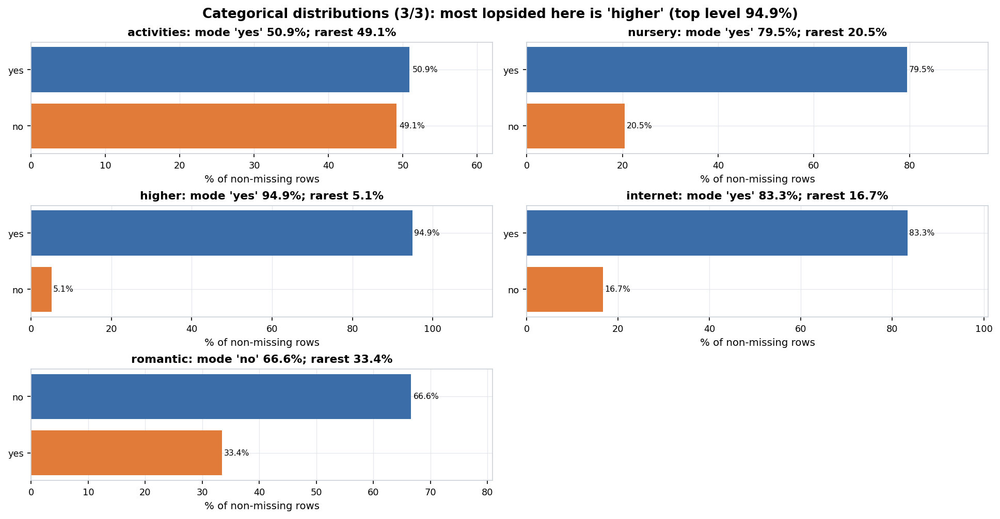

*Figure 14. Categorical distributions (3/3): most lopsided here is 'higher' (top level 94.9%).* Share of rows per level (top 15 levels; the rest are grouped as 'Other'). The orange bar marks the smallest (minority) level.

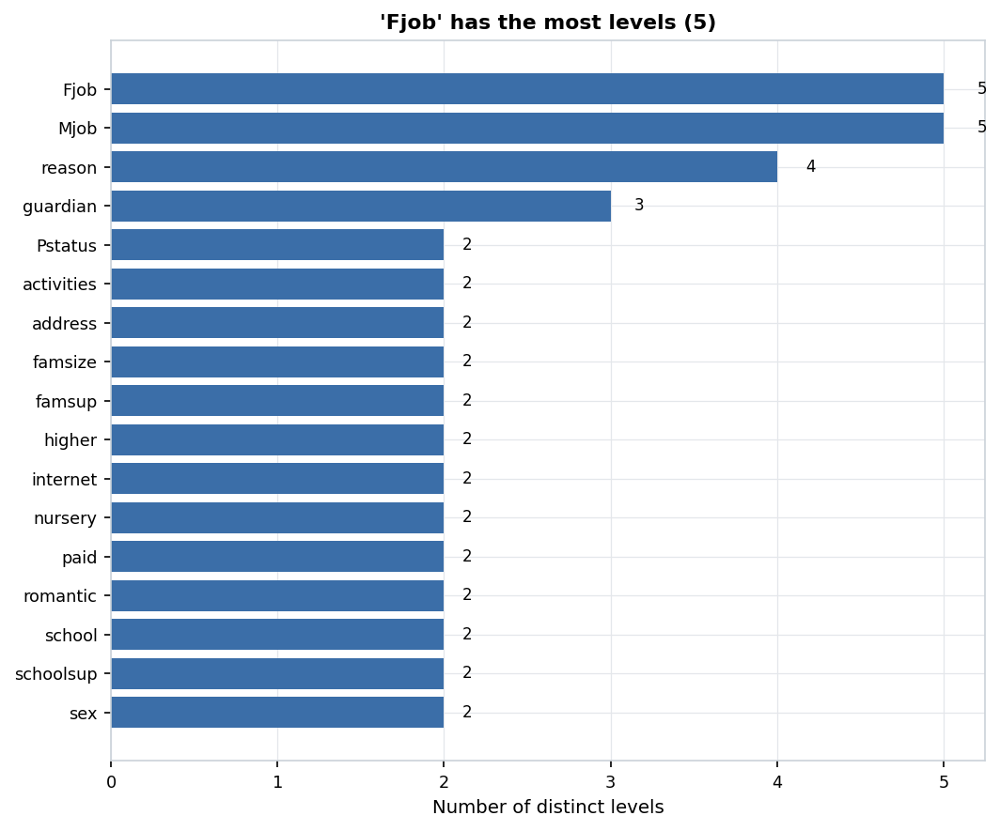

*Figure 15. 'Fjob' has the most levels (5).* Number of distinct values in each categorical or binary column.

**Categorical summary**

| Column | Levels | Mode | Mode % | Entropy (0-1) | Rarest level | Rarest % | Levels under 1% of rows |
| :--- | ---: | :--- | ---: | ---: | :--- | ---: | ---: |
| school | 2 | GP | 88.35 | 0.519 | MS | 11.65 | 0 |
| sex | 2 | F | 52.66 | 0.998 | M | 47.34 | 0 |
| address | 2 | U | 77.72 | 0.765 | R | 22.28 | 0 |
| famsize | 2 | GT3 | 71.14 | 0.867 | LE3 | 28.86 | 0 |
| Pstatus | 2 | T | 89.62 | 0.481 | A | 10.38 | 0 |
| Mjob | 5 | other | 35.7 | 0.929 | health | 8.61 | 0 |
| Fjob | 5 | other | 54.94 | 0.727 | health | 4.56 | 0 |
| reason | 4 | course | 36.71 | 0.933 | other | 9.11 | 0 |
| guardian | 3 | mother | 69.11 | 0.724 | other | 8.1 | 0 |
| schoolsup | 2 | no | 87.09 | 0.555 | yes | 12.91 | 0 |
| famsup | 2 | yes | 61.27 | 0.963 | no | 38.73 | 0 |
| paid | 2 | no | 54.18 | 0.995 | yes | 45.82 | 0 |
| activities | 2 | yes | 50.89 | 1 | no | 49.11 | 0 |
| nursery | 2 | yes | 79.49 | 0.732 | no | 20.51 | 0 |
| higher | 2 | yes | 94.94 | 0.289 | no | 5.06 | 0 |
| internet | 2 | yes | 83.29 | 0.651 | no | 16.71 | 0 |
| romantic | 2 | no | 66.58 | 0.919 | yes | 33.42 | 0 |

### 4.5 Target / class balance

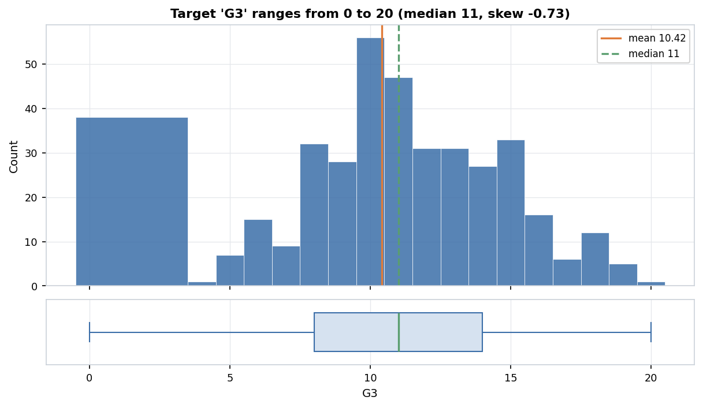

*Figure 16. Target 'G3' ranges from 0 to 20 (median 11, skew -0.73).* Distribution of the target column.

### 4.6 Relationships between columns (descriptive)

All coefficients here describe the data; none of them is a test result. Spearman rho and Pearson r range from -1 to +1; eta² and Cramér's V range from 0 (no association) to 1.

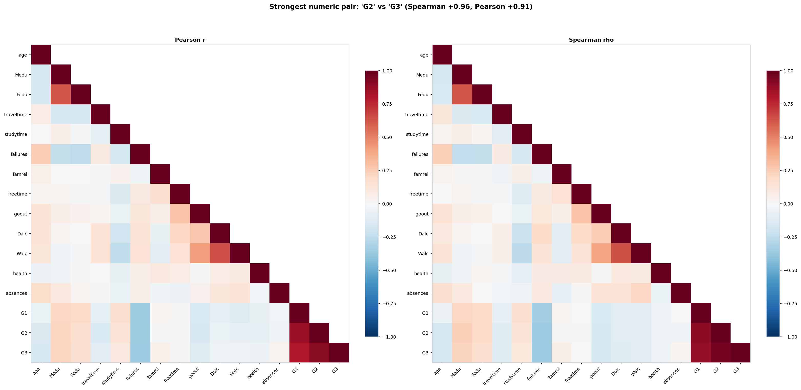

*Figure 17. Strongest numeric pair: 'G2' vs 'G3' (Spearman +0.96, Pearson +0.91).* Correlation between numeric columns (lower triangle). Left: Pearson (linear). Right: Spearman (rank-based). Descriptive coefficients only; no hypothesis tests were run.

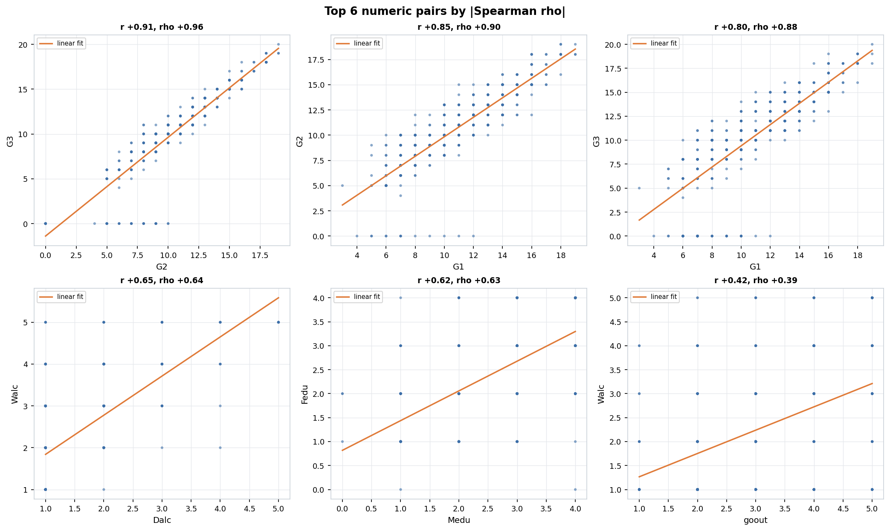

*Figure 18. Top 6 numeric pairs by |Spearman rho|.* Scatter plots with a straight-line fit for the most strongly related numeric pairs. Large datasets are randomly sampled for plotting. Descriptive coefficients only; no hypothesis tests were run.

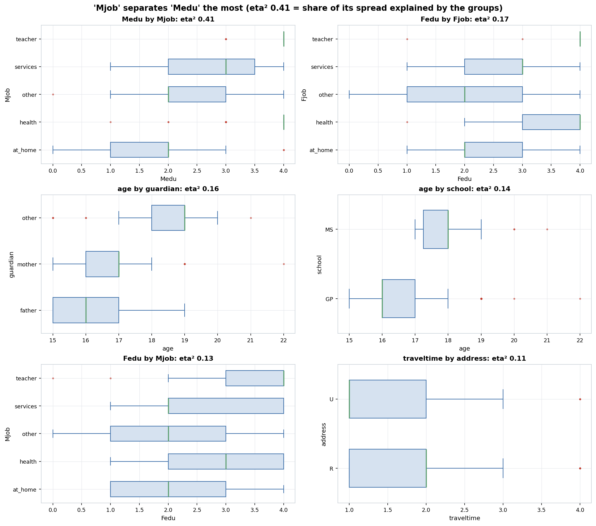

*Figure 19. 'Mjob' separates 'Medu' the most (eta² 0.41 = share of its spread explained by the groups).* Box plots of numeric columns split by categorical columns with up to 8 levels, for the pairs with the largest eta-squared. Descriptive coefficients only; no hypothesis tests were run.

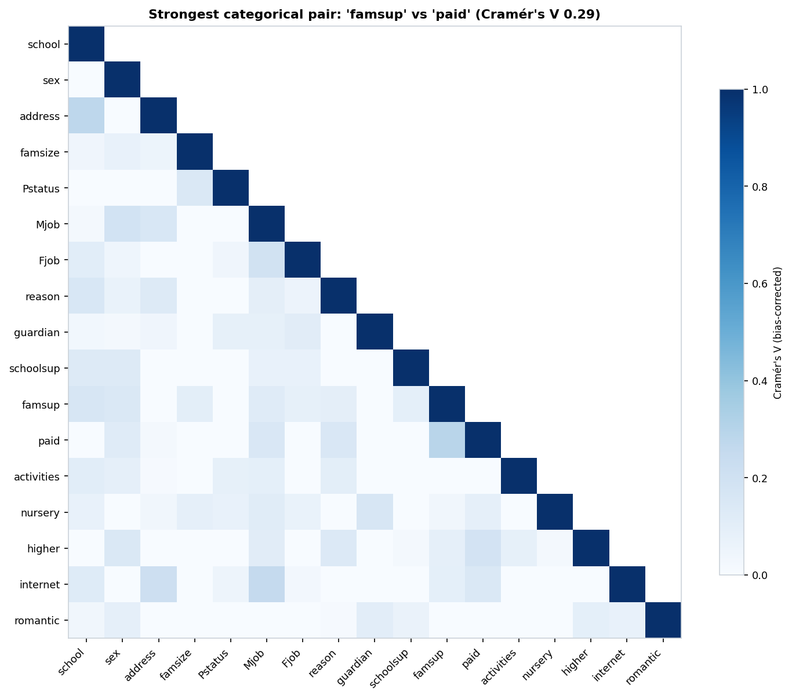

*Figure 20. Strongest categorical pair: 'famsup' vs 'paid' (Cramér's V 0.29).* Bias-corrected Cramér's V between categorical/binary columns: 0 = unrelated, 1 = one fully predicts the other. Descriptive coefficients only; no hypothesis tests were run.

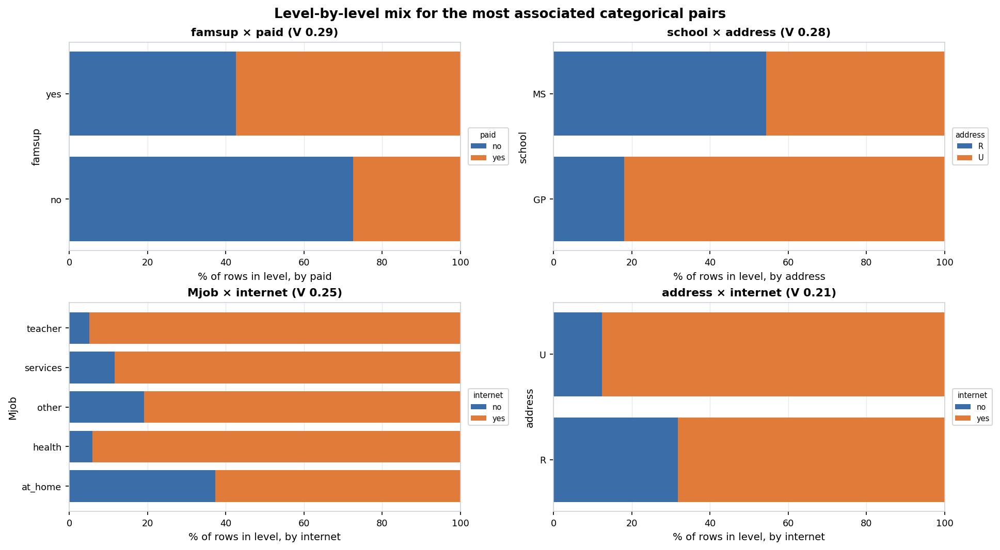

*Figure 21. Level-by-level mix for the most associated categorical pairs.* For each level of the first column, the share of rows in each level of the second column. Descriptive coefficients only; no hypothesis tests were run.

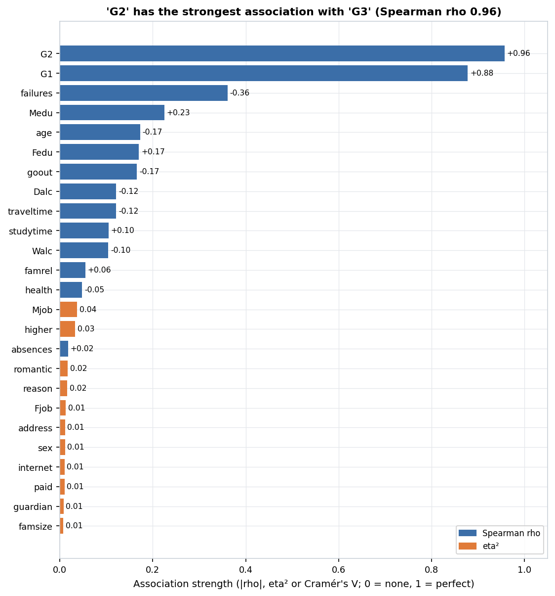

*Figure 22. 'G2' has the strongest association with 'G3' (Spearman rho 0.96).* Every feature ranked by a descriptive association with the target. Different measures are used for different column types, so compare bars of the same colour most directly. Descriptive coefficients only; no hypothesis tests were run.

**Top numeric pairs**

| Column A | Column B | Pearson r | Spearman rho | Rows used |
| :--- | :--- | ---: | ---: | ---: |
| G2 | G3 | 0.905 | 0.957 | 395 |
| G1 | G2 | 0.852 | 0.895 | 395 |
| G1 | G3 | 0.801 | 0.878 | 395 |
| Dalc | Walc | 0.648 | 0.64 | 395 |
| Medu | Fedu | 0.623 | 0.632 | 395 |
| goout | Walc | 0.42 | 0.393 | 395 |
| failures | G2 | -0.356 | -0.362 | 395 |
| failures | G3 | -0.36 | -0.361 | 395 |
| failures | G1 | -0.355 | -0.346 | 395 |
| freetime | goout | 0.285 | 0.285 | 395 |

Descriptive coefficients only; no hypothesis tests were run.
**Near-collinear numeric pairs**

| Column A | Column B | Pearson r |
| :--- | :--- | ---: |
| G2 | G3 | 0.905 |
**Numeric columns by group (eta²)**

| Numeric | Grouped by | eta² |
| :--- | :--- | ---: |
| Medu | Mjob | 0.407 |
| Fedu | Fjob | 0.168 |
| age | guardian | 0.161 |
| age | school | 0.143 |
| Fedu | Mjob | 0.133 |
| traveltime | address | 0.108 |
| studytime | sex | 0.094 |
| failures | higher | 0.09 |
| failures | guardian | 0.085 |
| Medu | Fjob | 0.081 |

Descriptive coefficients only; no hypothesis tests were run.
**Categorical pairs (Cramér's V)**

| Column A | Column B | Cramér's V |
| :--- | :--- | ---: |
| famsup | paid | 0.289 |
| school | address | 0.276 |
| Mjob | internet | 0.251 |
| address | internet | 0.211 |
| Mjob | Fjob | 0.191 |
| sex | Mjob | 0.185 |
| paid | higher | 0.183 |
| guardian | nursery | 0.16 |
| school | famsup | 0.157 |
| school | reason | 0.155 |

Descriptive coefficients only; no hypothesis tests were run.
**Every feature vs. the target**

| Feature | Measure | Value |
| :--- | :--- | ---: |
| G2 | Spearman rho | 0.957 |
| G1 | Spearman rho | 0.878 |
| failures | Spearman rho | -0.361 |
| Medu | Spearman rho | 0.225 |
| age | Spearman rho | -0.173 |
| Fedu | Spearman rho | 0.17 |
| goout | Spearman rho | -0.166 |
| Dalc | Spearman rho | -0.121 |
| traveltime | Spearman rho | -0.121 |
| studytime | Spearman rho | 0.105 |
| Walc | Spearman rho | -0.104 |
| famrel | Spearman rho | 0.055 |
| health | Spearman rho | -0.048 |
| Mjob | eta² | 0.037 |
| higher | eta² | 0.033 |
| absences | Spearman rho | 0.018 |
| romantic | eta² | 0.017 |
| reason | eta² | 0.016 |
| Fjob | eta² | 0.013 |
| address | eta² | 0.011 |
| sex | eta² | 0.011 |
| internet | eta² | 0.01 |
| paid | eta² | 0.01 |
| guardian | eta² | 0.008 |
| famsize | eta² | 0.007 |
| schoolsup | eta² | 0.007 |
| freetime | Spearman rho | -0.005 |
| Pstatus | eta² | 0.003 |
| nursery | eta² | 0.003 |
| famsup | eta² | 0.002 |
| school | eta² | 0.002 |
| activities | eta² | 0 |

Descriptive coefficients only; no hypothesis tests were run.

## 5. Insights

Automated insights rated **high** or **medium** (11 of 26; the full list is in [insights.md](insights.md) and [insights.json](insights.json)):

- **MEDIUM** (distribution) — 'failures' has many outliers: 21.01% of its values (n = 83) are beyond 1.5×IQR. They are flagged, not removed. ([figure](figures/outlier_summary.png))
- **MEDIUM** (distribution) — 'famrel' has many outliers: 6.58% of its values (n = 26) are beyond 1.5×IQR. They are flagged, not removed. ([figure](figures/outlier_summary.png))
- **MEDIUM** (distribution) — 'studytime' has many outliers: 6.84% of its values (n = 27) are beyond 1.5×IQR. They are flagged, not removed. ([figure](figures/outlier_summary.png))
- **MEDIUM** (distribution) — 'absences' is right-skewed (skew = 3.67): its median (4) is below its mean (5.71), so a log transform is advisable for plots and parametric models. ([figure](figures/numeric_detail_absences.png))
- **MEDIUM** (distribution) — 'Dalc' is right-skewed (skew = 2.19): its median (1) is below its mean (1.48), so a log transform is advisable for plots and parametric models. ([figure](figures/numeric_detail_dalc.png))
- **MEDIUM** (distribution) — 'failures' is right-skewed (skew = 2.39): its median (0) is below its mean (0.33), so a log transform is advisable for plots and parametric models. ([figure](figures/numeric_detail_failures.png))
- **MEDIUM** (distribution) — 'traveltime' is right-skewed (skew = 1.61): its median (1) is below its mean (1.45), so a log transform is advisable for plots and parametric models. ([figure](figures/numeric_detail_traveltime.png))
- **MEDIUM** (distribution) — 'failures' is zero-inflated: 78.99% of its values are exactly zero. ([figure](figures/numeric_detail_failures.png))
- **MEDIUM** (relationship) — 'G2' and 'G3' are nearly collinear (Pearson r = +0.91); models should not use both as if they were separate information. ([figure](figures/correlation_heatmap.png))
- **MEDIUM** (relationship) — The numeric feature most associated with target 'G3' is 'G2' (Spearman rho = +0.96; descriptive). ([figure](figures/target_relationships.png))
- **MEDIUM** (testing implication) — Rank-based methods (Spearman, Mann-Whitney, Kruskal-Wallis) are recommended for 6 skewed or outlier-heavy column(s): 'Dalc', 'absences', 'failures', 'famrel', 'studytime', 'traveltime'.

### Manual insights (written by the analyst)

- **Longitudinal grade collinearity (`G1`, `G2` -> `G3`):** First-period (`G1`) and second-period (`G2`) grades are earlier assessments in the exact same math course, so `G2` nearly determines final grade `G3` (Spearman $\rho = +0.96$, Pearson $r = +0.90$) and `G1` correlates at $\rho = +0.88$. Any substantive analysis of what student habits drive achievement must be evaluated both with and without `G1`/`G2`.
- **Zero-inflation in final grade (`G3 == 0`):** Exactly 38 students (9.62%) have `G3 = 0` while almost all of them have positive `G1`/`G2` grades and `0` recorded absences. This spike at zero represents students who dropped the course or missed the final exam rather than scoring 0% on the test.
- **Quoted integer strings in raw CSV:** In `student-mat.csv` (semicolon-delimited), `G1` and `G2` values are wrapped in double quotes (`"5"`, `"14"`) while `G3` is unquoted; string-first ingestion strips quotes and infers all three as numeric automatically.
- **Behavioral & family predictors (excluding `G1`/`G2`):** Past class failures (`failures`, Spearman $\rho = -0.36$), higher education ambition (`higher`, $\eta^2 = 0.03$), mother's education (`Medu`, $\rho = +0.23$), and study time (`studytime`, $\rho = +0.10$) are the most informative non-grade predictors, whereas alcohol consumption (`Dalc`, `Walc`) and `absences` (`skew = +3.67`) are heavily right-skewed.
- **Small subgroup sample sizes:** With only 395 total rows, rare categorical levels such as `higher = no` ($n = 20$) and `school = MS` ($n = 46$) have limited statistical power for multi-way interaction tests.
- **Target findings for Phase 5 benchmark recovery:** (1) `G2 <-> G3` and `G1 <-> G3` (very strong positive collinearity), (2) `failures <-> G3` (moderate negative effect), (3) `Medu / Fedu <-> G3` (positive family education effect), (4) `higher <-> G3` (positive aspiration effect), and (5) `Dalc / Walc <-> studytime / goout`.

## 6. Normalization / scaling

| Column | Skew | Recommended transform | Reason |
| :--- | ---: | :--- | :--- |
| `age` | +0.47 | none | Moderate/low skewness (skew=0.47); no non-linear transform needed. |
| `Medu` | -0.32 | none | Moderate/low skewness (skew=-0.32); no non-linear transform needed. |
| `Fedu` | -0.03 | none | Moderate/low skewness (skew=-0.03); no non-linear transform needed. |
| `traveltime` | +1.61 | log1p | Right-skewed (skew=1.61 > 1.0) with non-negative domain (min=1); log1p recommended. |
| `studytime` | +0.63 | none | Moderate/low skewness (skew=0.63); no non-linear transform needed. |
| `failures` | +2.39 | log1p | Right-skewed (skew=2.39 > 1.0) with non-negative domain (min=0); log1p recommended. |
| `famrel` | -0.95 | none | Moderate/low skewness (skew=-0.95); no non-linear transform needed. |
| `freetime` | -0.16 | none | Moderate/low skewness (skew=-0.16); no non-linear transform needed. |
| `goout` | +0.12 | none | Moderate/low skewness (skew=0.12); no non-linear transform needed. |
| `Dalc` | +2.19 | log1p | Right-skewed (skew=2.19 > 1.0) with non-negative domain (min=1); log1p recommended. |
| `Walc` | +0.61 | none | Moderate/low skewness (skew=0.61); no non-linear transform needed. |
| `health` | -0.49 | none | Moderate/low skewness (skew=-0.49); no non-linear transform needed. |
| `absences` | +3.67 | log1p | Right-skewed (skew=3.67 > 1.0) with non-negative domain (min=0); log1p recommended. |
| `G1` | +0.24 | none | Moderate/low skewness (skew=0.24); no non-linear transform needed. |
| `G2` | -0.43 | none | Moderate/low skewness (skew=-0.43); no non-linear transform needed. |
| `G3` | -0.73 | none | Moderate/low skewness (skew=-0.73); no non-linear transform needed. |

Scale disparity across numeric columns (largest std ÷ smallest std): 11.47. Z-score standardization is recommended only for scale-sensitive methods.

> Primary cleaned output is **not** scaled. The Phase 3 test library is rank-based or scale-invariant (Welch/Mann-Whitney, Spearman, Kruskal, chi-square), so scaling would not change results. Log transforms are recommended for columns [traveltime, failures, Dalc, absences] only for plotting and for parametric/regression use. A scaled copy is provided for TA review and for any future modeling.

Scaled convenience copy (for review and future modeling only, never used for testing): `data/cleaned/student_performance_scaled.csv`. Details: [scaling_report.md](scaling_report.md).

## 7. Output files

- [profile.json](profile.json): full profile of the raw file
- [profile_cleaned.json](profile_cleaned.json): profile of the cleaned file
- [column_schema.json](column_schema.json): Phase 2 handoff: type and role of every column
- [cleaning_log.json](cleaning_log.json): every cleaning change (machine-readable)
- [cleaning_log.md](cleaning_log.md): every cleaning change (readable)
- [scaling_report.md](scaling_report.md): scaling and transform decisions
- [scaling_params.json](scaling_params.json): fitted scaling parameters
- [eda_summary.json](eda_summary.json): every EDA number used by the insights
- [insights.json](insights.json): automated insights with evidence
- [insights.md](insights.md): automated + manual insights
- [report.md](report.md): this report (markdown)
- [report.html](report.html): this report (HTML)
- [config_resolved.yaml](config_resolved.yaml): the exact settings used for this run
- `figures/`: 22 PNG figures; `tables/`: EDA tables as markdown
- `data/cleaned/student_performance_cleaned.csv`: conservative cleaned data (primary, NaN kept)
- `data/cleaned/student_performance_cleaned_imputed.csv`: imputed cleaned data (secondary, with `__was_missing` flags)
- `data/cleaned/student_performance_scaled.csv`: scaled convenience copy
