# Phase 1 Dataset Report — `telco_churn`

_Generated by the VeriData Phase 1 pipeline. Every number comes from code (no LLM). Relationship numbers are descriptive only; no hypothesis tests were run in Phase 1._

**Contents:** 1. Overview · 2. Columns · 3. Data cleaning · 4. Exploratory data analysis · 5. Insights · 6. Normalization / scaling · 7. Output files

## 1. Overview

| Item | Value |
| :--- | :--- |
| Source file | `data\raw\telco_churn\WA_Fn-UseC_-Telco-Customer-Churn.csv` |
| SHA-256 | `16320c9c1ec72448db59aa0a26a0b95401046bef5d02fd3aeb906448e3055e91` |
| Raw shape | 7,043 rows × 21 columns |
| Cleaned shape (conservative, primary) | 7,043 rows × 21 columns |
| Cleaned shape (imputed, secondary) | 7,043 rows × 21 columns |
| Exact duplicate rows in raw file | 0 |
| Missing cells in raw file (incl. placeholder text) | 11 (0.01%) |
| Memory (raw) | 8.824246 MB |
| Target column | `Churn` (categorical) |

### Profiling warnings (raw file)

- Column 'customerID' looks like an ID (config override: listed in id_columns).
- Binary column 'PhoneService' is highly imbalanced (minority class = 9.7%).

## 2. Column profile (raw file)

| Column | Raw dtype | Inferred type | Missing % | Unique | Why this type |
| :--- | :--- | :--- | ---: | ---: | :--- |
| `customerID` | `object` | `id_like` | 0.0% | 7,043 | config override: listed in id_columns |
| `gender` | `object` | `binary` | 0.0% | 2 | binary string/mixed encoding (gender binary (Male/Female): ['Female', 'Male']) |
| `SeniorCitizen` | `int64` | `categorical_nominal` | 0.0% | 2 | config override: forced_types['SeniorCitizen'] = categorical_nominal |
| `Partner` | `object` | `binary` | 0.0% | 2 | binary string/mixed encoding (boolean-like (Yes/No/1/0): ['No', 'Yes']) |
| `Dependents` | `object` | `binary` | 0.0% | 2 | binary string/mixed encoding (boolean-like (Yes/No/1/0): ['No', 'Yes']) |
| `tenure` | `int64` | `numeric_continuous` | 0.0% | 73 | numeric values (100.0% parseable, 73 unique) |
| `PhoneService` | `object` | `binary` | 0.0% | 2 | binary string/mixed encoding (boolean-like (Yes/No/1/0): ['No', 'Yes']) |
| `MultipleLines` | `object` | `categorical_nominal` | 0.0% | 3 | string categorical with 3 normalized unique values (raw=3) |
| `InternetService` | `object` | `categorical_nominal` | 0.0% | 3 | string categorical with 3 normalized unique values (raw=3) |
| `OnlineSecurity` | `object` | `categorical_nominal` | 0.0% | 3 | string categorical with 3 normalized unique values (raw=3) |
| `OnlineBackup` | `object` | `categorical_nominal` | 0.0% | 3 | string categorical with 3 normalized unique values (raw=3) |
| `DeviceProtection` | `object` | `categorical_nominal` | 0.0% | 3 | string categorical with 3 normalized unique values (raw=3) |
| `TechSupport` | `object` | `categorical_nominal` | 0.0% | 3 | string categorical with 3 normalized unique values (raw=3) |
| `StreamingTV` | `object` | `categorical_nominal` | 0.0% | 3 | string categorical with 3 normalized unique values (raw=3) |
| `StreamingMovies` | `object` | `categorical_nominal` | 0.0% | 3 | string categorical with 3 normalized unique values (raw=3) |
| `Contract` | `object` | `categorical_nominal` | 0.0% | 3 | string categorical with 3 normalized unique values (raw=3) |
| `PaperlessBilling` | `object` | `binary` | 0.0% | 2 | binary string/mixed encoding (boolean-like (Yes/No/1/0): ['No', 'Yes']) |
| `PaymentMethod` | `object` | `categorical_nominal` | 0.0% | 4 | string categorical with 4 normalized unique values (raw=4) |
| `MonthlyCharges` | `float64` | `numeric_continuous` | 0.0% | 1,585 | numeric values (100.0% parseable, 1585 unique) |
| `TotalCharges` | `object` | `numeric_continuous` | 0.2% | 6,530 | numeric values (100.0% parseable, 6530 unique) |
| `Churn` | `object` | `binary` | 0.0% | 2 | binary string/mixed encoding (boolean-like (Yes/No/1/0): ['No', 'Yes']) |

## 3. Data cleaning

4 cleaning steps made 4 logged changes touching 22 cells. Rows: 7,043 in the raw file → 7,043 in the conservative output → 7,043 in the imputed output.

### What the TA asked for

| Requirement | What the pipeline did |
| :--- | :--- |
| Missing values | ✔ imputed median: 11 cells. Conservative output keeps NaN; imputed output fills gaps and adds `__was_missing` flags |
| Duplicates | ✔ checked; nothing to change |
| Outliers | ✔ flagged outliers: 136 rows. 3 column(s) flagged; values are kept in the conservative output |
| Inconsistent formats | ✔ stripped and normalized ws: 11 cells |
| Empty rows / columns | ✔ marked excluded |

### Changes by step

| Step | Log entries | Cells changed | Rows removed |
| :--- | ---: | ---: | ---: |
| `clean_whitespace_unicode` | 1 | 11 | 0 |
| `structural_drops` | 1 | 0 | 0 |
| `handle_missing_values` | 1 | 11 | 0 |
| `handle_outliers` | 1 | 0 | 0 |

### Outlier flags (1.5×IQR and modified z-score)

| Column | Flagged | Flagged % | Extreme (3×IQR) | Normal range (1.5×IQR) | Action |
| :--- | ---: | ---: | ---: | :--- | :--- |
| `MonthlyCharges` | 0 | 0.00% | 0 | -46.025 to 171.375 | flag |
| `TotalCharges` | 136 | 1.93% | 0 | -4,688.481 to 8,884.669 | flag |
| `tenure` | 0 | 0.00% | 0 | -60 to 124 | flag |

The full step-by-step log with before/after examples is in [cleaning_log.md](cleaning_log.md) (machine-readable: [cleaning_log.json](cleaning_log.json)).

## 4. Exploratory data analysis

### 4.1 Dataset overview

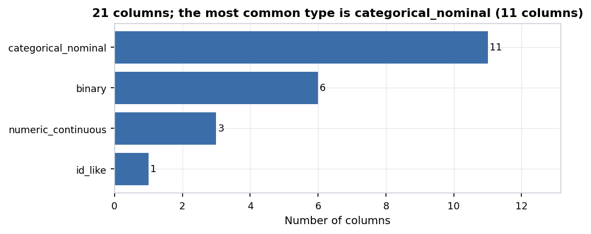

*Figure 1. 21 columns; the most common type is categorical_nominal (11 columns).* Count of columns by the semantic type the pipeline inferred (after cleaning).

| Item | Value |
| :--- | :--- |
| Rows (raw file) | 7,043 |
| Rows (cleaned, conservative) | 7,043 |
| Columns | 21 |
| Memory | 3.103 MB |
| Missing cells | 11 (0.01%) |
| Columns typed `categorical_nominal` | 11 |
| Columns typed `binary` | 6 |
| Columns typed `numeric_continuous` | 3 |
| Columns typed `id_like` | 1 |
| Columns left out of EDA (ID / excluded) | customerID |

### 4.2 Missing values

Missing values are concentrated: the 10% of rows with the most gaps hold 100.0% of all missing cells.

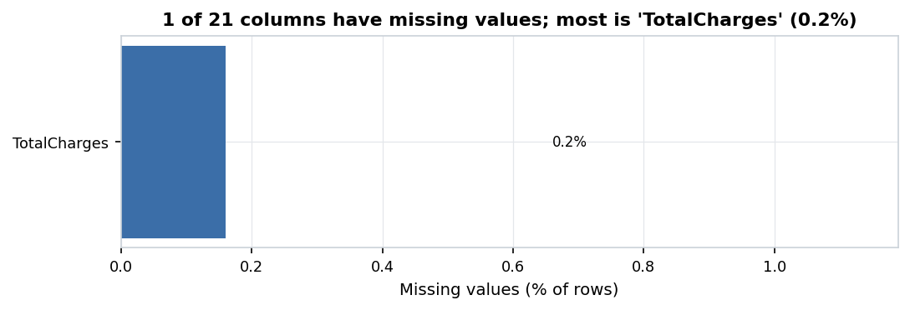

*Figure 2. 1 of 21 columns have missing values; most is 'TotalCharges' (0.2%).* Percent of rows missing per column (only columns with at least one gap). Red bars are above 40%.

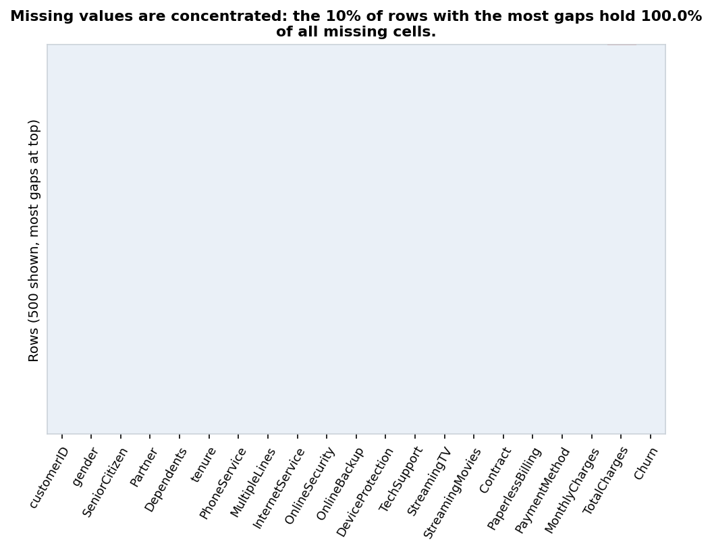

*Figure 3. Missing values are concentrated: the 10% of rows with the most gaps hold 100.0% of all missing cells.* Each red cell is a missing value; rows are sorted by how many gaps they have. A random sample of 500 of 7,043 rows is shown.

**Missing values per column (cleaned data)**

| Column | Missing | Missing % |
| :--- | ---: | ---: |
| TotalCharges | 11 | 0.16 |

### 4.3 Numeric columns

Red dots in box plots are values beyond 1.5×IQR; they are flagged but kept in the conservative cleaned data.

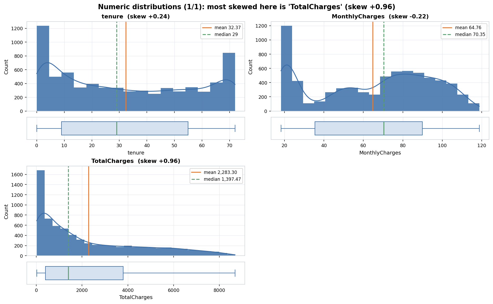

*Figure 4. Numeric distributions (1/1): most skewed here is 'TotalCharges' (skew +0.96).* Histogram (with a smooth density curve for many-valued columns) and a box plot per column. Orange line = mean, green dashed line = median; red dots are values beyond 1.5×IQR.

**Numeric summary**

| Column | Count | Mean | Std | Min | Q1 | Median | Q3 | Max | Skew | Kurtosis | % zeros | % outliers (1.5×IQR) |
| :--- | ---: | ---: | ---: | ---: | ---: | ---: | ---: | ---: | ---: | ---: | ---: | ---: |
| tenure | 7,043 | 32.371 | 24.559 | 0 | 9 | 29 | 55 | 72 | 0.24 | -1.387 | 0.16 | 0 |
| MonthlyCharges | 7,043 | 64.762 | 30.09 | 18.25 | 35.5 | 70.35 | 89.85 | 118.75 | -0.221 | -1.257 | 0 | 0 |
| TotalCharges | 7,032 | 2,283.3 | 2,266.771 | 18.8 | 401.45 | 1,397.475 | 3,794.738 | 8,684.8 | 0.962 | -0.232 | 0 | 0 |

### 4.4 Categorical and binary columns

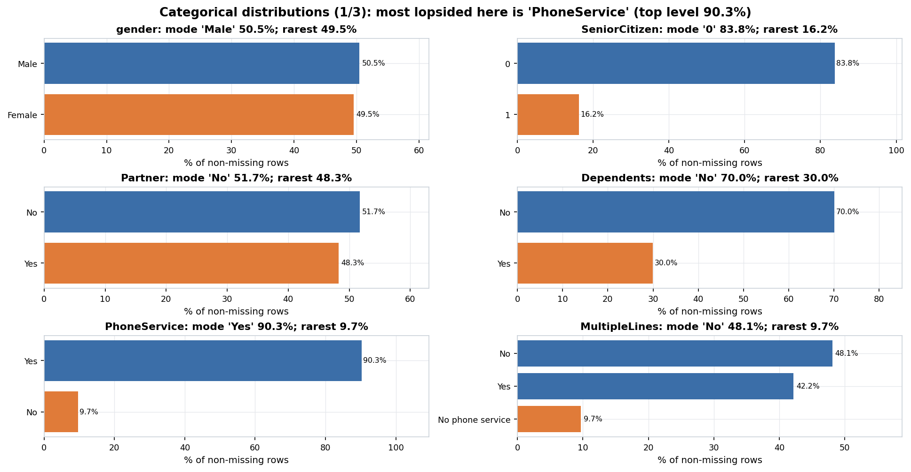

*Figure 5. Categorical distributions (1/3): most lopsided here is 'PhoneService' (top level 90.3%).* Share of rows per level (top 15 levels; the rest are grouped as 'Other'). The orange bar marks the smallest (minority) level.

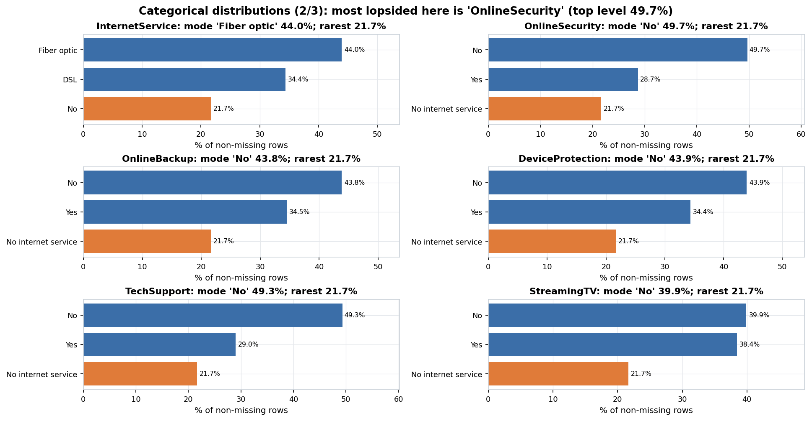

*Figure 6. Categorical distributions (2/3): most lopsided here is 'OnlineSecurity' (top level 49.7%).* Share of rows per level (top 15 levels; the rest are grouped as 'Other'). The orange bar marks the smallest (minority) level.

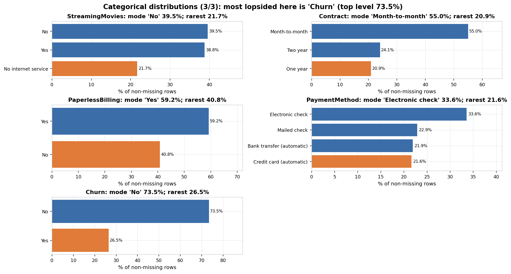

*Figure 7. Categorical distributions (3/3): most lopsided here is 'Churn' (top level 73.5%).* Share of rows per level (top 15 levels; the rest are grouped as 'Other'). The orange bar marks the smallest (minority) level.

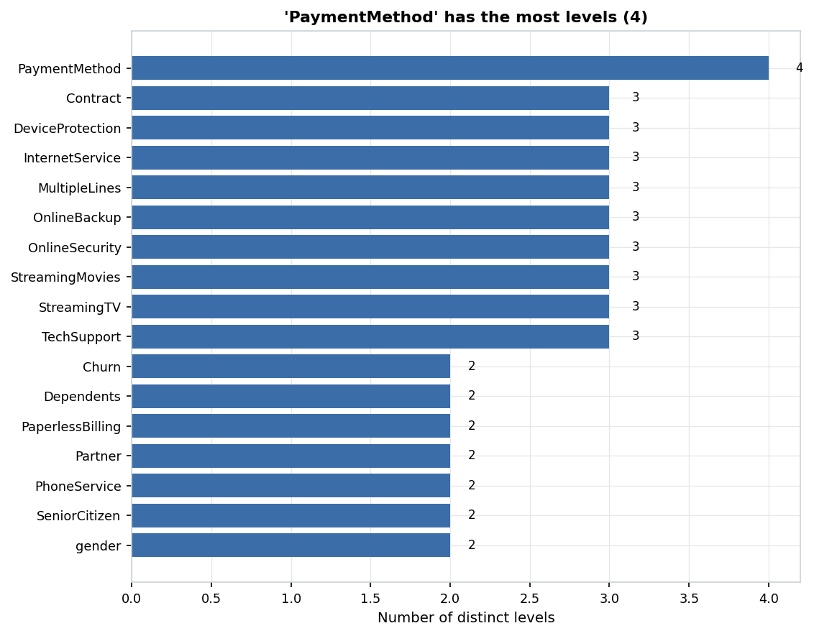

*Figure 8. 'PaymentMethod' has the most levels (4).* Number of distinct values in each categorical or binary column.

**Categorical summary**

| Column | Levels | Mode | Mode % | Entropy (0-1) | Rarest level | Rarest % | Levels under 1% of rows |
| :--- | ---: | :--- | ---: | ---: | :--- | ---: | ---: |
| gender | 2 | Male | 50.48 | 1 | Female | 49.52 | 0 |
| SeniorCitizen | 2 | 0 | 83.79 | 0.639 | 1 | 16.21 | 0 |
| Partner | 2 | No | 51.7 | 0.999 | Yes | 48.3 | 0 |
| Dependents | 2 | No | 70.04 | 0.881 | Yes | 29.96 | 0 |
| PhoneService | 2 | Yes | 90.32 | 0.459 | No | 9.68 | 0 |
| MultipleLines | 3 | No | 48.13 | 0.858 | No phone service | 9.68 | 0 |
| InternetService | 3 | Fiber optic | 43.96 | 0.965 | No | 21.67 | 0 |
| OnlineSecurity | 3 | No | 49.67 | 0.944 | No internet service | 21.67 | 0 |
| OnlineBackup | 3 | No | 43.84 | 0.965 | No internet service | 21.67 | 0 |
| DeviceProtection | 3 | No | 43.94 | 0.965 | No internet service | 21.67 | 0 |
| TechSupport | 3 | No | 49.31 | 0.946 | No internet service | 21.67 | 0 |
| StreamingTV | 3 | No | 39.9 | 0.97 | No internet service | 21.67 | 0 |
| StreamingMovies | 3 | No | 39.54 | 0.97 | No internet service | 21.67 | 0 |
| Contract | 3 | Month-to-month | 55.02 | 0.909 | One year | 20.91 | 0 |
| PaperlessBilling | 2 | Yes | 59.22 | 0.975 | No | 40.78 | 0 |
| PaymentMethod | 4 | Electronic check | 33.58 | 0.987 | Credit card (automatic) | 21.61 | 0 |
| Churn | 2 | No | 73.46 | 0.835 | Yes | 26.54 | 0 |

### 4.5 Target / class balance

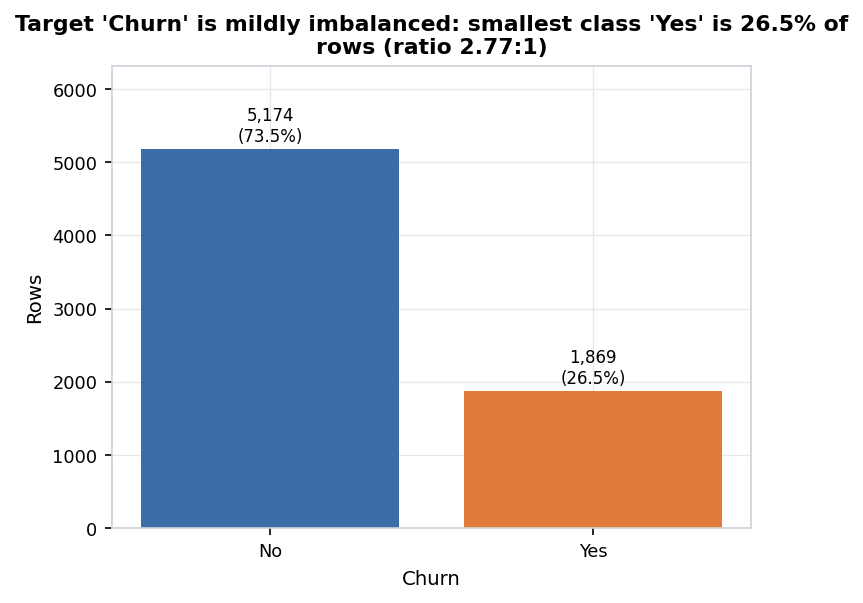

*Figure 9. Target 'Churn' is mildly imbalanced: smallest class 'Yes' is 26.5% of rows (ratio 2.77:1).* Rows per target class. The orange bar is the smallest class. Highly imbalanced = smallest class under 10% of rows; mildly = largest/smallest ratio of 1.5 or more.

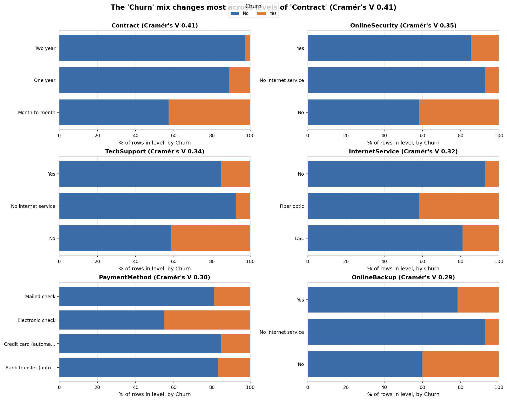

*Figure 10. The 'Churn' mix changes most across levels of 'Contract' (Cramér's V 0.41).* Share of each target class within each level of the categorical features most associated with the target (bias-corrected Cramér's V). Descriptive coefficients only; no hypothesis tests were run.

**Target classes**

| Class | Count | % |
| :--- | ---: | ---: |
| No | 5,174 | 73.46 |
| Yes | 1,869 | 26.54 |

Imbalance ratio (largest/smallest class) = 2.77: **mildly imbalanced**.

### 4.6 Relationships between columns (descriptive)

All coefficients here describe the data; none of them is a test result. Spearman rho and Pearson r range from -1 to +1; eta² and Cramér's V range from 0 (no association) to 1.

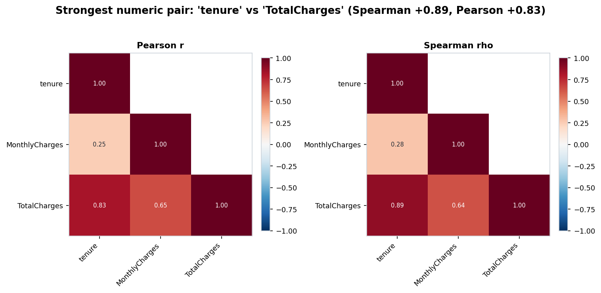

*Figure 11. Strongest numeric pair: 'tenure' vs 'TotalCharges' (Spearman +0.89, Pearson +0.83).* Correlation between numeric columns (lower triangle). Left: Pearson (linear). Right: Spearman (rank-based). Descriptive coefficients only; no hypothesis tests were run.

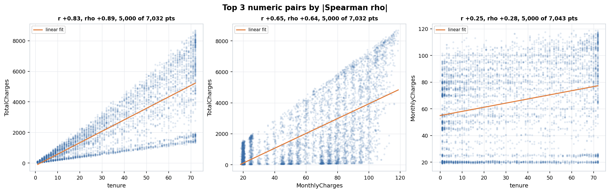

*Figure 12. Top 3 numeric pairs by |Spearman rho|.* Scatter plots with a straight-line fit for the most strongly related numeric pairs. Large datasets are randomly sampled for plotting. Descriptive coefficients only; no hypothesis tests were run.

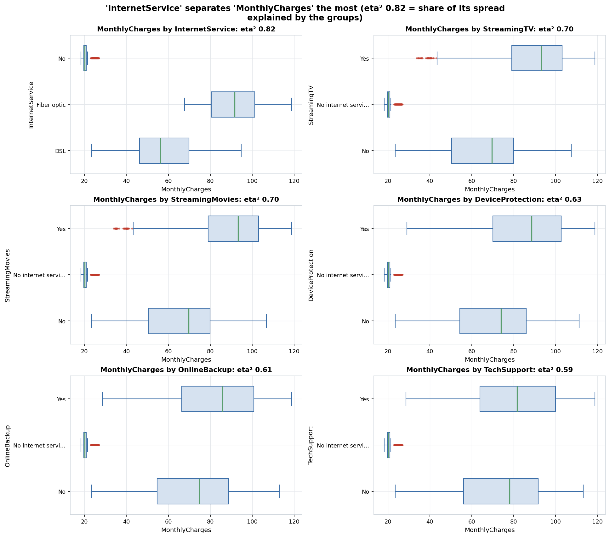

*Figure 13. 'InternetService' separates 'MonthlyCharges' the most (eta² 0.82 = share of its spread explained by the groups).* Box plots of numeric columns split by categorical columns with up to 8 levels, for the pairs with the largest eta-squared. Descriptive coefficients only; no hypothesis tests were run.

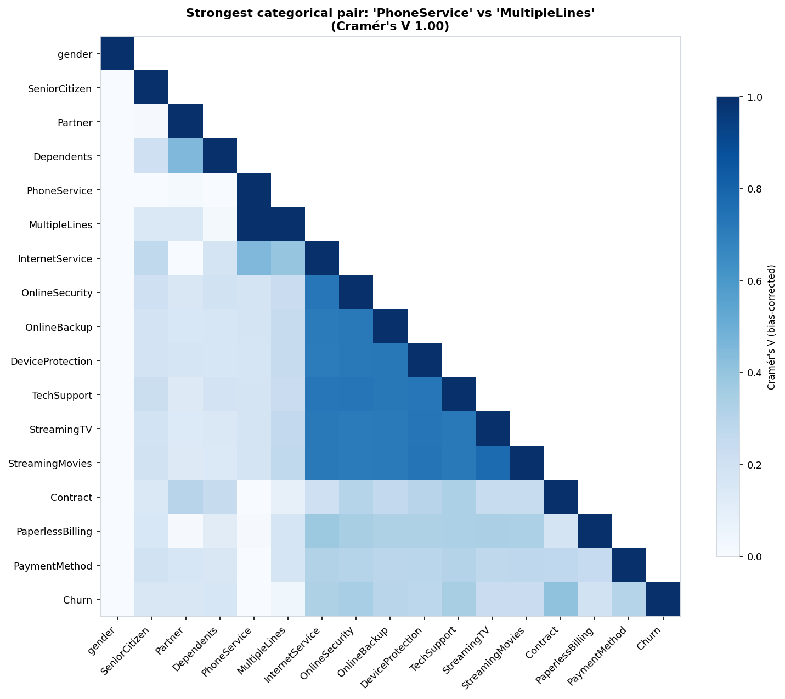

*Figure 14. Strongest categorical pair: 'PhoneService' vs 'MultipleLines' (Cramér's V 1.00).* Bias-corrected Cramér's V between categorical/binary columns: 0 = unrelated, 1 = one fully predicts the other. Descriptive coefficients only; no hypothesis tests were run.

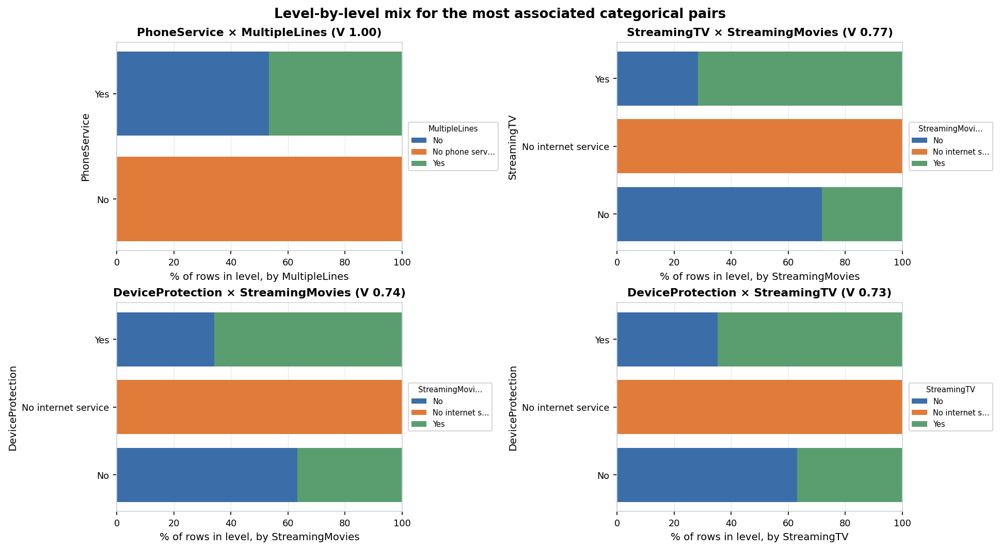

*Figure 15. Level-by-level mix for the most associated categorical pairs.* For each level of the first column, the share of rows in each level of the second column. Descriptive coefficients only; no hypothesis tests were run.

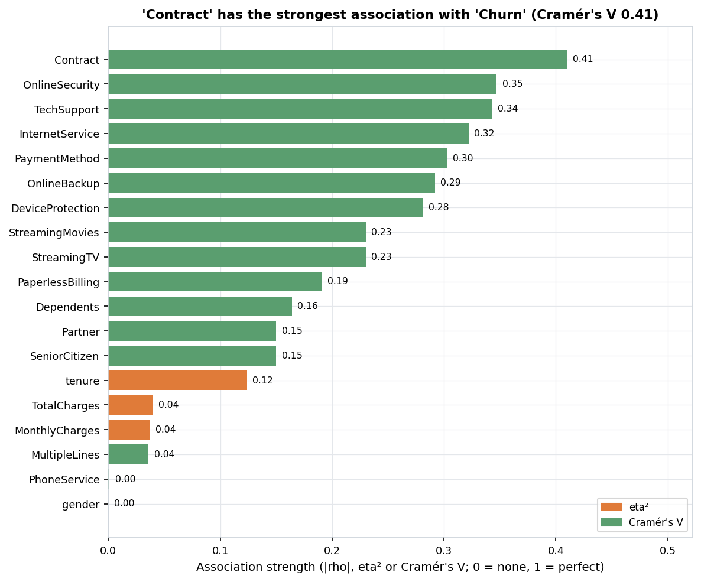

*Figure 16. 'Contract' has the strongest association with 'Churn' (Cramér's V 0.41).* Every feature ranked by a descriptive association with the target. Different measures are used for different column types, so compare bars of the same colour most directly. Descriptive coefficients only; no hypothesis tests were run.

**Top numeric pairs**

| Column A | Column B | Pearson r | Spearman rho | Rows used |
| :--- | :--- | ---: | ---: | ---: |
| tenure | TotalCharges | 0.826 | 0.889 | 7,032 |
| MonthlyCharges | TotalCharges | 0.651 | 0.638 | 7,032 |
| tenure | MonthlyCharges | 0.248 | 0.276 | 7,043 |

Descriptive coefficients only; no hypothesis tests were run.
**Near-collinear numeric pairs**

No numeric pairs have |Pearson r| above 0.9.
**Numeric columns by group (eta²)**

| Numeric | Grouped by | eta² |
| :--- | :--- | ---: |
| MonthlyCharges | InternetService | 0.821 |
| MonthlyCharges | StreamingTV | 0.701 |
| MonthlyCharges | StreamingMovies | 0.698 |
| MonthlyCharges | DeviceProtection | 0.626 |
| MonthlyCharges | OnlineBackup | 0.609 |
| MonthlyCharges | TechSupport | 0.591 |
| MonthlyCharges | OnlineSecurity | 0.585 |
| tenure | Contract | 0.457 |
| TotalCharges | DeviceProtection | 0.31 |
| TotalCharges | StreamingMovies | 0.3 |

Descriptive coefficients only; no hypothesis tests were run.
**Categorical pairs (Cramér's V)**

| Column A | Column B | Cramér's V |
| :--- | :--- | ---: |
| PhoneService | MultipleLines | 1 |
| StreamingTV | StreamingMovies | 0.771 |
| DeviceProtection | StreamingMovies | 0.736 |
| DeviceProtection | StreamingTV | 0.734 |
| OnlineSecurity | TechSupport | 0.733 |
| DeviceProtection | TechSupport | 0.726 |
| InternetService | OnlineSecurity | 0.724 |
| InternetService | TechSupport | 0.723 |
| OnlineBackup | TechSupport | 0.72 |
| OnlineBackup | DeviceProtection | 0.719 |

Descriptive coefficients only; no hypothesis tests were run.
**Every feature vs. the target**

| Feature | Measure | Value |
| :--- | :--- | ---: |
| Contract | Cramér's V | 0.41 |
| OnlineSecurity | Cramér's V | 0.347 |
| TechSupport | Cramér's V | 0.343 |
| InternetService | Cramér's V | 0.322 |
| PaymentMethod | Cramér's V | 0.303 |
| OnlineBackup | Cramér's V | 0.292 |
| DeviceProtection | Cramér's V | 0.281 |
| StreamingMovies | Cramér's V | 0.23 |
| StreamingTV | Cramér's V | 0.23 |
| PaperlessBilling | Cramér's V | 0.191 |
| Dependents | Cramér's V | 0.164 |
| Partner | Cramér's V | 0.15 |
| SeniorCitizen | Cramér's V | 0.15 |
| tenure | eta² | 0.124 |
| TotalCharges | eta² | 0.04 |
| MonthlyCharges | eta² | 0.037 |
| MultipleLines | Cramér's V | 0.036 |
| PhoneService | Cramér's V | 0.001 |
| gender | Cramér's V | 0 |

Descriptive coefficients only; no hypothesis tests were run.

## 5. Insights

Automated insights rated **high** or **medium** (3 of 17; the full list is in [insights.md](insights.md) and [insights.json](insights.json)):

- **MEDIUM** (class balance) — Target 'Churn' is mildly imbalanced: the smallest class 'Yes' is 26.54% of rows and the largest 'No' is 73.46% (the largest class is 2.77 times the smallest). ([figure](figures/target_balance.png))
- **MEDIUM** (relationship) — The categorical feature most associated with target 'Churn' is 'Contract' (Cramér's V = 0.41; descriptive). ([figure](figures/target_relationships.png))
- **MEDIUM** (testing implication) — Because target 'Churn' is mildly imbalanced, compare groups using rates (% per class) rather than raw counts, and use stratified splits for any later modeling. ([figure](figures/target_balance.png))

### Manual insights (written by the analyst)

- **Structural missingness in `TotalCharges`:** Exactly 11 rows contain whitespace-only strings (`" "`) in `TotalCharges`, causing naive `pd.read_csv()` to misclassify the entire column as `object`. Every single one of those 11 customers has `tenure == 0` (newly signed up customers who have not yet been billed for their first month), meaning the missingness is structurally explained (**MAR** given `tenure == 0`), not random data corruption.
- **Encoded binary demographic (`SeniorCitizen`):** Unlike `Partner` and `Dependents` (`Yes`/`No`), `SeniorCitizen` is encoded as `0`/`1` integers; our dataset config explicitly documents this as categorical/binary so it is treated consistently in group comparisons.
- **Redundant category levels across add-on services:** Six service columns (`OnlineSecurity`, `OnlineBackup`, `DeviceProtection`, `TechSupport`, `StreamingTV`, `StreamingMovies`) share an identical `"No internet service"` level (21.7% of rows), which is perfectly collinear with `InternetService == "No"`.
- **Contract structure & early-tenure churn hazard:** Customers on `Month-to-month` contracts exhibit the highest churn rate (~42.7%), whereas `One year` (~11.3%) and `Two year` (~2.8%) contracts strongly retain subscribers (Cramér's $V = 0.41$). Churn is heavily concentrated in the first 1-6 months of `tenure` (Spearman $\rho = -0.35$).
- **Collinearity warning (`TotalCharges` vs `tenure x MonthlyCharges`):** `TotalCharges` is approximately the product `tenure * MonthlyCharges` (Pearson $r = +0.83$ with `tenure`), causing opposite-direction univariate associations with `Churn` (`MonthlyCharges` positively associated with churn due to Fiber Optic pricing, while `TotalCharges` is negatively associated with churn because high `TotalCharges` requires long `tenure`).
- **Target findings for Phase 5 benchmark recovery:** (1) `Contract <-> Churn` (strong categorical association), (2) `tenure <-> Churn` (strong negative relationship), (3) `InternetService (Fiber optic) <-> Churn` (higher churn), (4) `OnlineSecurity / TechSupport <-> Churn` (protective effect), and (5) `PaymentMethod (Electronic check) <-> Churn`.

## 6. Normalization / scaling

| Column | Skew | Recommended transform | Reason |
| :--- | ---: | :--- | :--- |
| `tenure` | +0.24 | none | Moderate/low skewness (skew=0.24); no non-linear transform needed. |
| `MonthlyCharges` | -0.22 | none | Moderate/low skewness (skew=-0.22); no non-linear transform needed. |
| `TotalCharges` | +0.96 | none | Moderate/low skewness (skew=0.96); no non-linear transform needed. |

Scale disparity across numeric columns (largest std ÷ smallest std): 92.3. Z-score standardization is recommended only for scale-sensitive methods.

> Primary cleaned output is **not** scaled. The Phase 3 test library is rank-based or scale-invariant (Welch/Mann-Whitney, Spearman, Kruskal, chi-square), so scaling would not change results. Log transforms are recommended for columns [none (no numeric column exceeded skewness threshold)] only for plotting and for parametric/regression use. A scaled copy is provided for TA review and for any future modeling.

Scaled convenience copy (for review and future modeling only, never used for testing): `data/cleaned/telco_churn_scaled.csv`. Details: [scaling_report.md](scaling_report.md).

## 7. Output files

- [profile.json](profile.json): full profile of the raw file
- [profile_cleaned.json](profile_cleaned.json): profile of the cleaned file
- [column_schema.json](column_schema.json): Phase 2 handoff: type and role of every column
- [cleaning_log.json](cleaning_log.json): every cleaning change (machine-readable)
- [cleaning_log.md](cleaning_log.md): every cleaning change (readable)
- [scaling_report.md](scaling_report.md): scaling and transform decisions
- [scaling_params.json](scaling_params.json): fitted scaling parameters
- [eda_summary.json](eda_summary.json): every EDA number used by the insights
- [insights.json](insights.json): automated insights with evidence
- [insights.md](insights.md): automated + manual insights
- [report.md](report.md): this report (markdown)
- [report.html](report.html): this report (HTML)
- [config_resolved.yaml](config_resolved.yaml): the exact settings used for this run
- `figures/`: 16 PNG figures; `tables/`: EDA tables as markdown
- `data/cleaned/telco_churn_cleaned.csv`: conservative cleaned data (primary, NaN kept)
- `data/cleaned/telco_churn_cleaned_imputed.csv`: imputed cleaned data (secondary, with `__was_missing` flags)
- `data/cleaned/telco_churn_scaled.csv`: scaled convenience copy
