# VeriData findings report — `telco_churn`

7,043 rows × 21 columns after cleaning · VeriData 0.1.0 · config `052b2ad5e68a` · generated 2026-11-21

## 1. Executive summary

VeriData tested 190 column pairs. 113 of them had a raw p-value below 0.05, the usual threshold. After correcting for the number of tests (Benjamini-Hochberg method) and requiring an effect that is not negligible, 151 remain as validated findings. The others were rejected for the reasons shown below. Every finding is an association, not evidence of cause and effect.

- Tests run: 190
- Raw p below 0.05: 113
- Validated findings: 151
- Rejected — effect too small: 38
- Rejected — not supported after correction: 33
- Rejected — derived / duplicate columns: 1

_A rejected test can have more than a single reason, so these counts can add up to more than the number of rejected tests._

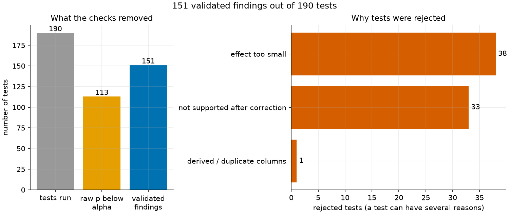

**Highlights** (largest effects):

- `StreamingMovies` ↔ `StreamingTV`: large (Cramér's V = 0.77)
- `DeviceProtection` ↔ `StreamingMovies`: large (Cramér's V = 0.74)
- `DeviceProtection` ↔ `StreamingTV`: large (Cramér's V = 0.73)

## 2. Validated findings

### 2.1 `StreamingMovies` ↔ `StreamingTV`

StreamingMovies and StreamingTV are associated (Cramér's V = 0.77, 95% CI 0.76 to 0.78, large; n = 7,043). The largest departure from independence: more records with StreamingMovies = No internet service and StreamingTV = No internet service than expected if the columns were unrelated (1,526 observed vs 330.64 expected). After correcting for 190 tests (Benjamini-Hochberg method, false discovery rate 5.0%), the association is statistically supported (adjusted p <0.001). This is an association, not evidence of cause and effect.

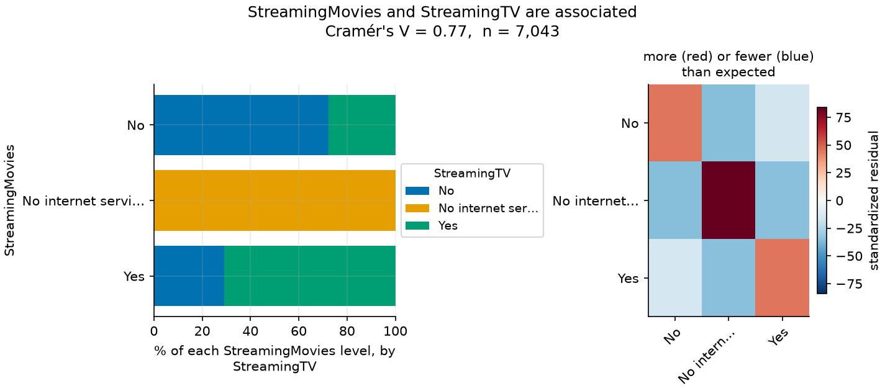

| | |
| :--- | :--- |
| Test used | chi-square test of independence |
| Test statistic | 8,374.21 |
| Degrees of freedom | 4 |
| Raw p-value | <0.001 |
| Adjusted p-value (q) | <0.001 |
| Effect size | Cramér's V = 0.77 (95% CI 0.76 to 0.78), large |
| Records used | 7,043 |

How was this tested?

Every cell of the table had enough expected records, so the standard chi-square test of independence was used.

Where do the numbers come from?

| Fact | Shown as | Comes from |
| :--- | :--- | :--- |
| `cell1_col` | No internet service | `TestResult.descriptives.top_residual_cells[0].col` |
| `cell1_expected` | 330.64 | `TestResult.descriptives.top_residual_cells[0].expected` |
| `cell1_more_or_fewer` | more | `observed vs expected count` |
| `cell1_observed` | 1,526 | `TestResult.descriptives.top_residual_cells[0].observed` |
| `cell1_row` | No internet service | `TestResult.descriptives.top_residual_cells[0].row` |
| `cell2_col` | No | `TestResult.descriptives.top_residual_cells[1].col` |
| `cell2_expected` | 1,111.15 | `TestResult.descriptives.top_residual_cells[1].expected` |
| `cell2_more_or_fewer` | more | `observed vs expected count` |
| `cell2_observed` | 2,018 | `TestResult.descriptives.top_residual_cells[1].observed` |
| `cell2_row` | No | `TestResult.descriptives.top_residual_cells[1].row` |
| `ci_high` | 0.78 | `TestResult.effect.ci_high` |
| `ci_low` | 0.76 | `TestResult.effect.ci_low` |
| `col_a` | StreamingMovies | `Hypothesis.column_a` |
| `col_b` | StreamingTV | `Hypothesis.column_b` |
| `col_label0` | No | `TestResult.descriptives.col_labels[0]` |
| `col_label1` | No internet service | `TestResult.descriptives.col_labels[1]` |
| `col_label2` | Yes | `TestResult.descriptives.col_labels[2]` |
| `comparable_value` | 1.09 | `TestResult.effect.comparable_value` |
| `df` | 4 | `TestResult.df` |
| `direction_word` | any | `TestResult.direction_observed` |
| `effect_abs` | 0.77 | `abs(TestResult.effect.value)` |
| `effect_name` | Cramér's V | `TestResult.effect.name` |
| `effect_value` | 0.77 | `TestResult.effect.value` |
| `family_size` | 190 | `ValidationDecision.family_size` |
| `magnitude_label` | large | `TestResult.effect.magnitude` |
| `n_cols_table` | 3 | `len(TestResult.descriptives.col_labels)` |
| `n_rows_table` | 3 | `len(TestResult.descriptives.row_labels)` |
| `n_used` | 7,043 | `TestResult.n_used` |
| `p_raw` | <0.001 | `ValidationDecision.p_raw` |
| `q_value` | <0.001 | `ValidationDecision.q_value` |
| `row_label0` | No | `TestResult.descriptives.row_labels[0]` |
| `row_label1` | No internet service | `TestResult.descriptives.row_labels[1]` |
| `row_label2` | Yes | `TestResult.descriptives.row_labels[2]` |
| `statistic` | 8,374.21 | `TestResult.statistic` |
| `test_name` | chi-square test of independence | `TestResult.test_name` |

### 2.2 `DeviceProtection` ↔ `StreamingMovies`

DeviceProtection and StreamingMovies are associated (Cramér's V = 0.74, 95% CI 0.73 to 0.74, large; n = 7,043). The largest departure from independence: more records with DeviceProtection = No internet service and StreamingMovies = No internet service than expected if the columns were unrelated (1,526 observed vs 330.64 expected). After correcting for 190 tests (Benjamini-Hochberg method, false discovery rate 5.0%), the association is statistically supported (adjusted p <0.001). This is an association, not evidence of cause and effect.

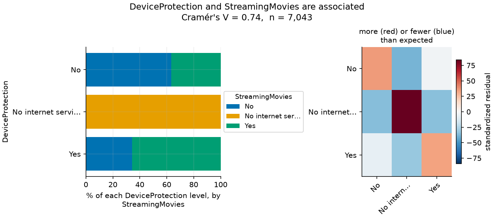

| | |
| :--- | :--- |
| Test used | chi-square test of independence |
| Test statistic | 7,631.31 |
| Degrees of freedom | 4 |
| Raw p-value | <0.001 |
| Adjusted p-value (q) | <0.001 |
| Effect size | Cramér's V = 0.74 (95% CI 0.73 to 0.74), large |
| Records used | 7,043 |

How was this tested?

Every cell of the table had enough expected records, so the standard chi-square test of independence was used.

Where do the numbers come from?

| Fact | Shown as | Comes from |
| :--- | :--- | :--- |
| `cell1_col` | No internet service | `TestResult.descriptives.top_residual_cells[0].col` |
| `cell1_expected` | 330.64 | `TestResult.descriptives.top_residual_cells[0].expected` |
| `cell1_more_or_fewer` | more | `observed vs expected count` |
| `cell1_observed` | 1,526 | `TestResult.descriptives.top_residual_cells[0].observed` |
| `cell1_row` | No internet service | `TestResult.descriptives.top_residual_cells[0].row` |
| `cell2_col` | No internet service | `TestResult.descriptives.top_residual_cells[1].col` |
| `cell2_expected` | 670.59 | `TestResult.descriptives.top_residual_cells[1].expected` |
| `cell2_more_or_fewer` | fewer | `observed vs expected count` |
| `cell2_observed` | 0 | `TestResult.descriptives.top_residual_cells[1].observed` |
| `cell2_row` | No | `TestResult.descriptives.top_residual_cells[1].row` |
| `ci_high` | 0.74 | `TestResult.effect.ci_high` |
| `ci_low` | 0.73 | `TestResult.effect.ci_low` |
| `col_a` | DeviceProtection | `Hypothesis.column_a` |
| `col_b` | StreamingMovies | `Hypothesis.column_b` |
| `col_label0` | No | `TestResult.descriptives.col_labels[0]` |
| `col_label1` | No internet service | `TestResult.descriptives.col_labels[1]` |
| `col_label2` | Yes | `TestResult.descriptives.col_labels[2]` |
| `comparable_value` | 1.04 | `TestResult.effect.comparable_value` |
| `df` | 4 | `TestResult.df` |
| `direction_word` | any | `TestResult.direction_observed` |
| `effect_abs` | 0.74 | `abs(TestResult.effect.value)` |
| `effect_name` | Cramér's V | `TestResult.effect.name` |
| `effect_value` | 0.74 | `TestResult.effect.value` |
| `family_size` | 190 | `ValidationDecision.family_size` |
| `magnitude_label` | large | `TestResult.effect.magnitude` |
| `n_cols_table` | 3 | `len(TestResult.descriptives.col_labels)` |
| `n_rows_table` | 3 | `len(TestResult.descriptives.row_labels)` |
| `n_used` | 7,043 | `TestResult.n_used` |
| `p_raw` | <0.001 | `ValidationDecision.p_raw` |
| `q_value` | <0.001 | `ValidationDecision.q_value` |
| `row_label0` | No | `TestResult.descriptives.row_labels[0]` |
| `row_label1` | No internet service | `TestResult.descriptives.row_labels[1]` |
| `row_label2` | Yes | `TestResult.descriptives.row_labels[2]` |
| `statistic` | 7,631.31 | `TestResult.statistic` |
| `test_name` | chi-square test of independence | `TestResult.test_name` |

### 2.3 `DeviceProtection` ↔ `StreamingTV`

DeviceProtection and StreamingTV are associated (Cramér's V = 0.73, 95% CI 0.73 to 0.74, large; n = 7,043). The largest departure from independence: more records with DeviceProtection = No internet service and StreamingTV = No internet service than expected if the columns were unrelated (1,526 observed vs 330.64 expected). After correcting for 190 tests (Benjamini-Hochberg method, false discovery rate 5.0%), the association is statistically supported (adjusted p <0.001). This is an association, not evidence of cause and effect.

| | |
| :--- | :--- |
| Test used | chi-square test of independence |
| Test statistic | 7,581.91 |
| Degrees of freedom | 4 |
| Raw p-value | <0.001 |
| Adjusted p-value (q) | <0.001 |
| Effect size | Cramér's V = 0.73 (95% CI 0.73 to 0.74), large |
| Records used | 7,043 |

How was this tested?

Every cell of the table had enough expected records, so the standard chi-square test of independence was used.

Where do the numbers come from?

| Fact | Shown as | Comes from |
| :--- | :--- | :--- |
| `cell1_col` | No internet service | `TestResult.descriptives.top_residual_cells[0].col` |
| `cell1_expected` | 330.64 | `TestResult.descriptives.top_residual_cells[0].expected` |
| `cell1_more_or_fewer` | more | `observed vs expected count` |
| `cell1_observed` | 1,526 | `TestResult.descriptives.top_residual_cells[0].observed` |
| `cell1_row` | No internet service | `TestResult.descriptives.top_residual_cells[0].row` |
| `cell2_col` | No internet service | `TestResult.descriptives.top_residual_cells[1].col` |
| `cell2_expected` | 670.59 | `TestResult.descriptives.top_residual_cells[1].expected` |
| `cell2_more_or_fewer` | fewer | `observed vs expected count` |
| `cell2_observed` | 0 | `TestResult.descriptives.top_residual_cells[1].observed` |
| `cell2_row` | No | `TestResult.descriptives.top_residual_cells[1].row` |
| `ci_high` | 0.74 | `TestResult.effect.ci_high` |
| `ci_low` | 0.73 | `TestResult.effect.ci_low` |
| `col_a` | DeviceProtection | `Hypothesis.column_a` |
| `col_b` | StreamingTV | `Hypothesis.column_b` |
| `col_label0` | No | `TestResult.descriptives.col_labels[0]` |
| `col_label1` | No internet service | `TestResult.descriptives.col_labels[1]` |
| `col_label2` | Yes | `TestResult.descriptives.col_labels[2]` |
| `comparable_value` | 1.04 | `TestResult.effect.comparable_value` |
| `df` | 4 | `TestResult.df` |
| `direction_word` | any | `TestResult.direction_observed` |
| `effect_abs` | 0.73 | `abs(TestResult.effect.value)` |
| `effect_name` | Cramér's V | `TestResult.effect.name` |
| `effect_value` | 0.73 | `TestResult.effect.value` |
| `family_size` | 190 | `ValidationDecision.family_size` |
| `magnitude_label` | large | `TestResult.effect.magnitude` |
| `n_cols_table` | 3 | `len(TestResult.descriptives.col_labels)` |
| `n_rows_table` | 3 | `len(TestResult.descriptives.row_labels)` |
| `n_used` | 7,043 | `TestResult.n_used` |
| `p_raw` | <0.001 | `ValidationDecision.p_raw` |
| `q_value` | <0.001 | `ValidationDecision.q_value` |
| `row_label0` | No | `TestResult.descriptives.row_labels[0]` |
| `row_label1` | No internet service | `TestResult.descriptives.row_labels[1]` |
| `row_label2` | Yes | `TestResult.descriptives.row_labels[2]` |
| `statistic` | 7,581.91 | `TestResult.statistic` |
| `test_name` | chi-square test of independence | `TestResult.test_name` |

### 2.4 `OnlineSecurity` ↔ `TechSupport`

OnlineSecurity and TechSupport are associated (Cramér's V = 0.73, 95% CI 0.73 to 0.74, large; n = 7,043). The largest departure from independence: more records with OnlineSecurity = No internet service and TechSupport = No internet service than expected if the columns were unrelated (1,526 observed vs 330.64 expected). After correcting for 190 tests (Benjamini-Hochberg method, false discovery rate 5.0%), the association is statistically supported (adjusted p <0.001). This is an association, not evidence of cause and effect.

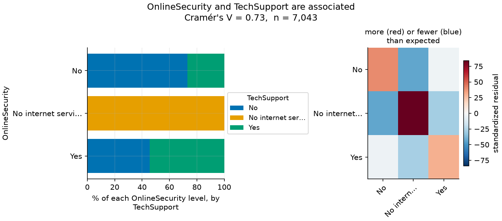

| | |
| :--- | :--- |
| Test used | chi-square test of independence |
| Test statistic | 7,569.72 |
| Degrees of freedom | 4 |
| Raw p-value | <0.001 |
| Adjusted p-value (q) | <0.001 |
| Effect size | Cramér's V = 0.73 (95% CI 0.73 to 0.74), large |
| Records used | 7,043 |

How was this tested?

Every cell of the table had enough expected records, so the standard chi-square test of independence was used.

Where do the numbers come from?

| Fact | Shown as | Comes from |
| :--- | :--- | :--- |
| `cell1_col` | No internet service | `TestResult.descriptives.top_residual_cells[0].col` |
| `cell1_expected` | 330.64 | `TestResult.descriptives.top_residual_cells[0].expected` |
| `cell1_more_or_fewer` | more | `observed vs expected count` |
| `cell1_observed` | 1,526 | `TestResult.descriptives.top_residual_cells[0].observed` |
| `cell1_row` | No internet service | `TestResult.descriptives.top_residual_cells[0].row` |
| `cell2_col` | No internet service | `TestResult.descriptives.top_residual_cells[1].col` |
| `cell2_expected` | 757.91 | `TestResult.descriptives.top_residual_cells[1].expected` |
| `cell2_more_or_fewer` | fewer | `observed vs expected count` |
| `cell2_observed` | 0 | `TestResult.descriptives.top_residual_cells[1].observed` |
| `cell2_row` | No | `TestResult.descriptives.top_residual_cells[1].row` |
| `ci_high` | 0.74 | `TestResult.effect.ci_high` |
| `ci_low` | 0.73 | `TestResult.effect.ci_low` |
| `col_a` | OnlineSecurity | `Hypothesis.column_a` |
| `col_b` | TechSupport | `Hypothesis.column_b` |
| `col_label0` | No | `TestResult.descriptives.col_labels[0]` |
| `col_label1` | No internet service | `TestResult.descriptives.col_labels[1]` |
| `col_label2` | Yes | `TestResult.descriptives.col_labels[2]` |
| `comparable_value` | 1.04 | `TestResult.effect.comparable_value` |
| `df` | 4 | `TestResult.df` |
| `direction_word` | any | `TestResult.direction_observed` |
| `effect_abs` | 0.73 | `abs(TestResult.effect.value)` |
| `effect_name` | Cramér's V | `TestResult.effect.name` |
| `effect_value` | 0.73 | `TestResult.effect.value` |
| `family_size` | 190 | `ValidationDecision.family_size` |
| `magnitude_label` | large | `TestResult.effect.magnitude` |
| `n_cols_table` | 3 | `len(TestResult.descriptives.col_labels)` |
| `n_rows_table` | 3 | `len(TestResult.descriptives.row_labels)` |
| `n_used` | 7,043 | `TestResult.n_used` |
| `p_raw` | <0.001 | `ValidationDecision.p_raw` |
| `q_value` | <0.001 | `ValidationDecision.q_value` |
| `row_label0` | No | `TestResult.descriptives.row_labels[0]` |
| `row_label1` | No internet service | `TestResult.descriptives.row_labels[1]` |
| `row_label2` | Yes | `TestResult.descriptives.row_labels[2]` |
| `statistic` | 7,569.72 | `TestResult.statistic` |
| `test_name` | chi-square test of independence | `TestResult.test_name` |

### 2.5 `DeviceProtection` ↔ `TechSupport`

DeviceProtection and TechSupport are associated (Cramér's V = 0.73, 95% CI 0.72 to 0.73, large; n = 7,043). The largest departure from independence: more records with DeviceProtection = No internet service and TechSupport = No internet service than expected if the columns were unrelated (1,526 observed vs 330.64 expected). After correcting for 190 tests (Benjamini-Hochberg method, false discovery rate 5.0%), the association is statistically supported (adjusted p <0.001). This is an association, not evidence of cause and effect.

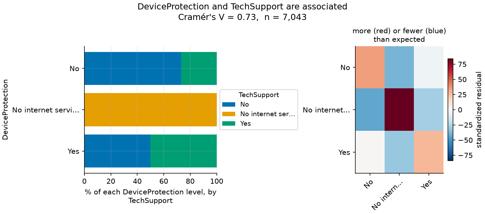

| | |
| :--- | :--- |
| Test used | chi-square test of independence |
| Test statistic | 7,434.32 |
| Degrees of freedom | 4 |
| Raw p-value | <0.001 |
| Adjusted p-value (q) | <0.001 |
| Effect size | Cramér's V = 0.73 (95% CI 0.72 to 0.73), large |
| Records used | 7,043 |

How was this tested?

Every cell of the table had enough expected records, so the standard chi-square test of independence was used.

Where do the numbers come from?

| Fact | Shown as | Comes from |
| :--- | :--- | :--- |
| `cell1_col` | No internet service | `TestResult.descriptives.top_residual_cells[0].col` |
| `cell1_expected` | 330.64 | `TestResult.descriptives.top_residual_cells[0].expected` |
| `cell1_more_or_fewer` | more | `observed vs expected count` |
| `cell1_observed` | 1,526 | `TestResult.descriptives.top_residual_cells[0].observed` |
| `cell1_row` | No internet service | `TestResult.descriptives.top_residual_cells[0].row` |
| `cell2_col` | No | `TestResult.descriptives.top_residual_cells[1].col` |
| `cell2_expected` | 752.49 | `TestResult.descriptives.top_residual_cells[1].expected` |
| `cell2_more_or_fewer` | fewer | `observed vs expected count` |
| `cell2_observed` | 0 | `TestResult.descriptives.top_residual_cells[1].observed` |
| `cell2_row` | No internet service | `TestResult.descriptives.top_residual_cells[1].row` |
| `ci_high` | 0.73 | `TestResult.effect.ci_high` |
| `ci_low` | 0.72 | `TestResult.effect.ci_low` |
| `col_a` | DeviceProtection | `Hypothesis.column_a` |
| `col_b` | TechSupport | `Hypothesis.column_b` |
| `col_label0` | No | `TestResult.descriptives.col_labels[0]` |
| `col_label1` | No internet service | `TestResult.descriptives.col_labels[1]` |
| `col_label2` | Yes | `TestResult.descriptives.col_labels[2]` |
| `comparable_value` | 1.03 | `TestResult.effect.comparable_value` |
| `df` | 4 | `TestResult.df` |
| `direction_word` | any | `TestResult.direction_observed` |
| `effect_abs` | 0.73 | `abs(TestResult.effect.value)` |
| `effect_name` | Cramér's V | `TestResult.effect.name` |
| `effect_value` | 0.73 | `TestResult.effect.value` |
| `family_size` | 190 | `ValidationDecision.family_size` |
| `magnitude_label` | large | `TestResult.effect.magnitude` |
| `n_cols_table` | 3 | `len(TestResult.descriptives.col_labels)` |
| `n_rows_table` | 3 | `len(TestResult.descriptives.row_labels)` |
| `n_used` | 7,043 | `TestResult.n_used` |
| `p_raw` | <0.001 | `ValidationDecision.p_raw` |
| `q_value` | <0.001 | `ValidationDecision.q_value` |
| `row_label0` | No | `TestResult.descriptives.row_labels[0]` |
| `row_label1` | No internet service | `TestResult.descriptives.row_labels[1]` |
| `row_label2` | Yes | `TestResult.descriptives.row_labels[2]` |
| `statistic` | 7,434.32 | `TestResult.statistic` |
| `test_name` | chi-square test of independence | `TestResult.test_name` |

### 2.6 `InternetService` ↔ `OnlineSecurity`

InternetService and OnlineSecurity are associated (Cramér's V = 0.72, 95% CI 0.72 to 0.73, large; n = 7,043). The largest departure from independence: more records with InternetService = No and OnlineSecurity = No internet service than expected if the columns were unrelated (1,526 observed vs 330.64 expected). After correcting for 190 tests (Benjamini-Hochberg method, false discovery rate 5.0%), the association is statistically supported (adjusted p <0.001). This is an association, not evidence of cause and effect.

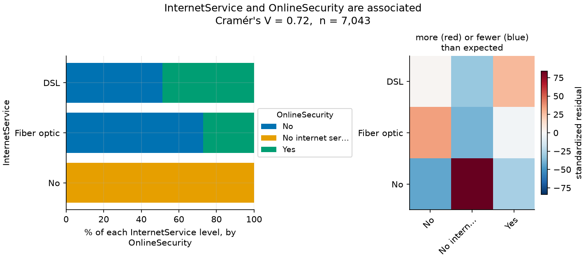

| | |
| :--- | :--- |
| Test used | chi-square test of independence |
| Test statistic | 7,393.06 |
| Degrees of freedom | 4 |
| Raw p-value | <0.001 |
| Adjusted p-value (q) | <0.001 |
| Effect size | Cramér's V = 0.72 (95% CI 0.72 to 0.73), large |
| Records used | 7,043 |

How was this tested?

Every cell of the table had enough expected records, so the standard chi-square test of independence was used.

Where do the numbers come from?

| Fact | Shown as | Comes from |
| :--- | :--- | :--- |
| `cell1_col` | No internet service | `TestResult.descriptives.top_residual_cells[0].col` |
| `cell1_expected` | 330.64 | `TestResult.descriptives.top_residual_cells[0].expected` |
| `cell1_more_or_fewer` | more | `observed vs expected count` |
| `cell1_observed` | 1,526 | `TestResult.descriptives.top_residual_cells[0].observed` |
| `cell1_row` | No | `TestResult.descriptives.top_residual_cells[0].row` |
| `cell2_col` | No | `TestResult.descriptives.top_residual_cells[1].col` |
| `cell2_expected` | 757.91 | `TestResult.descriptives.top_residual_cells[1].expected` |
| `cell2_more_or_fewer` | fewer | `observed vs expected count` |
| `cell2_observed` | 0 | `TestResult.descriptives.top_residual_cells[1].observed` |
| `cell2_row` | No | `TestResult.descriptives.top_residual_cells[1].row` |
| `ci_high` | 0.73 | `TestResult.effect.ci_high` |
| `ci_low` | 0.72 | `TestResult.effect.ci_low` |
| `col_a` | InternetService | `Hypothesis.column_a` |
| `col_b` | OnlineSecurity | `Hypothesis.column_b` |
| `col_label0` | No | `TestResult.descriptives.col_labels[0]` |
| `col_label1` | No internet service | `TestResult.descriptives.col_labels[1]` |
| `col_label2` | Yes | `TestResult.descriptives.col_labels[2]` |
| `comparable_value` | 1.02 | `TestResult.effect.comparable_value` |
| `df` | 4 | `TestResult.df` |
| `direction_word` | any | `TestResult.direction_observed` |
| `effect_abs` | 0.72 | `abs(TestResult.effect.value)` |
| `effect_name` | Cramér's V | `TestResult.effect.name` |
| `effect_value` | 0.72 | `TestResult.effect.value` |
| `family_size` | 190 | `ValidationDecision.family_size` |
| `magnitude_label` | large | `TestResult.effect.magnitude` |
| `n_cols_table` | 3 | `len(TestResult.descriptives.col_labels)` |
| `n_rows_table` | 3 | `len(TestResult.descriptives.row_labels)` |
| `n_used` | 7,043 | `TestResult.n_used` |
| `p_raw` | <0.001 | `ValidationDecision.p_raw` |
| `q_value` | <0.001 | `ValidationDecision.q_value` |
| `row_label0` | DSL | `TestResult.descriptives.row_labels[0]` |
| `row_label1` | Fiber optic | `TestResult.descriptives.row_labels[1]` |
| `row_label2` | No | `TestResult.descriptives.row_labels[2]` |
| `statistic` | 7,393.06 | `TestResult.statistic` |
| `test_name` | chi-square test of independence | `TestResult.test_name` |

### 2.7 `InternetService` ↔ `TechSupport`

InternetService and TechSupport are associated (Cramér's V = 0.72, 95% CI 0.72 to 0.73, large; n = 7,043). The largest departure from independence: more records with InternetService = No and TechSupport = No internet service than expected if the columns were unrelated (1,526 observed vs 330.64 expected). After correcting for 190 tests (Benjamini-Hochberg method, false discovery rate 5.0%), the association is statistically supported (adjusted p <0.001). This is an association, not evidence of cause and effect.

| | |
| :--- | :--- |
| Test used | chi-square test of independence |
| Test statistic | 7,361.22 |
| Degrees of freedom | 4 |
| Raw p-value | <0.001 |
| Adjusted p-value (q) | <0.001 |
| Effect size | Cramér's V = 0.72 (95% CI 0.72 to 0.73), large |
| Records used | 7,043 |

How was this tested?

Every cell of the table had enough expected records, so the standard chi-square test of independence was used.

Where do the numbers come from?

| Fact | Shown as | Comes from |
| :--- | :--- | :--- |
| `cell1_col` | No internet service | `TestResult.descriptives.top_residual_cells[0].col` |
| `cell1_expected` | 330.64 | `TestResult.descriptives.top_residual_cells[0].expected` |
| `cell1_more_or_fewer` | more | `observed vs expected count` |
| `cell1_observed` | 1,526 | `TestResult.descriptives.top_residual_cells[0].observed` |
| `cell1_row` | No | `TestResult.descriptives.top_residual_cells[0].row` |
| `cell2_col` | No | `TestResult.descriptives.top_residual_cells[1].col` |
| `cell2_expected` | 752.49 | `TestResult.descriptives.top_residual_cells[1].expected` |
| `cell2_more_or_fewer` | fewer | `observed vs expected count` |
| `cell2_observed` | 0 | `TestResult.descriptives.top_residual_cells[1].observed` |
| `cell2_row` | No | `TestResult.descriptives.top_residual_cells[1].row` |
| `ci_high` | 0.73 | `TestResult.effect.ci_high` |
| `ci_low` | 0.72 | `TestResult.effect.ci_low` |
| `col_a` | InternetService | `Hypothesis.column_a` |
| `col_b` | TechSupport | `Hypothesis.column_b` |
| `col_label0` | No | `TestResult.descriptives.col_labels[0]` |
| `col_label1` | No internet service | `TestResult.descriptives.col_labels[1]` |
| `col_label2` | Yes | `TestResult.descriptives.col_labels[2]` |
| `comparable_value` | 1.02 | `TestResult.effect.comparable_value` |
| `df` | 4 | `TestResult.df` |
| `direction_word` | any | `TestResult.direction_observed` |
| `effect_abs` | 0.72 | `abs(TestResult.effect.value)` |
| `effect_name` | Cramér's V | `TestResult.effect.name` |
| `effect_value` | 0.72 | `TestResult.effect.value` |
| `family_size` | 190 | `ValidationDecision.family_size` |
| `magnitude_label` | large | `TestResult.effect.magnitude` |
| `n_cols_table` | 3 | `len(TestResult.descriptives.col_labels)` |
| `n_rows_table` | 3 | `len(TestResult.descriptives.row_labels)` |
| `n_used` | 7,043 | `TestResult.n_used` |
| `p_raw` | <0.001 | `ValidationDecision.p_raw` |
| `q_value` | <0.001 | `ValidationDecision.q_value` |
| `row_label0` | DSL | `TestResult.descriptives.row_labels[0]` |
| `row_label1` | Fiber optic | `TestResult.descriptives.row_labels[1]` |
| `row_label2` | No | `TestResult.descriptives.row_labels[2]` |
| `statistic` | 7,361.22 | `TestResult.statistic` |
| `test_name` | chi-square test of independence | `TestResult.test_name` |

### 2.8 `OnlineBackup` ↔ `TechSupport`

OnlineBackup and TechSupport are associated (Cramér's V = 0.72, 95% CI 0.72 to 0.72, large; n = 7,043). The largest departure from independence: more records with OnlineBackup = No internet service and TechSupport = No internet service than expected if the columns were unrelated (1,526 observed vs 330.64 expected). After correcting for 190 tests (Benjamini-Hochberg method, false discovery rate 5.0%), the association is statistically supported (adjusted p <0.001). This is an association, not evidence of cause and effect.

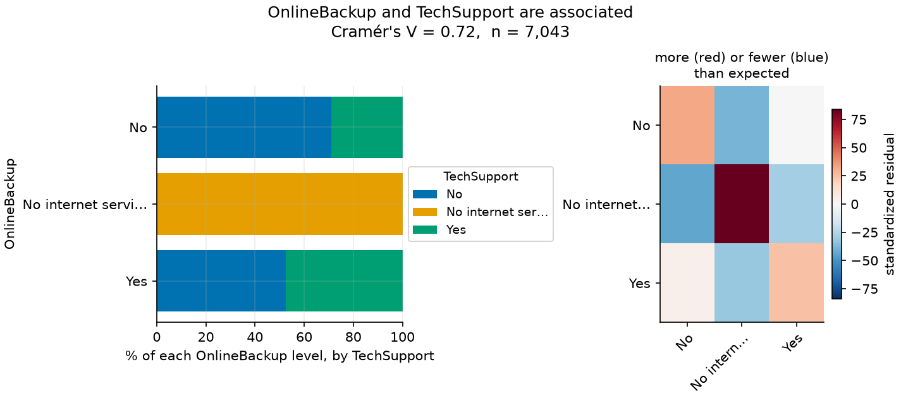

| | |
| :--- | :--- |
| Test used | chi-square test of independence |
| Test statistic | 7,298.82 |
| Degrees of freedom | 4 |
| Raw p-value | <0.001 |
| Adjusted p-value (q) | <0.001 |
| Effect size | Cramér's V = 0.72 (95% CI 0.72 to 0.72), large |
| Records used | 7,043 |

How was this tested?

Every cell of the table had enough expected records, so the standard chi-square test of independence was used.

Where do the numbers come from?

| Fact | Shown as | Comes from |
| :--- | :--- | :--- |
| `cell1_col` | No internet service | `TestResult.descriptives.top_residual_cells[0].col` |
| `cell1_expected` | 330.64 | `TestResult.descriptives.top_residual_cells[0].expected` |
| `cell1_more_or_fewer` | more | `observed vs expected count` |
| `cell1_observed` | 1,526 | `TestResult.descriptives.top_residual_cells[0].observed` |
| `cell1_row` | No internet service | `TestResult.descriptives.top_residual_cells[0].row` |
| `cell2_col` | No | `TestResult.descriptives.top_residual_cells[1].col` |
| `cell2_expected` | 752.49 | `TestResult.descriptives.top_residual_cells[1].expected` |
| `cell2_more_or_fewer` | fewer | `observed vs expected count` |
| `cell2_observed` | 0 | `TestResult.descriptives.top_residual_cells[1].observed` |
| `cell2_row` | No internet service | `TestResult.descriptives.top_residual_cells[1].row` |
| `ci_high` | 0.72 | `TestResult.effect.ci_high` |
| `ci_low` | 0.72 | `TestResult.effect.ci_low` |
| `col_a` | OnlineBackup | `Hypothesis.column_a` |
| `col_b` | TechSupport | `Hypothesis.column_b` |
| `col_label0` | No | `TestResult.descriptives.col_labels[0]` |
| `col_label1` | No internet service | `TestResult.descriptives.col_labels[1]` |
| `col_label2` | Yes | `TestResult.descriptives.col_labels[2]` |
| `comparable_value` | 1.02 | `TestResult.effect.comparable_value` |
| `df` | 4 | `TestResult.df` |
| `direction_word` | any | `TestResult.direction_observed` |
| `effect_abs` | 0.72 | `abs(TestResult.effect.value)` |
| `effect_name` | Cramér's V | `TestResult.effect.name` |
| `effect_value` | 0.72 | `TestResult.effect.value` |
| `family_size` | 190 | `ValidationDecision.family_size` |
| `magnitude_label` | large | `TestResult.effect.magnitude` |
| `n_cols_table` | 3 | `len(TestResult.descriptives.col_labels)` |
| `n_rows_table` | 3 | `len(TestResult.descriptives.row_labels)` |
| `n_used` | 7,043 | `TestResult.n_used` |
| `p_raw` | <0.001 | `ValidationDecision.p_raw` |
| `q_value` | <0.001 | `ValidationDecision.q_value` |
| `row_label0` | No | `TestResult.descriptives.row_labels[0]` |
| `row_label1` | No internet service | `TestResult.descriptives.row_labels[1]` |
| `row_label2` | Yes | `TestResult.descriptives.row_labels[2]` |
| `statistic` | 7,298.82 | `TestResult.statistic` |
| `test_name` | chi-square test of independence | `TestResult.test_name` |

### 2.9 `DeviceProtection` ↔ `OnlineBackup`

DeviceProtection and OnlineBackup are associated (Cramér's V = 0.72, 95% CI 0.72 to 0.72, large; n = 7,043). The largest departure from independence: more records with DeviceProtection = No internet service and OnlineBackup = No internet service than expected if the columns were unrelated (1,526 observed vs 330.64 expected). After correcting for 190 tests (Benjamini-Hochberg method, false discovery rate 5.0%), the association is statistically supported (adjusted p <0.001). This is an association, not evidence of cause and effect.

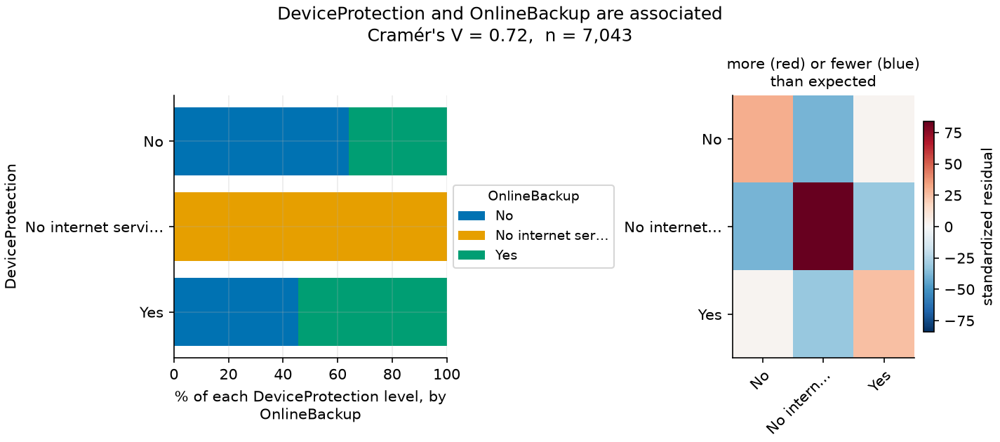

| | |
| :--- | :--- |
| Test used | chi-square test of independence |
| Test statistic | 7,284.45 |
| Degrees of freedom | 4 |
| Raw p-value | <0.001 |
| Adjusted p-value (q) | <0.001 |
| Effect size | Cramér's V = 0.72 (95% CI 0.72 to 0.72), large |
| Records used | 7,043 |

How was this tested?

Every cell of the table had enough expected records, so the standard chi-square test of independence was used.

Where do the numbers come from?

| Fact | Shown as | Comes from |
| :--- | :--- | :--- |
| `cell1_col` | No internet service | `TestResult.descriptives.top_residual_cells[0].col` |
| `cell1_expected` | 330.64 | `TestResult.descriptives.top_residual_cells[0].expected` |
| `cell1_more_or_fewer` | more | `observed vs expected count` |
| `cell1_observed` | 1,526 | `TestResult.descriptives.top_residual_cells[0].observed` |
| `cell1_row` | No internet service | `TestResult.descriptives.top_residual_cells[0].row` |
| `cell2_col` | No internet service | `TestResult.descriptives.top_residual_cells[1].col` |
| `cell2_expected` | 670.59 | `TestResult.descriptives.top_residual_cells[1].expected` |
| `cell2_more_or_fewer` | fewer | `observed vs expected count` |
| `cell2_observed` | 0 | `TestResult.descriptives.top_residual_cells[1].observed` |
| `cell2_row` | No | `TestResult.descriptives.top_residual_cells[1].row` |
| `ci_high` | 0.72 | `TestResult.effect.ci_high` |
| `ci_low` | 0.72 | `TestResult.effect.ci_low` |
| `col_a` | DeviceProtection | `Hypothesis.column_a` |
| `col_b` | OnlineBackup | `Hypothesis.column_b` |
| `col_label0` | No | `TestResult.descriptives.col_labels[0]` |
| `col_label1` | No internet service | `TestResult.descriptives.col_labels[1]` |
| `col_label2` | Yes | `TestResult.descriptives.col_labels[2]` |
| `comparable_value` | 1.02 | `TestResult.effect.comparable_value` |
| `df` | 4 | `TestResult.df` |
| `direction_word` | any | `TestResult.direction_observed` |
| `effect_abs` | 0.72 | `abs(TestResult.effect.value)` |
| `effect_name` | Cramér's V | `TestResult.effect.name` |
| `effect_value` | 0.72 | `TestResult.effect.value` |
| `family_size` | 190 | `ValidationDecision.family_size` |
| `magnitude_label` | large | `TestResult.effect.magnitude` |
| `n_cols_table` | 3 | `len(TestResult.descriptives.col_labels)` |
| `n_rows_table` | 3 | `len(TestResult.descriptives.row_labels)` |
| `n_used` | 7,043 | `TestResult.n_used` |
| `p_raw` | <0.001 | `ValidationDecision.p_raw` |
| `q_value` | <0.001 | `ValidationDecision.q_value` |
| `row_label0` | No | `TestResult.descriptives.row_labels[0]` |
| `row_label1` | No internet service | `TestResult.descriptives.row_labels[1]` |
| `row_label2` | Yes | `TestResult.descriptives.row_labels[2]` |
| `statistic` | 7,284.45 | `TestResult.statistic` |
| `test_name` | chi-square test of independence | `TestResult.test_name` |

### 2.10 `OnlineBackup` ↔ `OnlineSecurity`

OnlineBackup and OnlineSecurity are associated (Cramér's V = 0.72, 95% CI 0.72 to 0.72, large; n = 7,043). The largest departure from independence: more records with OnlineBackup = No internet service and OnlineSecurity = No internet service than expected if the columns were unrelated (1,526 observed vs 330.64 expected). After correcting for 190 tests (Benjamini-Hochberg method, false discovery rate 5.0%), the association is statistically supported (adjusted p <0.001). This is an association, not evidence of cause and effect.

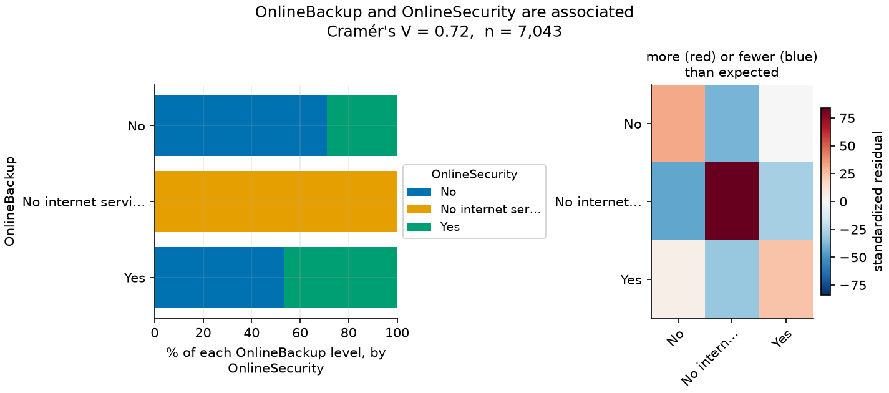

| | |
| :--- | :--- |
| Test used | chi-square test of independence |
| Test statistic | 7,270.46 |
| Degrees of freedom | 4 |
| Raw p-value | <0.001 |
| Adjusted p-value (q) | <0.001 |
| Effect size | Cramér's V = 0.72 (95% CI 0.72 to 0.72), large |
| Records used | 7,043 |

How was this tested?

Every cell of the table had enough expected records, so the standard chi-square test of independence was used.

Where do the numbers come from?

| Fact | Shown as | Comes from |
| :--- | :--- | :--- |
| `cell1_col` | No internet service | `TestResult.descriptives.top_residual_cells[0].col` |
| `cell1_expected` | 330.64 | `TestResult.descriptives.top_residual_cells[0].expected` |
| `cell1_more_or_fewer` | more | `observed vs expected count` |
| `cell1_observed` | 1,526 | `TestResult.descriptives.top_residual_cells[0].observed` |
| `cell1_row` | No internet service | `TestResult.descriptives.top_residual_cells[0].row` |
| `cell2_col` | No | `TestResult.descriptives.top_residual_cells[1].col` |
| `cell2_expected` | 757.91 | `TestResult.descriptives.top_residual_cells[1].expected` |
| `cell2_more_or_fewer` | fewer | `observed vs expected count` |
| `cell2_observed` | 0 | `TestResult.descriptives.top_residual_cells[1].observed` |
| `cell2_row` | No internet service | `TestResult.descriptives.top_residual_cells[1].row` |
| `ci_high` | 0.72 | `TestResult.effect.ci_high` |
| `ci_low` | 0.72 | `TestResult.effect.ci_low` |
| `col_a` | OnlineBackup | `Hypothesis.column_a` |
| `col_b` | OnlineSecurity | `Hypothesis.column_b` |
| `col_label0` | No | `TestResult.descriptives.col_labels[0]` |
| `col_label1` | No internet service | `TestResult.descriptives.col_labels[1]` |
| `col_label2` | Yes | `TestResult.descriptives.col_labels[2]` |
| `comparable_value` | 1.02 | `TestResult.effect.comparable_value` |
| `df` | 4 | `TestResult.df` |
| `direction_word` | any | `TestResult.direction_observed` |
| `effect_abs` | 0.72 | `abs(TestResult.effect.value)` |
| `effect_name` | Cramér's V | `TestResult.effect.name` |
| `effect_value` | 0.72 | `TestResult.effect.value` |
| `family_size` | 190 | `ValidationDecision.family_size` |
| `magnitude_label` | large | `TestResult.effect.magnitude` |
| `n_cols_table` | 3 | `len(TestResult.descriptives.col_labels)` |
| `n_rows_table` | 3 | `len(TestResult.descriptives.row_labels)` |
| `n_used` | 7,043 | `TestResult.n_used` |
| `p_raw` | <0.001 | `ValidationDecision.p_raw` |
| `q_value` | <0.001 | `ValidationDecision.q_value` |
| `row_label0` | No | `TestResult.descriptives.row_labels[0]` |
| `row_label1` | No internet service | `TestResult.descriptives.row_labels[1]` |
| `row_label2` | Yes | `TestResult.descriptives.row_labels[2]` |
| `statistic` | 7,270.46 | `TestResult.statistic` |
| `test_name` | chi-square test of independence | `TestResult.test_name` |

### 2.11 `DeviceProtection` ↔ `OnlineSecurity`

DeviceProtection and OnlineSecurity are associated (Cramér's V = 0.72, 95% CI 0.71 to 0.72, large; n = 7,043). The largest departure from independence: more records with DeviceProtection = No internet service and OnlineSecurity = No internet service than expected if the columns were unrelated (1,526 observed vs 330.64 expected). After correcting for 190 tests (Benjamini-Hochberg method, false discovery rate 5.0%), the association is statistically supported (adjusted p <0.001). This is an association, not evidence of cause and effect.

| | |
| :--- | :--- |
| Test used | chi-square test of independence |
| Test statistic | 7,247.35 |
| Degrees of freedom | 4 |
| Raw p-value | <0.001 |
| Adjusted p-value (q) | <0.001 |
| Effect size | Cramér's V = 0.72 (95% CI 0.71 to 0.72), large |
| Records used | 7,043 |

How was this tested?

Every cell of the table had enough expected records, so the standard chi-square test of independence was used.

Where do the numbers come from?

| Fact | Shown as | Comes from |
| :--- | :--- | :--- |
| `cell1_col` | No internet service | `TestResult.descriptives.top_residual_cells[0].col` |
| `cell1_expected` | 330.64 | `TestResult.descriptives.top_residual_cells[0].expected` |
| `cell1_more_or_fewer` | more | `observed vs expected count` |
| `cell1_observed` | 1,526 | `TestResult.descriptives.top_residual_cells[0].observed` |
| `cell1_row` | No internet service | `TestResult.descriptives.top_residual_cells[0].row` |
| `cell2_col` | No | `TestResult.descriptives.top_residual_cells[1].col` |
| `cell2_expected` | 757.91 | `TestResult.descriptives.top_residual_cells[1].expected` |
| `cell2_more_or_fewer` | fewer | `observed vs expected count` |
| `cell2_observed` | 0 | `TestResult.descriptives.top_residual_cells[1].observed` |
| `cell2_row` | No internet service | `TestResult.descriptives.top_residual_cells[1].row` |
| `ci_high` | 0.72 | `TestResult.effect.ci_high` |
| `ci_low` | 0.71 | `TestResult.effect.ci_low` |
| `col_a` | DeviceProtection | `Hypothesis.column_a` |
| `col_b` | OnlineSecurity | `Hypothesis.column_b` |
| `col_label0` | No | `TestResult.descriptives.col_labels[0]` |
| `col_label1` | No internet service | `TestResult.descriptives.col_labels[1]` |
| `col_label2` | Yes | `TestResult.descriptives.col_labels[2]` |
| `comparable_value` | 1.01 | `TestResult.effect.comparable_value` |
| `df` | 4 | `TestResult.df` |
| `direction_word` | any | `TestResult.direction_observed` |
| `effect_abs` | 0.72 | `abs(TestResult.effect.value)` |
| `effect_name` | Cramér's V | `TestResult.effect.name` |
| `effect_value` | 0.72 | `TestResult.effect.value` |
| `family_size` | 190 | `ValidationDecision.family_size` |
| `magnitude_label` | large | `TestResult.effect.magnitude` |
| `n_cols_table` | 3 | `len(TestResult.descriptives.col_labels)` |
| `n_rows_table` | 3 | `len(TestResult.descriptives.row_labels)` |
| `n_used` | 7,043 | `TestResult.n_used` |
| `p_raw` | <0.001 | `ValidationDecision.p_raw` |
| `q_value` | <0.001 | `ValidationDecision.q_value` |
| `row_label0` | No | `TestResult.descriptives.row_labels[0]` |
| `row_label1` | No internet service | `TestResult.descriptives.row_labels[1]` |
| `row_label2` | Yes | `TestResult.descriptives.row_labels[2]` |
| `statistic` | 7,247.35 | `TestResult.statistic` |
| `test_name` | chi-square test of independence | `TestResult.test_name` |

### 2.12 `InternetService` ↔ `StreamingTV`

InternetService and StreamingTV are associated (Cramér's V = 0.72, 95% CI 0.71 to 0.72, large; n = 7,043). The largest departure from independence: more records with InternetService = No and StreamingTV = No internet service than expected if the columns were unrelated (1,526 observed vs 330.64 expected). After correcting for 190 tests (Benjamini-Hochberg method, false discovery rate 5.0%), the association is statistically supported (adjusted p <0.001). This is an association, not evidence of cause and effect.

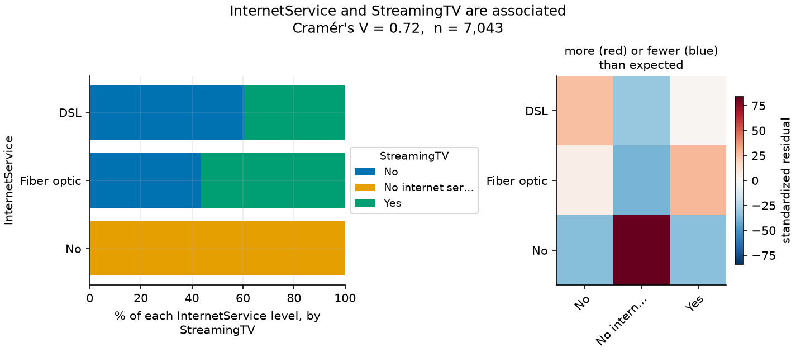

| | |
| :--- | :--- |
| Test used | chi-square test of independence |
| Test statistic | 7,243.46 |
| Degrees of freedom | 4 |
| Raw p-value | <0.001 |
| Adjusted p-value (q) | <0.001 |
| Effect size | Cramér's V = 0.72 (95% CI 0.71 to 0.72), large |
| Records used | 7,043 |

How was this tested?

Every cell of the table had enough expected records, so the standard chi-square test of independence was used.

Where do the numbers come from?

| Fact | Shown as | Comes from |
| :--- | :--- | :--- |
| `cell1_col` | No internet service | `TestResult.descriptives.top_residual_cells[0].col` |
| `cell1_expected` | 330.64 | `TestResult.descriptives.top_residual_cells[0].expected` |
| `cell1_more_or_fewer` | more | `observed vs expected count` |
| `cell1_observed` | 1,526 | `TestResult.descriptives.top_residual_cells[0].observed` |
| `cell1_row` | No | `TestResult.descriptives.top_residual_cells[0].row` |
| `cell2_col` | No internet service | `TestResult.descriptives.top_residual_cells[1].col` |
| `cell2_expected` | 670.81 | `TestResult.descriptives.top_residual_cells[1].expected` |
| `cell2_more_or_fewer` | fewer | `observed vs expected count` |
| `cell2_observed` | 0 | `TestResult.descriptives.top_residual_cells[1].observed` |
| `cell2_row` | Fiber optic | `TestResult.descriptives.top_residual_cells[1].row` |
| `ci_high` | 0.72 | `TestResult.effect.ci_high` |
| `ci_low` | 0.71 | `TestResult.effect.ci_low` |
| `col_a` | InternetService | `Hypothesis.column_a` |
| `col_b` | StreamingTV | `Hypothesis.column_b` |
| `col_label0` | No | `TestResult.descriptives.col_labels[0]` |
| `col_label1` | No internet service | `TestResult.descriptives.col_labels[1]` |
| `col_label2` | Yes | `TestResult.descriptives.col_labels[2]` |
| `comparable_value` | 1.01 | `TestResult.effect.comparable_value` |
| `df` | 4 | `TestResult.df` |
| `direction_word` | any | `TestResult.direction_observed` |
| `effect_abs` | 0.72 | `abs(TestResult.effect.value)` |
| `effect_name` | Cramér's V | `TestResult.effect.name` |
| `effect_value` | 0.72 | `TestResult.effect.value` |
| `family_size` | 190 | `ValidationDecision.family_size` |
| `magnitude_label` | large | `TestResult.effect.magnitude` |
| `n_cols_table` | 3 | `len(TestResult.descriptives.col_labels)` |
| `n_rows_table` | 3 | `len(TestResult.descriptives.row_labels)` |
| `n_used` | 7,043 | `TestResult.n_used` |
| `p_raw` | <0.001 | `ValidationDecision.p_raw` |
| `q_value` | <0.001 | `ValidationDecision.q_value` |
| `row_label0` | DSL | `TestResult.descriptives.row_labels[0]` |
| `row_label1` | Fiber optic | `TestResult.descriptives.row_labels[1]` |
| `row_label2` | No | `TestResult.descriptives.row_labels[2]` |
| `statistic` | 7,243.46 | `TestResult.statistic` |
| `test_name` | chi-square test of independence | `TestResult.test_name` |

### 2.13 `StreamingMovies` ↔ `TechSupport`

StreamingMovies and TechSupport are associated (Cramér's V = 0.72, 95% CI 0.71 to 0.72, large; n = 7,043). The largest departure from independence: more records with StreamingMovies = No internet service and TechSupport = No internet service than expected if the columns were unrelated (1,526 observed vs 330.64 expected). After correcting for 190 tests (Benjamini-Hochberg method, false discovery rate 5.0%), the association is statistically supported (adjusted p <0.001). This is an association, not evidence of cause and effect.

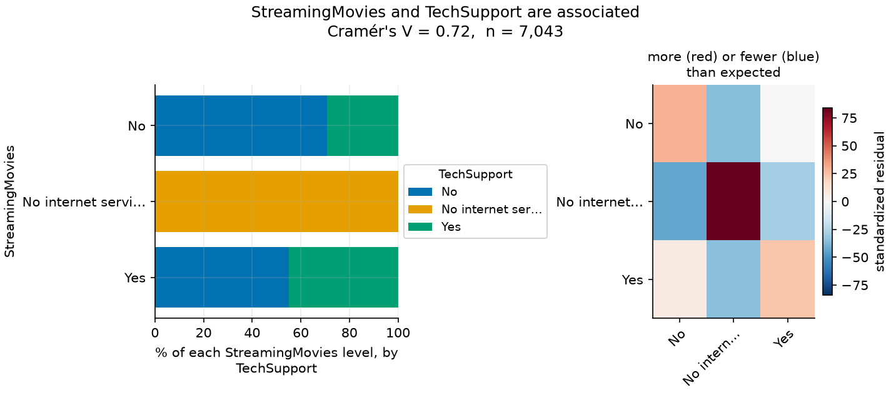

| | |
| :--- | :--- |
| Test used | chi-square test of independence |
| Test statistic | 7,227.86 |
| Degrees of freedom | 4 |
| Raw p-value | <0.001 |
| Adjusted p-value (q) | <0.001 |
| Effect size | Cramér's V = 0.72 (95% CI 0.71 to 0.72), large |
| Records used | 7,043 |

How was this tested?

Every cell of the table had enough expected records, so the standard chi-square test of independence was used.

Where do the numbers come from?

| Fact | Shown as | Comes from |
| :--- | :--- | :--- |
| `cell1_col` | No internet service | `TestResult.descriptives.top_residual_cells[0].col` |
| `cell1_expected` | 330.64 | `TestResult.descriptives.top_residual_cells[0].expected` |
| `cell1_more_or_fewer` | more | `observed vs expected count` |
| `cell1_observed` | 1,526 | `TestResult.descriptives.top_residual_cells[0].observed` |
| `cell1_row` | No internet service | `TestResult.descriptives.top_residual_cells[0].row` |
| `cell2_col` | No | `TestResult.descriptives.top_residual_cells[1].col` |
| `cell2_expected` | 752.49 | `TestResult.descriptives.top_residual_cells[1].expected` |
| `cell2_more_or_fewer` | fewer | `observed vs expected count` |
| `cell2_observed` | 0 | `TestResult.descriptives.top_residual_cells[1].observed` |
| `cell2_row` | No internet service | `TestResult.descriptives.top_residual_cells[1].row` |
| `ci_high` | 0.72 | `TestResult.effect.ci_high` |
| `ci_low` | 0.71 | `TestResult.effect.ci_low` |
| `col_a` | StreamingMovies | `Hypothesis.column_a` |
| `col_b` | TechSupport | `Hypothesis.column_b` |
| `col_label0` | No | `TestResult.descriptives.col_labels[0]` |
| `col_label1` | No internet service | `TestResult.descriptives.col_labels[1]` |
| `col_label2` | Yes | `TestResult.descriptives.col_labels[2]` |
| `comparable_value` | 1.01 | `TestResult.effect.comparable_value` |
| `df` | 4 | `TestResult.df` |
| `direction_word` | any | `TestResult.direction_observed` |
| `effect_abs` | 0.72 | `abs(TestResult.effect.value)` |
| `effect_name` | Cramér's V | `TestResult.effect.name` |
| `effect_value` | 0.72 | `TestResult.effect.value` |
| `family_size` | 190 | `ValidationDecision.family_size` |
| `magnitude_label` | large | `TestResult.effect.magnitude` |
| `n_cols_table` | 3 | `len(TestResult.descriptives.col_labels)` |
| `n_rows_table` | 3 | `len(TestResult.descriptives.row_labels)` |
| `n_used` | 7,043 | `TestResult.n_used` |
| `p_raw` | <0.001 | `ValidationDecision.p_raw` |
| `q_value` | <0.001 | `ValidationDecision.q_value` |
| `row_label0` | No | `TestResult.descriptives.row_labels[0]` |
| `row_label1` | No internet service | `TestResult.descriptives.row_labels[1]` |
| `row_label2` | Yes | `TestResult.descriptives.row_labels[2]` |
| `statistic` | 7,227.86 | `TestResult.statistic` |
| `test_name` | chi-square test of independence | `TestResult.test_name` |

### 2.14 `StreamingTV` ↔ `TechSupport`

StreamingTV and TechSupport are associated (Cramér's V = 0.72, 95% CI 0.71 to 0.72, large; n = 7,043). The largest departure from independence: more records with StreamingTV = No internet service and TechSupport = No internet service than expected if the columns were unrelated (1,526 observed vs 330.64 expected). After correcting for 190 tests (Benjamini-Hochberg method, false discovery rate 5.0%), the association is statistically supported (adjusted p <0.001). This is an association, not evidence of cause and effect.

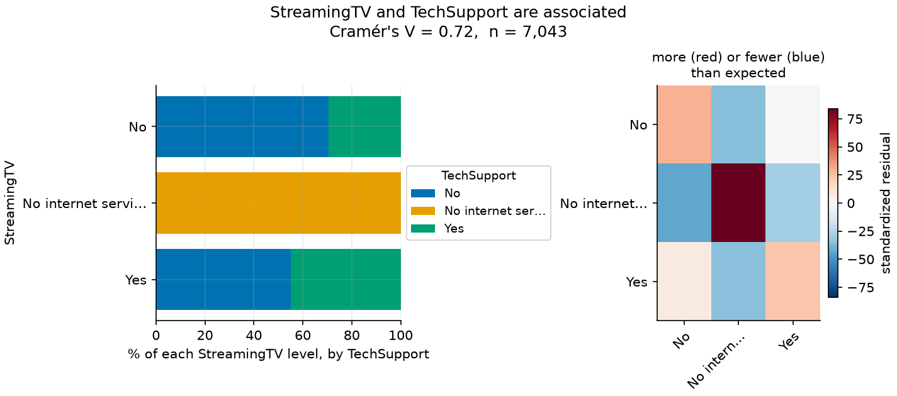

| | |
| :--- | :--- |
| Test used | chi-square test of independence |
| Test statistic | 7,226.65 |
| Degrees of freedom | 4 |
| Raw p-value | <0.001 |
| Adjusted p-value (q) | <0.001 |
| Effect size | Cramér's V = 0.72 (95% CI 0.71 to 0.72), large |
| Records used | 7,043 |

How was this tested?

Every cell of the table had enough expected records, so the standard chi-square test of independence was used.

Where do the numbers come from?

| Fact | Shown as | Comes from |
| :--- | :--- | :--- |
| `cell1_col` | No internet service | `TestResult.descriptives.top_residual_cells[0].col` |
| `cell1_expected` | 330.64 | `TestResult.descriptives.top_residual_cells[0].expected` |
| `cell1_more_or_fewer` | more | `observed vs expected count` |
| `cell1_observed` | 1,526 | `TestResult.descriptives.top_residual_cells[0].observed` |
| `cell1_row` | No internet service | `TestResult.descriptives.top_residual_cells[0].row` |
| `cell2_col` | No | `TestResult.descriptives.top_residual_cells[1].col` |
| `cell2_expected` | 752.49 | `TestResult.descriptives.top_residual_cells[1].expected` |
| `cell2_more_or_fewer` | fewer | `observed vs expected count` |
| `cell2_observed` | 0 | `TestResult.descriptives.top_residual_cells[1].observed` |
| `cell2_row` | No internet service | `TestResult.descriptives.top_residual_cells[1].row` |
| `ci_high` | 0.72 | `TestResult.effect.ci_high` |
| `ci_low` | 0.71 | `TestResult.effect.ci_low` |
| `col_a` | StreamingTV | `Hypothesis.column_a` |
| `col_b` | TechSupport | `Hypothesis.column_b` |
| `col_label0` | No | `TestResult.descriptives.col_labels[0]` |
| `col_label1` | No internet service | `TestResult.descriptives.col_labels[1]` |
| `col_label2` | Yes | `TestResult.descriptives.col_labels[2]` |
| `comparable_value` | 1.01 | `TestResult.effect.comparable_value` |
| `df` | 4 | `TestResult.df` |
| `direction_word` | any | `TestResult.direction_observed` |
| `effect_abs` | 0.72 | `abs(TestResult.effect.value)` |
| `effect_name` | Cramér's V | `TestResult.effect.name` |
| `effect_value` | 0.72 | `TestResult.effect.value` |
| `family_size` | 190 | `ValidationDecision.family_size` |
| `magnitude_label` | large | `TestResult.effect.magnitude` |
| `n_cols_table` | 3 | `len(TestResult.descriptives.col_labels)` |
| `n_rows_table` | 3 | `len(TestResult.descriptives.row_labels)` |
| `n_used` | 7,043 | `TestResult.n_used` |
| `p_raw` | <0.001 | `ValidationDecision.p_raw` |
| `q_value` | <0.001 | `ValidationDecision.q_value` |
| `row_label0` | No | `TestResult.descriptives.row_labels[0]` |
| `row_label1` | No internet service | `TestResult.descriptives.row_labels[1]` |
| `row_label2` | Yes | `TestResult.descriptives.row_labels[2]` |
| `statistic` | 7,226.65 | `TestResult.statistic` |
| `test_name` | chi-square test of independence | `TestResult.test_name` |

### 2.15 `InternetService` ↔ `StreamingMovies`

InternetService and StreamingMovies are associated (Cramér's V = 0.72, 95% CI 0.71 to 0.72, large; n = 7,043). The largest departure from independence: more records with InternetService = No and StreamingMovies = No internet service than expected if the columns were unrelated (1,526 observed vs 330.64 expected). After correcting for 190 tests (Benjamini-Hochberg method, false discovery rate 5.0%), the association is statistically supported (adjusted p <0.001). This is an association, not evidence of cause and effect.

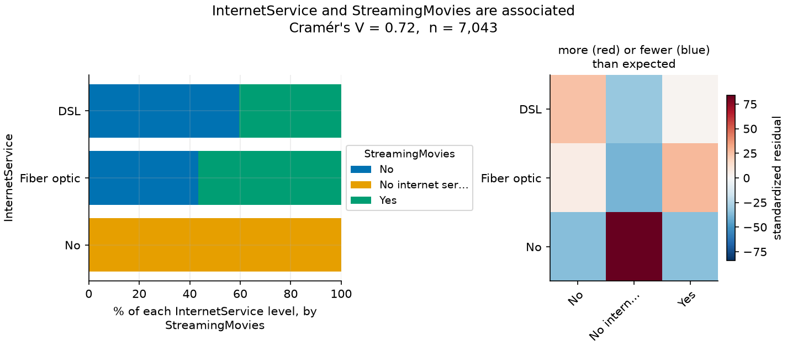

| | |
| :--- | :--- |
| Test used | chi-square test of independence |
| Test statistic | 7,221.43 |
| Degrees of freedom | 4 |
| Raw p-value | <0.001 |
| Adjusted p-value (q) | <0.001 |
| Effect size | Cramér's V = 0.72 (95% CI 0.71 to 0.72), large |
| Records used | 7,043 |

How was this tested?

Every cell of the table had enough expected records, so the standard chi-square test of independence was used.

Where do the numbers come from?

| Fact | Shown as | Comes from |
| :--- | :--- | :--- |
| `cell1_col` | No internet service | `TestResult.descriptives.top_residual_cells[0].col` |
| `cell1_expected` | 330.64 | `TestResult.descriptives.top_residual_cells[0].expected` |
| `cell1_more_or_fewer` | more | `observed vs expected count` |
| `cell1_observed` | 1,526 | `TestResult.descriptives.top_residual_cells[0].observed` |
| `cell1_row` | No | `TestResult.descriptives.top_residual_cells[0].row` |
| `cell2_col` | No internet service | `TestResult.descriptives.top_residual_cells[1].col` |
| `cell2_expected` | 670.81 | `TestResult.descriptives.top_residual_cells[1].expected` |
| `cell2_more_or_fewer` | fewer | `observed vs expected count` |
| `cell2_observed` | 0 | `TestResult.descriptives.top_residual_cells[1].observed` |
| `cell2_row` | Fiber optic | `TestResult.descriptives.top_residual_cells[1].row` |
| `ci_high` | 0.72 | `TestResult.effect.ci_high` |
| `ci_low` | 0.71 | `TestResult.effect.ci_low` |
| `col_a` | InternetService | `Hypothesis.column_a` |
| `col_b` | StreamingMovies | `Hypothesis.column_b` |
| `col_label0` | No | `TestResult.descriptives.col_labels[0]` |
| `col_label1` | No internet service | `TestResult.descriptives.col_labels[1]` |
| `col_label2` | Yes | `TestResult.descriptives.col_labels[2]` |
| `comparable_value` | 1.01 | `TestResult.effect.comparable_value` |
| `df` | 4 | `TestResult.df` |
| `direction_word` | any | `TestResult.direction_observed` |
| `effect_abs` | 0.72 | `abs(TestResult.effect.value)` |
| `effect_name` | Cramér's V | `TestResult.effect.name` |
| `effect_value` | 0.72 | `TestResult.effect.value` |
| `family_size` | 190 | `ValidationDecision.family_size` |
| `magnitude_label` | large | `TestResult.effect.magnitude` |
| `n_cols_table` | 3 | `len(TestResult.descriptives.col_labels)` |
| `n_rows_table` | 3 | `len(TestResult.descriptives.row_labels)` |
| `n_used` | 7,043 | `TestResult.n_used` |
| `p_raw` | <0.001 | `ValidationDecision.p_raw` |
| `q_value` | <0.001 | `ValidationDecision.q_value` |
| `row_label0` | DSL | `TestResult.descriptives.row_labels[0]` |
| `row_label1` | Fiber optic | `TestResult.descriptives.row_labels[1]` |
| `row_label2` | No | `TestResult.descriptives.row_labels[2]` |
| `statistic` | 7,221.43 | `TestResult.statistic` |
| `test_name` | chi-square test of independence | `TestResult.test_name` |

### 2.16 `OnlineBackup` ↔ `StreamingTV`

OnlineBackup and StreamingTV are associated (Cramér's V = 0.71, 95% CI 0.71 to 0.72, large; n = 7,043). The largest departure from independence: more records with OnlineBackup = No internet service and StreamingTV = No internet service than expected if the columns were unrelated (1,526 observed vs 330.64 expected). After correcting for 190 tests (Benjamini-Hochberg method, false discovery rate 5.0%), the association is statistically supported (adjusted p <0.001). This is an association, not evidence of cause and effect.

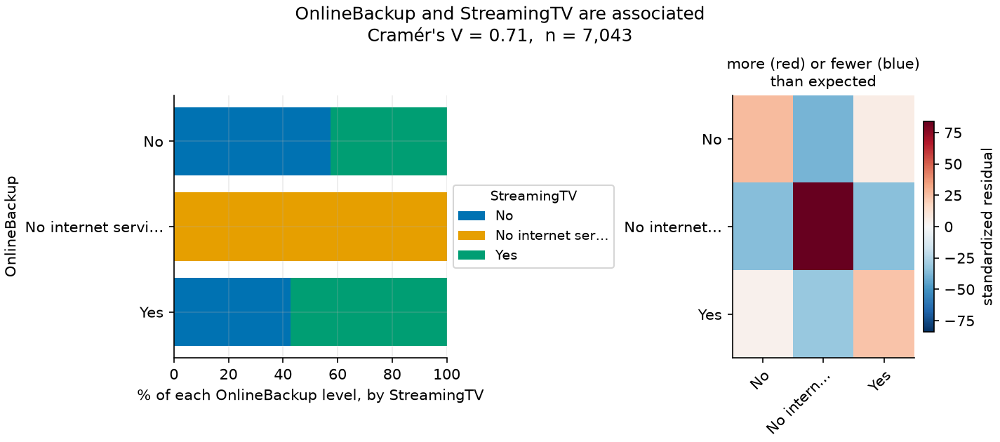

| | |
| :--- | :--- |
| Test used | chi-square test of independence |
| Test statistic | 7,195.06 |
| Degrees of freedom | 4 |
| Raw p-value | <0.001 |
| Adjusted p-value (q) | <0.001 |
| Effect size | Cramér's V = 0.71 (95% CI 0.71 to 0.72), large |
| Records used | 7,043 |

How was this tested?

Every cell of the table had enough expected records, so the standard chi-square test of independence was used.

Where do the numbers come from?

| Fact | Shown as | Comes from |
| :--- | :--- | :--- |
| `cell1_col` | No internet service | `TestResult.descriptives.top_residual_cells[0].col` |
| `cell1_expected` | 330.64 | `TestResult.descriptives.top_residual_cells[0].expected` |
| `cell1_more_or_fewer` | more | `observed vs expected count` |
| `cell1_observed` | 1,526 | `TestResult.descriptives.top_residual_cells[0].observed` |
| `cell1_row` | No internet service | `TestResult.descriptives.top_residual_cells[0].row` |
| `cell2_col` | No internet service | `TestResult.descriptives.top_residual_cells[1].col` |
| `cell2_expected` | 669.07 | `TestResult.descriptives.top_residual_cells[1].expected` |
| `cell2_more_or_fewer` | fewer | `observed vs expected count` |
| `cell2_observed` | 0 | `TestResult.descriptives.top_residual_cells[1].observed` |
| `cell2_row` | No | `TestResult.descriptives.top_residual_cells[1].row` |
| `ci_high` | 0.72 | `TestResult.effect.ci_high` |
| `ci_low` | 0.71 | `TestResult.effect.ci_low` |
| `col_a` | OnlineBackup | `Hypothesis.column_a` |
| `col_b` | StreamingTV | `Hypothesis.column_b` |
| `col_label0` | No | `TestResult.descriptives.col_labels[0]` |
| `col_label1` | No internet service | `TestResult.descriptives.col_labels[1]` |
| `col_label2` | Yes | `TestResult.descriptives.col_labels[2]` |
| `comparable_value` | 1.01 | `TestResult.effect.comparable_value` |
| `df` | 4 | `TestResult.df` |
| `direction_word` | any | `TestResult.direction_observed` |
| `effect_abs` | 0.71 | `abs(TestResult.effect.value)` |
| `effect_name` | Cramér's V | `TestResult.effect.name` |
| `effect_value` | 0.71 | `TestResult.effect.value` |
| `family_size` | 190 | `ValidationDecision.family_size` |
| `magnitude_label` | large | `TestResult.effect.magnitude` |
| `n_cols_table` | 3 | `len(TestResult.descriptives.col_labels)` |
| `n_rows_table` | 3 | `len(TestResult.descriptives.row_labels)` |
| `n_used` | 7,043 | `TestResult.n_used` |
| `p_raw` | <0.001 | `ValidationDecision.p_raw` |
| `q_value` | <0.001 | `ValidationDecision.q_value` |
| `row_label0` | No | `TestResult.descriptives.row_labels[0]` |
| `row_label1` | No internet service | `TestResult.descriptives.row_labels[1]` |
| `row_label2` | Yes | `TestResult.descriptives.row_labels[2]` |
| `statistic` | 7,195.06 | `TestResult.statistic` |
| `test_name` | chi-square test of independence | `TestResult.test_name` |

### 2.17 `OnlineBackup` ↔ `StreamingMovies`

OnlineBackup and StreamingMovies are associated (Cramér's V = 0.71, 95% CI 0.71 to 0.72, large; n = 7,043). The largest departure from independence: more records with OnlineBackup = No internet service and StreamingMovies = No internet service than expected if the columns were unrelated (1,526 observed vs 330.64 expected). After correcting for 190 tests (Benjamini-Hochberg method, false discovery rate 5.0%), the association is statistically supported (adjusted p <0.001). This is an association, not evidence of cause and effect.

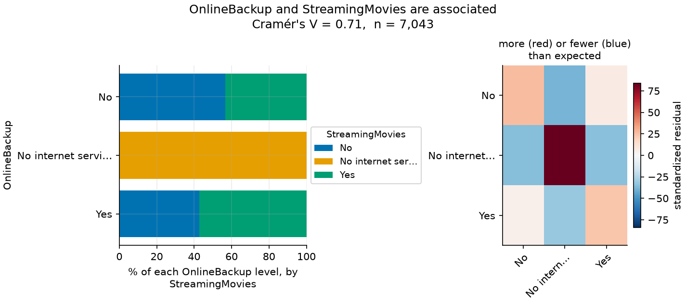

| | |
| :--- | :--- |
| Test used | chi-square test of independence |
| Test statistic | 7,174.59 |
| Degrees of freedom | 4 |
| Raw p-value | <0.001 |
| Adjusted p-value (q) | <0.001 |
| Effect size | Cramér's V = 0.71 (95% CI 0.71 to 0.72), large |
| Records used | 7,043 |

How was this tested?

Every cell of the table had enough expected records, so the standard chi-square test of independence was used.

Where do the numbers come from?

| Fact | Shown as | Comes from |
| :--- | :--- | :--- |
| `cell1_col` | No internet service | `TestResult.descriptives.top_residual_cells[0].col` |
| `cell1_expected` | 330.64 | `TestResult.descriptives.top_residual_cells[0].expected` |
| `cell1_more_or_fewer` | more | `observed vs expected count` |
| `cell1_observed` | 1,526 | `TestResult.descriptives.top_residual_cells[0].observed` |
| `cell1_row` | No internet service | `TestResult.descriptives.top_residual_cells[0].row` |
| `cell2_col` | No internet service | `TestResult.descriptives.top_residual_cells[1].col` |
| `cell2_expected` | 669.07 | `TestResult.descriptives.top_residual_cells[1].expected` |
| `cell2_more_or_fewer` | fewer | `observed vs expected count` |
| `cell2_observed` | 0 | `TestResult.descriptives.top_residual_cells[1].observed` |
| `cell2_row` | No | `TestResult.descriptives.top_residual_cells[1].row` |
| `ci_high` | 0.72 | `TestResult.effect.ci_high` |
| `ci_low` | 0.71 | `TestResult.effect.ci_low` |
| `col_a` | OnlineBackup | `Hypothesis.column_a` |
| `col_b` | StreamingMovies | `Hypothesis.column_b` |
| `col_label0` | No | `TestResult.descriptives.col_labels[0]` |
| `col_label1` | No internet service | `TestResult.descriptives.col_labels[1]` |
| `col_label2` | Yes | `TestResult.descriptives.col_labels[2]` |
| `comparable_value` | 1.01 | `TestResult.effect.comparable_value` |
| `df` | 4 | `TestResult.df` |
| `direction_word` | any | `TestResult.direction_observed` |
| `effect_abs` | 0.71 | `abs(TestResult.effect.value)` |
| `effect_name` | Cramér's V | `TestResult.effect.name` |
| `effect_value` | 0.71 | `TestResult.effect.value` |
| `family_size` | 190 | `ValidationDecision.family_size` |
| `magnitude_label` | large | `TestResult.effect.magnitude` |
| `n_cols_table` | 3 | `len(TestResult.descriptives.col_labels)` |
| `n_rows_table` | 3 | `len(TestResult.descriptives.row_labels)` |
| `n_used` | 7,043 | `TestResult.n_used` |
| `p_raw` | <0.001 | `ValidationDecision.p_raw` |
| `q_value` | <0.001 | `ValidationDecision.q_value` |
| `row_label0` | No | `TestResult.descriptives.row_labels[0]` |
| `row_label1` | No internet service | `TestResult.descriptives.row_labels[1]` |
| `row_label2` | Yes | `TestResult.descriptives.row_labels[2]` |
| `statistic` | 7,174.59 | `TestResult.statistic` |
| `test_name` | chi-square test of independence | `TestResult.test_name` |

### 2.18 `OnlineSecurity` ↔ `StreamingMovies`

OnlineSecurity and StreamingMovies are associated (Cramér's V = 0.71, 95% CI 0.71 to 0.71, large; n = 7,043). The largest departure from independence: more records with OnlineSecurity = No internet service and StreamingMovies = No internet service than expected if the columns were unrelated (1,526 observed vs 330.64 expected). After correcting for 190 tests (Benjamini-Hochberg method, false discovery rate 5.0%), the association is statistically supported (adjusted p <0.001). This is an association, not evidence of cause and effect.

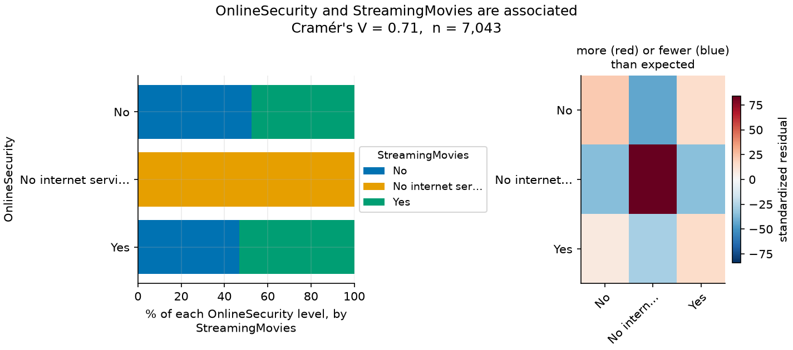

| | |
| :--- | :--- |
| Test used | chi-square test of independence |
| Test statistic | 7,064.96 |
| Degrees of freedom | 4 |
| Raw p-value | <0.001 |
| Adjusted p-value (q) | <0.001 |
| Effect size | Cramér's V = 0.71 (95% CI 0.71 to 0.71), large |
| Records used | 7,043 |

How was this tested?

Every cell of the table had enough expected records, so the standard chi-square test of independence was used.

Where do the numbers come from?

| Fact | Shown as | Comes from |
| :--- | :--- | :--- |
| `cell1_col` | No internet service | `TestResult.descriptives.top_residual_cells[0].col` |
| `cell1_expected` | 330.64 | `TestResult.descriptives.top_residual_cells[0].expected` |
| `cell1_more_or_fewer` | more | `observed vs expected count` |
| `cell1_observed` | 1,526 | `TestResult.descriptives.top_residual_cells[0].observed` |
| `cell1_row` | No internet service | `TestResult.descriptives.top_residual_cells[0].row` |
| `cell2_col` | No internet service | `TestResult.descriptives.top_residual_cells[1].col` |
| `cell2_expected` | 757.91 | `TestResult.descriptives.top_residual_cells[1].expected` |
| `cell2_more_or_fewer` | fewer | `observed vs expected count` |
| `cell2_observed` | 0 | `TestResult.descriptives.top_residual_cells[1].observed` |
| `cell2_row` | No | `TestResult.descriptives.top_residual_cells[1].row` |
| `ci_high` | 0.71 | `TestResult.effect.ci_high` |
| `ci_low` | 0.71 | `TestResult.effect.ci_low` |
| `col_a` | OnlineSecurity | `Hypothesis.column_a` |
| `col_b` | StreamingMovies | `Hypothesis.column_b` |
| `col_label0` | No | `TestResult.descriptives.col_labels[0]` |
| `col_label1` | No internet service | `TestResult.descriptives.col_labels[1]` |
| `col_label2` | Yes | `TestResult.descriptives.col_labels[2]` |
| `comparable_value` | 1.00 | `TestResult.effect.comparable_value` |
| `df` | 4 | `TestResult.df` |
| `direction_word` | any | `TestResult.direction_observed` |
| `effect_abs` | 0.71 | `abs(TestResult.effect.value)` |
| `effect_name` | Cramér's V | `TestResult.effect.name` |
| `effect_value` | 0.71 | `TestResult.effect.value` |
| `family_size` | 190 | `ValidationDecision.family_size` |
| `magnitude_label` | large | `TestResult.effect.magnitude` |
| `n_cols_table` | 3 | `len(TestResult.descriptives.col_labels)` |
| `n_rows_table` | 3 | `len(TestResult.descriptives.row_labels)` |
| `n_used` | 7,043 | `TestResult.n_used` |
| `p_raw` | <0.001 | `ValidationDecision.p_raw` |
| `q_value` | <0.001 | `ValidationDecision.q_value` |
| `row_label0` | No | `TestResult.descriptives.row_labels[0]` |
| `row_label1` | No internet service | `TestResult.descriptives.row_labels[1]` |
| `row_label2` | Yes | `TestResult.descriptives.row_labels[2]` |
| `statistic` | 7,064.96 | `TestResult.statistic` |
| `test_name` | chi-square test of independence | `TestResult.test_name` |

### 2.19 `OnlineSecurity` ↔ `StreamingTV`

OnlineSecurity and StreamingTV are associated (Cramér's V = 0.71, 95% CI 0.71 to 0.71, large; n = 7,043). The largest departure from independence: more records with OnlineSecurity = No internet service and StreamingTV = No internet service than expected if the columns were unrelated (1,526 observed vs 330.64 expected). After correcting for 190 tests (Benjamini-Hochberg method, false discovery rate 5.0%), the association is statistically supported (adjusted p <0.001). This is an association, not evidence of cause and effect.

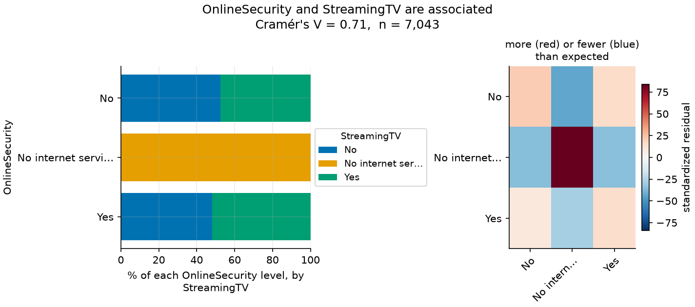

| | |
| :--- | :--- |
| Test used | chi-square test of independence |
| Test statistic | 7,056.58 |
| Degrees of freedom | 4 |
| Raw p-value | <0.001 |
| Adjusted p-value (q) | <0.001 |
| Effect size | Cramér's V = 0.71 (95% CI 0.71 to 0.71), large |
| Records used | 7,043 |

How was this tested?

Every cell of the table had enough expected records, so the standard chi-square test of independence was used.

Where do the numbers come from?

| Fact | Shown as | Comes from |
| :--- | :--- | :--- |
| `cell1_col` | No internet service | `TestResult.descriptives.top_residual_cells[0].col` |
| `cell1_expected` | 330.64 | `TestResult.descriptives.top_residual_cells[0].expected` |
| `cell1_more_or_fewer` | more | `observed vs expected count` |
| `cell1_observed` | 1,526 | `TestResult.descriptives.top_residual_cells[0].observed` |
| `cell1_row` | No internet service | `TestResult.descriptives.top_residual_cells[0].row` |
| `cell2_col` | No internet service | `TestResult.descriptives.top_residual_cells[1].col` |
| `cell2_expected` | 757.91 | `TestResult.descriptives.top_residual_cells[1].expected` |
| `cell2_more_or_fewer` | fewer | `observed vs expected count` |
| `cell2_observed` | 0 | `TestResult.descriptives.top_residual_cells[1].observed` |
| `cell2_row` | No | `TestResult.descriptives.top_residual_cells[1].row` |
| `ci_high` | 0.71 | `TestResult.effect.ci_high` |
| `ci_low` | 0.71 | `TestResult.effect.ci_low` |
| `col_a` | OnlineSecurity | `Hypothesis.column_a` |
| `col_b` | StreamingTV | `Hypothesis.column_b` |
| `col_label0` | No | `TestResult.descriptives.col_labels[0]` |
| `col_label1` | No internet service | `TestResult.descriptives.col_labels[1]` |
| `col_label2` | Yes | `TestResult.descriptives.col_labels[2]` |
| `comparable_value` | 1.00 | `TestResult.effect.comparable_value` |
| `df` | 4 | `TestResult.df` |
| `direction_word` | any | `TestResult.direction_observed` |
| `effect_abs` | 0.71 | `abs(TestResult.effect.value)` |
| `effect_name` | Cramér's V | `TestResult.effect.name` |
| `effect_value` | 0.71 | `TestResult.effect.value` |
| `family_size` | 190 | `ValidationDecision.family_size` |
| `magnitude_label` | large | `TestResult.effect.magnitude` |
| `n_cols_table` | 3 | `len(TestResult.descriptives.col_labels)` |
| `n_rows_table` | 3 | `len(TestResult.descriptives.row_labels)` |
| `n_used` | 7,043 | `TestResult.n_used` |
| `p_raw` | <0.001 | `ValidationDecision.p_raw` |
| `q_value` | <0.001 | `ValidationDecision.q_value` |
| `row_label0` | No | `TestResult.descriptives.row_labels[0]` |
| `row_label1` | No internet service | `TestResult.descriptives.row_labels[1]` |
| `row_label2` | Yes | `TestResult.descriptives.row_labels[2]` |
| `statistic` | 7,056.58 | `TestResult.statistic` |
| `test_name` | chi-square test of independence | `TestResult.test_name` |

### 2.20 `InternetService` ↔ `OnlineBackup`

InternetService and OnlineBackup are associated (Cramér's V = 0.71, 95% CI 0.71 to 0.71, large; n = 7,043). The largest departure from independence: more records with InternetService = No and OnlineBackup = No internet service than expected if the columns were unrelated (1,526 observed vs 330.64 expected). After correcting for 190 tests (Benjamini-Hochberg method, false discovery rate 5.0%), the association is statistically supported (adjusted p <0.001). This is an association, not evidence of cause and effect.

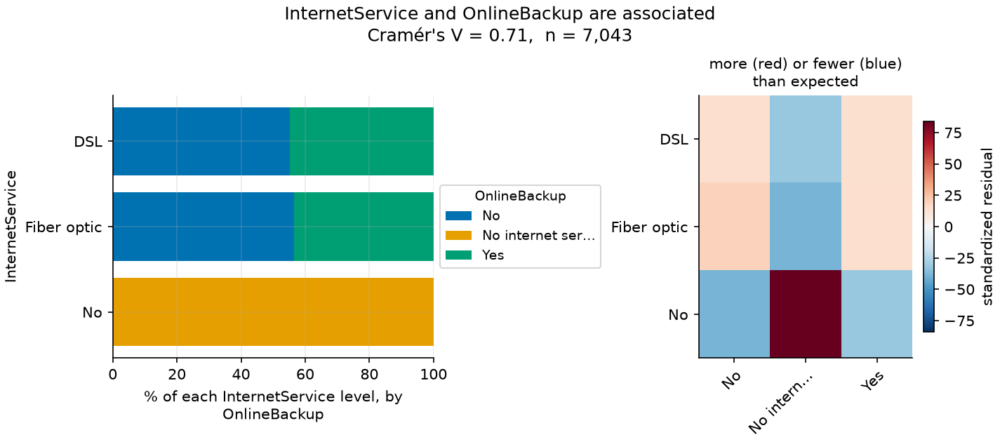

| | |
| :--- | :--- |
| Test used | chi-square test of independence |
| Test statistic | 7,044.54 |
| Degrees of freedom | 4 |
| Raw p-value | <0.001 |
| Adjusted p-value (q) | <0.001 |
| Effect size | Cramér's V = 0.71 (95% CI 0.71 to 0.71), large |
| Records used | 7,043 |

How was this tested?

Every cell of the table had enough expected records, so the standard chi-square test of independence was used.

Where do the numbers come from?

| Fact | Shown as | Comes from |
| :--- | :--- | :--- |
| `cell1_col` | No internet service | `TestResult.descriptives.top_residual_cells[0].col` |
| `cell1_expected` | 330.64 | `TestResult.descriptives.top_residual_cells[0].expected` |
| `cell1_more_or_fewer` | more | `observed vs expected count` |
| `cell1_observed` | 1,526 | `TestResult.descriptives.top_residual_cells[0].observed` |
| `cell1_row` | No | `TestResult.descriptives.top_residual_cells[0].row` |
| `cell2_col` | No internet service | `TestResult.descriptives.top_residual_cells[1].col` |
| `cell2_expected` | 670.81 | `TestResult.descriptives.top_residual_cells[1].expected` |
| `cell2_more_or_fewer` | fewer | `observed vs expected count` |
| `cell2_observed` | 0 | `TestResult.descriptives.top_residual_cells[1].observed` |
| `cell2_row` | Fiber optic | `TestResult.descriptives.top_residual_cells[1].row` |
| `ci_high` | 0.71 | `TestResult.effect.ci_high` |
| `ci_low` | 0.71 | `TestResult.effect.ci_low` |
| `col_a` | InternetService | `Hypothesis.column_a` |
| `col_b` | OnlineBackup | `Hypothesis.column_b` |
| `col_label0` | No | `TestResult.descriptives.col_labels[0]` |
| `col_label1` | No internet service | `TestResult.descriptives.col_labels[1]` |
| `col_label2` | Yes | `TestResult.descriptives.col_labels[2]` |
| `comparable_value` | 1.00 | `TestResult.effect.comparable_value` |
| `df` | 4 | `TestResult.df` |
| `direction_word` | any | `TestResult.direction_observed` |
| `effect_abs` | 0.71 | `abs(TestResult.effect.value)` |
| `effect_name` | Cramér's V | `TestResult.effect.name` |
| `effect_value` | 0.71 | `TestResult.effect.value` |
| `family_size` | 190 | `ValidationDecision.family_size` |
| `magnitude_label` | large | `TestResult.effect.magnitude` |
| `n_cols_table` | 3 | `len(TestResult.descriptives.col_labels)` |
| `n_rows_table` | 3 | `len(TestResult.descriptives.row_labels)` |
| `n_used` | 7,043 | `TestResult.n_used` |
| `p_raw` | <0.001 | `ValidationDecision.p_raw` |
| `q_value` | <0.001 | `ValidationDecision.q_value` |
| `row_label0` | DSL | `TestResult.descriptives.row_labels[0]` |
| `row_label1` | Fiber optic | `TestResult.descriptives.row_labels[1]` |
| `row_label2` | No | `TestResult.descriptives.row_labels[2]` |
| `statistic` | 7,044.54 | `TestResult.statistic` |
| `test_name` | chi-square test of independence | `TestResult.test_name` |

### 2.21 `DeviceProtection` ↔ `InternetService`

DeviceProtection and InternetService are associated (Cramér's V = 0.71, 95% CI 0.71 to 0.71, large; n = 7,043). The largest departure from independence: more records with DeviceProtection = No internet service and InternetService = No than expected if the columns were unrelated (1,526 observed vs 330.64 expected). After correcting for 190 tests (Benjamini-Hochberg method, false discovery rate 5.0%), the association is statistically supported (adjusted p <0.001). This is an association, not evidence of cause and effect.

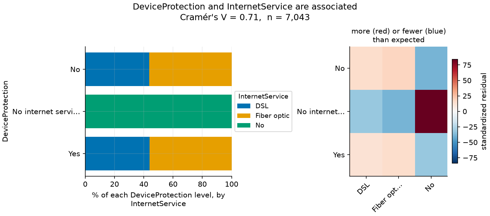

| | |
| :--- | :--- |
| Test used | chi-square test of independence |
| Test statistic | 7,043.02 |
| Degrees of freedom | 4 |
| Raw p-value | <0.001 |
| Adjusted p-value (q) | <0.001 |
| Effect size | Cramér's V = 0.71 (95% CI 0.71 to 0.71), large |
| Records used | 7,043 |

How was this tested?

Every cell of the table had enough expected records, so the standard chi-square test of independence was used.

Where do the numbers come from?

| Fact | Shown as | Comes from |
| :--- | :--- | :--- |
| `cell1_col` | No | `TestResult.descriptives.top_residual_cells[0].col` |
| `cell1_expected` | 330.64 | `TestResult.descriptives.top_residual_cells[0].expected` |
| `cell1_more_or_fewer` | more | `observed vs expected count` |
| `cell1_observed` | 1,526 | `TestResult.descriptives.top_residual_cells[0].observed` |
| `cell1_row` | No internet service | `TestResult.descriptives.top_residual_cells[0].row` |
| `cell2_col` | Fiber optic | `TestResult.descriptives.top_residual_cells[1].col` |
| `cell2_expected` | 670.81 | `TestResult.descriptives.top_residual_cells[1].expected` |
| `cell2_more_or_fewer` | fewer | `observed vs expected count` |
| `cell2_observed` | 0 | `TestResult.descriptives.top_residual_cells[1].observed` |
| `cell2_row` | No internet service | `TestResult.descriptives.top_residual_cells[1].row` |
| `ci_high` | 0.71 | `TestResult.effect.ci_high` |
| `ci_low` | 0.71 | `TestResult.effect.ci_low` |
| `col_a` | DeviceProtection | `Hypothesis.column_a` |
| `col_b` | InternetService | `Hypothesis.column_b` |
| `col_label0` | DSL | `TestResult.descriptives.col_labels[0]` |
| `col_label1` | Fiber optic | `TestResult.descriptives.col_labels[1]` |
| `col_label2` | No | `TestResult.descriptives.col_labels[2]` |
| `comparable_value` | 1.00 | `TestResult.effect.comparable_value` |
| `df` | 4 | `TestResult.df` |
| `direction_word` | any | `TestResult.direction_observed` |
| `effect_abs` | 0.71 | `abs(TestResult.effect.value)` |
| `effect_name` | Cramér's V | `TestResult.effect.name` |
| `effect_value` | 0.71 | `TestResult.effect.value` |
| `family_size` | 190 | `ValidationDecision.family_size` |
| `magnitude_label` | large | `TestResult.effect.magnitude` |
| `n_cols_table` | 3 | `len(TestResult.descriptives.col_labels)` |
| `n_rows_table` | 3 | `len(TestResult.descriptives.row_labels)` |
| `n_used` | 7,043 | `TestResult.n_used` |
| `p_raw` | <0.001 | `ValidationDecision.p_raw` |
| `q_value` | <0.001 | `ValidationDecision.q_value` |
| `row_label0` | No | `TestResult.descriptives.row_labels[0]` |
| `row_label1` | No internet service | `TestResult.descriptives.row_labels[1]` |
| `row_label2` | Yes | `TestResult.descriptives.row_labels[2]` |
| `statistic` | 7,043.02 | `TestResult.statistic` |
| `test_name` | chi-square test of independence | `TestResult.test_name` |

### 2.22 `TotalCharges` ↔ `tenure`

TotalCharges and tenure are positively associated (Spearman rank correlation rho = 0.89, 95% CI 0.88 to 0.90; n = 7,032). The relationship is monotonic and may not be linear. The association is large. After correcting for 190 tests (Benjamini-Hochberg method, false discovery rate 5.0%), the association is statistically supported (adjusted p <0.001). The data were not close enough to the shape a parametric test needs, so a rank-based test was used instead. A second test (Pearson correlation test) did not fully agree, so treat this result with some caution. This is an association, not evidence of cause and effect.

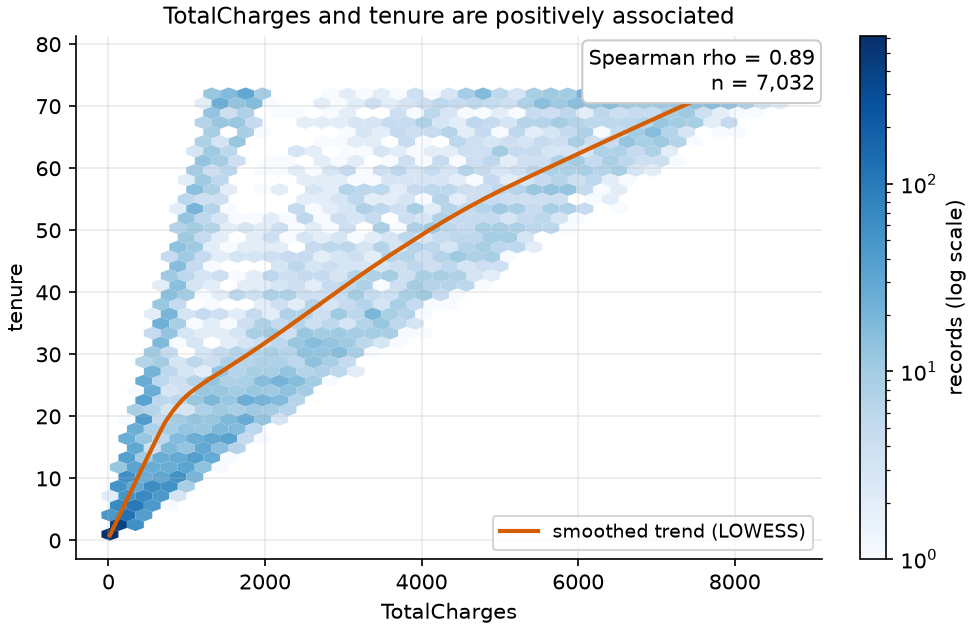

| | |
| :--- | :--- |
| Test used | Spearman rank correlation test |
| Test statistic | 0.89 |
| Degrees of freedom | 7,030 |
| Raw p-value | <0.001 |
| Adjusted p-value (q) | <0.001 |
| Effect size | Spearman rho = 0.89 (95% CI 0.88 to 0.90), large |
| Records used | 7,032 |
| Flags | test sensitive |

How was this tested?

The columns were skewed, had outliers or many ties, so the rank-based Spearman correlation was used.

Where do the numbers come from?

| Fact | Shown as | Comes from |
| :--- | :--- | :--- |
| `alt_effect_value` | 0.83 | `TestResult.descriptives.sensitivity_alt_test.effect_value` |
| `alt_test_name` | Pearson correlation test | `TestResult.descriptives.sensitivity_alt_test.test_name` |
| `ci_high` | 0.90 | `TestResult.effect.ci_high` |
| `ci_low` | 0.88 | `TestResult.effect.ci_low` |
| `col_a` | TotalCharges | `Hypothesis.column_a` |
| `col_b` | tenure | `Hypothesis.column_b` |
| `comparable_value` | 0.89 | `TestResult.effect.comparable_value` |
| `df` | 7,030 | `TestResult.df` |
| `direction_word` | positive | `TestResult.direction_observed` |
| `effect_abs` | 0.89 | `abs(TestResult.effect.value)` |
| `effect_name` | Spearman rho | `TestResult.effect.name` |
| `effect_value` | 0.89 | `TestResult.effect.value` |
| `family_size` | 190 | `ValidationDecision.family_size` |
| `magnitude_label` | large | `TestResult.effect.magnitude` |
| `n_used` | 7,032 | `TestResult.n_used` |
| `ols_slope` | 0.0089 | `TestResult.descriptives.ols_slope` |
| `p_raw` | <0.001 | `ValidationDecision.p_raw` |
| `q_value` | <0.001 | `ValidationDecision.q_value` |
| `statistic` | 0.89 | `TestResult.statistic` |
| `test_name` | Spearman rank correlation test | `TestResult.test_name` |

### 2.23 `MonthlyCharges` ↔ `PhoneService`

Among 7,043 records, the average MonthlyCharges was 42.03 for PhoneService = No and 67.20 for PhoneService = Yes (difference -25.17, 95% CI -26.31 to -24.03). On average, MonthlyCharges is higher for PhoneService = Yes. The difference is large (Hedges' g = -0.86, 95% CI -0.94 to -0.78). After correcting for 190 tests (Benjamini-Hochberg method, false discovery rate 5.0%), the association is statistically supported (adjusted p <0.001). This is an association, not evidence of cause and effect.

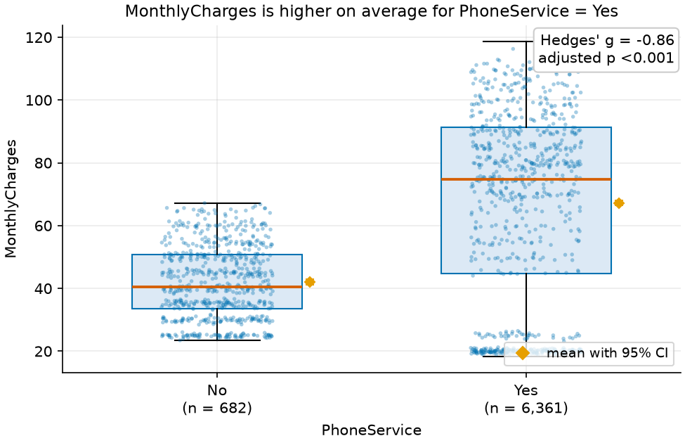

| | |
| :--- | :--- |
| Test used | Welch's t-test |
| Test statistic | -43.36 |
| Degrees of freedom | 1,991.1 |
| Raw p-value | <0.001 |
| Adjusted p-value (q) | <0.001 |
| Effect size | Hedges' g = -0.86 (95% CI -0.94 to -0.78), large |
| Records used | 7,043 |

How was this tested?

Both groups looked close enough to normal (or were large enough), so the means were compared with Welch's t-test, which does not assume equal spreads.

Where do the numbers come from?

| Fact | Shown as | Comes from |
| :--- | :--- | :--- |
| `alt_effect_value` | -0.47 | `TestResult.descriptives.sensitivity_alt_test.effect_value` |
| `alt_test_name` | Mann-Whitney U test | `TestResult.descriptives.sensitivity_alt_test.test_name` |
| `ci_high` | -0.78 | `TestResult.effect.ci_high` |
| `ci_low` | -0.94 | `TestResult.effect.ci_low` |
| `col_a` | MonthlyCharges | `Hypothesis.column_a` |
| `col_b` | PhoneService | `Hypothesis.column_b` |
| `comparable_value` | 0.86 | `TestResult.effect.comparable_value` |
| `df` | 1,991.1 | `TestResult.df` |
| `direction_word` | b_greater | `TestResult.direction_observed` |
| `effect_abs` | 0.86 | `abs(TestResult.effect.value)` |
| `effect_name` | Hedges' g | `TestResult.effect.name` |
| `effect_value` | -0.86 | `TestResult.effect.value` |
| `family_size` | 190 | `ValidationDecision.family_size` |
| `g1` | No | `TestResult.descriptives.group_order[0]` |
| `g2` | Yes | `TestResult.descriptives.group_order[1]` |
| `group_label0` | No | `TestResult.group_sizes key 0` |
| `group_label1` | Yes | `TestResult.group_sizes key 1` |
| `group_size0` | 682 | `TestResult.group_sizes[No]` |
| `group_size1` | 6,361 | `TestResult.group_sizes[Yes]` |
| `higher_group` | Yes | `TestResult.descriptives.higher_group` |
| `magnitude_label` | large | `TestResult.effect.magnitude` |
| `mean_diff` | -25.17 | `TestResult.descriptives.mean_diff` |
| `mean_diff_abs` | 25.17 | `abs(TestResult.descriptives.mean_diff)` |
| `mean_diff_ci_high` | -24.03 | `TestResult.descriptives.mean_diff_ci_high` |
| `mean_diff_ci_low` | -26.31 | `TestResult.descriptives.mean_diff_ci_low` |
| `mean_g1` | 42.03 | `TestResult.descriptives.groups[No].mean` |
| `mean_g2` | 67.20 | `TestResult.descriptives.groups[Yes].mean` |
| `mean_high` | 67.20 | `same as mean_g2` |
| `mean_other` | 42.03 | `same as mean_g1` |
| `median_g1` | 40.58 | `TestResult.descriptives.groups[No].median` |
| `median_g2` | 74.70 | `TestResult.descriptives.groups[Yes].median` |
| `median_high` | 74.70 | `same as median_g2` |
| `median_other` | 40.58 | `same as median_g1` |
| `n_g1` | 682 | `TestResult.descriptives.groups[No].n` |
| `n_g2` | 6,361 | `TestResult.descriptives.groups[Yes].n` |
| `n_groups` | 2 | `len(TestResult.group_sizes)` |
| `n_used` | 7,043 | `TestResult.n_used` |
| `other_group` | No | `the other group in TestResult.descriptives.group_order` |
| `p_raw` | <0.001 | `ValidationDecision.p_raw` |
| `q_value` | <0.001 | `ValidationDecision.q_value` |
| `sd_g1` | 11.42 | `TestResult.descriptives.groups[No].sd` |
| `sd_g2` | 30.45 | `TestResult.descriptives.groups[Yes].sd` |
| `statistic` | -43.36 | `TestResult.statistic` |
| `test_name` | Welch's t-test | `TestResult.test_name` |

### 2.24 `tenure` ↔ `Churn`

Among 7,043 records, the average tenure was 37.57 for Churn = No and 17.98 for Churn = Yes (difference 19.59, 95% CI 18.49 to 20.69). On average, tenure is higher for Churn = No. The difference is large (Hedges' g = 0.85, 95% CI 0.80 to 0.91). After correcting for 190 tests (Benjamini-Hochberg method, false discovery rate 5.0%), the association is statistically supported (adjusted p <0.001). This is an association, not evidence of cause and effect.

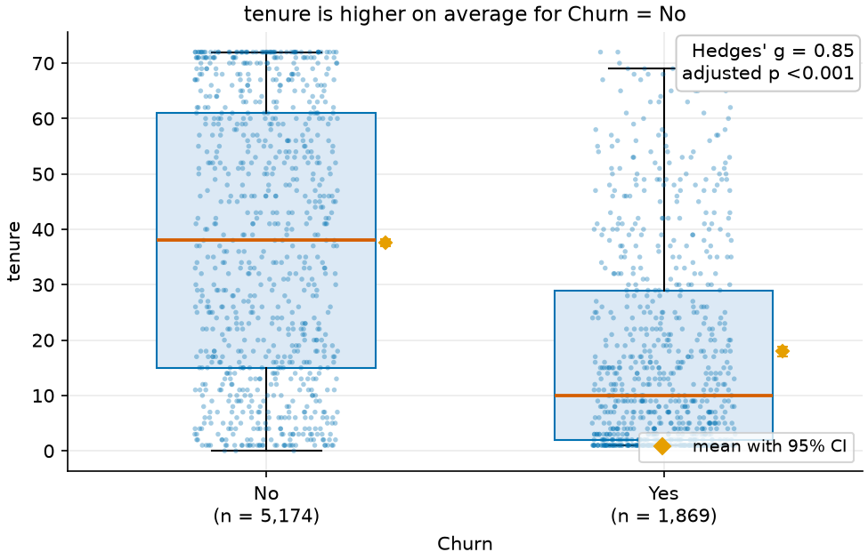

| | |
| :--- | :--- |
| Test used | Welch's t-test |
| Test statistic | 34.82 |
| Degrees of freedom | 4,048.3 |
| Raw p-value | <0.001 |
| Adjusted p-value (q) | <0.001 |
| Effect size | Hedges' g = 0.85 (95% CI 0.80 to 0.91), large |
| Records used | 7,043 |

How was this tested?

Both groups looked close enough to normal (or were large enough), so the means were compared with Welch's t-test, which does not assume equal spreads.

Where do the numbers come from?

| Fact | Shown as | Comes from |
| :--- | :--- | :--- |
| `alt_effect_value` | 0.48 | `TestResult.descriptives.sensitivity_alt_test.effect_value` |
| `alt_test_name` | Mann-Whitney U test | `TestResult.descriptives.sensitivity_alt_test.test_name` |
| `ci_high` | 0.91 | `TestResult.effect.ci_high` |
| `ci_low` | 0.80 | `TestResult.effect.ci_low` |
| `col_a` | tenure | `Hypothesis.column_a` |
| `col_b` | Churn | `Hypothesis.column_b` |
| `comparable_value` | 0.85 | `TestResult.effect.comparable_value` |
| `df` | 4,048.3 | `TestResult.df` |
| `direction_word` | a_greater | `TestResult.direction_observed` |
| `effect_abs` | 0.85 | `abs(TestResult.effect.value)` |
| `effect_name` | Hedges' g | `TestResult.effect.name` |
| `effect_value` | 0.85 | `TestResult.effect.value` |
| `family_size` | 190 | `ValidationDecision.family_size` |
| `g1` | No | `TestResult.descriptives.group_order[0]` |
| `g2` | Yes | `TestResult.descriptives.group_order[1]` |
| `group_label0` | No | `TestResult.group_sizes key 0` |
| `group_label1` | Yes | `TestResult.group_sizes key 1` |
| `group_size0` | 5,174 | `TestResult.group_sizes[No]` |
| `group_size1` | 1,869 | `TestResult.group_sizes[Yes]` |
| `higher_group` | No | `TestResult.descriptives.higher_group` |
| `magnitude_label` | large | `TestResult.effect.magnitude` |
| `mean_diff` | 19.59 | `TestResult.descriptives.mean_diff` |
| `mean_diff_abs` | 19.59 | `abs(TestResult.descriptives.mean_diff)` |
| `mean_diff_ci_high` | 20.69 | `TestResult.descriptives.mean_diff_ci_high` |
| `mean_diff_ci_low` | 18.49 | `TestResult.descriptives.mean_diff_ci_low` |
| `mean_g1` | 37.57 | `TestResult.descriptives.groups[No].mean` |
| `mean_g2` | 17.98 | `TestResult.descriptives.groups[Yes].mean` |
| `mean_high` | 37.57 | `same as mean_g1` |
| `mean_other` | 17.98 | `same as mean_g2` |
| `median_g1` | 38.00 | `TestResult.descriptives.groups[No].median` |
| `median_g2` | 10.00 | `TestResult.descriptives.groups[Yes].median` |
| `median_high` | 38.00 | `same as median_g1` |
| `median_other` | 10.00 | `same as median_g2` |
| `n_g1` | 5,174 | `TestResult.descriptives.groups[No].n` |
| `n_g2` | 1,869 | `TestResult.descriptives.groups[Yes].n` |
| `n_groups` | 2 | `len(TestResult.group_sizes)` |
| `n_used` | 7,043 | `TestResult.n_used` |
| `other_group` | Yes | `the other group in TestResult.descriptives.group_order` |
| `p_raw` | <0.001 | `ValidationDecision.p_raw` |
| `q_value` | <0.001 | `ValidationDecision.q_value` |
| `sd_g1` | 24.11 | `TestResult.descriptives.groups[No].sd` |
| `sd_g2` | 19.53 | `TestResult.descriptives.groups[Yes].sd` |
| `statistic` | 34.82 | `TestResult.statistic` |
| `test_name` | Welch's t-test | `TestResult.test_name` |

### 2.25 `tenure` ↔ `Partner`

Among 7,043 records, the average tenure was 23.36 for Partner = No and 42.02 for Partner = Yes (difference -18.66, 95% CI -19.72 to -17.59). On average, tenure is higher for Partner = Yes. The difference is large (Hedges' g = -0.82, 95% CI -0.87 to -0.77). After correcting for 190 tests (Benjamini-Hochberg method, false discovery rate 5.0%), the association is statistically supported (adjusted p <0.001). This is an association, not evidence of cause and effect.

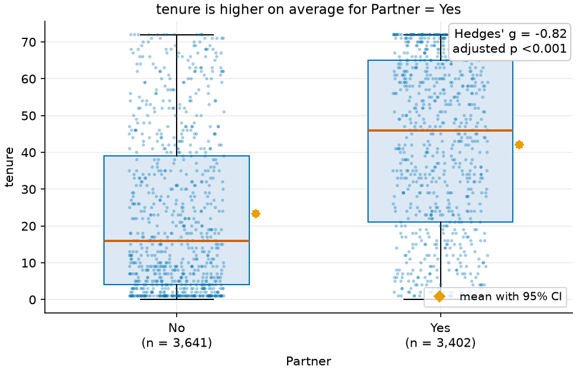

| | |
| :--- | :--- |
| Test used | Welch's t-test |
| Test statistic | -34.34 |
| Degrees of freedom | 6,881.3 |
| Raw p-value | <0.001 |
| Adjusted p-value (q) | <0.001 |
| Effect size | Hedges' g = -0.82 (95% CI -0.87 to -0.77), large |
| Records used | 7,043 |

How was this tested?

Both groups looked close enough to normal (or were large enough), so the means were compared with Welch's t-test, which does not assume equal spreads.

Where do the numbers come from?

| Fact | Shown as | Comes from |
| :--- | :--- | :--- |
| `alt_effect_value` | -0.44 | `TestResult.descriptives.sensitivity_alt_test.effect_value` |
| `alt_test_name` | Mann-Whitney U test | `TestResult.descriptives.sensitivity_alt_test.test_name` |
| `ci_high` | -0.77 | `TestResult.effect.ci_high` |
| `ci_low` | -0.87 | `TestResult.effect.ci_low` |
| `col_a` | tenure | `Hypothesis.column_a` |
| `col_b` | Partner | `Hypothesis.column_b` |
| `comparable_value` | 0.82 | `TestResult.effect.comparable_value` |
| `df` | 6,881.3 | `TestResult.df` |
| `direction_word` | b_greater | `TestResult.direction_observed` |
| `effect_abs` | 0.82 | `abs(TestResult.effect.value)` |
| `effect_name` | Hedges' g | `TestResult.effect.name` |
| `effect_value` | -0.82 | `TestResult.effect.value` |
| `family_size` | 190 | `ValidationDecision.family_size` |
| `g1` | No | `TestResult.descriptives.group_order[0]` |
| `g2` | Yes | `TestResult.descriptives.group_order[1]` |
| `group_label0` | No | `TestResult.group_sizes key 0` |
| `group_label1` | Yes | `TestResult.group_sizes key 1` |
| `group_size0` | 3,641 | `TestResult.group_sizes[No]` |
| `group_size1` | 3,402 | `TestResult.group_sizes[Yes]` |
| `higher_group` | Yes | `TestResult.descriptives.higher_group` |
| `magnitude_label` | large | `TestResult.effect.magnitude` |
| `mean_diff` | -18.66 | `TestResult.descriptives.mean_diff` |
| `mean_diff_abs` | 18.66 | `abs(TestResult.descriptives.mean_diff)` |
| `mean_diff_ci_high` | -17.59 | `TestResult.descriptives.mean_diff_ci_high` |
| `mean_diff_ci_low` | -19.72 | `TestResult.descriptives.mean_diff_ci_low` |
| `mean_g1` | 23.36 | `TestResult.descriptives.groups[No].mean` |
| `mean_g2` | 42.02 | `TestResult.descriptives.groups[Yes].mean` |
| `mean_high` | 42.02 | `same as mean_g2` |
| `mean_other` | 23.36 | `same as mean_g1` |
| `median_g1` | 16.00 | `TestResult.descriptives.groups[No].median` |
| `median_g2` | 46.00 | `TestResult.descriptives.groups[Yes].median` |
| `median_high` | 46.00 | `same as median_g2` |
| `median_other` | 16.00 | `same as median_g1` |
| `n_g1` | 3,641 | `TestResult.descriptives.groups[No].n` |
| `n_g2` | 3,402 | `TestResult.descriptives.groups[Yes].n` |
| `n_groups` | 2 | `len(TestResult.group_sizes)` |
| `n_used` | 7,043 | `TestResult.n_used` |
| `other_group` | No | `the other group in TestResult.descriptives.group_order` |
| `p_raw` | <0.001 | `ValidationDecision.p_raw` |
| `q_value` | <0.001 | `ValidationDecision.q_value` |
| `sd_g1` | 21.77 | `TestResult.descriptives.groups[No].sd` |
| `sd_g2` | 23.70 | `TestResult.descriptives.groups[Yes].sd` |
| `statistic` | -34.34 | `TestResult.statistic` |
| `test_name` | Welch's t-test | `TestResult.test_name` |

### 2.26 `MonthlyCharges` ↔ `InternetService`

The average MonthlyCharges differs across the 3 groups of InternetService: highest for Fiber optic (mean 91.50) and lowest for No (mean 21.08). About 82.1% of the variation in MonthlyCharges is associated with InternetService (eta squared = 0.82, 95% CI 0.82 to 0.83, large). After correcting for 190 tests (Benjamini-Hochberg method, false discovery rate 5.0%), the association is statistically supported (adjusted p <0.001). This is an association, not evidence of cause and effect.

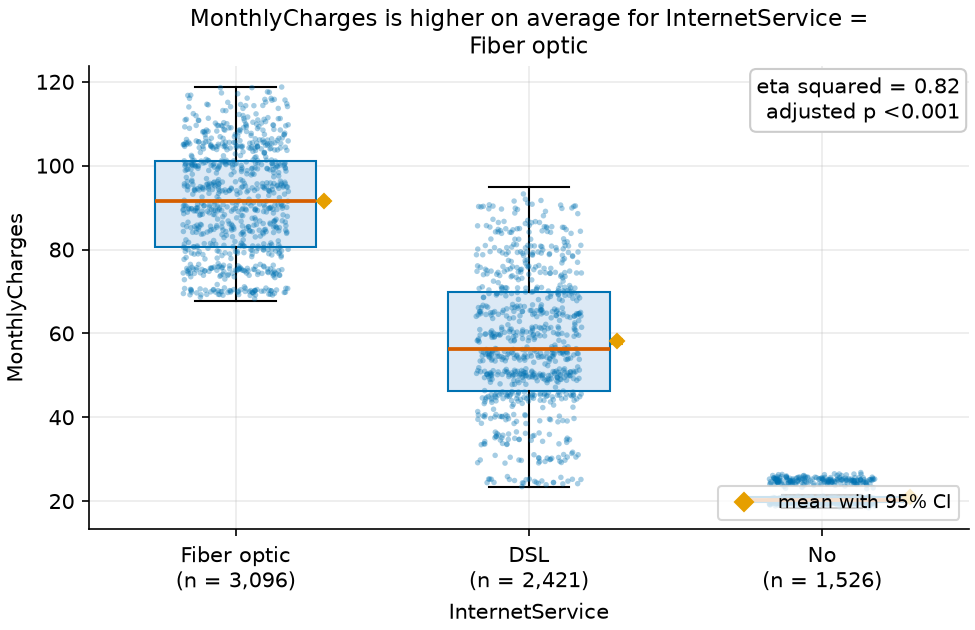

| | |
| :--- | :--- |
| Test used | Welch's ANOVA |
| Test statistic | 50,068.86 |
| Degrees of freedom | 2 and 3,891.7 |
| Raw p-value | <0.001 |
| Adjusted p-value (q) | <0.001 |
| Effect size | eta squared = 0.82 (95% CI 0.82 to 0.83), large |
| Records used | 7,043 |

How was this tested?

All groups looked close enough to normal (or were large enough), so the group means were compared with Welch's ANOVA, which does not assume equal spreads.

Where do the numbers come from?

| Fact | Shown as | Comes from |
| :--- | :--- | :--- |
| `ci_high` | 0.83 | `TestResult.effect.ci_high` |
| `ci_low` | 0.82 | `TestResult.effect.ci_low` |
| `col_a` | MonthlyCharges | `Hypothesis.column_a` |
| `col_b` | InternetService | `Hypothesis.column_b` |
| `comparable_value` | 0.82 | `TestResult.effect.comparable_value` |
| `df1` | 2 | `TestResult.df[0]` |
| `df2` | 3,891.7 | `TestResult.df[1]` |
| `direction_word` | any | `TestResult.direction_observed` |
| `effect_abs` | 0.82 | `abs(TestResult.effect.value)` |
| `effect_name` | eta squared | `TestResult.effect.name` |
| `effect_value` | 0.82 | `TestResult.effect.value` |
| `eta_sq_pct` | 82.1% | `100 * TestResult.effect.value (eta_squared)` |
| `family_size` | 190 | `ValidationDecision.family_size` |
| `g1` | DSL | `TestResult.descriptives.group_order[0]` |
| `g2` | Fiber optic | `TestResult.descriptives.group_order[1]` |
| `g3` | No | `TestResult.descriptives.group_order[2]` |
| `group_label0` | DSL | `TestResult.group_sizes key 0` |
| `group_label1` | Fiber optic | `TestResult.group_sizes key 1` |
| `group_label2` | No | `TestResult.group_sizes key 2` |
| `group_size0` | 2,421 | `TestResult.group_sizes[DSL]` |
| `group_size1` | 3,096 | `TestResult.group_sizes[Fiber optic]` |
| `group_size2` | 1,526 | `TestResult.group_sizes[No]` |
| `highest_group` | Fiber optic | `TestResult.descriptives.highest_group` |
| `lowest_group` | No | `TestResult.descriptives.lowest_group` |
| `magnitude_label` | large | `TestResult.effect.magnitude` |
| `mean_g1` | 58.10 | `TestResult.descriptives.groups[DSL].mean` |
| `mean_g2` | 91.50 | `TestResult.descriptives.groups[Fiber optic].mean` |
| `mean_g3` | 21.08 | `TestResult.descriptives.groups[No].mean` |
| `mean_high` | 91.50 | `same as mean_g2` |
| `mean_low` | 21.08 | `same as mean_g3` |
| `median_g1` | 56.15 | `TestResult.descriptives.groups[DSL].median` |
| `median_g2` | 91.68 | `TestResult.descriptives.groups[Fiber optic].median` |
| `median_g3` | 20.15 | `TestResult.descriptives.groups[No].median` |
| `median_high` | 91.68 | `same as median_g2` |
| `median_low` | 20.15 | `same as median_g3` |
| `n_g1` | 2,421 | `TestResult.descriptives.groups[DSL].n` |
| `n_g2` | 3,096 | `TestResult.descriptives.groups[Fiber optic].n` |
| `n_g3` | 1,526 | `TestResult.descriptives.groups[No].n` |
| `n_groups` | 3 | `len(TestResult.group_sizes)` |
| `n_used` | 7,043 | `TestResult.n_used` |
| `omega_squared` | 0.82 | `TestResult.descriptives.omega_squared` |
| `other_group` | DSL | `the other group in TestResult.descriptives.group_order` |
| `p_raw` | <0.001 | `ValidationDecision.p_raw` |
| `q_value` | <0.001 | `ValidationDecision.q_value` |
| `sd_g1` | 16.26 | `TestResult.descriptives.groups[DSL].sd` |
| `sd_g2` | 12.66 | `TestResult.descriptives.groups[Fiber optic].sd` |
| `sd_g3` | 2.16 | `TestResult.descriptives.groups[No].sd` |
| `statistic` | 50,068.86 | `TestResult.statistic` |
| `test_name` | Welch's ANOVA | `TestResult.test_name` |

### 2.27 `MonthlyCharges` ↔ `PaperlessBilling`

Among 7,043 records, the average MonthlyCharges was 51.99 for PaperlessBilling = No and 73.55 for PaperlessBilling = Yes (difference -21.56, 95% CI -22.92 to -20.20). On average, MonthlyCharges is higher for PaperlessBilling = Yes. The difference is medium (Hedges' g = -0.77, 95% CI -0.81 to -0.72). After correcting for 190 tests (Benjamini-Hochberg method, false discovery rate 5.0%), the association is statistically supported (adjusted p <0.001). This is an association, not evidence of cause and effect.

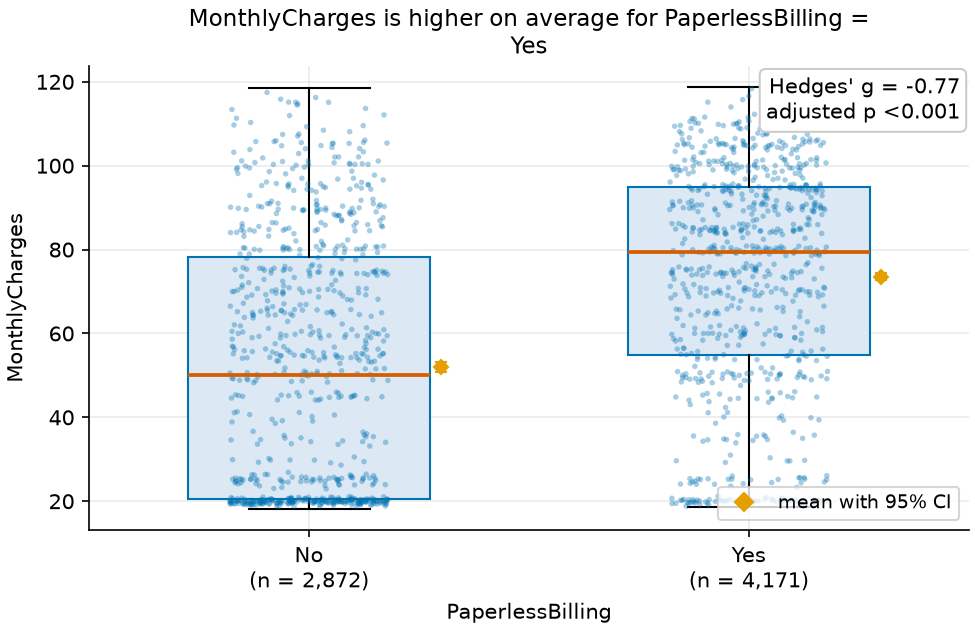

| | |
| :--- | :--- |
| Test used | Welch's t-test |
| Test statistic | -31.04 |
| Degrees of freedom | 5,789.0 |
| Raw p-value | <0.001 |
| Adjusted p-value (q) | <0.001 |
| Effect size | Hedges' g = -0.77 (95% CI -0.81 to -0.72), medium |
| Records used | 7,043 |

How was this tested?

Both groups looked close enough to normal (or were large enough), so the means were compared with Welch's t-test, which does not assume equal spreads.

Where do the numbers come from?

| Fact | Shown as | Comes from |
| :--- | :--- | :--- |
| `alt_effect_value` | -0.41 | `TestResult.descriptives.sensitivity_alt_test.effect_value` |
| `alt_test_name` | Mann-Whitney U test | `TestResult.descriptives.sensitivity_alt_test.test_name` |
| `ci_high` | -0.72 | `TestResult.effect.ci_high` |
| `ci_low` | -0.81 | `TestResult.effect.ci_low` |
| `col_a` | MonthlyCharges | `Hypothesis.column_a` |
| `col_b` | PaperlessBilling | `Hypothesis.column_b` |
| `comparable_value` | 0.77 | `TestResult.effect.comparable_value` |
| `df` | 5,789.0 | `TestResult.df` |
| `direction_word` | b_greater | `TestResult.direction_observed` |
| `effect_abs` | 0.77 | `abs(TestResult.effect.value)` |
| `effect_name` | Hedges' g | `TestResult.effect.name` |
| `effect_value` | -0.77 | `TestResult.effect.value` |
| `family_size` | 190 | `ValidationDecision.family_size` |
| `g1` | No | `TestResult.descriptives.group_order[0]` |
| `g2` | Yes | `TestResult.descriptives.group_order[1]` |
| `group_label0` | No | `TestResult.group_sizes key 0` |
| `group_label1` | Yes | `TestResult.group_sizes key 1` |
| `group_size0` | 2,872 | `TestResult.group_sizes[No]` |
| `group_size1` | 4,171 | `TestResult.group_sizes[Yes]` |
| `higher_group` | Yes | `TestResult.descriptives.higher_group` |
| `magnitude_label` | medium | `TestResult.effect.magnitude` |
| `mean_diff` | -21.56 | `TestResult.descriptives.mean_diff` |
| `mean_diff_abs` | 21.56 | `abs(TestResult.descriptives.mean_diff)` |
| `mean_diff_ci_high` | -20.20 | `TestResult.descriptives.mean_diff_ci_high` |
| `mean_diff_ci_low` | -22.92 | `TestResult.descriptives.mean_diff_ci_low` |
| `mean_g1` | 51.99 | `TestResult.descriptives.groups[No].mean` |
| `mean_g2` | 73.55 | `TestResult.descriptives.groups[Yes].mean` |
| `mean_high` | 73.55 | `same as mean_g2` |
| `mean_other` | 51.99 | `same as mean_g1` |
| `median_g1` | 50.17 | `TestResult.descriptives.groups[No].median` |
| `median_g2` | 79.45 | `TestResult.descriptives.groups[Yes].median` |
| `median_high` | 79.45 | `same as median_g2` |
| `median_other` | 50.17 | `same as median_g1` |
| `n_g1` | 2,872 | `TestResult.descriptives.groups[No].n` |
| `n_g2` | 4,171 | `TestResult.descriptives.groups[Yes].n` |
| `n_groups` | 2 | `len(TestResult.group_sizes)` |
| `n_used` | 7,043 | `TestResult.n_used` |
| `other_group` | No | `the other group in TestResult.descriptives.group_order` |
| `p_raw` | <0.001 | `ValidationDecision.p_raw` |
| `q_value` | <0.001 | `ValidationDecision.q_value` |
| `sd_g1` | 29.70 | `TestResult.descriptives.groups[No].sd` |
| `sd_g2` | 27.06 | `TestResult.descriptives.groups[Yes].sd` |
| `statistic` | -31.04 | `TestResult.statistic` |
| `test_name` | Welch's t-test | `TestResult.test_name` |

### 2.28 `MonthlyCharges` ↔ `StreamingTV`

The average MonthlyCharges differs across the 3 groups of StreamingTV: highest for Yes (mean 88.74) and lowest for No internet service (mean 21.08). About 70.1% of the variation in MonthlyCharges is associated with StreamingTV (eta squared = 0.70, 95% CI 0.69 to 0.71, large). After correcting for 190 tests (Benjamini-Hochberg method, false discovery rate 5.0%), the association is statistically supported (adjusted p <0.001). This is an association, not evidence of cause and effect.

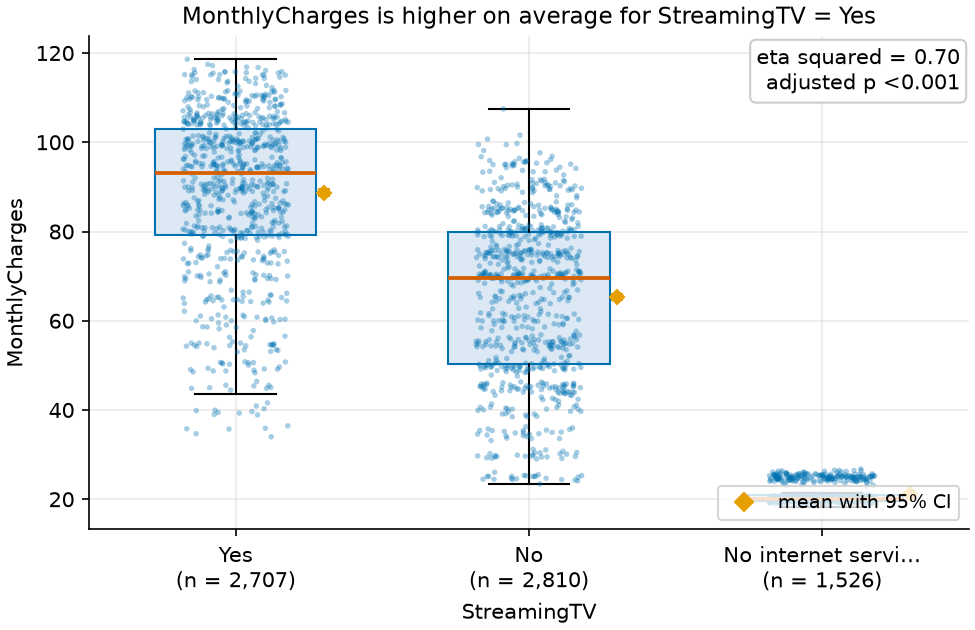

| | |
| :--- | :--- |
| Test used | Welch's ANOVA |
| Test statistic | 25,004.82 |
| Degrees of freedom | 2 and 3,845.9 |
| Raw p-value | <0.001 |
| Adjusted p-value (q) | <0.001 |
| Effect size | eta squared = 0.70 (95% CI 0.69 to 0.71), large |
| Records used | 7,043 |

How was this tested?

All groups looked close enough to normal (or were large enough), so the group means were compared with Welch's ANOVA, which does not assume equal spreads.

Where do the numbers come from?

| Fact | Shown as | Comes from |
| :--- | :--- | :--- |
| `ci_high` | 0.71 | `TestResult.effect.ci_high` |
| `ci_low` | 0.69 | `TestResult.effect.ci_low` |
| `col_a` | MonthlyCharges | `Hypothesis.column_a` |
| `col_b` | StreamingTV | `Hypothesis.column_b` |
| `comparable_value` | 0.70 | `TestResult.effect.comparable_value` |
| `df1` | 2 | `TestResult.df[0]` |
| `df2` | 3,845.9 | `TestResult.df[1]` |
| `direction_word` | any | `TestResult.direction_observed` |
| `effect_abs` | 0.70 | `abs(TestResult.effect.value)` |
| `effect_name` | eta squared | `TestResult.effect.name` |
| `effect_value` | 0.70 | `TestResult.effect.value` |
| `eta_sq_pct` | 70.1% | `100 * TestResult.effect.value (eta_squared)` |
| `family_size` | 190 | `ValidationDecision.family_size` |
| `g1` | No | `TestResult.descriptives.group_order[0]` |
| `g2` | No internet service | `TestResult.descriptives.group_order[1]` |
| `g3` | Yes | `TestResult.descriptives.group_order[2]` |
| `group_label0` | No | `TestResult.group_sizes key 0` |
| `group_label1` | No internet service | `TestResult.group_sizes key 1` |
| `group_label2` | Yes | `TestResult.group_sizes key 2` |
| `group_size0` | 2,810 | `TestResult.group_sizes[No]` |
| `group_size1` | 1,526 | `TestResult.group_sizes[No internet service]` |
| `group_size2` | 2,707 | `TestResult.group_sizes[Yes]` |
| `highest_group` | Yes | `TestResult.descriptives.highest_group` |
| `lowest_group` | No internet service | `TestResult.descriptives.lowest_group` |
| `magnitude_label` | large | `TestResult.effect.magnitude` |
| `mean_g1` | 65.39 | `TestResult.descriptives.groups[No].mean` |
| `mean_g2` | 21.08 | `TestResult.descriptives.groups[No internet service].mean` |
| `mean_g3` | 88.74 | `TestResult.descriptives.groups[Yes].mean` |
| `mean_high` | 88.74 | `same as mean_g3` |
| `mean_low` | 21.08 | `same as mean_g2` |
| `median_g1` | 69.60 | `TestResult.descriptives.groups[No].median` |
| `median_g2` | 20.15 | `TestResult.descriptives.groups[No internet service].median` |
| `median_g3` | 93.20 | `TestResult.descriptives.groups[Yes].median` |
| `median_high` | 93.20 | `same as median_g3` |
| `median_low` | 20.15 | `same as median_g2` |
| `n_g1` | 2,810 | `TestResult.descriptives.groups[No].n` |
| `n_g2` | 1,526 | `TestResult.descriptives.groups[No internet service].n` |
| `n_g3` | 2,707 | `TestResult.descriptives.groups[Yes].n` |
| `n_groups` | 3 | `len(TestResult.group_sizes)` |
| `n_used` | 7,043 | `TestResult.n_used` |
| `omega_squared` | 0.70 | `TestResult.descriptives.omega_squared` |
| `other_group` | No | `the other group in TestResult.descriptives.group_order` |
| `p_raw` | <0.001 | `ValidationDecision.p_raw` |
| `q_value` | <0.001 | `ValidationDecision.q_value` |
| `sd_g1` | 18.72 | `TestResult.descriptives.groups[No].sd` |
| `sd_g2` | 2.16 | `TestResult.descriptives.groups[No internet service].sd` |
| `sd_g3` | 18.39 | `TestResult.descriptives.groups[Yes].sd` |
| `statistic` | 25,004.82 | `TestResult.statistic` |
| `test_name` | Welch's ANOVA | `TestResult.test_name` |

### 2.29 `MonthlyCharges` ↔ `StreamingMovies`

The average MonthlyCharges differs across the 3 groups of StreamingMovies: highest for Yes (mean 88.48) and lowest for No internet service (mean 21.08). About 69.8% of the variation in MonthlyCharges is associated with StreamingMovies (eta squared = 0.70, 95% CI 0.69 to 0.71, large). After correcting for 190 tests (Benjamini-Hochberg method, false discovery rate 5.0%), the association is statistically supported (adjusted p <0.001). This is an association, not evidence of cause and effect.

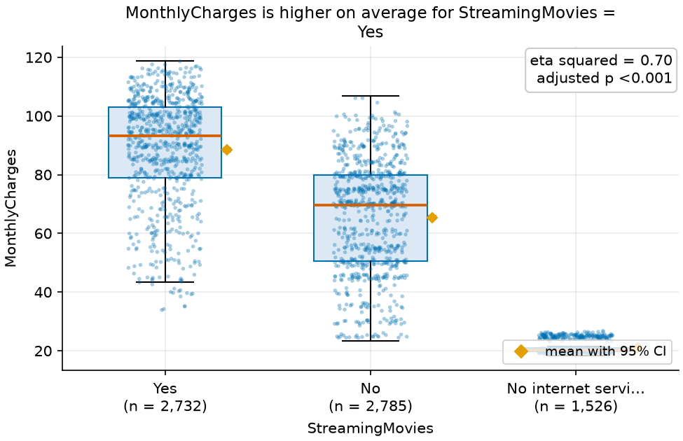

| | |
| :--- | :--- |
| Test used | Welch's ANOVA |
| Test statistic | 24,614.32 |
| Degrees of freedom | 2 and 3,845.2 |
| Raw p-value | <0.001 |
| Adjusted p-value (q) | <0.001 |
| Effect size | eta squared = 0.70 (95% CI 0.69 to 0.71), large |
| Records used | 7,043 |

How was this tested?

All groups looked close enough to normal (or were large enough), so the group means were compared with Welch's ANOVA, which does not assume equal spreads.

Where do the numbers come from?

| Fact | Shown as | Comes from |
| :--- | :--- | :--- |
| `ci_high` | 0.71 | `TestResult.effect.ci_high` |
| `ci_low` | 0.69 | `TestResult.effect.ci_low` |
| `col_a` | MonthlyCharges | `Hypothesis.column_a` |
| `col_b` | StreamingMovies | `Hypothesis.column_b` |
| `comparable_value` | 0.70 | `TestResult.effect.comparable_value` |
| `df1` | 2 | `TestResult.df[0]` |
| `df2` | 3,845.2 | `TestResult.df[1]` |
| `direction_word` | any | `TestResult.direction_observed` |
| `effect_abs` | 0.70 | `abs(TestResult.effect.value)` |
| `effect_name` | eta squared | `TestResult.effect.name` |
| `effect_value` | 0.70 | `TestResult.effect.value` |
| `eta_sq_pct` | 69.8% | `100 * TestResult.effect.value (eta_squared)` |
| `family_size` | 190 | `ValidationDecision.family_size` |
| `g1` | No | `TestResult.descriptives.group_order[0]` |
| `g2` | No internet service | `TestResult.descriptives.group_order[1]` |
| `g3` | Yes | `TestResult.descriptives.group_order[2]` |
| `group_label0` | No | `TestResult.group_sizes key 0` |
| `group_label1` | No internet service | `TestResult.group_sizes key 1` |
| `group_label2` | Yes | `TestResult.group_sizes key 2` |
| `group_size0` | 2,785 | `TestResult.group_sizes[No]` |
| `group_size1` | 1,526 | `TestResult.group_sizes[No internet service]` |
| `group_size2` | 2,732 | `TestResult.group_sizes[Yes]` |
| `highest_group` | Yes | `TestResult.descriptives.highest_group` |
| `lowest_group` | No internet service | `TestResult.descriptives.lowest_group` |
| `magnitude_label` | large | `TestResult.effect.magnitude` |
| `mean_g1` | 65.43 | `TestResult.descriptives.groups[No].mean` |
| `mean_g2` | 21.08 | `TestResult.descriptives.groups[No internet service].mean` |
| `mean_g3` | 88.48 | `TestResult.descriptives.groups[Yes].mean` |
| `mean_high` | 88.48 | `same as mean_g3` |
| `mean_low` | 21.08 | `same as mean_g2` |
| `median_g1` | 69.65 | `TestResult.descriptives.groups[No].median` |
| `median_g2` | 20.15 | `TestResult.descriptives.groups[No internet service].median` |
| `median_g3` | 93.20 | `TestResult.descriptives.groups[Yes].median` |
| `median_high` | 93.20 | `same as median_g3` |
| `median_low` | 20.15 | `same as median_g2` |
| `n_g1` | 2,785 | `TestResult.descriptives.groups[No].n` |
| `n_g2` | 1,526 | `TestResult.descriptives.groups[No internet service].n` |
| `n_g3` | 2,732 | `TestResult.descriptives.groups[Yes].n` |
| `n_groups` | 3 | `len(TestResult.group_sizes)` |
| `n_used` | 7,043 | `TestResult.n_used` |
| `omega_squared` | 0.70 | `TestResult.descriptives.omega_squared` |
| `other_group` | No | `the other group in TestResult.descriptives.group_order` |
| `p_raw` | <0.001 | `ValidationDecision.p_raw` |
| `q_value` | <0.001 | `ValidationDecision.q_value` |
| `sd_g1` | 18.71 | `TestResult.descriptives.groups[No].sd` |
| `sd_g2` | 2.16 | `TestResult.descriptives.groups[No internet service].sd` |
| `sd_g3` | 18.60 | `TestResult.descriptives.groups[Yes].sd` |
| `statistic` | 24,614.32 | `TestResult.statistic` |
| `test_name` | Welch's ANOVA | `TestResult.test_name` |

### 2.30 `TotalCharges` ↔ `Partner`

Among 7,032 records, the average TotalCharges was 1,584.96 for Partner = No and 3,032.27 for Partner = Yes (difference -1,447.31, 95% CI -1,548.69 to -1,345.94). On average, TotalCharges is higher for Partner = Yes. The difference is medium (Hedges' g = -0.67, 95% CI -0.72 to -0.63). After correcting for 190 tests (Benjamini-Hochberg method, false discovery rate 5.0%), the association is statistically supported (adjusted p <0.001). This is an association, not evidence of cause and effect.

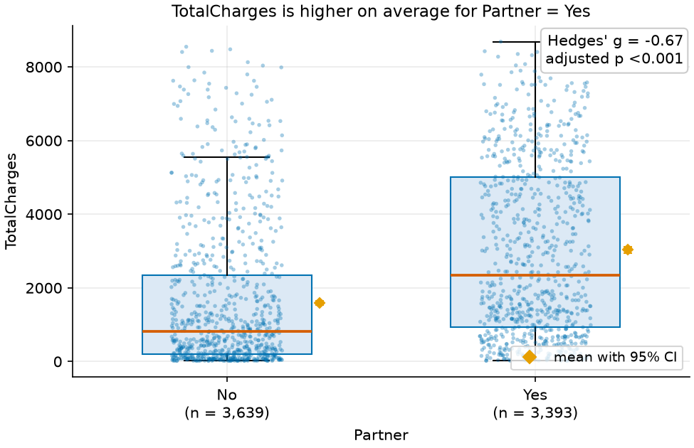

| | |
| :--- | :--- |
| Test used | Welch's t-test |
| Test statistic | -27.99 |
| Degrees of freedom | 6,403.3 |
| Raw p-value | <0.001 |
| Adjusted p-value (q) | <0.001 |
| Effect size | Hedges' g = -0.67 (95% CI -0.72 to -0.63), medium |
| Records used | 7,032 |

How was this tested?

Both groups looked close enough to normal (or were large enough), so the means were compared with Welch's t-test, which does not assume equal spreads.

Where do the numbers come from?

| Fact | Shown as | Comes from |
| :--- | :--- | :--- |
| `alt_effect_value` | -0.40 | `TestResult.descriptives.sensitivity_alt_test.effect_value` |
| `alt_test_name` | Mann-Whitney U test | `TestResult.descriptives.sensitivity_alt_test.test_name` |
| `ci_high` | -0.63 | `TestResult.effect.ci_high` |
| `ci_low` | -0.72 | `TestResult.effect.ci_low` |
| `col_a` | TotalCharges | `Hypothesis.column_a` |
| `col_b` | Partner | `Hypothesis.column_b` |
| `comparable_value` | 0.67 | `TestResult.effect.comparable_value` |
| `df` | 6,403.3 | `TestResult.df` |
| `direction_word` | b_greater | `TestResult.direction_observed` |
| `effect_abs` | 0.67 | `abs(TestResult.effect.value)` |
| `effect_name` | Hedges' g | `TestResult.effect.name` |
| `effect_value` | -0.67 | `TestResult.effect.value` |
| `family_size` | 190 | `ValidationDecision.family_size` |
| `g1` | No | `TestResult.descriptives.group_order[0]` |
| `g2` | Yes | `TestResult.descriptives.group_order[1]` |
| `group_label0` | No | `TestResult.group_sizes key 0` |
| `group_label1` | Yes | `TestResult.group_sizes key 1` |
| `group_size0` | 3,639 | `TestResult.group_sizes[No]` |
| `group_size1` | 3,393 | `TestResult.group_sizes[Yes]` |
| `higher_group` | Yes | `TestResult.descriptives.higher_group` |
| `magnitude_label` | medium | `TestResult.effect.magnitude` |
| `mean_diff` | -1,447.31 | `TestResult.descriptives.mean_diff` |
| `mean_diff_abs` | 1,447.31 | `abs(TestResult.descriptives.mean_diff)` |
| `mean_diff_ci_high` | -1,345.94 | `TestResult.descriptives.mean_diff_ci_high` |
| `mean_diff_ci_low` | -1,548.69 | `TestResult.descriptives.mean_diff_ci_low` |
| `mean_g1` | 1,584.96 | `TestResult.descriptives.groups[No].mean` |
| `mean_g2` | 3,032.27 | `TestResult.descriptives.groups[Yes].mean` |
| `mean_high` | 3,032.27 | `same as mean_g2` |
| `mean_other` | 1,584.96 | `same as mean_g1` |
| `median_g1` | 811.80 | `TestResult.descriptives.groups[No].median` |
| `median_g2` | 2,347.90 | `TestResult.descriptives.groups[Yes].median` |
| `median_high` | 2,347.90 | `same as median_g2` |
| `median_other` | 811.80 | `same as median_g1` |
| `n_g1` | 3,639 | `TestResult.descriptives.groups[No].n` |
| `n_g2` | 3,393 | `TestResult.descriptives.groups[Yes].n` |
| `n_groups` | 2 | `len(TestResult.group_sizes)` |
| `n_used` | 7,032 | `TestResult.n_used` |
| `other_group` | No | `the other group in TestResult.descriptives.group_order` |
| `p_raw` | <0.001 | `ValidationDecision.p_raw` |
| `q_value` | <0.001 | `ValidationDecision.q_value` |
| `sd_g1` | 1,874.79 | `TestResult.descriptives.groups[No].sd` |
| `sd_g2` | 2,407.61 | `TestResult.descriptives.groups[Yes].sd` |
| `statistic` | -27.99 | `TestResult.statistic` |
| `test_name` | Welch's t-test | `TestResult.test_name` |

**Further validated findings** (not shown in full):

| Columns | Test | Effect | Adjusted p |
| :--- | :--- | :--- | :--- |
| `MonthlyCharges` ↔ `TotalCharges` | Spearman rank correlation test | Spearman rho = 0.64 | <0.001 |
| `MonthlyCharges` ↔ `DeviceProtection` | Welch's ANOVA | eta squared = 0.63 | <0.001 |
| `MonthlyCharges` ↔ `SeniorCitizen` | Welch's t-test | Hedges' g = -0.61 | <0.001 |
| `MonthlyCharges` ↔ `OnlineBackup` | Welch's ANOVA | eta squared = 0.61 | <0.001 |
| `MonthlyCharges` ↔ `TechSupport` | Welch's ANOVA | eta squared = 0.59 | <0.001 |
| `MonthlyCharges` ↔ `OnlineSecurity` | Welch's ANOVA | eta squared = 0.59 | <0.001 |
| `InternetService` ↔ `MultipleLines` | chi-square test of independence | Cramér's V = 0.40 | <0.001 |
| `Contract` ↔ `TechSupport` | chi-square test of independence | Cramér's V = 0.33 | <0.001 |
| `TotalCharges` ↔ `Churn` | Welch's t-test | Hedges' g = 0.46 | <0.001 |
| `tenure` ↔ `Contract` | Welch's ANOVA | eta squared = 0.46 | <0.001 |
| `Dependents` ↔ `Partner` | chi-square test of independence | Cramér's V = 0.45 | <0.001 |
| `InternetService` ↔ `PhoneService` | chi-square test of independence | Cramér's V = 0.45 | <0.001 |
| `MonthlyCharges` ↔ `Churn` | Welch's t-test | Hedges' g = -0.45 | <0.001 |
| `InternetService` ↔ `PaymentMethod` | chi-square test of independence | Cramér's V = 0.31 | <0.001 |
| `PaymentMethod` ↔ `TechSupport` | chi-square test of independence | Cramér's V = 0.31 | <0.001 |
| `OnlineSecurity` ↔ `PaymentMethod` | chi-square test of independence | Cramér's V = 0.30 | <0.001 |
| `Contract` ↔ `OnlineSecurity` | chi-square test of independence | Cramér's V = 0.30 | <0.001 |
| `Contract` ↔ `DeviceProtection` | chi-square test of independence | Cramér's V = 0.30 | <0.001 |
| `Churn` ↔ `Contract` | chi-square test of independence | Cramér's V = 0.41 | <0.001 |
| `DeviceProtection` ↔ `PaymentMethod` | chi-square test of independence | Cramér's V = 0.29 | <0.001 |
| `OnlineBackup` ↔ `PaymentMethod` | chi-square test of independence | Cramér's V = 0.28 | <0.001 |
| `PaymentMethod` ↔ `StreamingMovies` | chi-square test of independence | Cramér's V = 0.27 | <0.001 |
| `PaymentMethod` ↔ `StreamingTV` | chi-square test of independence | Cramér's V = 0.27 | <0.001 |
| `TotalCharges` ↔ `PhoneService` | Welch's t-test | Hedges' g = -0.38 | <0.001 |
| `InternetService` ↔ `PaperlessBilling` | chi-square test of independence | Cramér's V = 0.38 | <0.001 |
| `Contract` ↔ `PaymentMethod` | chi-square test of independence | Cramér's V = 0.27 | <0.001 |
| `MultipleLines` ↔ `StreamingMovies` | chi-square test of independence | Cramér's V = 0.26 | <0.001 |
| `MultipleLines` ↔ `StreamingTV` | chi-square test of independence | Cramér's V = 0.26 | <0.001 |
| `Contract` ↔ `OnlineBackup` | chi-square test of independence | Cramér's V = 0.26 | <0.001 |
| `tenure` ↔ `Dependents` | Welch's t-test | Hedges' g = -0.35 | <0.001 |
| `DeviceProtection` ↔ `MultipleLines` | chi-square test of independence | Cramér's V = 0.25 | <0.001 |
| `Churn` ↔ `OnlineSecurity` | chi-square test of independence | Cramér's V = 0.35 | <0.001 |
| `MultipleLines` ↔ `OnlineBackup` | chi-square test of independence | Cramér's V = 0.24 | <0.001 |
| `Churn` ↔ `TechSupport` | chi-square test of independence | Cramér's V = 0.34 | <0.001 |
| `OnlineSecurity` ↔ `PaperlessBilling` | chi-square test of independence | Cramér's V = 0.34 | <0.001 |
| `Contract` ↔ `StreamingMovies` | chi-square test of independence | Cramér's V = 0.24 | <0.001 |
| `PaperlessBilling` ↔ `StreamingTV` | chi-square test of independence | Cramér's V = 0.34 | <0.001 |
| `Contract` ↔ `StreamingTV` | chi-square test of independence | Cramér's V = 0.24 | <0.001 |
| `PaperlessBilling` ↔ `StreamingMovies` | chi-square test of independence | Cramér's V = 0.33 | <0.001 |
| `PaperlessBilling` ↔ `TechSupport` | chi-square test of independence | Cramér's V = 0.33 | <0.001 |
| `TotalCharges` ↔ `PaperlessBilling` | Welch's t-test | Hedges' g = -0.33 | <0.001 |
| `MultipleLines` ↔ `TechSupport` | chi-square test of independence | Cramér's V = 0.23 | <0.001 |
| `MultipleLines` ↔ `OnlineSecurity` | chi-square test of independence | Cramér's V = 0.23 | <0.001 |
| `Churn` ↔ `InternetService` | chi-square test of independence | Cramér's V = 0.32 | <0.001 |
| `DeviceProtection` ↔ `PaperlessBilling` | chi-square test of independence | Cramér's V = 0.32 | <0.001 |
| `OnlineBackup` ↔ `PaperlessBilling` | chi-square test of independence | Cramér's V = 0.32 | <0.001 |
| `TotalCharges` ↔ `DeviceProtection` | Welch's ANOVA | eta squared = 0.31 | <0.001 |
| `Churn` ↔ `PaymentMethod` | chi-square test of independence | Cramér's V = 0.30 | <0.001 |
| `TotalCharges` ↔ `StreamingMovies` | Welch's ANOVA | eta squared = 0.30 | <0.001 |
| `TotalCharges` ↔ `OnlineBackup` | Welch's ANOVA | eta squared = 0.30 | <0.001 |
| `TotalCharges` ↔ `StreamingTV` | Welch's ANOVA | eta squared = 0.30 | <0.001 |
| `Contract` ↔ `Partner` | chi-square test of independence | Cramér's V = 0.30 | <0.001 |
| `Churn` ↔ `OnlineBackup` | chi-square test of independence | Cramér's V = 0.29 | <0.001 |
| `Contract` ↔ `InternetService` | chi-square test of independence | Cramér's V = 0.21 | <0.001 |
| `Churn` ↔ `DeviceProtection` | chi-square test of independence | Cramér's V = 0.28 | <0.001 |
| `TotalCharges` ↔ `SeniorCitizen` | Welch's t-test | Hedges' g = -0.28 | <0.001 |
| `MonthlyCharges` ↔ `tenure` | Spearman rank correlation test | Spearman rho = 0.28 | <0.001 |
| `InternetService` ↔ `SeniorCitizen` | chi-square test of independence | Cramér's V = 0.26 | <0.001 |
| `MonthlyCharges` ↔ `MultipleLines` | Welch's ANOVA | eta squared = 0.25 | <0.001 |
| `MonthlyCharges` ↔ `Dependents` | Welch's t-test | Hedges' g = 0.25 | <0.001 |
| `PaperlessBilling` ↔ `PaymentMethod` | chi-square test of independence | Cramér's V = 0.25 | <0.001 |
| `TotalCharges` ↔ `TechSupport` | Welch's ANOVA | eta squared = 0.25 | <0.001 |
| `Contract` ↔ `Dependents` | chi-square test of independence | Cramér's V = 0.24 | <0.001 |
| `MultipleLines` ↔ `PaymentMethod` | chi-square test of independence | Cramér's V = 0.17 | <0.001 |
| `TotalCharges` ↔ `OnlineSecurity` | Welch's ANOVA | eta squared = 0.23 | <0.001 |
| `Churn` ↔ `StreamingMovies` | chi-square test of independence | Cramér's V = 0.23 | <0.001 |
| `Churn` ↔ `StreamingTV` | chi-square test of independence | Cramér's V = 0.23 | <0.001 |
| `SeniorCitizen` ↔ `TechSupport` | chi-square test of independence | Cramér's V = 0.22 | <0.001 |
| `TotalCharges` ↔ `MultipleLines` | Welch's ANOVA | eta squared = 0.22 | <0.001 |
| `Dependents` ↔ `SeniorCitizen` | chi-square test of independence | Cramér's V = 0.21 | <0.001 |
| `OnlineSecurity` ↔ `SeniorCitizen` | chi-square test of independence | Cramér's V = 0.21 | <0.001 |
| `TotalCharges` ↔ `Contract` | Welch's ANOVA | eta squared = 0.21 | <0.001 |
| `PaymentMethod` ↔ `SeniorCitizen` | chi-square test of independence | Cramér's V = 0.19 | <0.001 |
| `Dependents` ↔ `OnlineSecurity` | chi-square test of independence | Cramér's V = 0.19 | <0.001 |
| `Churn` ↔ `PaperlessBilling` | chi-square test of independence | Cramér's V = 0.19 | <0.001 |
| `SeniorCitizen` ↔ `StreamingMovies` | chi-square test of independence | Cramér's V = 0.19 | <0.001 |
| `SeniorCitizen` ↔ `StreamingTV` | chi-square test of independence | Cramér's V = 0.18 | <0.001 |
| `TotalCharges` ↔ `InternetService` | Welch's ANOVA | eta squared = 0.18 | <0.001 |
| `DeviceProtection` ↔ `SeniorCitizen` | chi-square test of independence | Cramér's V = 0.18 | <0.001 |
| `OnlineBackup` ↔ `SeniorCitizen` | chi-square test of independence | Cramér's V = 0.18 | <0.001 |
| `Dependents` ↔ `TechSupport` | chi-square test of independence | Cramér's V = 0.18 | <0.001 |
| `PhoneService` ↔ `StreamingTV` | chi-square test of independence | Cramér's V = 0.18 | <0.001 |
| `Dependents` ↔ `InternetService` | chi-square test of independence | Cramér's V = 0.18 | <0.001 |
| `Contract` ↔ `PaperlessBilling` | chi-square test of independence | Cramér's V = 0.18 | <0.001 |
| `PhoneService` ↔ `StreamingMovies` | chi-square test of independence | Cramér's V = 0.18 | <0.001 |
| `PhoneService` ↔ `TechSupport` | chi-square test of independence | Cramér's V = 0.18 | <0.001 |
| `OnlineSecurity` ↔ `PhoneService` | chi-square test of independence | Cramér's V = 0.18 | <0.001 |
| `OnlineBackup` ↔ `PhoneService` | chi-square test of independence | Cramér's V = 0.17 | <0.001 |
| `DeviceProtection` ↔ `PhoneService` | chi-square test of independence | Cramér's V = 0.17 | <0.001 |
| `DeviceProtection` ↔ `Partner` | chi-square test of independence | Cramér's V = 0.17 | <0.001 |
| `MultipleLines` ↔ `PaperlessBilling` | chi-square test of independence | Cramér's V = 0.17 | <0.001 |
| `Churn` ↔ `Dependents` | chi-square test of independence | Cramér's V = 0.16 | <0.001 |
| `Dependents` ↔ `OnlineBackup` | chi-square test of independence | Cramér's V = 0.16 | <0.001 |
| `Partner` ↔ `PaymentMethod` | chi-square test of independence | Cramér's V = 0.16 | <0.001 |
| `MonthlyCharges` ↔ `PaymentMethod` | Welch's ANOVA | eta squared = 0.16 | <0.001 |
| `tenure` ↔ `PaymentMethod` | Welch's ANOVA | eta squared = 0.16 | <0.001 |
| `Dependents` ↔ `DeviceProtection` | chi-square test of independence | Cramér's V = 0.16 | <0.001 |
| `PaperlessBilling` ↔ `SeniorCitizen` | chi-square test of independence | Cramér's V = 0.16 | <0.001 |
| `TotalCharges` ↔ `PaymentMethod` | Kruskal-Wallis test | epsilon squared = 0.15 | <0.001 |
| `OnlineBackup` ↔ `Partner` | chi-square test of independence | Cramér's V = 0.15 | <0.001 |
| `OnlineSecurity` ↔ `Partner` | chi-square test of independence | Cramér's V = 0.15 | <0.001 |
| `Churn` ↔ `SeniorCitizen` | chi-square test of independence | Cramér's V = 0.15 | <0.001 |
| `Churn` ↔ `Partner` | chi-square test of independence | Cramér's V = 0.15 | <0.001 |
| `Dependents` ↔ `PaymentMethod` | chi-square test of independence | Cramér's V = 0.15 | <0.001 |
| `Dependents` ↔ `StreamingTV` | chi-square test of independence | Cramér's V = 0.15 | <0.001 |
| `MultipleLines` ↔ `SeniorCitizen` | chi-square test of independence | Cramér's V = 0.15 | <0.001 |
| `MultipleLines` ↔ `Partner` | chi-square test of independence | Cramér's V = 0.14 | <0.001 |
| `Contract` ↔ `SeniorCitizen` | chi-square test of independence | Cramér's V = 0.14 | <0.001 |
| `tenure` ↔ `DeviceProtection` | Welch's ANOVA | eta squared = 0.14 | <0.001 |
| `tenure` ↔ `OnlineBackup` | Welch's ANOVA | eta squared = 0.14 | <0.001 |
| `Dependents` ↔ `StreamingMovies` | chi-square test of independence | Cramér's V = 0.14 | <0.001 |
| `Partner` ↔ `StreamingTV` | chi-square test of independence | Cramér's V = 0.14 | <0.001 |
| `Partner` ↔ `StreamingMovies` | chi-square test of independence | Cramér's V = 0.13 | <0.001 |
| `Partner` ↔ `TechSupport` | chi-square test of independence | Cramér's V = 0.13 | <0.001 |
| `tenure` ↔ `MultipleLines` | Welch's ANOVA | eta squared = 0.12 | <0.001 |
| `tenure` ↔ `OnlineSecurity` | Welch's ANOVA | eta squared = 0.11 | <0.001 |
| `Contract` ↔ `MultipleLines` | chi-square test of independence | Cramér's V = 0.08 | <0.001 |
| `Dependents` ↔ `PaperlessBilling` | chi-square test of independence | Cramér's V = 0.11 | <0.001 |
| `tenure` ↔ `TechSupport` | Welch's ANOVA | eta squared = 0.11 | <0.001 |
| `tenure` ↔ `StreamingMovies` | Welch's ANOVA | eta squared = 0.09 | <0.001 |
| `tenure` ↔ `StreamingTV` | Welch's ANOVA | eta squared = 0.09 | <0.001 |

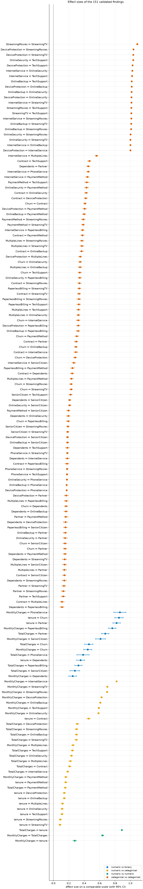

## 3. Patterns that looked interesting but were rejected

These patterns had the lowest raw p-values among the rejected tests. Each of them would look like a discovery to a naive analysis that tests 190 pairs without correction.

| Columns | Test | Raw p | Adjusted p | Effect | Why it was rejected |
| :--- | :--- | :--- | :--- | :--- | :--- |
| `MonthlyCharges` ↔ `Partner` | Welch's t-test | <0.001 | <0.001 | Hedges' g = -0.19 | Statistically detectable (adjusted p <0.001) but the effect is negligible (Hedges' g = -0.19, below the 0.20 threshold), so it has little practical importance. |
| `MonthlyCharges` ↔ `Contract` | Welch's ANOVA | <0.001 | <0.001 | eta squared = 0.01 | Statistically detectable (adjusted p <0.001) but the effect is negligible (eta squared = 0.01, below the 0.01 threshold), so it has little practical importance. |
| `TotalCharges` ↔ `Dependents` | Welch's t-test | <0.001 | <0.001 | Hedges' g = -0.14 | Statistically detectable (adjusted p <0.001) but the effect is negligible (Hedges' g = -0.14, below the 0.20 threshold), so it has little practical importance. |
| `Churn` ↔ `MultipleLines` | chi-square test of independence | 0.003 | 0.004 | Cramér's V = 0.04 | Statistically detectable (adjusted p = 0.004) but the effect is negligible (Cramér's V = 0.04 (comparable value 0.04), below the 0.10 threshold), so it has little practical importance. |
| `tenure` ↔ `InternetService` | Welch's ANOVA | 0.004 | 0.005 | eta squared = 0.00 | Statistically detectable (adjusted p = 0.005) but the effect is negligible (eta squared = 0.00, below the 0.01 threshold), so it has little practical importance. |
| `Dependents` ↔ `MultipleLines` | chi-square test of independence | 0.109 | 0.131 | Cramér's V = 0.02 | Raw p = 0.109, but after correcting for 190 tests the adjusted p is 0.131. With this many comparisons, a pattern like this is expected by chance, so it is not reported as a finding. Also, the effect is tiny but the effect is negligible (Cramér's V = 0.02 (comparable value 0.02), below the 0.10 threshold), so it has little practical importance. |
| `Partner` ↔ `PhoneService` | chi-square test of independence | 0.137 | 0.164 | Cramér's V = 0.01 | Raw p = 0.137, but after correcting for 190 tests the adjusted p is 0.164. With this many comparisons, a pattern like this is expected by chance, so it is not reported as a finding. Also, the effect is tiny but the effect is negligible (Cramér's V = 0.01 (comparable value 0.01), below the 0.10 threshold), so it has little practical importance. |
| `tenure` ↔ `SeniorCitizen` | Welch's t-test | 0.160 | 0.189 | Hedges' g = -0.04 | Raw p = 0.160, but after correcting for 190 tests the adjusted p is 0.189. With this many comparisons, a pattern like this is expected by chance, so it is not reported as a finding. Also, the effect is tiny but the effect is negligible (Hedges' g = -0.04, below the 0.20 threshold), so it has little practical importance. |
| `PaperlessBilling` ↔ `PhoneService` | chi-square test of independence | 0.166 | 0.195 | Cramér's V = 0.01 | Raw p = 0.166, but after correcting for 190 tests the adjusted p is 0.195. With this many comparisons, a pattern like this is expected by chance, so it is not reported as a finding. Also, the effect is tiny but the effect is negligible (Cramér's V = 0.01 (comparable value 0.01), below the 0.10 threshold), so it has little practical importance. |
| `Partner` ↔ `SeniorCitizen` | chi-square test of independence | 0.167 | 0.195 | Cramér's V = 0.01 | Raw p = 0.167, but after correcting for 190 tests the adjusted p is 0.195. With this many comparisons, a pattern like this is expected by chance, so it is not reported as a finding. Also, the effect is tiny but the effect is negligible (Cramér's V = 0.01 (comparable value 0.01), below the 0.10 threshold), so it has little practical importance. |

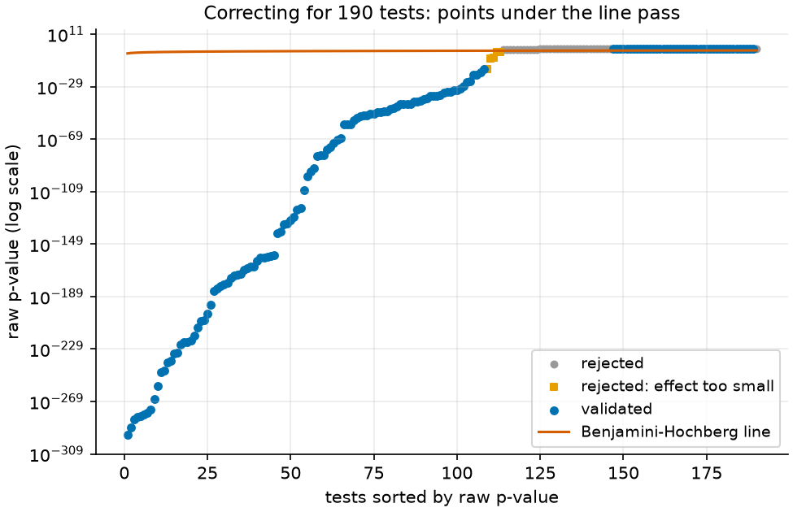

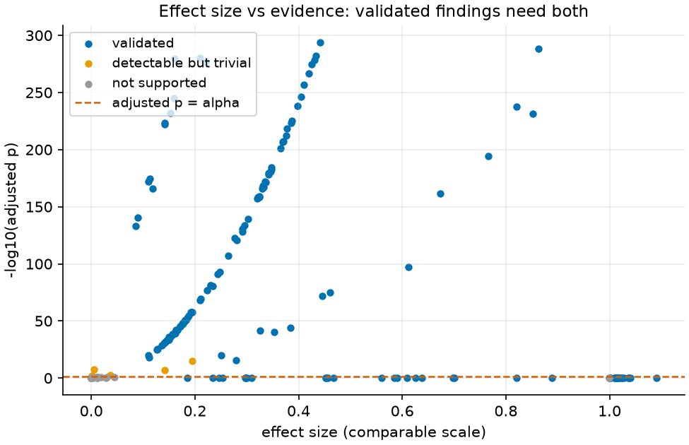

## 4. Likely derived or duplicated columns

- `MultipleLines` ↔ `PhoneService`: These columns appear to be derived from each other or to measure the same thing (Cramér's V = 1.00); this is a data-structure observation, not a discovery.

## 5. Data quality summary

- Raw file: 7,043 rows × 21 columns; after cleaning: 7,043 rows × 21 columns.
- Missing cells in the raw file: 0.0%.
- Exact duplicate rows removed: 0.
- Logged cleaning changes: 4, touching 22 cells (see the cleaning log).

## 6. Methods

**Hypotheses.** Hypotheses were generated in exhaustive mode from the column types only, before any test was run. 20 of 21 columns were eligible and 190 pairs were tested. A language model was not used to choose or change the tests.

**Tests.** Each pair is tested with a fixed, unit-tested test chosen by rules that check the data's shape first:

| Relationship | Default test | Fallback when assumptions fail |
| :--- | :--- | :--- |
| numeric vs a binary column | Welch's t-test | Mann-Whitney U test |
| numeric vs several groups | Welch's ANOVA | Kruskal-Wallis test |
| numeric vs numeric | Pearson correlation | Spearman rank correlation |
| category vs category | chi-square test | Fisher's exact test or a Monte Carlo (permutation) chi-square test |

Groups with fewer than 8 records are left out, and a pair needs at least 20 complete records. Groups of at least 50 records may use the parametric test when skewness stays below 2.00. Confidence intervals use 2,000 bootstrap resamples; permutation tests use 9,999 resamples.

**Correction.** All tests form a single family. The Benjamini-Hochberg method controls the false discovery rate at 5.0%: on average, at most this share of the reported findings should be false.

**Effect-size floors.** A result must also have an effect that is not negligible:

| Effect measure | Smallest effect reported |
| :--- | :--- |
| Hedges' g (binary groups) | 0.20 |
| rank-biserial correlation | 0.10 |
| Pearson r / Spearman rho | 0.10 |
| eta squared | 0.01 |
| epsilon squared | 0.01 |
| Cramér's V (comparable scale) | 0.10 |

**What 'validated' means.** A finding is validated when its adjusted p-value is below the false discovery rate, its effect is above the floor, and its test's assumptions were met or a suitable fallback test was used.

## 7. Limitations

- **Association, not causation.** Every finding describes how columns move together in this data. None of them shows that a column is the reason for another.
- **Rows are assumed independent.** The tests assume each row is a separate, unrelated record. Repeated measurements of the same person, place or time period break this assumption and make the results look more reliable than they are.
- **Pairwise only.** Each test looks at a single pair of columns. Interactions between several columns and confounding by a third column are not controlled for.
- **Correction under dependence.** The Benjamini-Hochberg correction assumes the tests are independent or positively dependent. Tests that share columns are dependent. In the planted-truth calibration it still kept the false discovery rate near the target with strongly correlated columns, but unusual (negative) dependence is not covered; the Benjamini-Yekutieli option (`stats.correction: by`) is the safer choice then.
- **Adjusted p-values are not per-finding error chances.** The correction controls the share of false findings across the whole list. A finding whose adjusted p-value is close to the cut-off is more likely to be a false lead than a finding far below it.
- **Effects of selected findings are optimistic.** Effect sizes and confidence intervals are reported for the findings that passed the checks, so they tend to be somewhat larger than the true effects. The intervals are not adjusted for this selection.
- **Missing data.** Each test uses the rows where both columns are present (pairwise deletion). If values are missing for a reason related to the columns, results can be biased.
- **Cleaning choices matter.** The results depend on the cleaning steps listed in the data quality section, such as removing duplicates and turning placeholder text into missing values.
- **Role of the language model.** No language model produced or changed any number in this report. The explanations are filled from fixed templates and every number is checked against the computed results.

## 8. Appendix

### All results

| Columns | Test | Raw p | Adjusted p | Effect | Decision |
| :--- | :--- | :--- | :--- | :--- | :--- |
| `TotalCharges` ↔ `TechSupport` | Welch's ANOVA | <0.001 | <0.001 | eta squared = 0.25 | validated |
| `OnlineBackup` ↔ `StreamingTV` | chi-square test of independence | <0.001 | <0.001 | Cramér's V = 0.71 | validated |
| `OnlineSecurity` ↔ `TechSupport` | chi-square test of independence | <0.001 | <0.001 | Cramér's V = 0.73 | validated |
| `OnlineBackup` ↔ `OnlineSecurity` | chi-square test of independence | <0.001 | <0.001 | Cramér's V = 0.72 | validated |
| `InternetService` ↔ `StreamingMovies` | chi-square test of independence | <0.001 | <0.001 | Cramér's V = 0.72 | validated |
| `InternetService` ↔ `StreamingTV` | chi-square test of independence | <0.001 | <0.001 | Cramér's V = 0.72 | validated |
| `TotalCharges` ↔ `StreamingMovies` | Welch's ANOVA | <0.001 | <0.001 | eta squared = 0.30 | validated |
| `InternetService` ↔ `MultipleLines` | chi-square test of independence | <0.001 | <0.001 | Cramér's V = 0.40 | validated |
| `OnlineSecurity` ↔ `StreamingMovies` | chi-square test of independence | <0.001 | <0.001 | Cramér's V = 0.71 | validated |
| `TotalCharges` ↔ `StreamingTV` | Welch's ANOVA | <0.001 | <0.001 | eta squared = 0.30 | validated |
| `OnlineBackup` ↔ `TechSupport` | chi-square test of independence | <0.001 | <0.001 | Cramér's V = 0.72 | validated |
| `TotalCharges` ↔ `tenure` | Spearman rank correlation test | <0.001 | <0.001 | Spearman rho = 0.89 | validated |
| `DeviceProtection` ↔ `OnlineSecurity` | chi-square test of independence | <0.001 | <0.001 | Cramér's V = 0.72 | validated |
| `Contract` ↔ `TechSupport` | chi-square test of independence | <0.001 | <0.001 | Cramér's V = 0.33 | validated |
| `StreamingTV` ↔ `TechSupport` | chi-square test of independence | <0.001 | <0.001 | Cramér's V = 0.72 | validated |
| `DeviceProtection` ↔ `OnlineBackup` | chi-square test of independence | <0.001 | <0.001 | Cramér's V = 0.72 | validated |
| `MonthlyCharges` ↔ `DeviceProtection` | Welch's ANOVA | <0.001 | <0.001 | eta squared = 0.63 | validated |
| `OnlineBackup` ↔ `StreamingMovies` | chi-square test of independence | <0.001 | <0.001 | Cramér's V = 0.71 | validated |
| `DeviceProtection` ↔ `StreamingMovies` | chi-square test of independence | <0.001 | <0.001 | Cramér's V = 0.74 | validated |
| `TotalCharges` ↔ `DeviceProtection` | Welch's ANOVA | <0.001 | <0.001 | eta squared = 0.31 | validated |
| `TotalCharges` ↔ `OnlineBackup` | Welch's ANOVA | <0.001 | <0.001 | eta squared = 0.30 | validated |
| `StreamingMovies` ↔ `TechSupport` | chi-square test of independence | <0.001 | <0.001 | Cramér's V = 0.72 | validated |
| `TotalCharges` ↔ `InternetService` | Welch's ANOVA | <0.001 | <0.001 | eta squared = 0.18 | validated |
| `MonthlyCharges` ↔ `TechSupport` | Welch's ANOVA | <0.001 | <0.001 | eta squared = 0.59 | validated |
| `MonthlyCharges` ↔ `StreamingMovies` | Welch's ANOVA | <0.001 | <0.001 | eta squared = 0.70 | validated |
| `InternetService` ↔ `OnlineBackup` | chi-square test of independence | <0.001 | <0.001 | Cramér's V = 0.71 | validated |
| `InternetService` ↔ `TechSupport` | chi-square test of independence | <0.001 | <0.001 | Cramér's V = 0.72 | validated |
| `OnlineSecurity` ↔ `StreamingTV` | chi-square test of independence | <0.001 | <0.001 | Cramér's V = 0.71 | validated |
| `DeviceProtection` ↔ `InternetService` | chi-square test of independence | <0.001 | <0.001 | Cramér's V = 0.71 | validated |
| `Dependents` ↔ `Partner` | chi-square test of independence | <0.001 | <0.001 | Cramér's V = 0.45 | validated |
| `DeviceProtection` ↔ `StreamingTV` | chi-square test of independence | <0.001 | <0.001 | Cramér's V = 0.73 | validated |
| `MonthlyCharges` ↔ `OnlineSecurity` | Welch's ANOVA | <0.001 | <0.001 | eta squared = 0.59 | validated |
| `InternetService` ↔ `PhoneService` | chi-square test of independence | <0.001 | <0.001 | Cramér's V = 0.45 | validated |
| `DeviceProtection` ↔ `TechSupport` | chi-square test of independence | <0.001 | <0.001 | Cramér's V = 0.73 | validated |
| `TotalCharges` ↔ `OnlineSecurity` | Welch's ANOVA | <0.001 | <0.001 | eta squared = 0.23 | validated |
| `MonthlyCharges` ↔ `TotalCharges` | Spearman rank correlation test | <0.001 | <0.001 | Spearman rho = 0.64 | validated |
| `MonthlyCharges` ↔ `StreamingTV` | Welch's ANOVA | <0.001 | <0.001 | eta squared = 0.70 | validated |
| `MonthlyCharges` ↔ `InternetService` | Welch's ANOVA | <0.001 | <0.001 | eta squared = 0.82 | validated |
| `MonthlyCharges` ↔ `OnlineBackup` | Welch's ANOVA | <0.001 | <0.001 | eta squared = 0.61 | validated |
| `StreamingMovies` ↔ `StreamingTV` | chi-square test of independence | <0.001 | <0.001 | Cramér's V = 0.77 | validated |
| `MonthlyCharges` ↔ `MultipleLines` | Welch's ANOVA | <0.001 | <0.001 | eta squared = 0.25 | validated |
| `InternetService` ↔ `OnlineSecurity` | chi-square test of independence | <0.001 | <0.001 | Cramér's V = 0.72 | validated |
| `tenure` ↔ `Contract` | Welch's ANOVA | <0.001 | <0.001 | eta squared = 0.46 | validated |
| `InternetService` ↔ `PaymentMethod` | chi-square test of independence | <0.001 | <0.001 | Cramér's V = 0.31 | validated |
| `MonthlyCharges` ↔ `PhoneService` | Welch's t-test | <0.001 | <0.001 | Hedges' g = -0.86 | validated |
| `PaymentMethod` ↔ `TechSupport` | chi-square test of independence | <0.001 | <0.001 | Cramér's V = 0.31 | validated |
| `TotalCharges` ↔ `Contract` | Welch's ANOVA | <0.001 | <0.001 | eta squared = 0.21 | validated |
| `MonthlyCharges` ↔ `PaymentMethod` | Welch's ANOVA | <0.001 | <0.001 | eta squared = 0.16 | validated |
| `OnlineSecurity` ↔ `PaymentMethod` | chi-square test of independence | <0.001 | <0.001 | Cramér's V = 0.30 | validated |
| `TotalCharges` ↔ `MultipleLines` | Welch's ANOVA | <0.001 | <0.001 | eta squared = 0.22 | validated |
| `Contract` ↔ `OnlineSecurity` | chi-square test of independence | <0.001 | <0.001 | Cramér's V = 0.30 | validated |
| `Contract` ↔ `DeviceProtection` | chi-square test of independence | <0.001 | <0.001 | Cramér's V = 0.30 | validated |
| `Churn` ↔ `Contract` | chi-square test of independence | <0.001 | <0.001 | Cramér's V = 0.41 | validated |
| `DeviceProtection` ↔ `PaymentMethod` | chi-square test of independence | <0.001 | <0.001 | Cramér's V = 0.29 | validated |
| `tenure` ↔ `PaymentMethod` | Welch's ANOVA | <0.001 | <0.001 | eta squared = 0.16 | validated |
| `OnlineBackup` ↔ `PaymentMethod` | chi-square test of independence | <0.001 | <0.001 | Cramér's V = 0.28 | validated |
| `tenure` ↔ `Partner` | Welch's t-test | <0.001 | <0.001 | Hedges' g = -0.82 | validated |
| `TotalCharges` ↔ `PaymentMethod` | Kruskal-Wallis test | <0.001 | <0.001 | epsilon squared = 0.15 | validated |
| `tenure` ↔ `Churn` | Welch's t-test | <0.001 | <0.001 | Hedges' g = 0.85 | validated |
| `PaymentMethod` ↔ `StreamingMovies` | chi-square test of independence | <0.001 | <0.001 | Cramér's V = 0.27 | validated |
| `PaymentMethod` ↔ `StreamingTV` | chi-square test of independence | <0.001 | <0.001 | Cramér's V = 0.27 | validated |
| `tenure` ↔ `DeviceProtection` | Welch's ANOVA | <0.001 | <0.001 | eta squared = 0.14 | validated |
| `tenure` ↔ `OnlineBackup` | Welch's ANOVA | <0.001 | <0.001 | eta squared = 0.14 | validated |
| `InternetService` ↔ `PaperlessBilling` | chi-square test of independence | <0.001 | <0.001 | Cramér's V = 0.38 | validated |
| `Contract` ↔ `PaymentMethod` | chi-square test of independence | <0.001 | <0.001 | Cramér's V = 0.27 | validated |
| `MultipleLines` ↔ `StreamingMovies` | chi-square test of independence | <0.001 | <0.001 | Cramér's V = 0.26 | validated |
| `MultipleLines` ↔ `StreamingTV` | chi-square test of independence | <0.001 | <0.001 | Cramér's V = 0.26 | validated |
| `Contract` ↔ `OnlineBackup` | chi-square test of independence | <0.001 | <0.001 | Cramér's V = 0.26 | validated |
| `MonthlyCharges` ↔ `PaperlessBilling` | Welch's t-test | <0.001 | <0.001 | Hedges' g = -0.77 | validated |
| `Churn` ↔ `OnlineSecurity` | chi-square test of independence | <0.001 | <0.001 | Cramér's V = 0.35 | validated |
| `DeviceProtection` ↔ `MultipleLines` | chi-square test of independence | <0.001 | <0.001 | Cramér's V = 0.25 | validated |
| `MultipleLines` ↔ `OnlineBackup` | chi-square test of independence | <0.001 | <0.001 | Cramér's V = 0.24 | validated |
| `Churn` ↔ `TechSupport` | chi-square test of independence | <0.001 | <0.001 | Cramér's V = 0.34 | validated |
| `OnlineSecurity` ↔ `PaperlessBilling` | chi-square test of independence | <0.001 | <0.001 | Cramér's V = 0.34 | validated |
| `tenure` ↔ `OnlineSecurity` | Welch's ANOVA | <0.001 | <0.001 | eta squared = 0.11 | validated |
| `PaperlessBilling` ↔ `StreamingTV` | chi-square test of independence | <0.001 | <0.001 | Cramér's V = 0.34 | validated |
| `tenure` ↔ `TechSupport` | Welch's ANOVA | <0.001 | <0.001 | eta squared = 0.11 | validated |
| `Contract` ↔ `StreamingMovies` | chi-square test of independence | <0.001 | <0.001 | Cramér's V = 0.24 | validated |
| `PaperlessBilling` ↔ `StreamingMovies` | chi-square test of independence | <0.001 | <0.001 | Cramér's V = 0.33 | validated |
| `Contract` ↔ `StreamingTV` | chi-square test of independence | <0.001 | <0.001 | Cramér's V = 0.24 | validated |
| `PaperlessBilling` ↔ `TechSupport` | chi-square test of independence | <0.001 | <0.001 | Cramér's V = 0.33 | validated |
| `tenure` ↔ `MultipleLines` | Welch's ANOVA | <0.001 | <0.001 | eta squared = 0.12 | validated |
| `TotalCharges` ↔ `Partner` | Welch's t-test | <0.001 | <0.001 | Hedges' g = -0.67 | validated |
| `MultipleLines` ↔ `TechSupport` | chi-square test of independence | <0.001 | <0.001 | Cramér's V = 0.23 | validated |
| `Churn` ↔ `InternetService` | chi-square test of independence | <0.001 | <0.001 | Cramér's V = 0.32 | validated |
| `MultipleLines` ↔ `OnlineSecurity` | chi-square test of independence | <0.001 | <0.001 | Cramér's V = 0.23 | validated |
| `DeviceProtection` ↔ `PaperlessBilling` | chi-square test of independence | <0.001 | <0.001 | Cramér's V = 0.32 | validated |
| `OnlineBackup` ↔ `PaperlessBilling` | chi-square test of independence | <0.001 | <0.001 | Cramér's V = 0.32 | validated |
| `tenure` ↔ `StreamingMovies` | Welch's ANOVA | <0.001 | <0.001 | eta squared = 0.09 | validated |
| `Churn` ↔ `PaymentMethod` | chi-square test of independence | <0.001 | <0.001 | Cramér's V = 0.30 | validated |
| `Contract` ↔ `Partner` | chi-square test of independence | <0.001 | <0.001 | Cramér's V = 0.30 | validated |
| `tenure` ↔ `StreamingTV` | Welch's ANOVA | <0.001 | <0.001 | eta squared = 0.09 | validated |
| `Churn` ↔ `OnlineBackup` | chi-square test of independence | <0.001 | <0.001 | Cramér's V = 0.29 | validated |
| `Contract` ↔ `InternetService` | chi-square test of independence | <0.001 | <0.001 | Cramér's V = 0.21 | validated |
| `MonthlyCharges` ↔ `tenure` | Spearman rank correlation test | <0.001 | <0.001 | Spearman rho = 0.28 | validated |
| `Churn` ↔ `DeviceProtection` | chi-square test of independence | <0.001 | <0.001 | Cramér's V = 0.28 | validated |
| `InternetService` ↔ `SeniorCitizen` | chi-square test of independence | <0.001 | <0.001 | Cramér's V = 0.26 | validated |
| `MonthlyCharges` ↔ `SeniorCitizen` | Welch's t-test | <0.001 | <0.001 | Hedges' g = -0.61 | validated |
| `PaperlessBilling` ↔ `PaymentMethod` | chi-square test of independence | <0.001 | <0.001 | Cramér's V = 0.25 | validated |
| `Contract` ↔ `Dependents` | chi-square test of independence | <0.001 | <0.001 | Cramér's V = 0.24 | validated |
| `Churn` ↔ `StreamingMovies` | chi-square test of independence | <0.001 | <0.001 | Cramér's V = 0.23 | validated |
| `Churn` ↔ `StreamingTV` | chi-square test of independence | <0.001 | <0.001 | Cramér's V = 0.23 | validated |
| `MultipleLines` ↔ `PaymentMethod` | chi-square test of independence | <0.001 | <0.001 | Cramér's V = 0.17 | validated |
| `SeniorCitizen` ↔ `TechSupport` | chi-square test of independence | <0.001 | <0.001 | Cramér's V = 0.22 | validated |
| `TotalCharges` ↔ `Churn` | Welch's t-test | <0.001 | <0.001 | Hedges' g = 0.46 | validated |
| `MonthlyCharges` ↔ `Churn` | Welch's t-test | <0.001 | <0.001 | Hedges' g = -0.45 | validated |
| `Dependents` ↔ `SeniorCitizen` | chi-square test of independence | <0.001 | <0.001 | Cramér's V = 0.21 | validated |
| `OnlineSecurity` ↔ `SeniorCitizen` | chi-square test of independence | <0.001 | <0.001 | Cramér's V = 0.21 | validated |
| `Dependents` ↔ `OnlineSecurity` | chi-square test of independence | <0.001 | <0.001 | Cramér's V = 0.19 | validated |
| `PaymentMethod` ↔ `SeniorCitizen` | chi-square test of independence | <0.001 | <0.001 | Cramér's V = 0.19 | validated |
| `Churn` ↔ `PaperlessBilling` | chi-square test of independence | <0.001 | <0.001 | Cramér's V = 0.19 | validated |
| `SeniorCitizen` ↔ `StreamingMovies` | chi-square test of independence | <0.001 | <0.001 | Cramér's V = 0.19 | validated |
| `SeniorCitizen` ↔ `StreamingTV` | chi-square test of independence | <0.001 | <0.001 | Cramér's V = 0.18 | validated |
| `DeviceProtection` ↔ `SeniorCitizen` | chi-square test of independence | <0.001 | <0.001 | Cramér's V = 0.18 | validated |
| `OnlineBackup` ↔ `SeniorCitizen` | chi-square test of independence | <0.001 | <0.001 | Cramér's V = 0.18 | validated |
| `Dependents` ↔ `TechSupport` | chi-square test of independence | <0.001 | <0.001 | Cramér's V = 0.18 | validated |
| `PhoneService` ↔ `StreamingTV` | chi-square test of independence | <0.001 | <0.001 | Cramér's V = 0.18 | validated |
| `Dependents` ↔ `InternetService` | chi-square test of independence | <0.001 | <0.001 | Cramér's V = 0.18 | validated |
| `Contract` ↔ `PaperlessBilling` | chi-square test of independence | <0.001 | <0.001 | Cramér's V = 0.18 | validated |
| `PhoneService` ↔ `StreamingMovies` | chi-square test of independence | <0.001 | <0.001 | Cramér's V = 0.18 | validated |
| `PhoneService` ↔ `TechSupport` | chi-square test of independence | <0.001 | <0.001 | Cramér's V = 0.18 | validated |
| `OnlineSecurity` ↔ `PhoneService` | chi-square test of independence | <0.001 | <0.001 | Cramér's V = 0.18 | validated |
| `OnlineBackup` ↔ `PhoneService` | chi-square test of independence | <0.001 | <0.001 | Cramér's V = 0.17 | validated |
| `DeviceProtection` ↔ `PhoneService` | chi-square test of independence | <0.001 | <0.001 | Cramér's V = 0.17 | validated |
| `TotalCharges` ↔ `PhoneService` | Welch's t-test | <0.001 | <0.001 | Hedges' g = -0.38 | validated |
| `Churn` ↔ `Dependents` | chi-square test of independence | <0.001 | <0.001 | Cramér's V = 0.16 | validated |
| `DeviceProtection` ↔ `Partner` | chi-square test of independence | <0.001 | <0.001 | Cramér's V = 0.17 | validated |
| `MultipleLines` ↔ `PaperlessBilling` | chi-square test of independence | <0.001 | <0.001 | Cramér's V = 0.17 | validated |
| `TotalCharges` ↔ `PaperlessBilling` | Welch's t-test | <0.001 | <0.001 | Hedges' g = -0.33 | validated |
| `Dependents` ↔ `OnlineBackup` | chi-square test of independence | <0.001 | <0.001 | Cramér's V = 0.16 | validated |
| `tenure` ↔ `Dependents` | Welch's t-test | <0.001 | <0.001 | Hedges' g = -0.35 | validated |
| `Partner` ↔ `PaymentMethod` | chi-square test of independence | <0.001 | <0.001 | Cramér's V = 0.16 | validated |
| `PaperlessBilling` ↔ `SeniorCitizen` | chi-square test of independence | <0.001 | <0.001 | Cramér's V = 0.16 | validated |
| `Dependents` ↔ `DeviceProtection` | chi-square test of independence | <0.001 | <0.001 | Cramér's V = 0.16 | validated |
| `Churn` ↔ `SeniorCitizen` | chi-square test of independence | <0.001 | <0.001 | Cramér's V = 0.15 | validated |
| `OnlineBackup` ↔ `Partner` | chi-square test of independence | <0.001 | <0.001 | Cramér's V = 0.15 | validated |
| `Churn` ↔ `Partner` | chi-square test of independence | <0.001 | <0.001 | Cramér's V = 0.15 | validated |
| `OnlineSecurity` ↔ `Partner` | chi-square test of independence | <0.001 | <0.001 | Cramér's V = 0.15 | validated |
| `Dependents` ↔ `PaymentMethod` | chi-square test of independence | <0.001 | <0.001 | Cramér's V = 0.15 | validated |
| `Dependents` ↔ `StreamingTV` | chi-square test of independence | <0.001 | <0.001 | Cramér's V = 0.15 | validated |
| `MultipleLines` ↔ `SeniorCitizen` | chi-square test of independence | <0.001 | <0.001 | Cramér's V = 0.15 | validated |
| `MultipleLines` ↔ `Partner` | chi-square test of independence | <0.001 | <0.001 | Cramér's V = 0.14 | validated |
| `Contract` ↔ `SeniorCitizen` | chi-square test of independence | <0.001 | <0.001 | Cramér's V = 0.14 | validated |
| `Dependents` ↔ `StreamingMovies` | chi-square test of independence | <0.001 | <0.001 | Cramér's V = 0.14 | validated |
| `Partner` ↔ `StreamingTV` | chi-square test of independence | <0.001 | <0.001 | Cramér's V = 0.14 | validated |
| `Partner` ↔ `StreamingMovies` | chi-square test of independence | <0.001 | <0.001 | Cramér's V = 0.13 | validated |
| `Partner` ↔ `TechSupport` | chi-square test of independence | <0.001 | <0.001 | Cramér's V = 0.13 | validated |
| `Dependents` ↔ `PaperlessBilling` | chi-square test of independence | <0.001 | <0.001 | Cramér's V = 0.11 | validated |
| `MonthlyCharges` ↔ `Dependents` | Welch's t-test | <0.001 | <0.001 | Hedges' g = 0.25 | validated |
| `Contract` ↔ `MultipleLines` | chi-square test of independence | <0.001 | <0.001 | Cramér's V = 0.08 | validated |
| `TotalCharges` ↔ `SeniorCitizen` | Welch's t-test | <0.001 | <0.001 | Hedges' g = -0.28 | validated |
| `MultipleLines` ↔ `PhoneService` | chi-square test of independence | <0.001 | <0.001 | Cramér's V = 1.00 | rejected: derived / duplicate columns |
| `MonthlyCharges` ↔ `Partner` | Welch's t-test | <0.001 | <0.001 | Hedges' g = -0.19 | rejected: effect too small |
| `MonthlyCharges` ↔ `Contract` | Welch's ANOVA | <0.001 | <0.001 | eta squared = 0.01 | rejected: effect too small |
| `TotalCharges` ↔ `Dependents` | Welch's t-test | <0.001 | <0.001 | Hedges' g = -0.14 | rejected: effect too small |
| `Churn` ↔ `MultipleLines` | chi-square test of independence | 0.003 | 0.004 | Cramér's V = 0.04 | rejected: effect too small |
| `tenure` ↔ `InternetService` | Welch's ANOVA | 0.004 | 0.005 | eta squared = 0.00 | rejected: effect too small |
| `Dependents` ↔ `MultipleLines` | chi-square test of independence | 0.109 | 0.131 | Cramér's V = 0.02 | rejected: not supported after correction, effect too small |
| `Partner` ↔ `PhoneService` | chi-square test of independence | 0.137 | 0.164 | Cramér's V = 0.01 | rejected: not supported after correction, effect too small |
| `tenure` ↔ `SeniorCitizen` | Welch's t-test | 0.160 | 0.189 | Hedges' g = -0.04 | rejected: not supported after correction, effect too small |
| `PaperlessBilling` ↔ `PhoneService` | chi-square test of independence | 0.166 | 0.195 | Cramér's V = 0.01 | rejected: not supported after correction, effect too small |
| `Partner` ↔ `SeniorCitizen` | chi-square test of independence | 0.167 | 0.195 | Cramér's V = 0.01 | rejected: not supported after correction, effect too small |
| `PaperlessBilling` ↔ `Partner` | chi-square test of independence | 0.212 | 0.247 | Cramér's V = 0.01 | rejected: not supported after correction, effect too small |
| `MonthlyCharges` ↔ `gender` | Welch's t-test | 0.221 | 0.257 | Hedges' g = 0.03 | rejected: not supported after correction, effect too small |
| `Churn` ↔ `PhoneService` | chi-square test of independence | 0.316 | 0.364 | Cramér's V = 0.00 | rejected: not supported after correction, effect too small |
| `PaperlessBilling` ↔ `gender` | chi-square test of independence | 0.324 | 0.371 | Cramér's V = 0.00 | rejected: not supported after correction, effect too small |
| `OnlineSecurity` ↔ `gender` | chi-square test of independence | 0.360 | 0.410 | Cramér's V = 0.00 | rejected: not supported after correction, effect too small |
| `Dependents` ↔ `gender` | chi-square test of independence | 0.377 | 0.427 | Cramér's V = 0.00 | rejected: not supported after correction, effect too small |
| `Churn` ↔ `gender` | chi-square test of independence | 0.470 | 0.526 | Cramér's V = 0.00 | rejected: not supported after correction, effect too small |
| `PhoneService` ↔ `SeniorCitizen` | chi-square test of independence | 0.472 | 0.526 | Cramér's V = 0.00 | rejected: not supported after correction, effect too small |
| `tenure` ↔ `PhoneService` | Welch's t-test | 0.473 | 0.526 | Hedges' g = -0.03 | rejected: not supported after correction, effect too small |
| `PaymentMethod` ↔ `gender` | chi-square test of independence | 0.485 | 0.535 | Cramér's V = 0.00 | rejected: not supported after correction, effect too small |
| `OnlineBackup` ↔ `gender` | chi-square test of independence | 0.511 | 0.562 | Cramér's V = 0.00 | rejected: not supported after correction, effect too small |
| `PhoneService` ↔ `gender` | chi-square test of independence | 0.586 | 0.640 | Cramér's V = 0.00 | rejected: not supported after correction, effect too small |
| `tenure` ↔ `PaperlessBilling` | Welch's t-test | 0.606 | 0.658 | Hedges' g = -0.01 | rejected: not supported after correction, effect too small |
| `InternetService` ↔ `gender` | chi-square test of independence | 0.637 | 0.687 | Cramér's V = 0.00 | rejected: not supported after correction, effect too small |
| `tenure` ↔ `gender` | Welch's t-test | 0.668 | 0.716 | Hedges' g = -0.01 | rejected: not supported after correction, effect too small |
| `StreamingMovies` ↔ `gender` | chi-square test of independence | 0.671 | 0.716 | Cramér's V = 0.00 | rejected: not supported after correction, effect too small |
| `TechSupport` ↔ `gender` | chi-square test of independence | 0.717 | 0.761 | Cramér's V = 0.00 | rejected: not supported after correction, effect too small |
| `MultipleLines` ↔ `gender` | chi-square test of independence | 0.730 | 0.771 | Cramér's V = 0.00 | rejected: not supported after correction, effect too small |
| `StreamingTV` ↔ `gender` | chi-square test of independence | 0.759 | 0.797 | Cramér's V = 0.00 | rejected: not supported after correction, effect too small |
| `Contract` ↔ `gender` | chi-square test of independence | 0.791 | 0.826 | Cramér's V = 0.00 | rejected: not supported after correction, effect too small |
| `PaymentMethod` ↔ `PhoneService` | chi-square test of independence | 0.862 | 0.895 | Cramér's V = 0.00 | rejected: not supported after correction, effect too small |
| `SeniorCitizen` ↔ `gender` | chi-square test of independence | 0.875 | 0.897 | Cramér's V = 0.00 | rejected: not supported after correction, effect too small |
| `Partner` ↔ `gender` | chi-square test of independence | 0.879 | 0.897 | Cramér's V = 0.00 | rejected: not supported after correction, effect too small |
| `DeviceProtection` ↔ `gender` | chi-square test of independence | 0.880 | 0.897 | Cramér's V = 0.00 | rejected: not supported after correction, effect too small |
| `Dependents` ↔ `PhoneService` | chi-square test of independence | 0.882 | 0.897 | Cramér's V = 0.00 | rejected: not supported after correction, effect too small |
| `Contract` ↔ `PhoneService` | chi-square test of independence | 0.946 | 0.956 | Cramér's V = 0.00 | rejected: not supported after correction, effect too small |
| `TotalCharges` ↔ `gender` | Welch's t-test | 0.997 | 0.997 | Hedges' g = 0.00 | rejected: not supported after correction, effect too small |
| `InternetService` ↔ `Partner` | chi-square test of independence | 0.997 | 0.997 | Cramér's V = 0.00 | rejected: not supported after correction, effect too small |

### Reproducibility

- VeriData version: 0.1.0; resolved config hash: `052b2ad5e68a`.
- Dataset SHA-256: `16320c9c1ec72448db59aa0a26a0b95401046bef5d02fd3aeb906448e3055e91`.
- Narration: deterministic templates (no language model).
